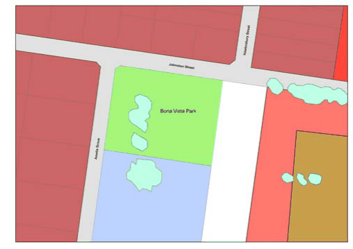
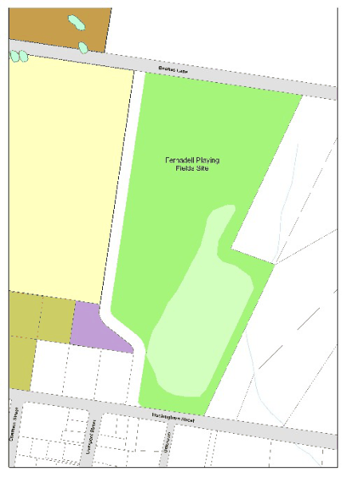

### 4.9 PUBLIC OPEN

### SPACE AND RECREATION

#### 4.9.1 Aims

y Pitt Town has adequate land set aside for the provision of public open space and suitable

> [Picture on page 22: a picture, saved as a picture (images/ch-04-00-pitt-town-page-22-8.gif, 150 dpi).]

recreation facilities to meet the needs of existing and future residents. y Recreation facilities and open space areas are designed to provide for multiple needs and demands.

#### 4.9.2 Rules

a) Public open space must be set aside as indicated on the Pitt Town Development Plan.

### 4.9.3 “Bona Vista” Park - Rules

a) A 1.32 hectare park is to be provided next to the northern side of the Bona Vista Homestead site on the corner of Johnston Street and the southern extension to Hawkesbury Street as indicated on the Pitt Town Development Plan.  This land will be acquired by Council using funds raised by way of development contributions.

b) A landscape plan is to be prepared by the developer for the park that includes retention of existing vegetation and the historic fencing along Johnston Street. The landscape plan should incorporate elements to assist the interpretation of the history of Bona Vista and the Pitt Town area.

> [Picture on page 22: a picture, saved as a picture (images/ch-04-00-pitt-town-page-22-25.gif, 150 dpi).]

Figure E4. 23: Bona Vista Park

### 4.9.4 “Fernadell” Playing Fields - Rules

a) A 9.84 hectare area between Bootles Lane and Buckingham Street as indicated on the Pitt Town Development Plan is to be set aside for public recreation and stormwater management purposes.  This land will be acquired by Council using funds raised by way of development contributions and Water Management fees.

b) A management plan is to be prepared by Council for the land to guide future development. The management plan must be consistent with the Pitt Town Development Plan.

c) A minimum of three playing fields is to be provided with sufficient parking and other ancillary facilities such as a children’s playground and public toilets.

d) Landscape treatments within the northern part of the site are to be native species compatible with the vegetation species found within the vegetated area to the north.

e) The site is to accommodate stormwater management facilities to service the

> [Picture on page 23: a picture, saved as a picture (images/ch-04-00-pitt-town-page-23-15.gif, 150 dpi).]

development area.

Figure E4. 34: Fernadell Playing Fields Site
