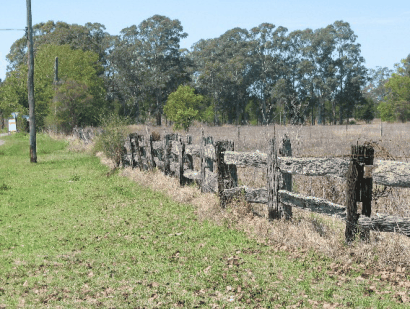

### 4.11 HERITAGE CONSERVATION

#### 4.11.1 Aims

y Places of recognised heritage significance are retained and enhanced. y The cultural landscape heritage values of Pitt Town are protected.

> [Picture on page 25: a picture, saved as a picture (images/ch-04-00-pitt-town-page-25-7.gif, 150 dpi).]

#### 4.11.2 Rules

a) Bona Vista Homestead and associated structures and plantings are to be retained as an historic site. The northern curtilage area is to be extended to Johnston Street as open space (Bona Vista park). The southern and eastern curtilage areas are to be extended and enhanced through widened road reserves and landscape treatments within the road reserve.

b) Historic windbreaks throughout the development area are to be retained within road reserves or proposed lots.

c) Historic lot boundaries that correspond to original land grant boundaries are to be retained, where possible, through subdivision of the area consistent with the Pitt Town Development Plan.

d) Historic road alignments (Bathurst Street / Hall Street / Johnston Street / Buckingham Street / Bootles Lane / Hawkesbury Street) are to be retained as indicated on the Pitt Town Development Plan.

e) The historic fence lines indicated on the Pitt Town Development Plan are to be retained within road reserves or proposed lots.

f) Other heritage places included on the Heritage Schedule to the Hawkesbury Local Environmental Plan 1989 are to be retained. A heritage conservation plan is to be prepared for each place to accompany any Development Application lodged for

> [Picture on page 25: a picture, saved as a picture (images/ch-04-00-pitt-town-page-25-27.gif, 150 dpi).]

these places.

Plate E4. 4: Historic Fence Line along Johnston Street
