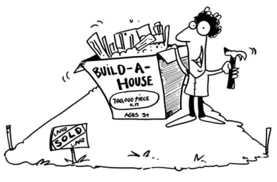
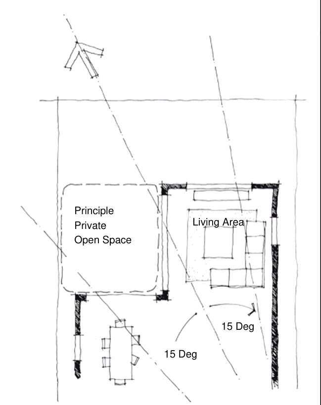
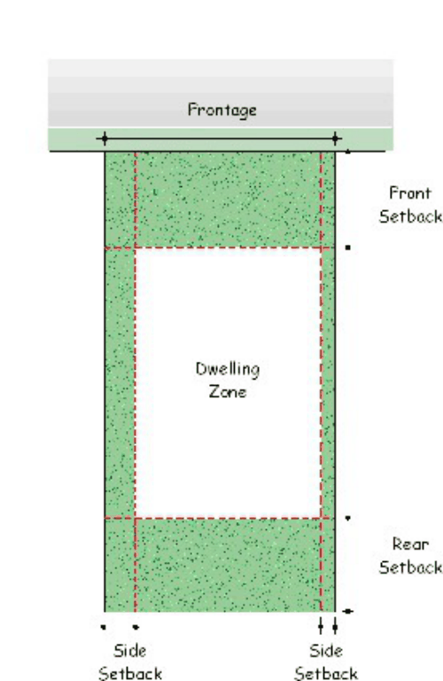

### 4.14 BUILDING ENVELOPES

#### 4.14.1 Aims

y The bulk and scale of new development is consistent with existing development within Pitt Town. y The height of new buildings is consistent with existing development and privacy or solar access conflicts between dwellings are avoided. y The size and siting of buildings within lots reinforces the open streetscapes and semi rural character of Pitt Town. y The size and siting of buildings provides adequate private open space within lots.

> [Picture on page 28: a picture, saved as a picture (images/ch-04-00-pitt-town-page-28-11.gif, 150 dpi).]

y The siting of buildings ensures that special natural or cultural features within lots are protected.

#### 4.14.2 Rules

a) The setback of dwellings from lot boundaries must meet the requirements set out in Table E4.4 below unless there are special natural or cultural features within the lot that require variations to these requirements. The development precincts are shown on Figure E4.3.

Table E4. 4: Minimum Building Setback Requirements

| Precinct | Minimum lot size area | Minimum front setback | Minimum rear setback | Minimum side setback | Corner lots - Minimum setback of secondary street frontage |
|---|---|---|---|---|---|
| North-south orientated lots |  |  |  |  |  |
| A | 550/650/750 | Dwellings - 6m with an articulation zone in front of dwelling of not greater than 1.2m Garages - 7m | 4m–550m2 5m-650 m2 6-750 m2 Or 15% of depth of lot, whichever is the greater | 1.3m minimum. Minor encroachments under eave line for 20% of overall wall length or maximum of 4.5m | 3m with an articulation zone in front of dwelling of not greater than 1.5m |
| B | 1000 | 7.5m | 8m or 15% of depth of lot, whichever is the greater | 1.5m minimum. Minor encroachments under eave line for 20% of overall wall length or maximum of 4.5m | 3.5m with an articulation zone in front of dwelling of not greater than 1.5m |
| C | 2000 | 9m | 8m, or 15% of depth of lot, whichever is the greater | 3m minimum. Minor encroachments under eave line for 20% of overall wall length or maximum of 5.5m | 5m |
| D | 5 lot/ ha | 9m | 8m or 15% of depth of lot, whichever is the greater | 3m minimum. Minor encroachments under eave line for 20% of overall wall length or maximum of 5.5m | 5m |

| Precinct | Minimum lot size area | Minimum front setback | Minimum rear setback | Minimum side setback | Corner lots - Minimum setback of secondary street frontage |
|---|---|---|---|---|---|
| E | 2500 | 9m | 8m or 15% of depth of lot, whichever is the greater | 3m both sides | 5.5m |
| F | 2000 | 9m | 8m, or 15% of depth of lot, whichever is the greater | 3m minimum. Minor encroachments under eave line for 20% of overall wall length or maximum of 5.5m | 5m |
| G | 4000m | 9m | 8m | 3m both sides | 6.5m |
| H | 10000m | 9m | 20m | 3m both sides | 7m |
| East-west orientated lots |  |  |  |  |  |
| A | 550/650/750 | Dwellings - 6m with an articulation zone in front of dwelling of not greater than 1.2m Garages - 6m | 4m–550m2 5m-650 m2 6-750 m2 Or 15% of depth of lot, whichever is the greater | 1.3m minimum. Minor encroachments under eave line, on southern side only, for 20% of overall wall length or maximum of 4.5m | 3m with an articulation zone in front of dwelling of not greater than 1.5m |
| B | 1000 | 7.5m | 8m or 15% of depth of lot, whichever is the greater | 1.5m minimum. Minor encroachments under eave line, on southern side only, for 20% of overall wall length or maximum of 4.5m | 3.5m with an articulation zone in front of dwelling of not greater than 1.5m |

| Precinct | Minimum lot size area | Minimum front setback | Minimum rear setback | Minimum side setback | Corner lots - Minimum setback of secondary street frontage |
|---|---|---|---|---|---|
| C | 2000 | 9m | 8m, or 15% of depth of lot, whichever is the greater | 3m minimum. Minor encroachments under eave line, on southern side only, for 20% of overall wall length or maximum of 5.5m | 5m |
| D | 5 lot/ ha | 9m | 8m or 15% of depth of lot, whichever is the greater | 3m minimum. Minor encroachments under eave line, on southern side only, for 20% of overall wall length or maximum of 5.5m | 5m |
| E | 2500 | 9m | 8m or 15% of depth of lot, whichever is the greater | 3m both sides | 5.5m |
| F | 2000 | 9m | 8m, or 15% of depth of lot, whichever is the greater | 3m minimum. Minor encroachments under eave line, on southern side only, for 20% of overall wall length or maximum of 5.5m | 5m |
| G | 4000m | 9m | 8m | 3m both sides | 6.5m |
| H | 10000m | 9m | 20m | 3m both sides | 7m |

Note: An Articulation zone is a notional area projecting 1.5m forward of the front building line within which additional, open building elements such as entry features and porticos, balconies, decks, verandas, and bay windows may be built.

b) Garages may be attached or separate. Garages must be a least 1 metre behind the front building line, to be no greater than 50% of the building width and designed to minimise visual prominence. Garages and outbuildings may be located in the rear and side set backs

c) Dwellings in all precincts are limited to two storeys.

d) New buildings that comply with the provisions of Table E4.4: Minimum Building Setback Requirements need not comply with the Building Height Plane set out in Part D Chapter 1 Clause 1.3.

e) Total building footprint area must comply with the site coverage requirements set out in Table E4.5 below.

Table E4. 5: Maximum Site Coverage

| Precinct | Minimum lot size area | Maximum site coverage |
|---|---|---|
| A1 | 550m2 | 60% |
| A2 | 650m2 | 60% |
| A3 | 750m2 | 50% |
| B | 1000m2 | 45% |
| C | 2000m2 | 30% |
| D | 5 lot/ ha | 40% |
| E | 2500m2 | 25% |
| F | 2000m2 | 30% |
| G | 4000m2 | 20% |

f) The building form for large houses is to be articulated or broken down to two or more buildings that may be interconnected.

g) Each habitable room in a dwelling erected within Precincts E and F shall have a floor level no lower than 18.7m AHD.

h) Dwellings must address the street frontage with a clearly defined entry (front access) facing the street and living areas providing street surveillance.

i) At least 25% of the private open space must face within 15 degrees of north (See Solar Access for Private Open Space Figure below)

j) Dwellings on lots less than 750m2 must have a minimum private open space area of 24m2 with a minimum width of 4m and be no steeper than 1:50.  Dwellings on lots greater than 750m2 must also comply with these requirements but the private open space must have a minimum of 20% of the site area.

k) Private open space shall not be located in the front boundary setback

> [Picture on page 33: a picture, saved as a picture (images/ch-04-00-pitt-town-page-33-1.gif, 150 dpi).]
> Words printed on the picture (title and legend, copied from the PDF):
> Living Area
> Principle
> Private
> Open Space
> 15 Deg
> 15 Deg

Figure E4.15  Solar Access for Private Open Space.

Note: For the purposes of corner blocks, a secondary street frontage means the longest frontage to a street/road where a lot has two of more frontages.  Where a corner lot has street/road frontages of equal length, exclusive of any curved frontage, one of the frontages shall be nominated as the secondary frontage.

> [Picture on page 34: a picture, saved as a picture (images/ch-04-00-pitt-town-page-34-1.gif, 150 dpi).]

Figure E4. 16: Diagrammatic Representation of Setbacks
