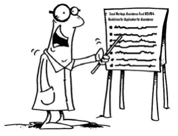

### 4.15 BUILDING DESIGN

#### 4.15.1 Aims

> [Picture on page 35: a picture, saved as a picture (images/ch-04-00-pitt-town-page-35-3.gif, 150 dpi).]

y Building design is compatible with the semi rural character of the area and incorporates contemporary expressions of design elements characteristic of historic development within Pitt Town. y Buildings are designed for energy efficiency to reduce potable water and electricity use. y Buildings are designed to maximise solar access and cross-ventilation to internal and external living areas.

y External fixtures do not detract from the appearance of the building or the streetscape.

#### 4.15.2 Rules

a) The use of passive solar design elements such as verandas, window shades and eaves with at least 450mm overhang is required.

b) At least one habitable room (other than a bedroom) must face within 15 degrees of north.  The habitable room must be provided with a window having an area not less than 10% of the floor area of that room.

c) The use of framed lightweight construction such as posted verandas and roof projections should dominate the appearance of buildings from the street.

d) Within Precinct A, a 1.2 metre articulation zone forward of the front building setback is permitted for minor feature elements on the dwelling façade. Acceptable building elements within the articulation zone include:

• entry feature or portico

• awnings or other features over windows

• eaves and sun shading structures

• window box treatment

• bay windows or similar features

• balconies, verandas, pergolas or the like

e) External walls materials are to be limited to weatherboard or plywood sheeting, rendered and bagged masonry, stone, glass or metal sheeting.  Face bricks may be used provided the colour blends are uniform throughout.

f) External colours are to be muted earth and bush vegetation tones. Large areas of white or primary, vibrant colours are to be avoided.

g) The visual privacy requirements set out in Part D, Chapter 1, Clause 1.11, must be met.

h) External fixtures such as solar panels and satellite dishes etc should be designed to integrate with the building or should not be visible from the street. Note Whilst the “Design Guidelines” required by condition B1(b) of the Minister for Planning Determination of the Pitt Town Concept Plan (MPA No. 07_0140) dated 10 July 2008 (prepared by Johnson Property Group, dated 27 August 2008) do not form part of this DCP, the applicant must take these into consideration in relation to architectural character and external finishes of dwelling structures and submit with any Development or Complying Development application an explanation as to how the proposal complies, or otherwise, with the Design Guidelines..
