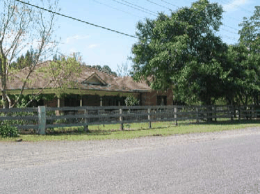
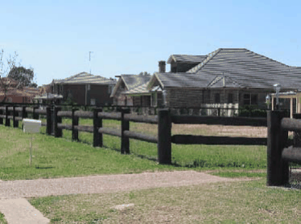

### 4.17 FENCING

#### 4.17.1 Aims

y New boundary fencing (where required) reflects the rural character and historic fence styles of Pitt Town. y New private open space screen fences

> [Picture on page 38: a picture, saved as a picture (images/ch-04-00-pitt-town-page-38-7.gif, 150 dpi).]

(where required) and pool fences are integrated with the design of buildings on the same site.

#### 4.17.2 Rules

a) Front boundary fencing must not exceed 1.2 metres in height with preferred styles being post and open timber rails or post and wire with top rail.

b) The integration of trees and natural ground vegetation with the fence line is encouraged.

c) Private open space screen fences and pool fences must not exceed 2.1 metres in height are to be constructed of materials that complement the buildings on the site.

d) Side fencing within the front setback area should be of open light weight contraction preferably post and open timber rails or post and wire with top rail.

> [Picture on page 38: a picture, saved as a picture (images/ch-04-00-pitt-town-page-38-20.gif, 150 dpi).]

> [Picture on page 38: a picture, saved as a picture (images/ch-04-00-pitt-town-page-38-21.gif, 150 dpi).]

Plate E4. 5: Examples of Acceptable Fence Styles
