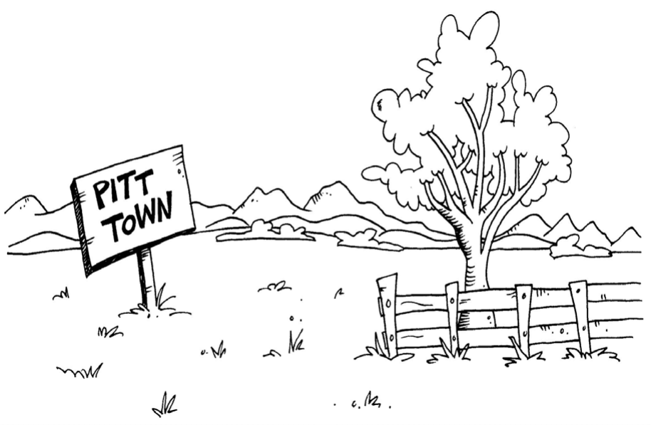

# Hawkesbury Development Control Plan 2002 - Chapter 4 Pitt Town

> This chapter is split into 17 section file(s), one per numbered heading, in the order they appear in the PDF.

Source PDF: [PARTE-Chapter4-PittTownFebruary2009.pdf](https://planfortomorrow.sharepoint.com/sites/Planfortomorrow/Shared%20Documents/00%20NSW-Planning-Resources/dcp/hawkesbury-development-control-plan-2002/ch-04-00-pitt-town/PARTE-Chapter4-PittTownFebruary2009.pdf)

> [Picture on page 1: a picture, saved as a picture (images/ch-04-00-pitt-town-page-1-1.gif, 150 dpi).]

### PART E

### SPECIFIC AREAS

## CHAPTER 4 PITT TOWN

> The PDF's contents list (page numbers of the printed document) is not repeated here - see Sections below.

SPECIFIC AREAS - PITT TOWN

i

|  | 4.7.1 Aims ............................................................ 17 |
|---|---|
|  | 4.7.2 Rules............................................................ 17 |
| 4.8 | COMMUNITY FACILITIES ........................................... 18 4.8.1 Aims ............................................................ 18 4.8.2 Rules............................................................ 18 |
| 4.9 | PUBLIC OPEN SPACE AND RECREATION ........................... 19 4.9.1 Aims ............................................................ 19 4.9.2 Rules............................................................ 19 4.9.3 “Bona Vista” Park - Rules..................................... 19 4.9.4 “Fernadell” Playing Fields - Rules ............................ 20 |
| 4.10 | ENVIRONMENTAL PROTECTION .................................... 21 4.10.1 Aims ............................................................ 21 4.10.2 Rules............................................................ 21 |
| 4.11 | HERITAGE CONSERVATION ......................................... 22 4.11.1 Aims ............................................................ 22 4.11.2 Rules............................................................ 22 |
| 4.12 | STORMWATER MANAGEMENT ...................................... 23 4.12.1 Aims ............................................................ 23 4.12.2 Rules............................................................ 23 |
| 4.13 | UTILITY SERVICES ................................................... 24 4.13.1 Aims ............................................................ 24 4.13.2 Rules............................................................ 24 |
| DEVELOPMENT CONTROLS .................................................. 25 |  |
| 4.14 | BUILDING ENVELOPES ............................................... 25 4.14.1 Aims ............................................................ 25 4.14.2 Rules............................................................ 25 |
| 4.15 | BUILDING DESIGN ................................................... 32 4.15.1 Aims ............................................................ 32 4.15.2 Rules............................................................ 32 |
| 4.16 | LANDSCAPING......................................................... 34 4.16.1 Aims ............................................................ 34 4.16.2 Rules............................................................ 34 |
| 4.17 | FENCING ............................................................... 35 4.17.1 Aims ............................................................ 35 4.17.2 Rules............................................................ 35 |

TABLE OF CONTENTS

ii

<!-- sections -->
## Sections

1. [4.1 INTRODUCTION](01-4-1-introduction.md)
2. [4.2 DESIRED CHARACTER](02-4-2-desired-character.md)
3. [4.3 GENERAL PRINCIPLES](03-4-3-general-principles.md)
4. [4.4 LAND USE](04-4-4-land-use.md)
5. [4.5 LOT DESIGN](05-4-5-lot-design.md)
6. [4.6 STREET DESIGN](06-4-6-street-design.md)
7. [4.7 BUS AND CYCLE ROUTES](07-4-7-bus-and-cycle-routes.md)
8. [4.8 COMMUNITY FACILITIES](08-4-8-community-facilities.md)
9. [4.9 PUBLIC OPEN](09-4-9-public-open.md)
10. [4.10 ENVIRONMENTAL PROTECTION](10-4-10-environmental-protection.md)
11. [4.11 HERITAGE CONSERVATION](11-4-11-heritage-conservation.md)
12. [4.12 STORMWATER MANAGEMENT](12-4-12-stormwater-management.md)
13. [4.13 UTILITY SERVICES](13-4-13-utility-services.md)
14. [4.14 BUILDING ENVELOPES](14-4-14-building-envelopes.md)
15. [4.15 BUILDING DESIGN](15-4-15-building-design.md)
16. [4.16 LANDSCAPING](16-4-16-landscaping.md)
17. [4.17 FENCING](17-4-17-fencing.md)
