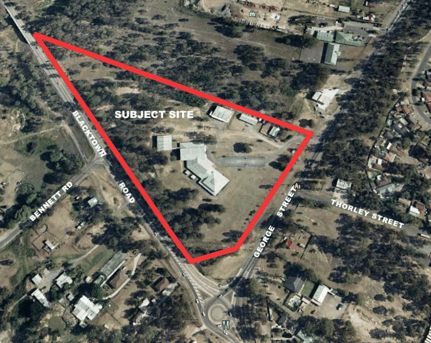

## Chapter 7 WINDSOR DISTRICT BAPTIST

### CHURCH SITE

### 739 - 741 GEORGE STREET, SOUTH WINDSOR

### 7.1 INTRODUCTION

This chapter provides objectives and development controls for the development of Lots 1 and 2 DP1148514, 739 – 741 George Street, South Windsor known as the Windsor District Baptist Church site.

The site has an area of approximately 6 hectares, and is located on the northern corner of the intersection of Richmond Road, Blacktown Road and George Street, Windsor.  The site is generally triangular in shape with a south-western frontage to Blacktown Road, a south-eastern frontage to George Street and a north-northeastern boundary which adjoins a property currently used for a service station.  A small north-western boundary adjoins Rickabys Creek.  The site and surrounds is shown in Figure 1 below.

#### Figure 1: Subject site and surrounds

> [Picture on page 3: a picture, saved as a picture (images/ch-07-00-739-741-george-street-south-windsor-page-3-12.gif, 150 dpi).]

Source:  Google Earth

The site is highly visible from the major junction of Blacktown Road and George Street and denotes the entry to the City of Hawkesbury on approach along Blacktown Road when travelling northwest. The site forms an important gateway as one key entry to the City of Hawkesbury.

George Street is the main route linking Windsor and Blacktown Road and is part of the main traffic route from Windsor to Penrith.  Blacktown Road serves as a main route linking Blacktown and Richmond.  Hence the site is situated on a number of major traffic routes for the Hawkesbury LGA.

Lot 1 DP 1148514, 739 George Street is occupied by a church and associated outbuildings and it is anticipated that these will remain and continue in operation.

Other limited commercial development adjoins the site such as service station and landscape supplies.  The site forms part of a small precinct that can provide services to both local residents and large volumes of travelling motorists who may be travelling either to or through the area.
