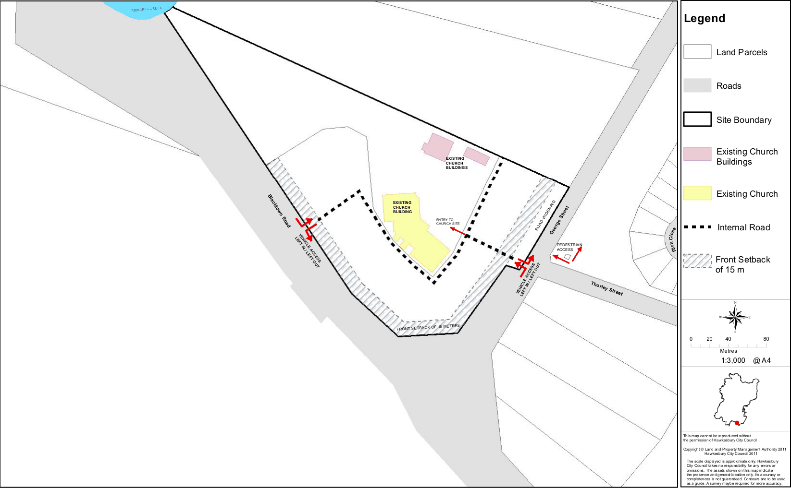

### 7.4 DEVELOPMENT CONTROLS

This chapter sets out specific requirements for development of the site.  These requirements are additional to the general development controls and land use-specific development controls contained within other parts of the DCP.  If this chapter is inconsistent with other parts of the DCP, this Chapter prevails to the extent of the inconsistency.  Figure 2 illustrates some of the development controls of this chapter.

#### 7.4.1 BUILDING DESIGN AND LOCATION

#### OBJECTIVES

a) To encourage innovative designs and development that is responsive to the site attributes, sympathetic to the existing streetscape and consistent with the desired future development of the site

b) To ensure that development will not detrimentally affect the amenity of land owners/occupiers in the locality

#### DEVELOPMENT CONTROLS

1\. Buildings are to be appropriately designed and located in order to:

a. facilitate development of the site as a gateway to the Hawkesbury and compliment the existing rural character of the locality

b. minimise adverse operation or visual impacts on the Church

2\. External materials, finishes and colours should be compatible with the surrounding environment and the existing development on the land

3\. Long blank walls should be avoided, and alignment of new buildings should be articulated, presenting an interesting and varied façade to the street frontages and other visually significant elevations

4\. The bulk and scale of buildings should harmonise with the surrounding development and the existing rural character of the locality

5\. Pitch roof forms for new buildings are encouraged to maintain and enhance the existing character of the locality

6\. Plant and equipment facilities should not be visible from George Street or Blacktown Road

7\. Where practicable, the existing screened views of the Church from Blacktown Road and George Streets should be retained through appropriate separation of new buildings or the introduction of open space areas between buildings

#### 7.4.2 BUILDING HEIGHT

#### OBJECTIVES

a) To ensure the height of new development is not excessive and is sympathetic to the local context

#### DEVELOPMENT CONTROLS

1\. The height of any building on the land shall not exceed 10 metres above existing ground level

#### 7.4.3 SETBACKS

#### OBJECTIVES

a) To establish, maintain or enhance attractive streetscapes and safer roadways with adequate sightlines

b) To maximise the opportunity to retain and reinforce mature vegetation

#### DEVELOPMENT CONTROLS

1\. The minimum front building setback to Blacktown Road and George Street (exclusive of any land required for road widening) is 15 metres.

2\. The setback area is to be used only for landscaping and associated landscaping structures, direct vehicular and pedestrian access to the site, and the placement of one (1) multi-tenant sign per street frontage located near the entry/exit points

#### 7.4.4 PARKING AND ACCESS

#### OBJECTIVES

a) To ensure adequate onsite parking is available to occupants and visitors

b) To ensure safe, efficient and effective vehicular and pedestrian access arrangement to and from the development

#### DEVELOPMENT CONTROLS

1\. Only one left-in/left-out entry/exit point to and from the site on George Street near or at the intersection of George Street/Thorley Street is permitted

2\. Only one left-in/left-out entry/exit point to and from the site on Blacktown Road near or at the intersection of Bennett Road/Blacktown Road is permitted

3\. An internal access road is to be provided on Lot 2 DP 1148514 near or adjacent to the common boundary of Lots 1 and 2.  This access is to be shared by both Lots.  The service road is to make allowance for connection with a possible future service road on the property to the north of the site.

4\. A pedestrian crossing on George Street it to be provided incorporating such design features as agreed by the Council and RTA, near the entry/exit point to the site or near Thorley Street

5\. A 2.5m wide shared pedestrian and cycleway on the eastern side of George Street between Thorley Street and Colonial Drive, Bligh Park is to be provided incorporating such design features as agreed by the Council and RTA

#### 7.4.5 LANDSCAPING AND FENCING

#### OBJECTIVES

a) To protect and enhance the views and vistas to and from the site when viewed from George Street and the corner of George Street and Blacktown Road

b) To retain and enhance the existing streetscape and soften bulk and scale of the development

c) To protect any significant vegetation and encourage additional significant vegetation within the site

#### DEVELOPMENT CONTROLS

1\. The front setback areas to George Street and Blacktown Road are to revegetated with Cumberland Plain Woodland species in order to enhance the existing streetscape whilst maintaining visual linkages to and from the site when viewed from George Street and the corner of George Street and Blacktown Road

2\. The areas of Cumberland Plain Woodland should be retained and incorporated into the landscaping provided on the site

3\. Only open style post and rail or post and wire strand fencing is permitted on street frontages. This is to maintain existing visual links and views to and from the site

#### 7.4.6 SIGNAGE

#### OBJECTIVES

a) To encourage well designed and well located signage that compliments the streetscape

b) To provide an opportunity to adequately and appropriately advertise an approved use/activity of any premises

c) To avoid visual clutter through the proliferation of signs

#### DEVELOPMENT CONTROLS

1\. Signage is to comply with the requirements set out in the Section 3.2 Signs in Commercial and Industrial Zones of Chapter 3 – ‘Signs’, Part C of this DCP

2\. Only one (1) multi-tenant sign per street frontage is permitted.  The sign is to be located near the entry/exit points and shall not be greater than 6 metres in height

#### 7.4.7 OPEN STORAGE AREAS

#### OBJECTIVES

a) To provide adequate areas for storage

b) To ensure outdoor storage areas do not detract from the appearance of the area

#### DEVELOPMENT CONTROLS

1\. Open storage areas are to be screened from the George Street and Blacktown Road and adjoining land by screen walls or other approved measures

2\. Storage areas are to be located behind the building line

PO Box 146, W indsor N SW 2756

Website: www.hawkesbury.nsw.gov.au

Email: council@hawkesbury.nsw.gov.au

Hours: M onday to Friday 8.30am - 5.00pm

### HAWKESBURY CITY COUNCIL

Phone: 02 4560 4444

> [Picture on page 9: a map, saved as a picture (images/ch-07-00-739-741-george-street-south-windsor-page-9-7.gif, 150 dpi); the street names and other small labels are on the picture.]
> Words printed on the picture (title and legend, copied from the PDF):
> Map of t
> e with ve
> e Internal Road
> and George Stre
> et. Pedestrian acc
> of 15 m
> ess also marked
> out along with th
> 0 40 80
> This map cannot be reproduced without
> the permission of Hawkesbury City Council
> Copyright © Land and Property Management Authority 2011
> Hawkesbury City Council 2011
> The scale displayed is approximate only. Hawkesbury
> City Council takes no responsibility for any errors or
> omissions. The assets shown on this map indicate
> the presence and general location only. Its accuracy or
> completeness is not guaranteed. Contours are to be used
> as a guide. A survey maybe required for more accuracy.

#### Legend

### 1:3,000®

#### Figure 2: Development Plan

Printing Date: 20 July 2011
