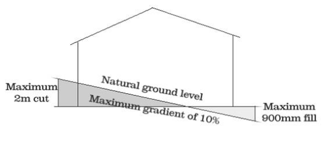
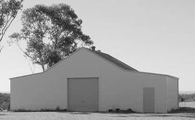
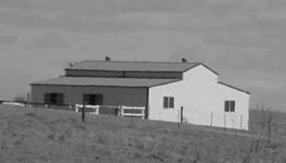
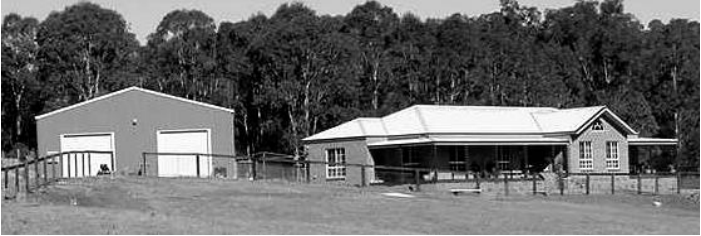
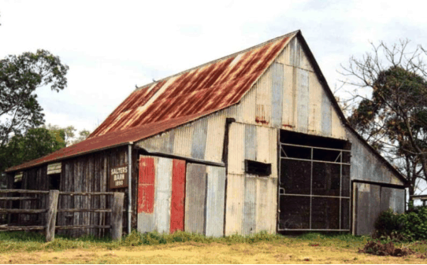

### 8.5 DEVELOPMENT CONTROLS

Development controls for farm buildings and outbuildings are as follows:

#### 8.5.1 Siting and Orientation

#### Objectives

(a) To ensure that farm buildings and outbuildings:

- Complement the character of the area and are not visually dominant,

- Have minimal impacts on  the removal of native vegetation,

- Take into consideration the natural features of the land, and

- Take into consideration existing and potential uses of the land.

#### Development Controls

1\. Farm buildings and outbuildings should be clustered in one location on the property.  Where possible, this should be close to dwellings, but not where this will result in land use conflict.

2\. Farm buildings and outbuildings are to be sited and orientated to minimise their visual dominance and impact on the streetscape.  In particular:

i) Ridgeline or hilltops locations should be avoided.

ii) The narrow elevation of the building should face the primary street frontage.

3\. Farm buildings and outbuildings as well as related driveways, manoeuvring areas and filled areas are to be positioned on the land so as to minimise the removal of any native vegetation.

4\. Farm Buildings or Outbuildings on properties which contain or are adjacent to a heritage item will be assessed on merit. Development applications shall be supported by an assessment against clause 5.10 Heritage conservation of the LEP and Part C Chapter 10 Heritage conservation of the DCP.

5\. Cut and fill for buildings, manoeuvring areas, fill batters and access driveways should be limited to a maximum 2 metres of cut and 900mm of fill. (Figure 1)

6\. Farm buildings and outbuildings should not be erected on land having a slope in excess of 10%.

7\. Farm buildings and outbuildings should be set back a minimum of 40 metres away from any

> [Picture on page 5: a picture, saved as a picture (images/ch-08-00-farm-buildings-and-outbuildings-page-5-6.gif, 150 dpi).]

watercourse.

#### Figure 1: Cut and fill

#### 8.5.2 Building Design and Form

#### Objectives

(a) To encourage attractive developments that blend in with the character of the locality, surrounding development and landscaping.

#### Development Controls

1\. Roof forms should provide visual relief to the building in order to reduce the building’s bulk. Barn style roof forms that are less bulky in appearance are encouraged in rural and environmental protection areas. (Figure 2)

2\. Building facades that can be readily viewed from adjacent roads should be articulated with suitable features such as windows, awnings and verandahs to minimise their visual bulk.

> [Picture on page 5: a picture, saved as a picture (images/ch-08-00-farm-buildings-and-outbuildings-page-5-19.gif, 150 dpi).]

> [Picture on page 5: a picture, saved as a picture (images/ch-08-00-farm-buildings-and-outbuildings-page-5-20.gif, 150 dpi).]

#### Figure 2: Less Bulky Appearance of Barn Style Roof Forms

#### 8.5.3 Building materials, finishes and colours

#### Objectives

(a) To ensure that building materials and external finishes of farm buildings and outbuildings do not have a significant adverse impact on the visual qualities of the landscape.

(b) Ensure that the colours used in the construction of farm buildings and outbuildings are consistent with the prevailing colours of the locality.

#### Development Controls

1\. External materials, finishes and colours should complement and harmonise with the surrounding environment and the existing development on the land.

2\. External materials should have non-reflective surfaces.  The use of unpainted metal surfaces may be permitted in limited circumstances subject to the size, height, design and location of the building.  The use of unpainted zincalume steel is not encouraged.

3\. In rural and environmental protection areas the walls and roof should be of colours primarily involving non-urban landscape colours (muted greens and browns).  Bright/stark colours such as white, black, blue, yellow or red or variations of these (e.g. cream, grey or orange) are generally not acceptable except as a minor detail colour (e.g. gutters) on a structure.

4\. Any part of a building below the 1-in-100 year flood level is to be constructed of flood compatible materials.

#### 8.5.4 Size, Setbacks and Height

#### Objectives

(a) To ensure that the bulk of farm buildings and outbuildings do not visually dominate the streetscape and the landscape.

(b) Ensure that the size of farm buildings and outbuildings is consistent with the intended use and the size of the property.

(c) Farm buildings and outbuildings should not be visually prominent or intrude into the skyline.

#### Development Controls

1\. The maximum areas and minimum setback requirements for farm buildings and outbuildings are provided under the following tables:

#### Farm Buildings

#### Table 1: Sizes and Setbacks for Farm Buildings

| LAND AREA | MAX ALLOWABLE AREA* (m2) | FRONT SETBACK (m) (from Primary Rd Frontage) | SIDE/REAR SETBACK (m) |
|---|---|---|---|
| <2,000m2 | 80 | Behind any existing dwelling or 10m, whichever is the greater | Considered on merit of the application |
| 2,000m2 to <1ha | 110 | Behind any existing dwelling or 10m, whichever is the greater | 3 |
| 1ha to <2ha | 270 | 15 | 5 |
| 2ha to <4ha | 325 | 20 | 10 |
| 4ha to <10ha | 450 | 20 | 10m to a property boundary or 50m (minimum) from a dwelling on an adjoining property, whichever is greater |
| 10ha or greater | 600 for first 10ha then 25 per every hectare thereafter | 20 | 10m to a property boundary or 50m (minimum) from a dwelling on an adjoining property, whichever is greater |

Any variation to the maximum allowable area for farm buildings will have to be justified in terms the use of the building and visual impact of the development.

2\. The maximum height of a farm building is 8m above ground level (existing).

#### Outbuildings

#### Table 2: Sizes and Setbacks for outbuildings

| LAND AREA | MAX ALLOWABLE AREA (m2) | FRONT SETBACK (m) (from Primary Rd Frontage) | SIDE/REAR SETBACK (m) |
|---|---|---|---|
| <1,000m2 | 60 | Behind any existing dwelling or 10m, whichever is the greater | Considered on merit of the application |
| 1,000 to < 4,000m2 | 110 | Behind any existing dwelling or 10m, whichever is the greater | 3 |
| 4,000m2 to <4ha | 180 | 15 | 5 |
| 4ha to <10ha | 250 | 20 | 10 |
| 10ha or greater | 325 for first 10ha then 25 per every hectare thereafter | 20 | 10m to a property boundary or 50m (minimum) from a dwelling on an adjoining property, whichever is greater |

Note: Maximum Allowable Area (m2) is calculated using the cumulative total of the enclosed floor area for farm buildings and outbuildings and does not include verandahs, awnings or the like that are open on two or more sides.

3\. The maximum height of an outbuilding with an area equal to or less than 200m2 is 5.5m above ground level (existing). The maximum height of ‘Barn style’ outbuildings or outbuildings greater than 200m2 is 6.5m above ground level (existing).

4\. Farm buildings and outbuildings that are greater in height than any existing or approved dwelling house on the land are discouraged. (Figure 3)

5\. The cumulative area for farm buildings and outbuildings on a single property will be considered based on the merits of the proposal.

6\. An open sided verandah or awning of not greater than one third of the area of the proposed farm building or outbuilding may be allowed in addition to the above mentioned maximum allowable areas.

7\. The total floor area specified for farm buildings and outbuildings does not include second floors and Mezzanine floors within a building that complies with the maximum height requirements.

8\. The size, setback and height rules do not apply to existing or replica historic slab barns and the building will be assessed based on the merit of the application. (Figure 4)

> [Picture on page 8: a picture, saved as a picture (images/ch-08-00-farm-buildings-and-outbuildings-page-8-15.gif, 150 dpi).]

#### Figure 3: Visual dominance of the shed (on left) due to its excessive height

> [Picture on page 8: a picture, saved as a picture (images/ch-08-00-farm-buildings-and-outbuildings-page-8-17.gif, 150 dpi).]

#### Figure 4: Slab Barn Style building

#### 8.5.5 Landscaping

#### Objectives

To provide attractive landscapes which are consistent with visual landscapes in the locality.

#### Development Controls

1\. Screening should be provided around farm buildings and outbuildings to reduce the bulk of the building and soften the appearance of the building from any adjoining dwelling, street or property boundary.

2\. Plants endemic to the area with suitable fire resistance, heights, coverage and density should be chosen. Landscaping shall consist of a mixture of trees, shrubs and ground cover to minimise the visual impact of the buildings.

3\. Trees should include species that at maturity have a height above the ridgeline of the proposed buildings.
