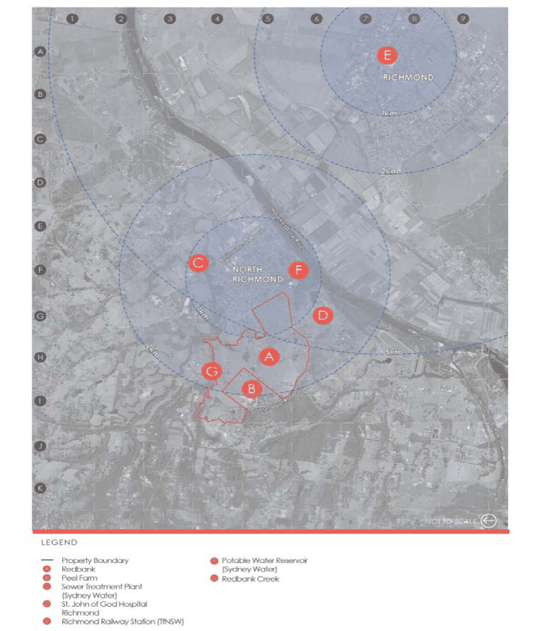
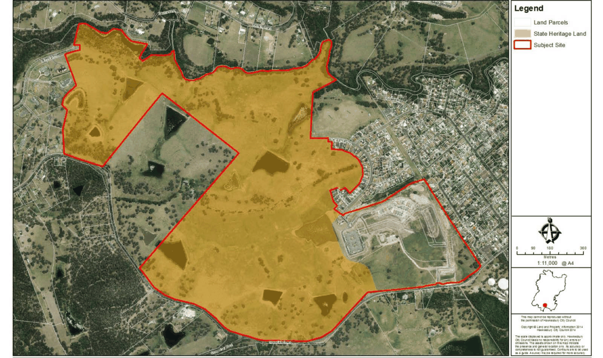

### 8.0 INTRODUCTION

This chapter applies to development on land known as “Redbank” at North Richmond consisting of Lot 72 DP 1187236, 124 Grose Vale Road, North Richmond; Lot 73 DP 1187236, 26 Arthur Phillip Drive North Richmond;  Lot 74 DP 1187236, 96 Grose Vale Road, North Richmond and Lot 274 DP 1156792, 28 Arthur Phillip Drive, North Richmond.

The land has an area of 179.2ha, and predominantly consists of cleared undulating land with a central saddle running approximately east-west creating two distinct valleys. The land is located on the northern side of Grose Vale Road and, immediately to the west of the North Richmond residential area and Peel Park, east of the Belmont Grove rural residential area, and south of Redbank Creek.  The site and surrounds is shown in Figures 8.1 and 8.2 below.

> [Picture on page 4: a picture, saved as a picture (images/ch-08-00-redbank-at-north-richmond-page-4-9.gif, 150 dpi).]

#### Figure 8.1 - Location Map

> [Picture on page 5: a picture, saved as a picture (images/ch-08-00-redbank-at-north-richmond-page-5-1.gif, 150 dpi).]

#### Figure 8.2 - Subject Site and Surrounds

The land varies in height from approximately 60-90m AHD along Grose Vale Road down to Redbank Creek at approximately 20-40m AHD and, it varies in slopes from reasonably flat terrain to land in excess of 15%.

The land is above the 1 in 100 year Hawkesbury River flood event level and a small part of the land (generally within the confines of the Redbank Creek riparian area) is below the Hawkesbury River Probable Maximum Flood Level.

The land contains some larger stands of remnant vegetation and creek lines which contain threatened ecological communities and threatened fauna and habitat resources. The land has been previously used for grazing and contains 11 dams which are a part of a former demonstration/experimental Keyline irrigation system development by P. A. Yeomans in the early 1950s.

The land contains remnants of the former Richmond to Kurrajong railway line in the form of two culverts and the path of the former railway line is apparent.

Part of the site is located on the former property ‘Yobarnie’ site which as of 8 March 2013 is subject to heritage listing under the State Heritage Register of the Heritage Act 1977 (see Figure 8.2). Yobarnie is of heritage significance as it is where the Yeomans’ Keyline system of agriculture was first developed, trialled and demonstrated. In accordance with the Heritage Council endorsed Heritage Conservation Management Plan (CMP) dated 27 March 2013, the significance of the site does not warrant the system’s complete reconstruction. Rather, robust and meaningful interpretation of the site and Keyline is

crucial to the retention of significance in the context of development. In particular, it is not imperative that the system operate as originally intended, rather than, it be apparent how it did. To achieve this outcome, this part of the DCP incorporates the recommendations of the CMP.

Associated with the State Heritage Register listing for Yobarnie are the following exemptions for works requiring Heritage Council of NSW approval under Section 57(1) of the Heritage Act 1977:

1\. All Standard Exemptions

2\. Future development:

(i) Development that is specified as exempt development or complying development in State Environmental Policy (Exempt and Complying Development Codes) 2008 provided it is also in accordance with a site specific Development Control Plan endorsed by the Heritage Council of NSW and a Masterplan for the site endorsed by the Heritage Council of NSW.

(ii) Development carried out generally in accordance with any site specific Development Control Plan endorsed by the Heritage Council of NSW.

3\. Maintenance of dedicated open space:

General maintenance and repair by Hawkesbury City Council for:

(i) tree surgery where considered necessary for the health of a tree;

(ii) removal or pruning of trees considered a danger to the public or staff;

(iii) minor works to reduce risks to public safety;

(iv) repair of damage caused by erosion and implementation of erosion control measures; and

(v) routine horticultural maintenance, including lawn mowing, cultivation and pruning.

4\. Maintenance and repair of infrastructure

Maintenance and repair by Hawkesbury Council of existing roads, paths, fences, gates, sporting amenities, drains, water reticulation facilities and other utilities. This exemption does not apply to excavation, unless Council can demonstrate the subject site is previously disturbed or comprises previous fill.

5\. Temporary uses

Erection and dismantling by Hawkesbury Council of temporary structures, signs, crowd control barriers, banners, stages, lighting and sound, and public address equipment associated with special events, sporting activities and functions held on Council land. This exemption does not apply to excavation, unless Council can demonstrate the subject site is previously disturbed or comprises previous fill.

In summary Exemption 2 means that provided a development is in accordance with a Heritage Council of NSW endorsed site specific DCP and, if required, endorsed Masterplan for the site, the development does not require approval from the Heritage Council under the provisions of Section 57(1) of the Heritage Act 1977.
