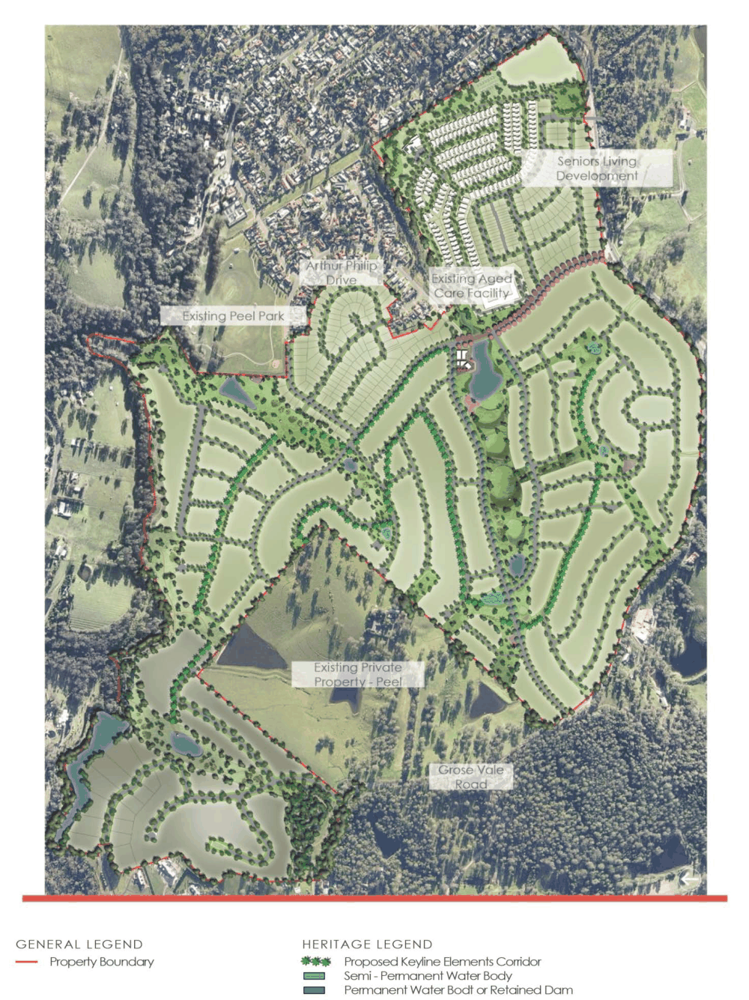

### 8.1 DESIRED FUTURE CHARACTER

The vision for Redbank at North Richmond is to be a sustainable and innovative residential community that responds to its unique heritage setting on the site of the original Yeomans’ Keyline system of agriculture (see Figures 8.3 and 8.7). Extensive, connected areas of public open space, being the parklands are to incorporate Keyline and City Forest principles and establish a distinct sense of place that creates a feeling of a community in an expansive open space/parkland setting. In particular, the Keyline elements are to be retained, adapted, and interpreted as appropriate and made a significant feature of the community.

Water is to be made a distinct feature of Redbank at North Richmond. Heritage elements including dams are to be retained or adapted, water is to be maintained high in the landscape and an integrated runoff management system incorporating best practice water sensitive urban design is to be provided in the public domain, including open spaces and streets.

Redbank at North Richmond is targeting the incorporation of smaller lots and areas of small scale attached housing. The residential community is to be supported by a small neighbourhood centre that provides for a range of local retail, commercial and community facilities.

> [Picture on page 8: a picture, saved as a picture (images/ch-08-00-redbank-at-north-richmond-page-8-1.gif, 150 dpi).]

#### Figure 8.3 - Vision Plan
