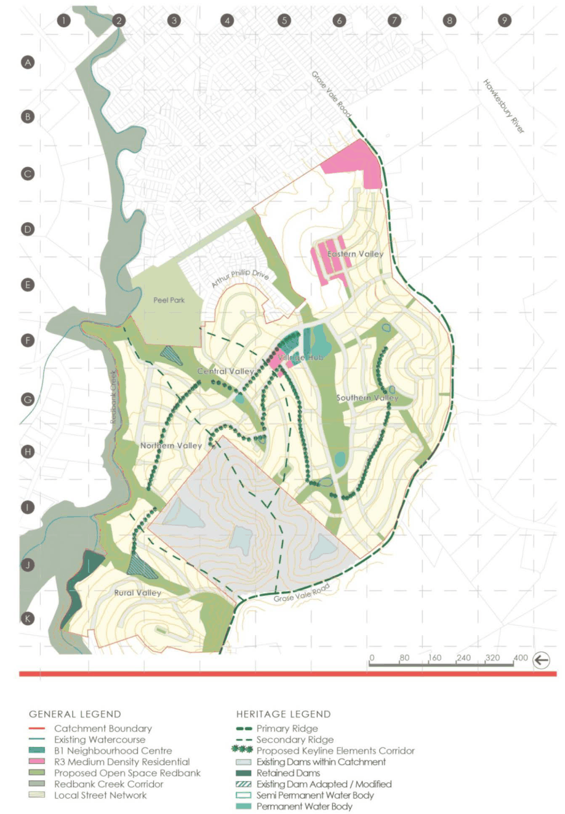
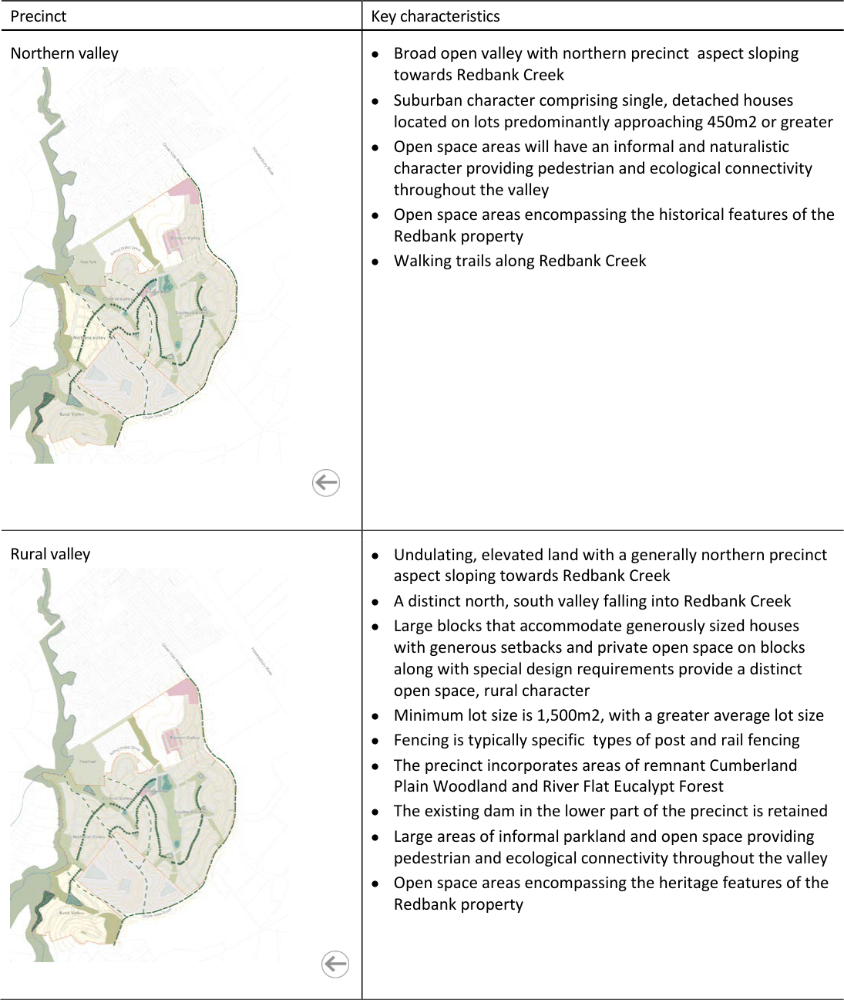
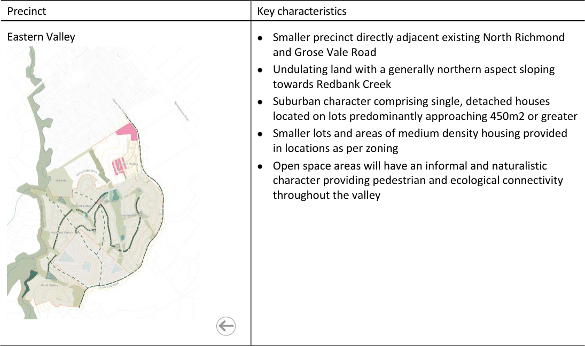

#### 8.3.1 DEVELOPMENT PRECINCTS

#### Objectives:

(a) To create a sense of place comprised of distinct neighbourhoods that respond to the dominant natural landscape features of the site, in particular dominant ridges and valleys.

#### Development Controls

1\. Future development and use of the five precincts identified within the land as shown in Figure 8.4 should be consistent with respective precinct characteristics identified in Table 1 below:

> [Picture on page 10: a picture, saved as a picture (images/ch-08-00-redbank-at-north-richmond-page-10-1.gif, 150 dpi).]

#### Figure 8.4 - Proposed Precincts

#### Table 8-1: Precinct Characteristics

| Precinct | Key characteristics |
|---|---|
| Southern valley | • Prevailing west to east precinct orientation • Open space focus in the centre of the valley • Suburban character comprising single, detached houses located on lots predominantly approaching 450m2 or greater • Smaller lots and areas of medium density housing provided in locations as per zoning • Contains the neighbourhood centre which provides for the day to day convenience needs of the community and includes: o an area of medium density housing in a village like character o shops, cafes and restaurants o indoor and outdoor community gathering space including a multi- function room • The neighbourhood centre is integrated with and provides strong connections to the adjoining public open space and water-body • Several small parks and play spaces • Large areas of informal parkland and open space providing pedestrian connectivity throughout the valley • Open space areas encompassing the historical features of the Redbank property |
| Central valley | • Prevailing south-west to north-east precinct orientation • Focussed on open space in the centre of the valley • Suburban character comprising single, detached houses located on lots predominantly approaching 450m2 or greater • Large areas of informal parkland and open space providing pedestrian connectivity throughout the valley • The north eastern end of the valley connects directly to Peel Park and Redbank Creek • Peel Park contains several sporting facilities • Open space areas encompassing the historical features of the Redbank property • Walking trails along Redbank Creek |

> [Picture on page 12: a picture, saved as a picture (images/ch-08-00-redbank-at-north-richmond-page-12-1.gif, 150 dpi).]
> Words printed on the picture (title and legend, copied from the PDF):
> Precinct
> Northern valley
> towards Redbank Creek
> throughout the valley
> Redbank property
> Rural valley
> open space, rural character
> Redbank property

Key characteristics

• Broad open valley with northern precinct  aspect sloping

• Suburban character comprising single, detached houses located on lots predominantly approaching 450m2 or greater

• Open space areas will have an informal and naturalistic character providing pedestrian and ecological connectivity

• Open space areas encompassing the historical features of the

• Walking trails along Redbank Creek

• Undulating, elevated land with a generally northern precinct aspect sloping towards Redbank Creek

• A distinct north, south valley falling into Redbank Creek

• Large blocks that accommodate generously sized houses with generous setbacks and private open space on blocks along with special design requirements provide a distinct

• Minimum lot size is 1,500m2, with a greater average lot size

• Fencing is typically specific  types of post and rail fencing

• The precinct incorporates areas of remnant Cumberland Plain Woodland and River Flat Eucalypt Forest

• The existing dam in the lower part of the precinct is retained

• Large areas of informal parkland and open space providing pedestrian and ecological connectivity throughout the valley

• Open space areas encompassing the heritage features of the

> [Picture on page 13: a picture, saved as a picture (images/ch-08-00-redbank-at-north-richmond-page-13-1.gif, 150 dpi).]
> Words printed on the picture (title and legend, copied from the PDF):
> Precinct
> Eastern Valley
> and Grose Vale Road
> towards Redbank Creek
> throughout the valley

Key characteristics

• Smaller precinct directly adjacent existing North Richmond

• Undulating land with a generally northern aspect sloping

• Suburban character comprising single, detached houses located on lots predominantly approaching 450m2 or greater

• Smaller lots and areas of medium density housing provided in locations as per zoning

• Open space areas will have an informal and naturalistic character providing pedestrian and ecological connectivity
