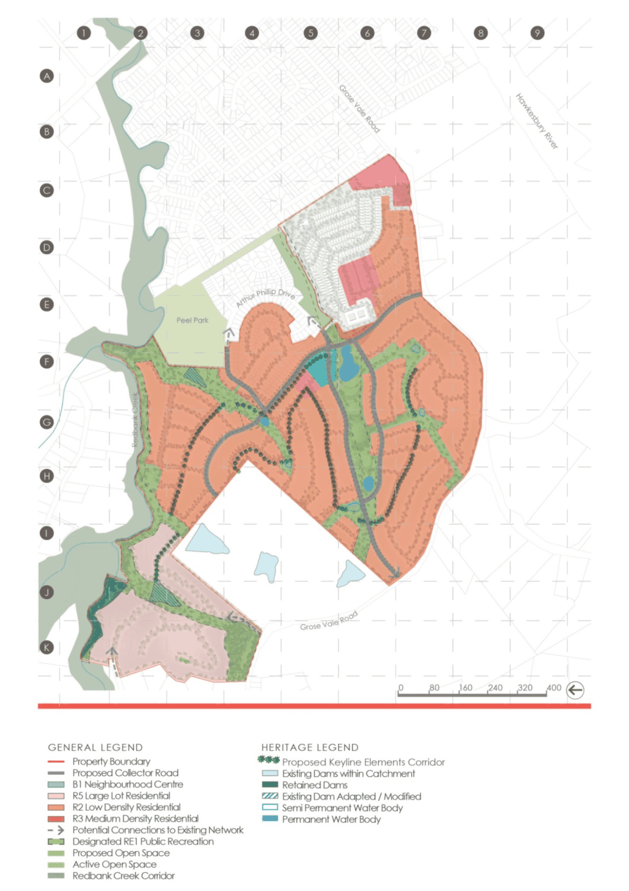

#### 8.3.2 SUBDIVISION

#### Objectives

(a) To ensure that development occurs in a co-ordinated manner consistent with the vision.

(b) To ensure key features are delivered whilst providing flexibility as to the final layout and design.

#### Development Controls

1\. Development is to be generally in accordance with the Development Plan at Figure 8.5.  Where variations are proposed, applicants are to provide a written justification in accordance with the requirements of Part A Chapter 1 Section 1.7 of the DCP.  The justification is to also explain why the variation is needed and demonstrate how the desired future character and general objectives of this chapter are to be achieved.

#### Notes

(i) Development includes subdivision; lot, road and drainage works; open space; proposed water bodies and keyline element corridor.

(ii) Key features are the keyline elements, the principal roads, key nodes, view corridors, heritage interpretation centre and signage.

(iii) The keyline elements are those heritage components being retained, adapted or interpreted in the proposed urban landscape being the combination of swale, significant tree in the swale (along with the dual use pedestrian/cycle path) connecting retained/adapted dams and new water bodies.

> [Picture on page 15: a picture, saved as a picture (images/ch-08-00-redbank-at-north-richmond-page-15-1.gif, 150 dpi).]

#### Figure 8.5 - Development Plan
