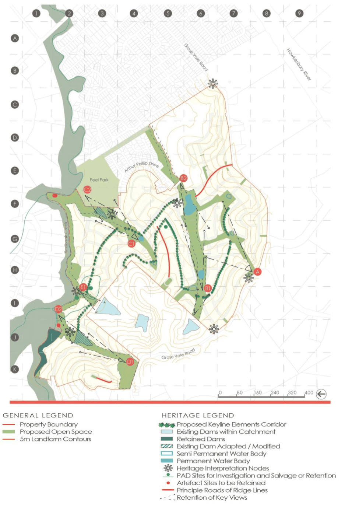
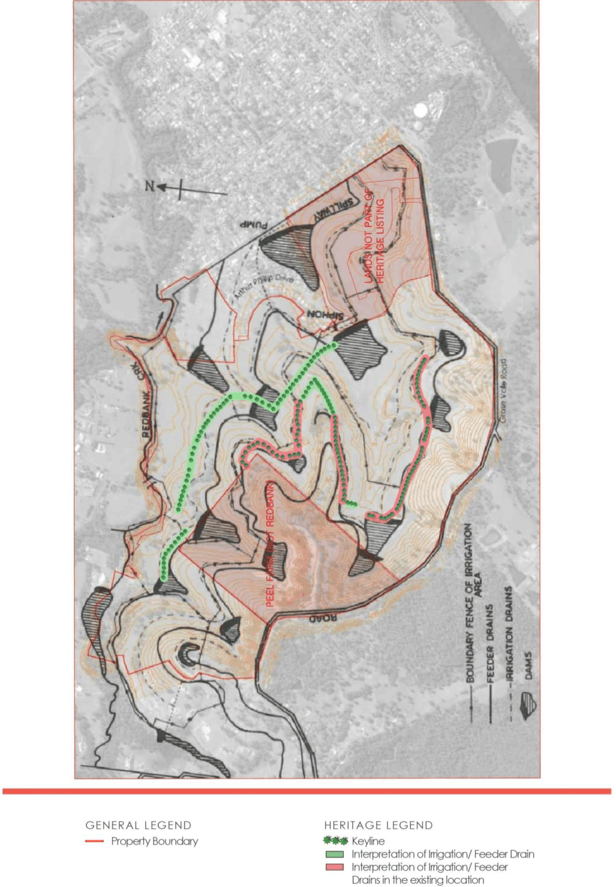

#### 8.3.3 HERITAGE CONSERVATION

#### Introduction

The Keyline system is a system of soil development and water management principles that provide for the development of farm and grazing landscapes, and more broadly, sustainable water management in the urban environment. Its primary aim is the development of better soil structure, increased soil fertility and greater actual depth of fertile soil.

The Keyline concept determines that there is a “keypoint” in the valley of a landscape which marks the point where the relationship changes between the upper and narrower slopes of the valley and the lower flatter slopes. The “keyline” then forms a contour in both directions from this point, lying at right angles to the slope of the land, and as the slope changes direction, the contour lines curve and turn. This keyline forms the basis for landscape planning, including the placement of the homestead or farm buildings, placement of roads, dam sites, irrigation channels and tree plantings.  The result is an integrated system of farm dams, feeder and irrigation drains to create a constantly moist and aerated soil climate, which promotes soil improvement.

Dams are then located to enable the farmer to use gravity to provide water under pressure, with the dams of greatest value being in the higher areas, allowing irrigation of the lower pastures. Dams are interconnected by a system of feeder and irrigation drains and spillways that channel run off to lower dams in the system (feeder drains) and irrigate pastures (irrigation drains). The landscape of Yobarnie made it possible to have two chains of dams at Keyline levels, with a third low level chain, starting at the Redbank Creek (thus using water which originates from outside the site and pumped up to the higher dams) with the lower dams positioned where excess water would leave the site.

The retention and correct positioning of trees is also an important part of the Keyline philosophy and timber clearing is planned to derive the greatest benefit from trees, for the whole of the farm. Typically there is a keyline tree corridor strip running below the keyline which forms a permanent guide for keyline cultivation.

Out of the original 16 keyline dams, 3 are part of a separate site (Peel property) and 2 were removed as part of earlier subdivisions to the former Yobarnie. Keyline at Redbank is to be demonstrated in the retention/interpretation of remnant dams (9 dams) and the interpreted feeder and irrigation drains to become the Keyline Elements Corridor.

#### Objectives

(a) To retain, adapt or interpret the significant history of the site, in particular the Keyline system.

(b) To incorporate City Forest and Keyline principles into the site, including:

i. maximising water retention high in the land and in the soil

ii. division of land into zones determined by gravity flowing water lines

iii. principal roads are generally located along crest lines

iv. provision being made for healthy landscaped environmental zones in the Keyline Elements Corridor and RE1 Public Recreation zoned land

v. retention or adaptation of dams along with interpretation of existing dams to become new waterbodies

vi. maintaining connectivity between dams to reflect the Keyline

(c) To be responsive to significant aspects of the natural topography and landform.

(d) To retain key views and vistas.

#### Development Controls

1\. Significant elements of the Keyline system, including dams, irrigation and feeder drains are to be retained, adapted or interpreted and incorporated into the public open space and water management systems.

2\. The Keyline is defined as a central landscape feature of the site, with accessibility being provided through its inclusion in public open space and its visual prominence reinforced by distinct tree planting.

3\. Dams and new waterbodies are to be incorporated in public open space and are key elements within the overall water management network for the site.

4\. Of the 16 original dams constructed as part of the Yobarnie sketch, there are 11 dams remaining and 9 of those dams are within the Redbank DCP area, as indicated on Figure 8.9.  Existing dams should be retained. Dams may be reconstructed as water-bodies (permanent or semi-permanent) where it is necessary to meet public health and safety requirements. Where dams are proposed be removed the following information is to be provided for consideration by Council:

i. the reasons for removal of the dam

ii. an assessment of the heritage significance of the dam and impact of its removal with respect to the findings and recommendations of the “Yobarnie” Conservation Management Plan (CMP)

iii. options that have been explored for the retention or reconstruction of the dam.

5\. Permanent and semi-permanent water-bodies are to be created to maintain water high in the catchment, with linkages to the prominent keyline elements via the open space focal points.

6\. The heritage significance of the site is to be interpreted within the open spaces and heritage interpretation nodes as identified in Figure 8.6.  A heritage interpretation strategy aligned with the Conservation Management Plan (CMP) for “Yobarnie” must be prepared by a qualified heritage consultant for Council approval, prior to its implementation.  In addition to interpretive devices within nodes and open spaces, the strategy shall incorporate the retention of selected physical elements in the landscape, including minimal modification to the landform whilst still maintaining view lines and dominant landform features.

7\. View corridors are to be  provided as follows:

i. View corridor ‘A’ providing a view from Grose Vale Road down along the open space corridor and above residential areas to the neighbourhood centre and adjoining public open space and water-body

ii. View corridor ‘B1 and B2’ providing a view from the upper reaches of the southern valley, down along the open space corridor to the neighbourhood centre and adjoining public open space and waterbody

iii. View corridor ‘C1 and C2’ providing a view from the local park, down along the open space corridor to Peel Park and the adjoining dam

iv. View corridor ‘D1 and D2’ providing a view from the local park containing Cumberland Plain Woodland (CPW), down along the open space corridor to the dam

v. View corridor ‘E1’ providing a view from the open space corridor between the rural valley and northern valley to Peel Farm.

8\. Rainfall and stormwater is to be retained where possible across the site through the retention, adaptation and interpretation of heritage features, including existing dams as retained dams and suitable reconstructed new water bodies through the retention, adaption or interpretation of Yeomans’ elements.

9\. Indigenous heritage as shown are to be protected and retained in public ownership, and where appropriate, opportunities are provided for their interpretation.

10\. Indigenous heritage sites are to be managed in accordance with the relevant provisions of National Parks and Wildlife Act 1974 and Heritage Act 1977. An indigenous heritage management plan, prepared by a suitably qualified heritage consultant, it is be submitted to Council for consideration demonstrating how the sites as shown on Figure 8.6 or any other unrecorded sites are to be investigated, retained, interpreted, salvaged or destroyed.

11\. The design (civil and landscape) needs to address slope and subsequent lot size and configuration due to the sites’ topography and its historical reference to Yeomans’ elements.

> [Picture on page 19: a picture, saved as a picture (images/ch-08-00-redbank-at-north-richmond-page-19-1.gif, 150 dpi).]

#### Figure 8.6 - Heritage Plan

> [Picture on page 20: a picture, saved as a picture (images/ch-08-00-redbank-at-north-richmond-page-20-1.gif, 150 dpi).]

#### Figure 8.7 – Keyline Corridor Overlay on Yeomans Sketch from CMP

Keyline Element Corridor Trees

The Keyline is to be identified in the landscape by signature tree species plantings of endemic native vegetation.  An indicative species list can be obtained from Council and is to be used when preparing development applications for subdivision.  Tree species selection is to be based on:

• ability to withstand harsh urban conditions

• the provision of adequate soil volume to support tree root growth

• the long term survival and sustainability

• the character of the site

Adequate soil volume is to be achieved by reinstating an appropriate depth of uncompacted topsoil to the verge and building setback zones.  This will provide adequate aeration, hydration and nutrients to support the long term growth and survival of trees.  Under these circumstances, tree roots will less likely grow towards infrastructure and building zones to search for air, water and nutrients.  Furthermore, zones external to the verge and building setback areas are composed of highly compacted sub base and foundations, which are poor conditions for tree root growth.

In addition, the keyline corridor tree is to be placed in a shallow swale that interprets two of the original keyline elements being the feeder and irrigation drains.
