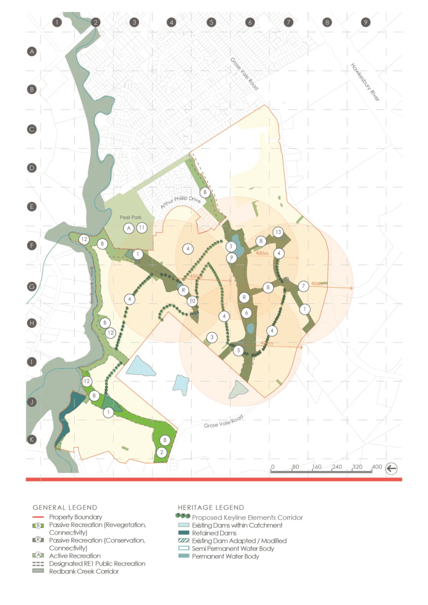

#### 8.3.4 OPEN SPACE

#### Objectives

(a) To provide a diverse, multi- functional and connected open space network that includes opportunities for passive and active recreation, environmental protection, heritage protection and collection and treatment of stormwater.

(b) To encompass to the historic features of Yeomans’ land and water management practices.

(c) To retain, modify and adopt the features of Yeomans’ elements, in particular the waterbodies and the Keyline, as focal points for the open space network.

(d) To incorporate and express environmentally sensitive water management systems for the development.

(e) To reinstate deep top soil and demonstrate passive rainfall collection and conveyance as an interpretation of Yeomans’ principals.

#### Development Controls

1\. The open space network is to be provided generally in accordance with the Voluntary Planning Agreement (VPA), the Conservation Management Plan (CMP), Hawkesbury City Council Planning and Design Guidelines Stage 2 of HCC Regional Open Space Strategy (ROSS), Figure 8.8 and Table 8.2.

2\. The open space areas are to predominantly be open grassland, in keeping with the rural heritage of Redbank.  The areas close to Redbank Creek and the area of remnant Cumberland Plain Woodland are to include endemic native vegetation. Away from Redbank Creek, small disbursed groupings of native and exotic vegetation in keeping with the broader North Richmond area and the farming heritage of Redbank are to be provided.

3\. Street trees are to enhance the visual and sensorial amenity of Redbank’s streetscapes and be able to withstand urban limitations and sustain healthy growth within the proposed verge conditions.

4\. A concept landscape plan is to be provided with development applications for subdivision.  An indicative species list of endemic native vegetation can be obtained from Council and is to be used when preparing the concept landscape plan.

> [Picture on page 23: a picture, saved as a picture (images/ch-08-00-redbank-at-north-richmond-page-23-1.gif, 150 dpi).]

#### Figure 8.8 - Interpretive Open Space Embellishment Plan

#### Table 8.2: Interpretive Open Space Embellishment Plan

| Refer to Figure 8.8 | Management Stormwater | Recreation Active | Amenity Visual | Connectivity | Conservation Environmental | Recreation Passive | Keyline - Conservation Heritage | Conservation Heritage | Hub Social |  |
|---|---|---|---|---|---|---|---|---|---|---|
| Ref # | Description |  |  |  |  |  |  |  |  | Indicative Facilities |
| 1 | ● |  | ● | ● |  | ● |  | ● |  | Existing waterbody modified and retained Heritage/Environmental interpretive information |
| 2 |  |  | ● | ● | ● |  |  |  |  | Remnant Cumberland Plain Woodland Pedestrian paths and interpretive information Environmental protection, revegetation/regeneration |
| 3 |  |  | ● |  |  | ● |  |  |  | Pocket park within passive open space incorporating: Seating/Shelters Historical and environmental interpretive information |
| 4 |  |  | ● | ● |  | ● | ● |  |  | Keyline linear corridor Passive open space feature representing the keyline and incorporating: Heritage interpretive information, Pedestrian and bicycle paths. Providing connectivity and a “green” link between numerous small parks and larger areas of open space |
| 5 |  |  | ● | ● |  | ● | ● | ● |  | Local park and playground within passive open space incorporating: Seating/Shelters/Lookout point Grassy kick-about area Heritage interpretive information Pedestrian and bicycle paths |
| 6 | ● |  | ● | ● |  | ● |  | ● |  | Passive open space incorporating: Seating Grassy kick-about area Heritage/Environmental interpretive information Pedestrian and bicycle paths |
| 7 |  |  | ● |  |  | ● |  | ● |  | Local park and playground within passive open space incorporating: Seating/Shelters Grassy kick-about area Heritage interpretive information Pedestrian and bicycle paths |
| 8 | ● |  | ● | ● |  |  |  |  |  | Passive open space providing connectivity and a “green” link between small parks and larger areas of open space Pedestrian paths |
| 9 | ● |  | ● |  |  | ● |  | ● | ● | Community centre adjacent a local park set in passive open space. A regional destination for the broader community providing a range of recreational opportunities including: Playground Boardwalks Grassy kick-about area Seating/Shelters/Picnic/BBQ |

| Refer to Figure 8.8 | Management Stormwater | Recreation Active | Amenity Visual | Connectivity | Conservation Environmental | Recreation Passive | Keyline - Conservation Heritage | Conservation Heritage | Hub Social |
|---|---|---|---|---|---|---|---|---|---|
| Ref # | Description |  |  |  |  |  |  |  | Indicative Facilities Heritage interpretive node Car parking and bus stop Pedestrian and bicycle paths |
| 10 | ● |  | ● | ● |  | ● |  |  | Playground Seating/Shelters Heritage interpretive information Pedestrian and bicycle paths |
| 11 |  | ● | ● | ● |  |  |  |  | Existing Peel Park - Primarily for active recreation Catering to district catchment with: Sportsfield, hardcourts Training and informal kick-about areas Off-leash dog walking BMX track Seating/Shelters/Picnic Heritage/Environmental interpretive information Car parking and bus stop Pedestrian and bicycle paths |
| 12 |  |  | ● | ● | ● | ● |  | ● | Redbank Creek Riparian Corridor Revegetated or regenerated with pockets of informal recreation opportunities including: Seating/Shelters Grassy kick-about area Heritage/Environmental interpretive information Pedestrian and bicycle paths |
| 13 |  |  | ● |  |  | ● |  |  | Pocket park within passive open space incorporating: Seating/Shelters Grassy kick-about area Heritage interpretive information Pedestrian and bicycle paths |
