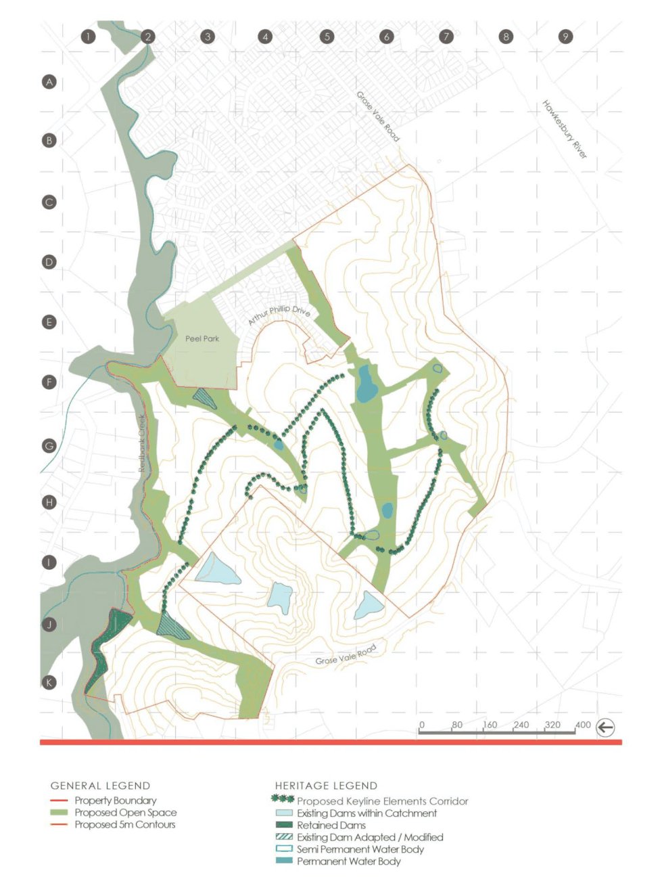
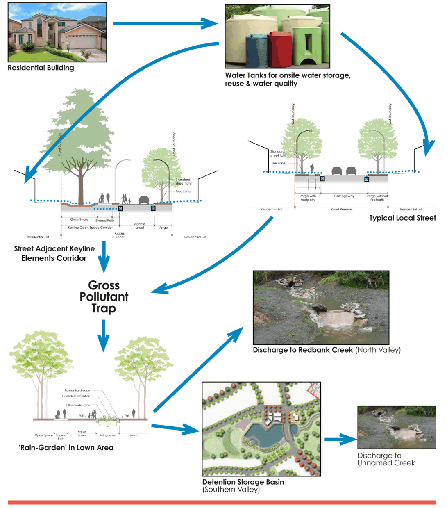

#### 8.3.5 WATER MANAGEMENT

#### Objectives

(a) To ensure no net increase in discharge to Redbank Creek .

(b) To improve waterway health, slow the conveyance of water across the site, improve the quality and regulate the quantity of stormwater discharge into Redbank Creek through Water Sensitive Urban Design (WSUD) initiatives.

(c) To provide a water management network that integrates with the broader objectives of the open space network.

(d) To retain, modify and adapt existing Yeomans’ Keyline elements, in particular waterbodies and the Keyline, as focal points for the open space network.

(e) To use water as a key landscape feature and incorporate the key elements of Yeomans’ Keyline elements  within the water management network.

(f) To retain a quantifiable amount of stormwater prior to discharge to Redbank Creek.

#### Development Controls

1\. Post development flows from the site shall not exceed the pre-development flows for all storms from the 1 in 1 year ARI to the 1 in 100 ARI storm.

2\. Selected (see Figure 8.9) existing dams are to be retained or adapted to become feature water-bodies, or removed.  The specific dams are to be confirmed with the development application process.  Suitable documentation reviewing dams from the perspectives of safety, heritage, public health, public and private property risk, environmental risk and engineering standards and on-going serviceability (maintenance) is to be submitted with relevant development applications.

3\. High retention of water in the ground is to be facilitated and a vegetated landscape character is to be created through the establishment of a connected keyline linear corridor and waterbody network.

4\. The Yeomans’ feeder and irrigation drains are to be represented through capture of stormwater from frequent rainfall events in the Keyline Element Corridor by the swale.

5\. Rainfall is to be retained on site where possible for re-use through improved groundwater retention. The water management network is to include:

i. dams to be retained , modified or adapted to become  permanent water bodies,

ii. bio-retention basins

iii. gross pollutant traps

iv. dry basins

v. swales and rain gardens

6\. Development Applications for subdivision are to include measures for:

i. street level treatment

ii. sub-catchment treatment

iii. overall site catchment/s treatment

7\. The following environment targets  are to be met via the implementation of the water cycle network shown in Figure 8.10:

• Gross pollutants (GP) – 90% retention of the average annual load (>5mm)

• Suspended solids (TSS) – 85% retention of the average annual load

• Total Phosphorous (TP) – 65% retention of average annual load

• Total Nitrogen (TN) – 45% retention of average annual load

(Source: NSW Department of Environment and Climate Change, Environmental Targets 2007)

8\. Where lots front grass swales and on site disposal of stormwater is not appropriate, suitable surface drainage outlets into the swale are to be provided prior to the issuing of a Subdivision Certificate.  Details of the proposed surface outlets are to be provided with relevant development applications.

9\. Where required, piped and sealed driveway crossings for large lot residential lots are to be provided prior to the issuing of a Subdivision Certificate.  Crossings are to ensure the integrity of the waterway area and protect the swale from vehicle damage.  Details of proposed crossings are to be provided with relevant development applications.

> [Picture on page 28: a picture, saved as a picture (images/ch-08-00-redbank-at-north-richmond-page-28-1.gif, 150 dpi).]

#### Figure 8.9 – Proposed Dam and Water bodies Network

> [Picture on page 29: a picture, saved as a picture (images/ch-08-00-redbank-at-north-richmond-page-29-1.gif, 150 dpi).]

#### Figure 8.10 – Water Cycle Plan
