#### 8.3.6 ENVIRONMENTAL MANAGEMENT

#### Objectives

(a) To protect significant existing vegetation.

(b) To protect and enhance riparian corridors for the following purposes:

i. water conveyance

ii. water quality

iii. protection of significant vegetation

iv. wildlife movement/habitat

v. visual amenity

vi. low impact recreation activities such as pedestrian and cyclist paths

(c) To mitigate bush fire risk to provide an appropriate level of personal and property safety on private land.

(d) To plant vegetation in the public open space and the street networks to contribute to sense of place and character.

#### Development Controls

1\. Cumberland Plain Woodland (identified both at a state and federal level as Critically Endangered Ecological Community) as indicatively shown in Figure 8.11 is to be protected and located within public open space wherever possible.

2\. River Flat Eucalyptus Forest (identified as an Endangered Ecological Community) is to be protected and located ideally within a riparian open space corridor or alternatively within a large lot residential area wherever possible.

3\. Approval must be obtained for the removal of any Endangered Ecological Communities as required by the relevant legislation including the Threatened Species Conservation Act 1995 and will need to be considered through due process (e.g. via biodiversity offsets).

i. the applicant must demonstrate that the objectives have been achieved through a Flora and Fauna Assessment prepared in accordance with the Threatened Biodiversity Survey and Assessment Guidelines – Guidelines for Developments and Activities Working Draft (DEC 2004)

ii. the applicant must demonstrate that the objectives have been achieved through a Biodiversity Management Strategy and Landscape Plan that will protect, manage and where appropriate promote the recovery of threatened species, populations and ecological communities and their habitats on the subject property.

iii. the applicant is to submit these management strategies and landscape plans with development applications for subdivisions and open space works

4\. Riparian zones are to be provided generally in accordance with Figure 8.11.

5\. Treatments to Redbank Creek are to be provided generally in accordance with Figures 8.17 to 8.20.

6\. Waterbody edges and rain garden are to be generally in accordance with Figures 8.12 to 8.16.

7\. Vegetation is to be planted in accordance with Figure 8.8 and comprise predominantly endemic native species in public open space.

8\. Vegetation management strategies and landscape plans are to be prepared for Cumberland Plain Woodland, River Flat Eucalyptus Forest and the Redbank Creek Riparian Corridor addressing the maintenance and conservation of heritage and environmental aspects of the area.  These strategies and plans are to be submitted at the time of lodging a development application for subdivision or open space works.  The identified areas indicatively shown on Figure 8.11 of remnant Cumberland Plain Woodland, River Flat Eucalyptus Forest and the Redbank Creek Riparian Corridor are to remain as soft landscaping areas with the predominant appearance being of a natural setting managed consistent with Council’s Plan of Management for ‘natural areas’.  In order to reduce visual intrusion into natural settings, playground equipment, retaining walls (greater than 0.5m), service structures or towers and the like are to be located away from identified areas indicatively shown on Figure 8.11 of remnant Cumberland Plain Woodland, River Flat Eucalyptus Forest and the Redbank Creek Riparian Corridor.

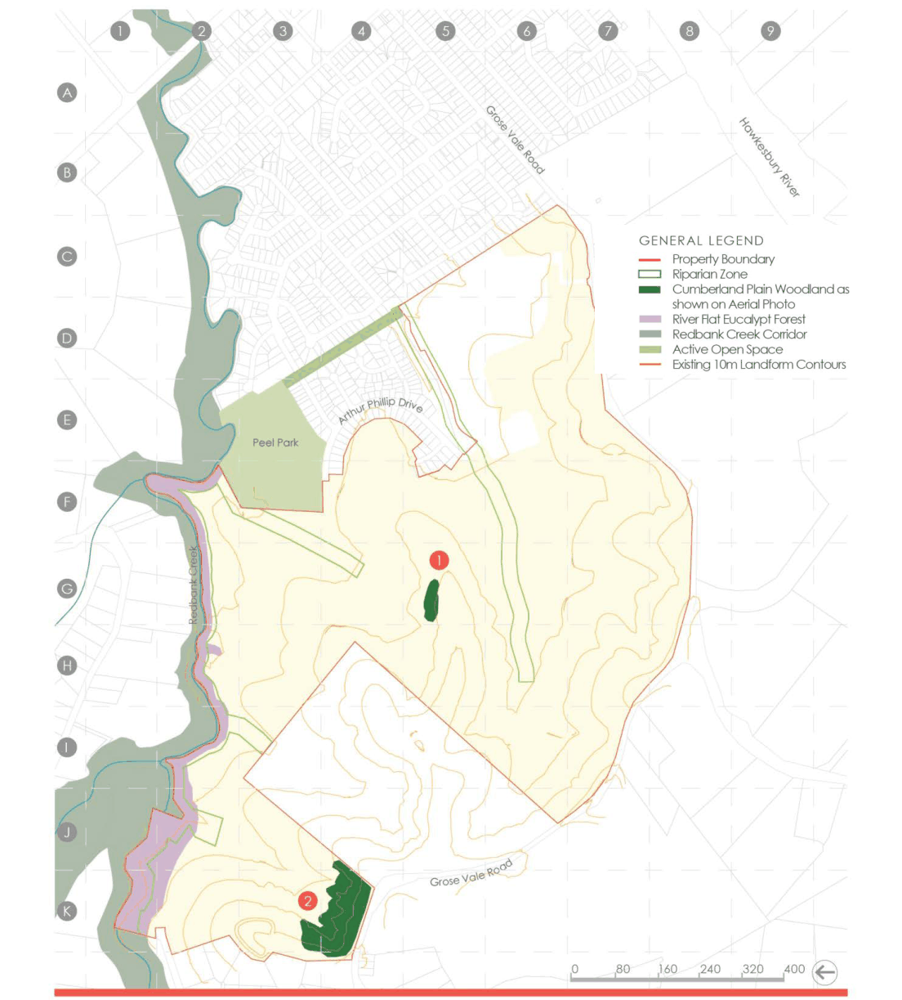

> [Picture on page 32: a picture, saved as a picture (images/ch-08-00-redbank-at-north-richmond-page-32-1.gif, 150 dpi).]

#### Figure 8.11 – Environmental Constraints

Waterbody Edge Treatment

The ‘water edge sections’ highlight various edge treatments for the interface between waterbody and open space or public domain.  These ‘interfaces’ generally occur within the RE1 Public Recreation zoning, with the exception of the B1 Neighbourhood Centre zoning where the waterbody abuts the neighbourhood centre promenade.  These variations in edge treatments allow for flexibility in response to existing and proposed site specificities when designing the interface between land and water.

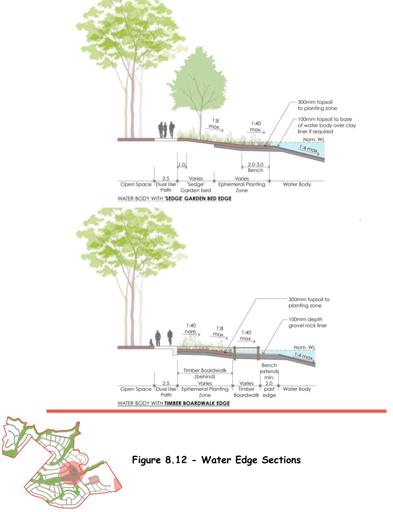

> [Picture on page 33: a picture, saved as a picture (images/ch-08-00-redbank-at-north-richmond-page-33-7.gif, 150 dpi).]

Figure 8.12 - Water Edge Sections

Waterbody Edge Treatment

The ‘water edge sections’ highlight various edge treatments for the interface between waterbody and open space or public domain.  These ‘interfaces’ generally occur within the RE1 Public Recreation zoning, with the exception of the B1 Neighbourhood Centre zoning where the waterbody abuts the neighbourhood centre promenade.  These variations in edge treatments allow for flexibility in response to existing and proposed site specificities when designing the interface between land and water.

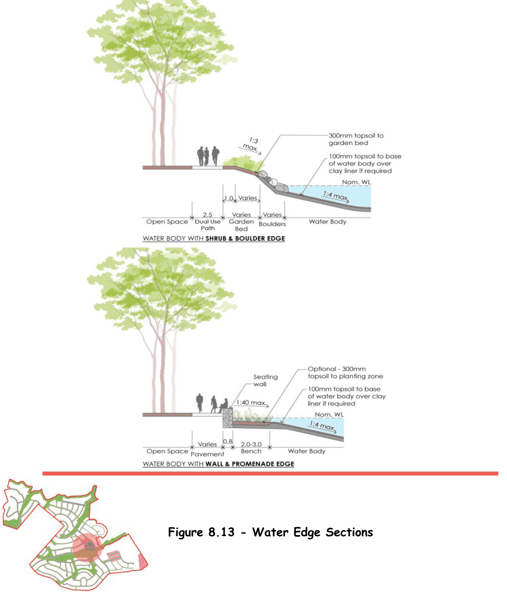

> [Picture on page 34: a picture, saved as a picture (images/ch-08-00-redbank-at-north-richmond-page-34-7.gif, 150 dpi).]

Figure 8.13 - Water Edge Sections

Waterbody Edge Treatment

The ‘water edge sections’ highlight various edge treatments for the interface between waterbody and open space or public domain.  These ‘interfaces’ generally occur within the RE1 Public Recreation zoning, with the exception of the B1 Neighbourhood Centre zoning where the waterbody abuts the neighbourhood centre promenade.  These variations in edge treatments allow for flexibility in response to existing and proposed site specificities when designing the interface between land and water.

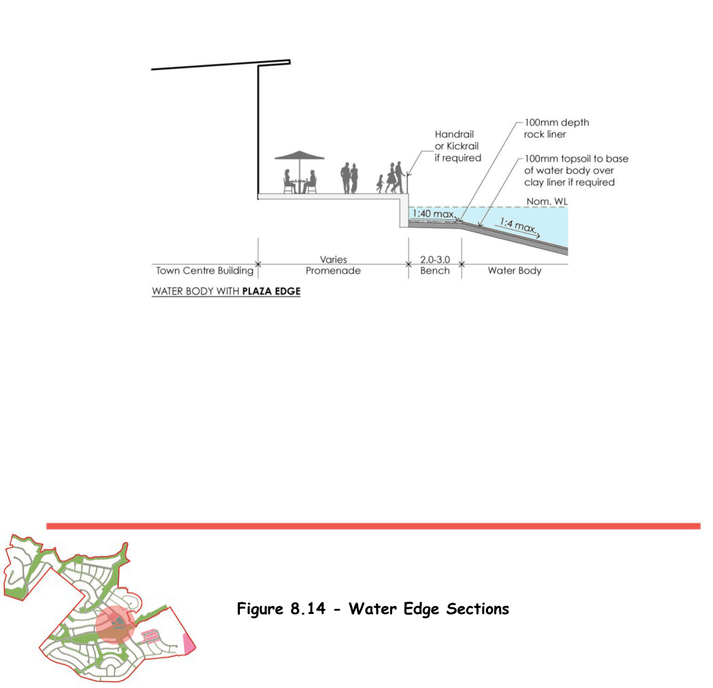

> [Picture on page 35: a picture, saved as a picture (images/ch-08-00-redbank-at-north-richmond-page-35-7.gif, 150 dpi).]

Figure 8.14 - Water Edge Sections

Rain Garden (Bio Retention) Sections

These sections highlight several scenarios for bio retention occurring within RE1 Public Recreation zoning.  Generally, a rain garden can be planted or grassed and allow for extended detention during rain events.  The peripheral landscape can also be planted or grassed with falls toward the rain garden.

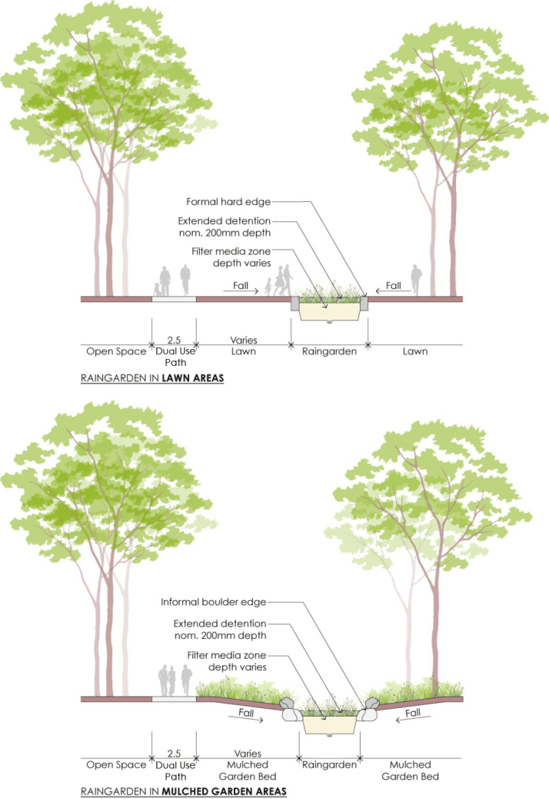

> [Picture on page 36: a picture, saved as a picture (images/ch-08-00-redbank-at-north-richmond-page-36-5.gif, 150 dpi).]

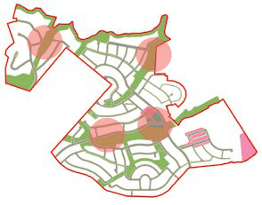

> [Picture on page 36: a picture, saved as a picture (images/ch-08-00-redbank-at-north-richmond-page-36-6.gif, 150 dpi).]

#### Figure 8.15 - Rain Garden Sections

Rain Garden (Bio Retention) Sections

These sections highlight several scenarios for bio retention occurring within the RE1 Public Recreation zoning.  Generally, a rain garden can be planted or grassed and allow for extended detention during rain events.  The peripheral landscape can also be planted or grassed with falls toward the rain garden.

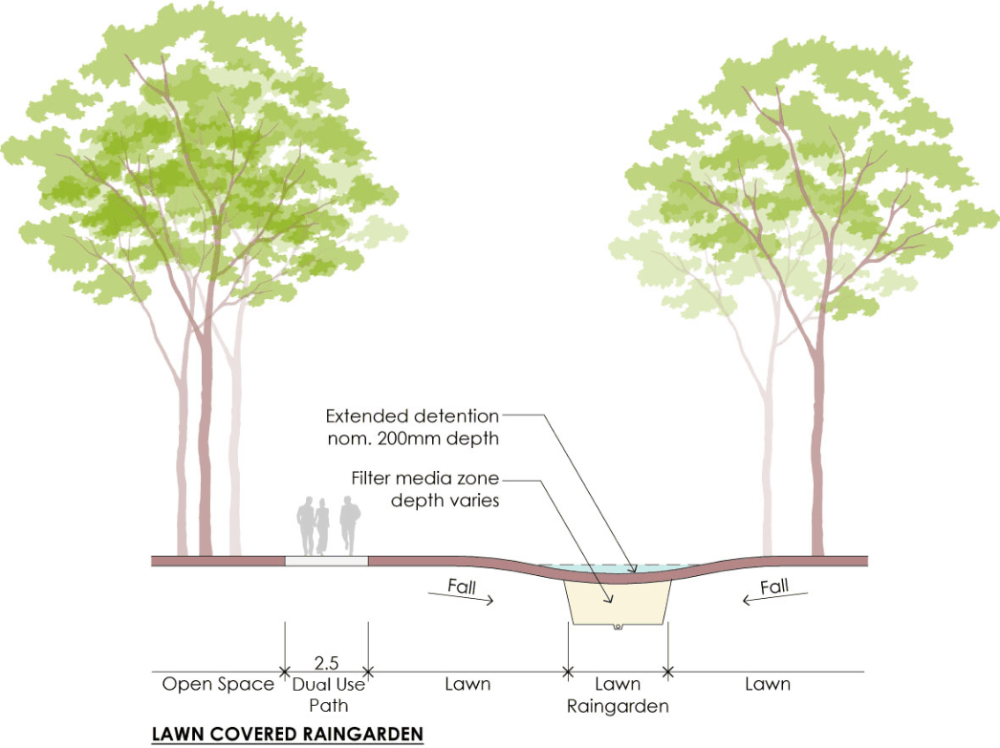

> [Picture on page 37: a picture, saved as a picture (images/ch-08-00-redbank-at-north-richmond-page-37-5.gif, 150 dpi).]

#### Figure 8.16 - Rain Garden Sections

Riparian Corridor - R5 Large Lot Residential Zoning

The following sections address the Redbank Creek Riparian Corridor in relation to R5 Large Lot Residential zoning.  They highlight the extents of the Vegetated Riparian Zone (VRZ).

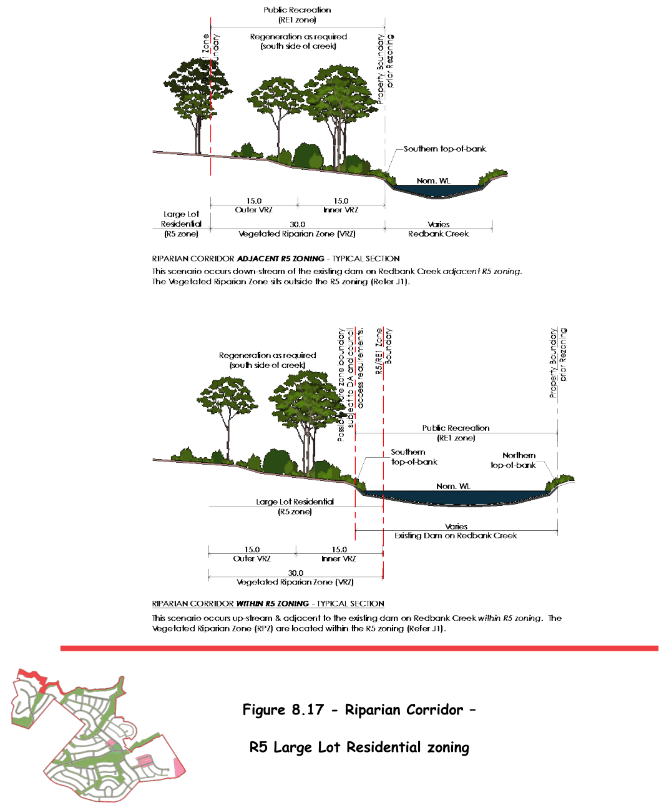

> [Picture on page 38: a picture, saved as a picture (images/ch-08-00-redbank-at-north-richmond-page-38-4.gif, 150 dpi).]

#### Figure 8.17 - Riparian Corridor – R5 Large Lot Residential zoning

Riparian Corridor – R2 Low Density Residential and RE1 Public Recreation Zonings

The following sections address the Redbank Creek Riparian Corridor in relation to R2 Low Density Residential and RE1 Public Recreation zonings.  They highlight the extents of the Vegetated Riparian Zone (VRZ).

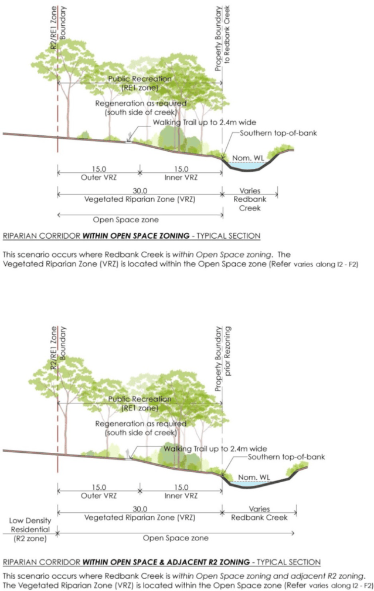

> [Picture on page 39: a picture, saved as a picture (images/ch-08-00-redbank-at-north-richmond-page-39-4.gif, 150 dpi).]

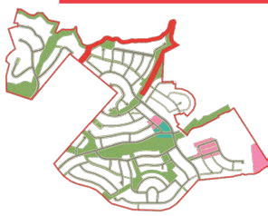

> [Picture on page 39: a picture, saved as a picture (images/ch-08-00-redbank-at-north-richmond-page-39-5.gif, 150 dpi).]

Figure 8.18 - Riparian Corridor – R2 Low Density Residential + RE1 Public Recreation zonings

Riparian Corridor - RE1 Public Recreation Zoning

The following sections address Riparian Corridors within the RE1 Public Recreation zoning and adjacent to the R2 Low Density Residential zoning.  They highlight the extents of the Vegetated Riparian Zone (VRZ).

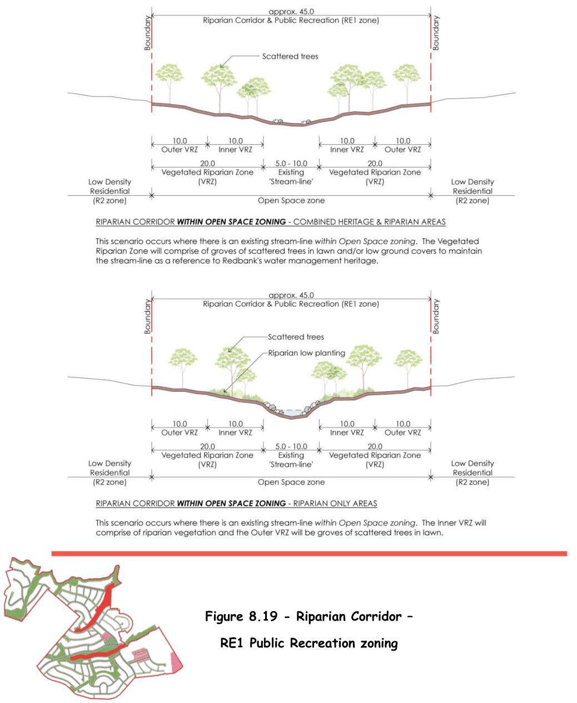

> [Picture on page 40: a picture, saved as a picture (images/ch-08-00-redbank-at-north-richmond-page-40-4.gif, 150 dpi).]

Figure 8.19 - Riparian Corridor –
