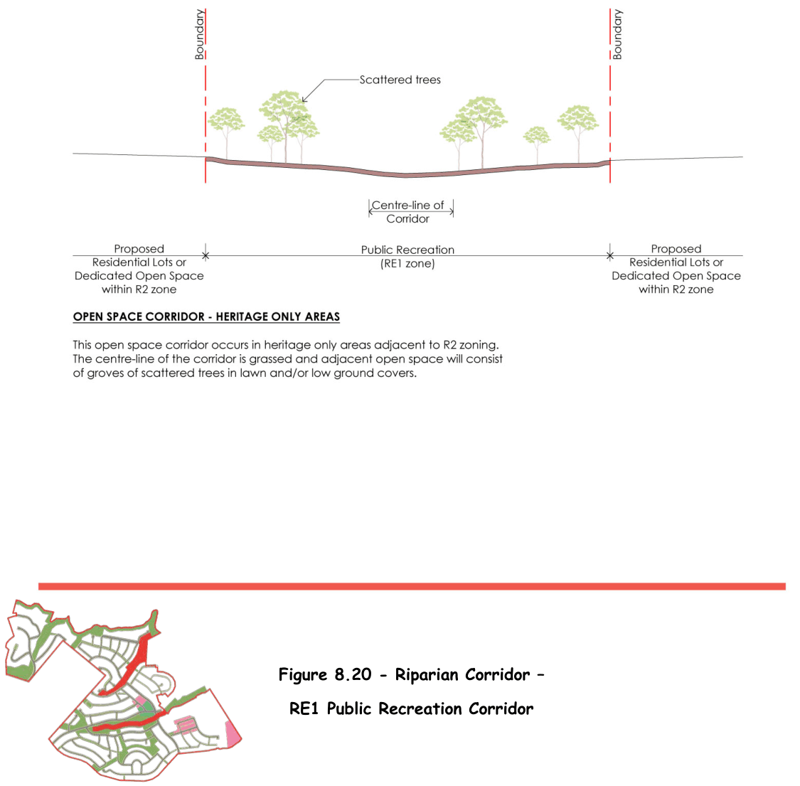

#### RE1 Public Recreation zoning

Riparian Corridor – RE1 Public Recreation Zoning

The following sections address Riparian Corridors within the RE1 Public Recreation zoning and adjacent to R2 Low Density Residential zoning.  They highlight the extents of the Vegetated Riparian Zone (VRZ).

> [Picture on page 41: a picture, saved as a picture (images/ch-08-00-redbank-at-north-richmond-page-41-4.gif, 150 dpi).]

Figure 8.20 - Riparian Corridor –
