#### RE1 Public Recreation Corridor

#### 8.3.7 MOVEMENT NETWORK

#### Objectives

(a) To create multi- functional streets that provide for the safe and efficient movement of vehicles, pedestrians and cyclists and include on-street car parking where appropriate.

(b) To create a distinct sense of place that responds to topography, natural landscape features and significant elements of the Yeomans’ system.

(c) To create a connected and permeable street network that integrates with the surrounding street network.

(d) To incorporate water cycle management into streets.

(e) To provide for and encourage more sustainable modes of movement, including public transport, walking and cycling.

(f) To enable convenient, safe and comfortable walking and cycling through a connected network of on-street and off-street pedestrian and cycle paths that links the neighbourhood centre, Peel Park and all other public open space and all residential areas.

#### Development Controls

Street Network

1\. The higher-order street network is to be provided generally in accordance with Figure 8.22.

2\. Streets are designed generally in accordance with Figure 8.23 through to Figure 8.49. It is not intended that these figures address all road configurations, special consideration may need to be given to other road configurations such as laneways and access ways. The characteristics and requirements for other roads will be assessed on merit as part of any relevant development application. The options shown for road design in these figures may be considered as a variation to the Road Alignment requirements of Appendix E of the DCP.  Any other variations will need to address relevant provisions of the endorsed Conservation Management Plan and the following criteria:

i. adequate manoeuvring for vehicles including commercial, service and emergency vehicles

ii. adequate on-street parking

iii. footpath provision on at least one side of the street

iv. cycleway provision

A lot layout and driveway location plan is to accompany the variation request and development application and demonstrate the abovementioned items can be achieved.

3\. No direct vehicle vehicular access of an individual lot is permitted to or from Grose Vale Road.

4\. The Entry Drive and Collector roads are to provide a distinctly rural character and an historic sense of place at the entry from Grose Vale Road.   Any landscape treatment including signage, fencing, gates, statues, lighting and walls are to be:

i. local rural identity in character

ii. a natural landscape style that is responsive to and reflective of the heritage and rural values of the setting rather than a formal or feature garden bed style

iii. primarily natural colours (e.g. earth tones) and materials such as timber

iv. of robust design, durable  materials and treatments e.g. resistant to weather and graffiti

v. a design that integrates local natural, agricultural or site references in any public art elements

vi. of low height and scale and have simple lines, textures and treatments

5\. To accompany any development application for an entry treatment, a landscape design plan shall be prepared for Council’s approval to show plan and section drawings of the existing features of the site at the same scale as the site plan and address the items in Development Control 4 above.

6\. Prior to construction of the Entry Drive and Collector roads, a landscape management plan shall be prepared for Council’s approval to show how the landscape treatment will be implemented and maintained for the first 12 months after planting.  The management plan is to include site specific details to address:

i. Weed control and management

ii. Root and drip line protection during construction and other measures in accordance with Australian Standard AS 4970-2009 - Protection of trees on development sites.

iii. Suitable alternate replacement species for long term management

7\. On completion of the landscaping works, prior to handover of any land to Council a landscape certification shall be provided by a landscape architect together with an implementation report to Council. This will provide written certification that the works have been completed in accordance with any relevant approval (e.g. DA or CC) and address the items in Development Controls 4 and 5 above.

8\. The Entry Drive is to be aligned to create a view corridor to the neighbourhood centre and adjoining public open space and waterbody.

9\. The Collector Roads are to be aligned to create a view corridor from Grose Vale Road through the site to the central linear park, neighbourhood centre and its adjoining waterbody.

10\. Water sensitive urban design is to be incorporated within identified streets, in particular keyline verges, to capture and infiltrate stormwater.

11\. Where bordering public open space, streets are to maximise opportunities for pedestrian and cyclist access and casual surveillance.

12\. Street furniture is to include seating in conjunction with street lighting and lighting of selected adjacent open space areas is to enhance the attractiveness, comfort and safety of streets and adjacent areas.

13\. Street trees are to be provided on all streets and:

i. reinforce the street hierarchy and create distinct places

ii. comprise a co-ordinated palette of climatically responsive, robust and low-maintenance species

iii. are to be planted in a co-ordinated, regularly spaced and formalised manner.

Mobility - Pedestrian and Cycle Network

14\. Footpaths and dual use pedestrian cycle paths are to be provided on both sides of all roads where there are frontages to houses or other buildings and on street frontages to the Neighbourhood Centre, with footpaths or dual use pedestrian cycle path to be provided on a minimum of one side of all roads where there are frontage to houses or other buildings.  However, within the ‘rural valley’ precinct no footpaths are required to be provided.

15\. Pedestrian and cycle paths are to be located and designed to suit the Vision Plan (Figure 8.3) and Figure 8.21 providing connectivity between pedestrian paths within Redbank generally, and the dual use pedestrian/cycle paths along the Keyline Elements Corridor within the site.

16\. The use of roundabouts is generally not supported unless intersections are designed to provide an emphasis on pedestrian friendly design.  Pedestrian refuges and crossing points are to align with pedestrian desire lines and bus stops.

Mobility - Bus Network

17\. A bus network is to be provided generally in accordance with Figure 8.21.

18\. Bus stops are to be located within the neighbourhood centre and generally to serve 400m walking catchments.

19\. Bus stops are to be located and designed to be:

i. easily accessible and highly visible from the street network

ii. integrated with the pedestrian and cycle network

iii. provided with facilities appropriate to their forecast usage (e.g. lighting and signage, and shelters and seating)

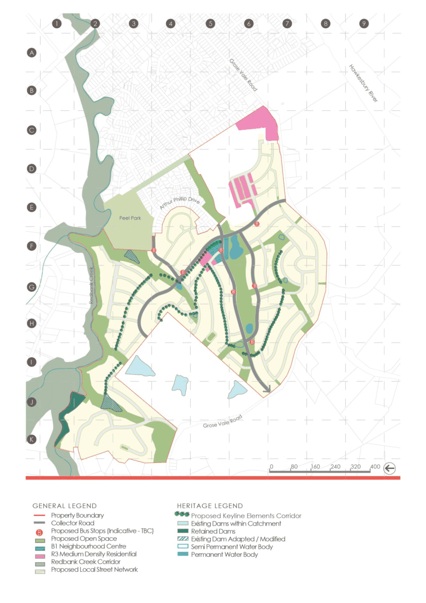

> [Picture on page 45: a picture, saved as a picture (images/ch-08-00-redbank-at-north-richmond-page-45-1.gif, 150 dpi).]

#### Figure 8.21 Public Transport and Cycleway Plan

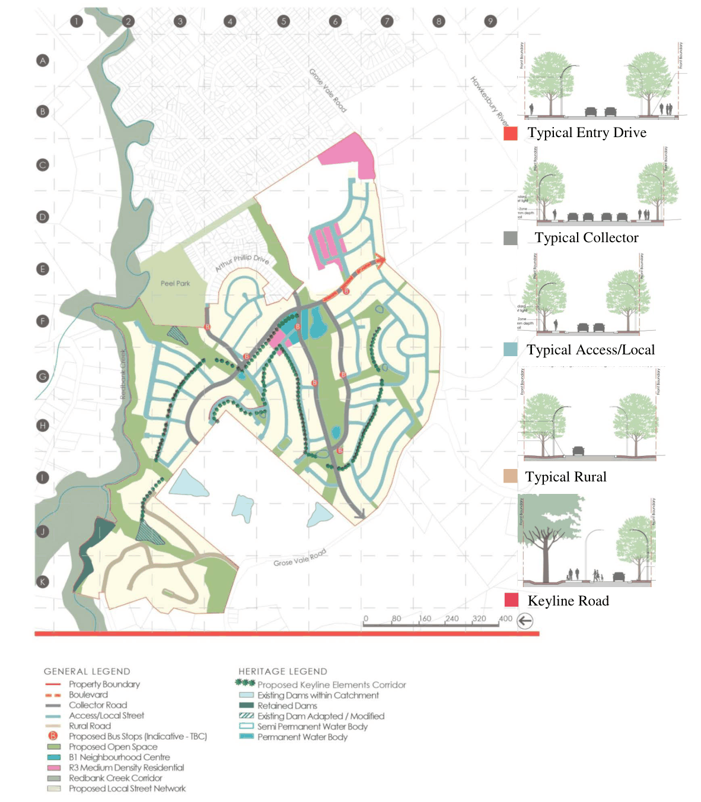

> [Picture on page 46: a picture, saved as a picture (images/ch-08-00-redbank-at-north-richmond-page-46-1.gif, 150 dpi).]
> Words printed on the picture (title and legend, copied from the PDF):
> Typical Entry Drive
> Typical Collector
> Typical Access/Local
> Typical Rural
> Keyline Road

#### Figure 8.22 - Street Hierarchy Plan

Verge Variations - Footpath

These verge variations show four (4) different arrangements for footpath, grass and trees in relation to the kerb.  Verges with footpaths are to be 4.5m wide and verges without footpaths are to be 3.5m wide.  These variations allow for flexibility in the design of road verges in response to existing and proposed site specificities.

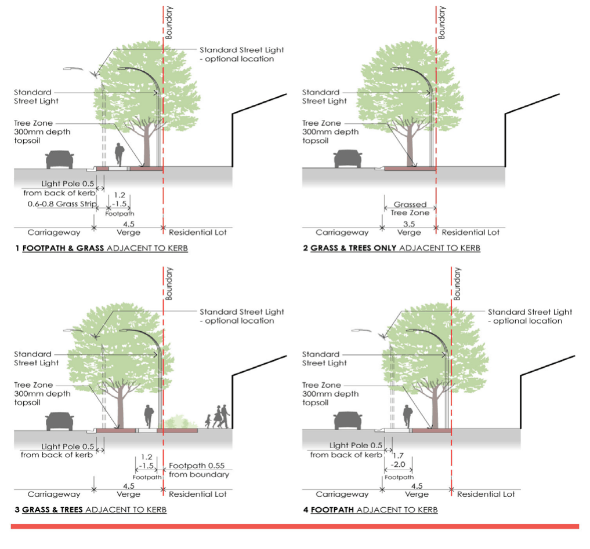

> [Picture on page 47: a picture, saved as a picture (images/ch-08-00-redbank-at-north-richmond-page-47-5.gif, 150 dpi).]

#### Figure 8.23 - Verge Variations - Footpath

Variations – Grading

These verge variations include four (4) options addressing steeply sloping roads and two (2) options with allowances for Water Sensitive Urban Design (WSUD) swales within the verge.

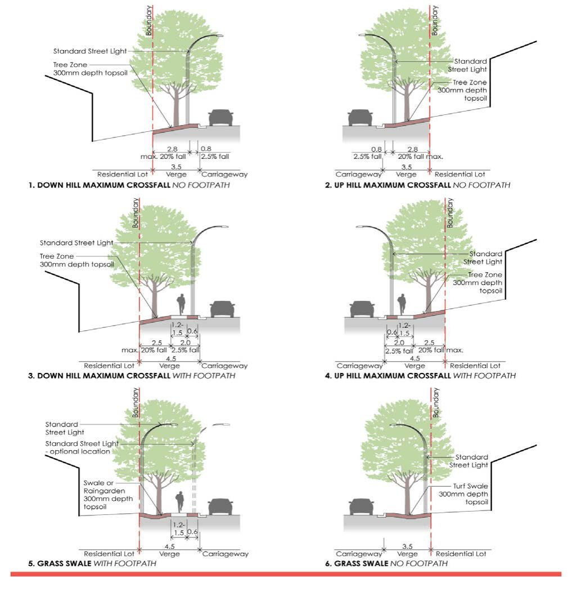

> [Picture on page 48: a picture, saved as a picture (images/ch-08-00-redbank-at-north-richmond-page-48-4.gif, 150 dpi).]

#### Figure 8.24 - Verge Variations – Grading

Driveways - Typical Treatment

Driveways will typically transition across front property boundaries into road reserves.  The driveway treatment within residential lots is to be selected by the owner.  The footpath or shared path is to be clearly defined with a continuous typical treatment of broom finished concrete without tooled margins.  The driveway and layback extending to the carriageway is to be in accordance with Council’s Driveway Specification.

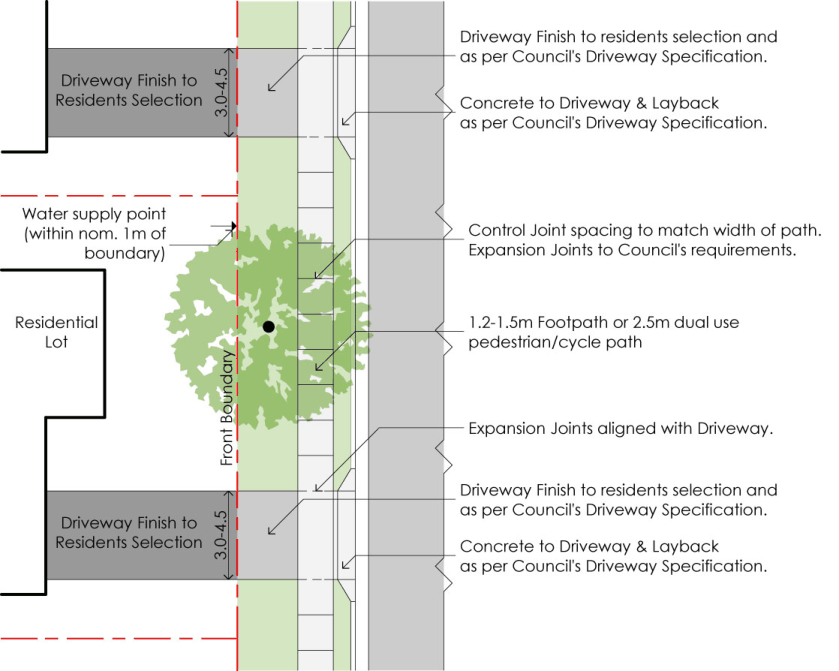

> [Picture on page 49: a picture, saved as a picture (images/ch-08-00-redbank-at-north-richmond-page-49-6.gif, 150 dpi).]

#### Figure 8.25 - Driveways – Typical Treatment

Road With One-Way Cross-Fall

Roads located on sloping sites with a kerb-to-kerb one-way cross-fall will require a kerb and gutter on the lower edge only. The higher edge shall be an upstand kerb.

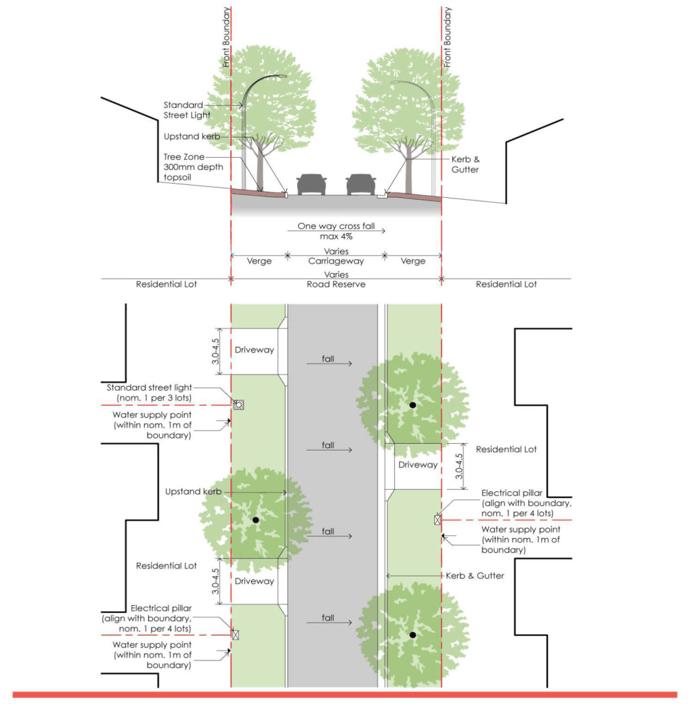

> [Picture on page 50: a picture, saved as a picture (images/ch-08-00-redbank-at-north-richmond-page-50-4.gif, 150 dpi).]

#### Figure 8.26 – Road with one-way cross-fall

13m Access Street (where street serves less than 10 properties)

Access streets are the smallest proposed streets.  At 13m wide, these streets cater for low traffic volume with a 6m wide carriageway allowing for two vehicles to pass side-by-side.  Verges are to be 3.5m wide with grass and trees centrally located.  Access roads occur within the R2 Low Density Residential and R3 Medium Density Residential zoning.

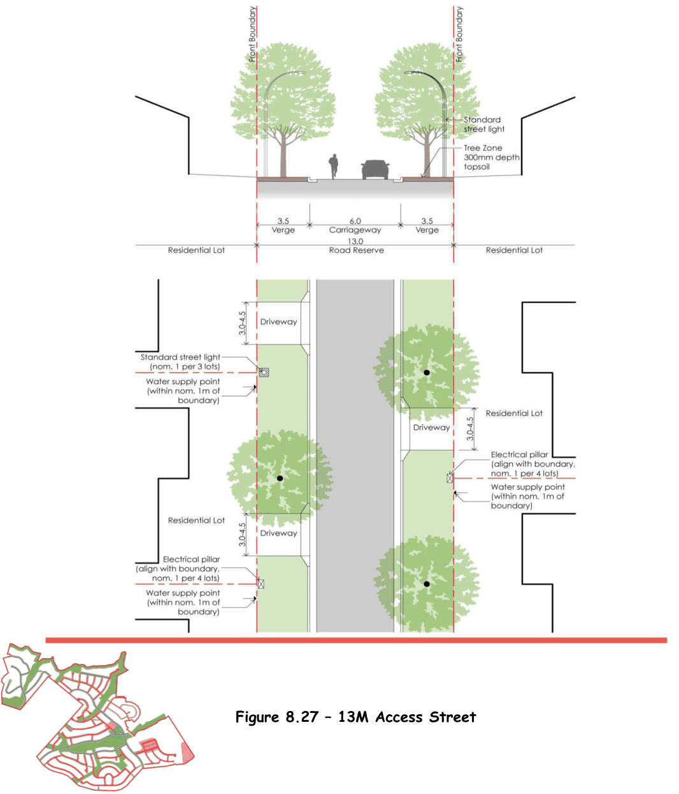

> [Picture on page 51: a picture, saved as a picture (images/ch-08-00-redbank-at-north-richmond-page-51-5.gif, 150 dpi).]

Figure 8.27 – 13M Access Street

Access Street With Footpath (where street serves less than 10 properties)

This street type is essentially the same as the 13m Access Street but is 1m wider to accommodate a target grass area width even with a 1.2-1.5 footpath being included.

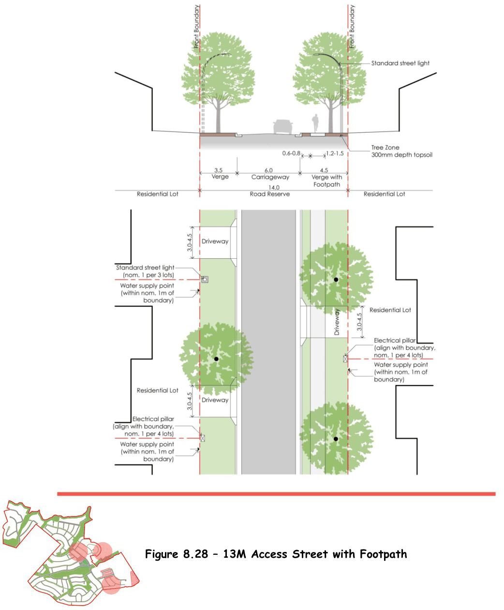

> [Picture on page 52: a picture, saved as a picture (images/ch-08-00-redbank-at-north-richmond-page-52-4.gif, 150 dpi).]

Figure 8.28 – 13M Access Street with Footpath

16m Local Street

Local streets are average-size streets proposed for local residential use.  At 16m wide, these streets cater for medium traffic volume with an 8m wide carriageway allowing for two vehicles to pass side-by-side and an additional parked vehicle.  Verges are to be 3.5m wide with grass and tree only and 4.5m wide with paved footpath, tree and grass.  Local streets occur within the R2 Low Density Residential and R3 Medium Density Residential zoning.

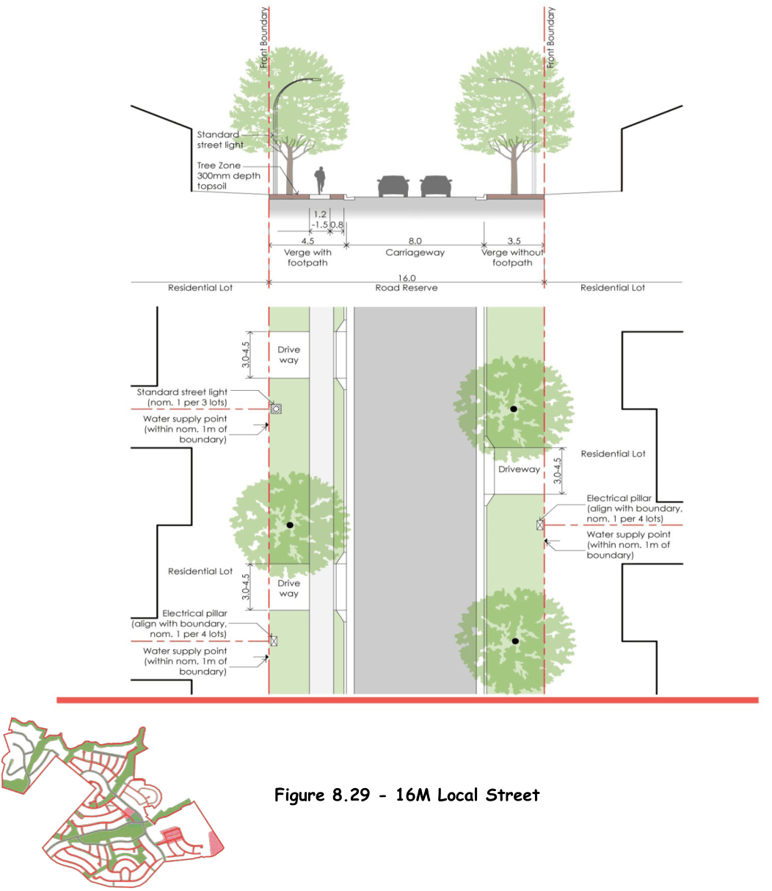

> [Picture on page 53: a picture, saved as a picture (images/ch-08-00-redbank-at-north-richmond-page-53-6.gif, 150 dpi).]

Figure 8.29 - 16M Local Street

Local Street Variation - Adjacent To Open Space

Local streets adjacent to open space zoning are 14m wide, maintaining an 8m wide carriageway and one 4.5m wide verge with or without paved footpath, tree and grass.  The verge adjacent to open space is only 1.5m wide to allow for street lighting, otherwise creating easy access and open vistas to parklands.  This type of local street occurs within the

R2 Low Density Residential and R3 Medium Density Residential zoning.

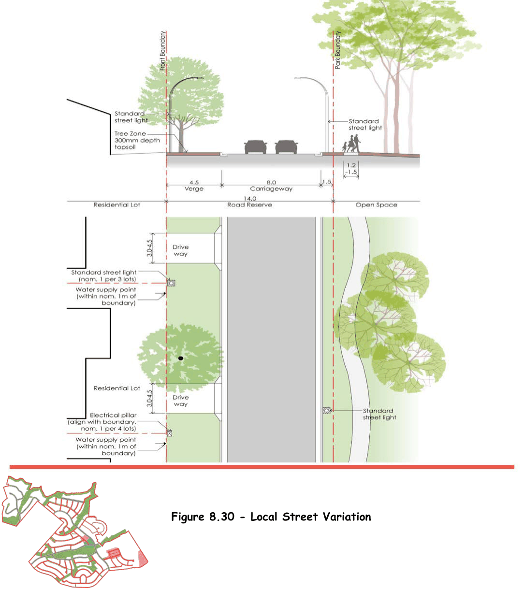

> [Picture on page 54: a picture, saved as a picture (images/ch-08-00-redbank-at-north-richmond-page-54-6.gif, 150 dpi).]

Figure 8.30 - Local Street Variation

Street Adjacent Neighbouring Development

This street is proposed as the interface between the R2 – Low Density Residential Area and the existing Seniors Living Development which also is of an R3 zoning. It provides for a widened verge at the interface corridor.

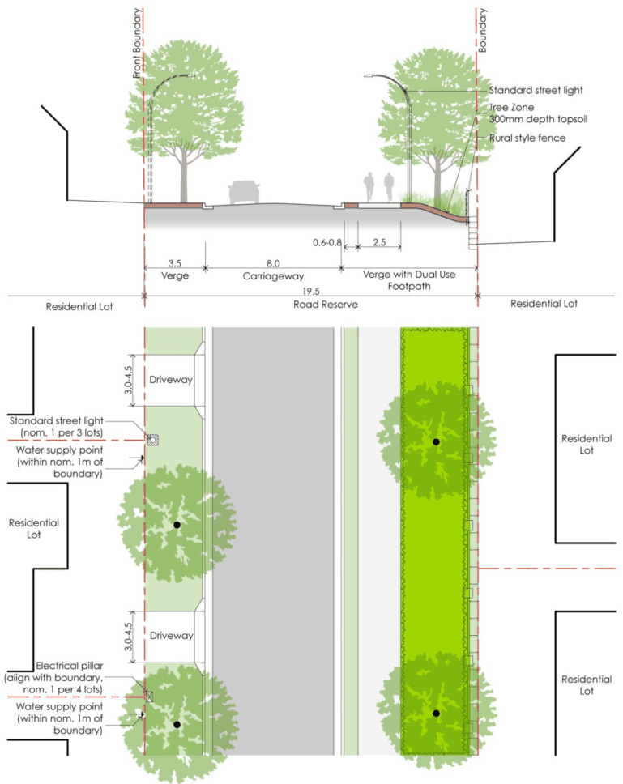

> [Picture on page 55: a picture, saved as a picture (images/ch-08-00-redbank-at-north-richmond-page-55-4.gif, 150 dpi).]

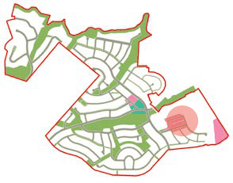

> [Picture on page 55: a picture, saved as a picture (images/ch-08-00-redbank-at-north-richmond-page-55-5.gif, 150 dpi).]

#### Figure 8.31 – Street adjoining Seniors Living Development

Local Street Variation - Within Transmission Line Easement (on-street parking)

Local streets which are proposed along the existing transmission line are to be dual carriageway, each at 3m wide.  A 14m wide median strip is to act as a buffer and base for the transmission line power poles, with car parking located on both sides of the median strip.  Verges are to be 5.0m wide and extend beyond the 30m easement to allow for a buffer and tree zone.  This type of local street occurs within the R2 Low Density Residential zoning.

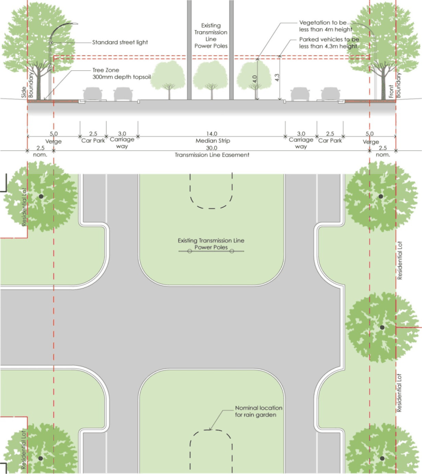

> [Picture on page 56: a picture, saved as a picture (images/ch-08-00-redbank-at-north-richmond-page-56-6.gif, 150 dpi).]

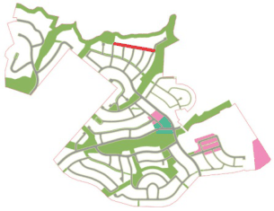

> [Picture on page 56: a picture, saved as a picture (images/ch-08-00-redbank-at-north-richmond-page-56-7.gif, 150 dpi).]

#### Figure 8.32 - Local Street Variation

Local Street Variation - Within Transmission Line Easement (No Parking)

Local streets which are proposed along the existing transmission line are to be dual carriageway, each at 3m wide. There will be no on-street parking in this option. A 19m wide median strip is to act as a buffer and base for the transmission line power poles. Verges are to be 5.0m wide and extend beyond the 30m easement to allow for a buffer and tree zone.  This type of local street occurs within the R2 Low Density Residential zoning.

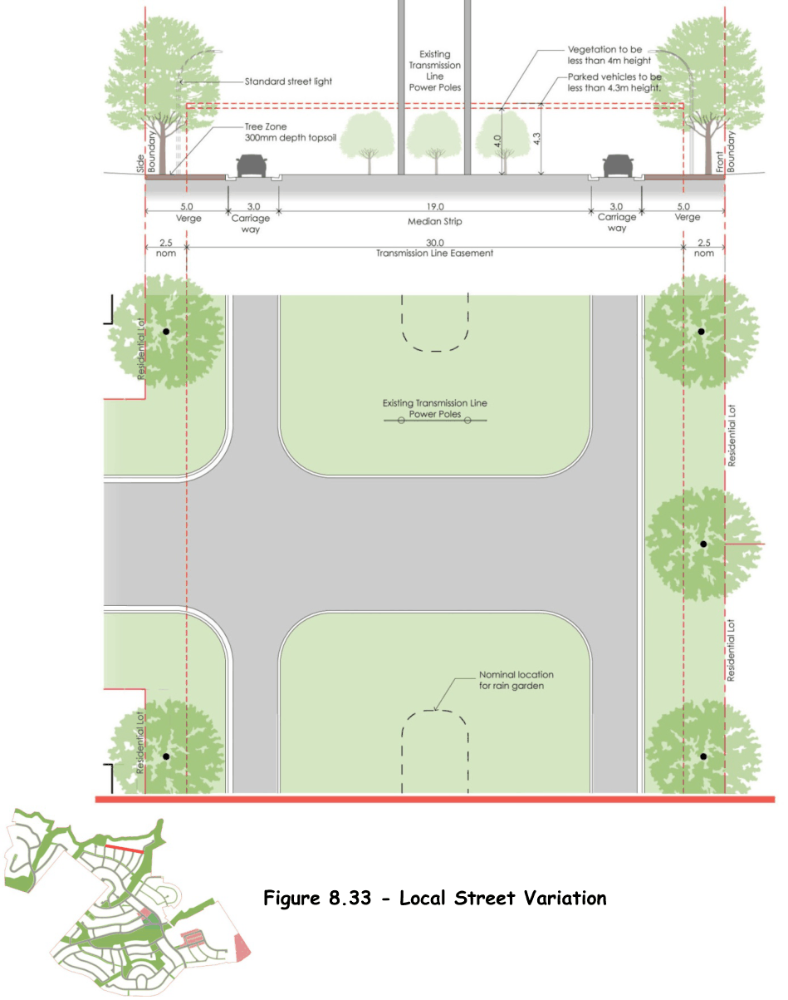

> [Picture on page 57: a picture, saved as a picture (images/ch-08-00-redbank-at-north-richmond-page-57-6.gif, 150 dpi).]

Figure 8.33 - Local Street Variation

Street Adjacent To Keyline Elements Corridor- Rear and Front Property Boundaries

Streets adjacent to the Keyline Elements Corridor (KEC) are to have a standard carriageway width of 8m.  A 3m wide verge with grass and trees is to be provided adjacent the front property boundary.  On the other side of the street, the KEC it to be 10m wide and cater for a dual path and 'Keyline' tree and swale.  The adjacent property with rear boundary backing onto the KEC sits at a higher level, requiring a retaining wall and 1m nominal high fence on the rear boundary. This scenario occurs within the R2 Low Density Residential zoning.

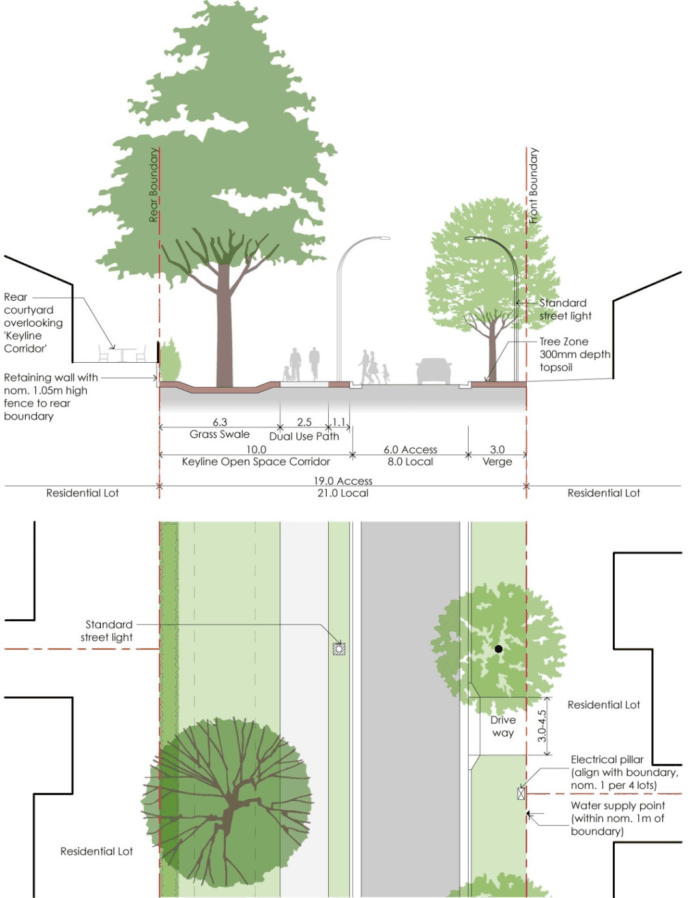

> [Picture on page 58: a picture, saved as a picture (images/ch-08-00-redbank-at-north-richmond-page-58-7.gif, 150 dpi).]

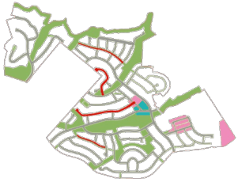

> [Picture on page 58: a picture, saved as a picture (images/ch-08-00-redbank-at-north-richmond-page-58-8.gif, 150 dpi).]

#### Figure 8.34 - Keyline Elements Corridor Street Variation

Street with Keyline Elements Corridor in the Central Median

Streets with front boundaries adjacent to the Keyline Elements Corridor (KEC) are to be dual carriageway, each at 5.5m

wide.   There is to be an 8m wide central median incorporating the KEC dual shared path and 'Keyline' tree and swale. This arrangement will eliminate driveway crossings to the KEC, thus accentuating the continuity of this significant heritage landscape feature.  Verges adjacent to these front property boundaries are to be 3.5m wide with grass and

tree. This scenario occurs within the R2 Low Density Residential zoning.

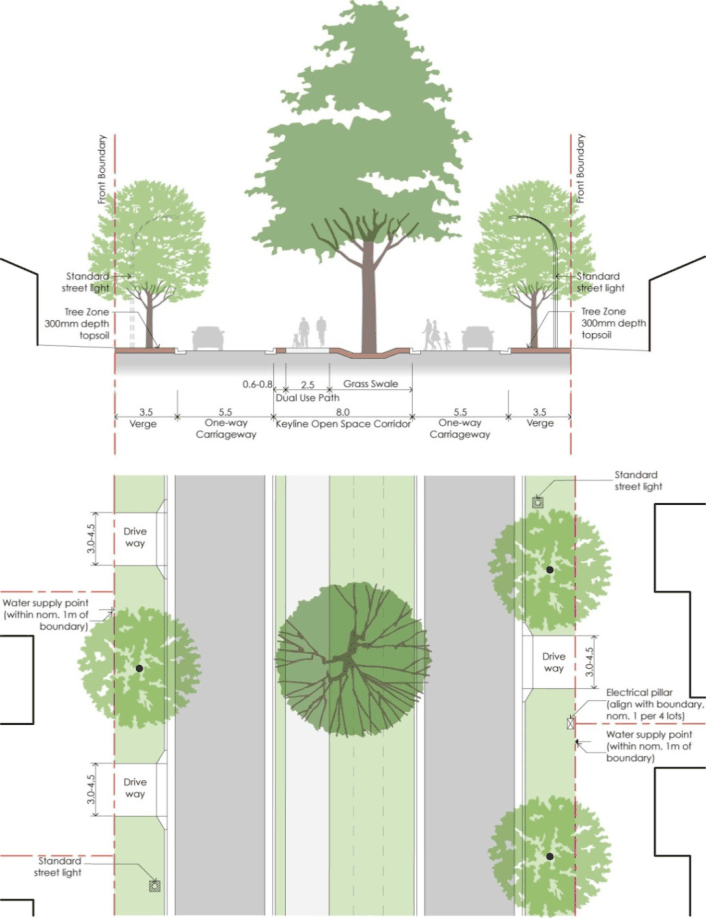

> [Picture on page 59: a picture, saved as a picture (images/ch-08-00-redbank-at-north-richmond-page-59-7.gif, 150 dpi).]

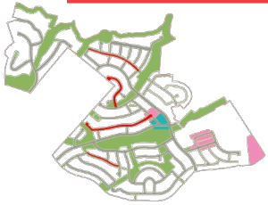

> [Picture on page 59: a picture, saved as a picture (images/ch-08-00-redbank-at-north-richmond-page-59-8.gif, 150 dpi).]

#### Figure 8.35 - Keyline Elements Corridor Street Variation

Street Adjacent To Keyline Element Corridor - Front Property Boundaries

Streets adjacent to the Keyline Elements Corridor (KEC) are to have a standard carriageway width of 6m for access streets and 8m for local streets.  A 3m wide verge with grass and tree is to be provided adjacent to one of the front property boundaries.  On the other side of the street, the KEC is to be 10m wide and cater for a dual path and 'Keyline' tree and swale.  The adjacent property sits at grade to the key line, with driveway access crossing over the KEC.  This scenario occurs within the R2 Low Density Residential zoning.

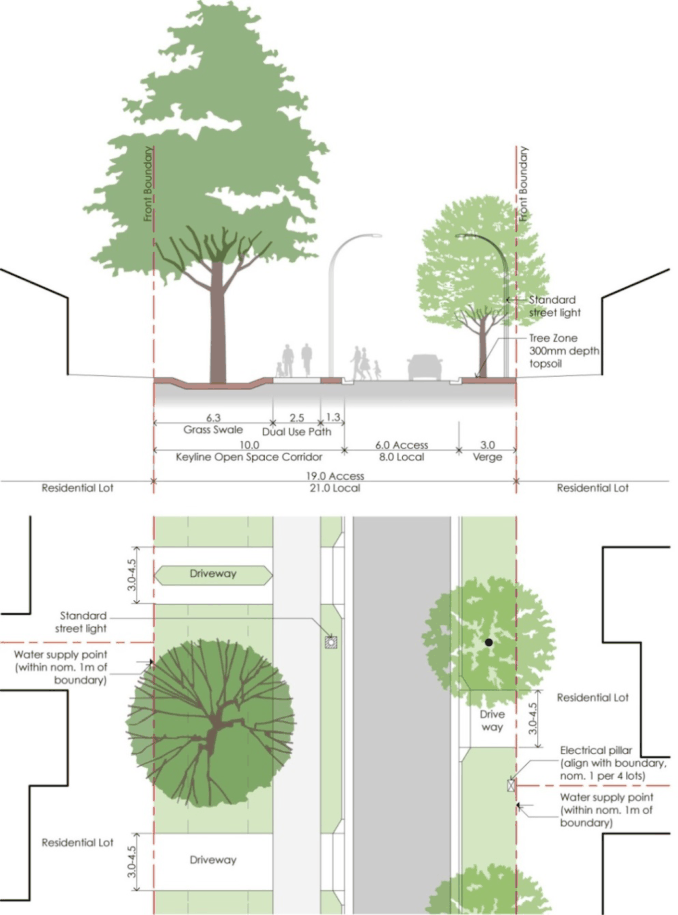

> [Picture on page 60: a picture, saved as a picture (images/ch-08-00-redbank-at-north-richmond-page-60-7.gif, 150 dpi).]

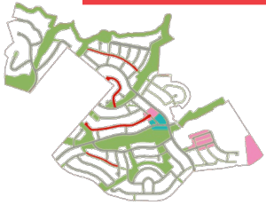

> [Picture on page 60: a picture, saved as a picture (images/ch-08-00-redbank-at-north-richmond-page-60-8.gif, 150 dpi).]

#### Figure 8.36 - Keyline Elements Corridor Street Variation

Driveways – Keyline Crossings

Front facing lots adjacent to the Keyline Elements Corridor (KEC) are to contain driveway crossings over the keyline swale.  The finished level of each driveway is to be a minimum 100mm above the finished level of the adjacent swale. This swale functions as a grassed element that retains water between the driveways during rain events.  This scenario occurs within the R2 Low Density Residential zoning.

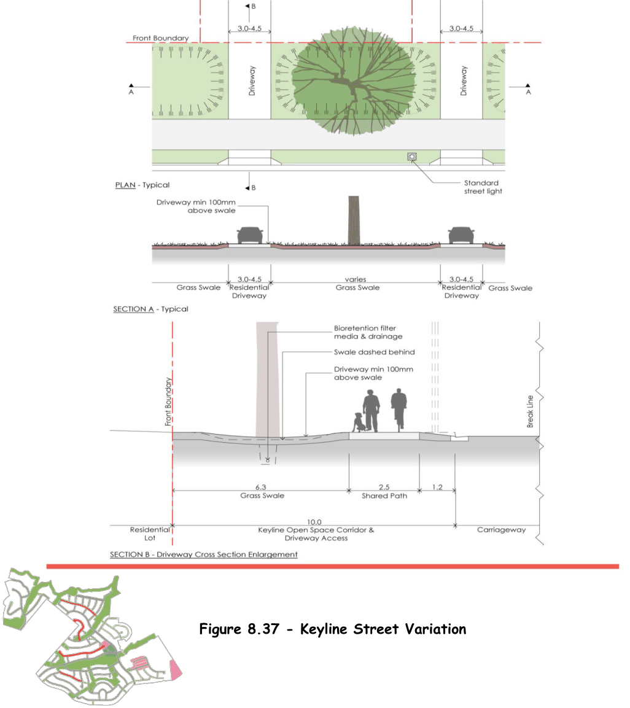

> [Picture on page 61: a picture, saved as a picture (images/ch-08-00-redbank-at-north-richmond-page-61-6.gif, 150 dpi).]

Figure 8.37 - Keyline Street Variation

Rural Road

Rural type roads occur only within the R5 Large Lot Residential zoning.  These roads have broad verges with grass swales to channel storm water run-off.  Trees are centrally located within the swale, channeling additional water to the root zone during rain events.  A flush kerb further facilitates the storm water run-off to drain toward the swale.  The carriageway is to be a minimum of 7.5m wide to allow two vehicles to easily pass side-by-side.

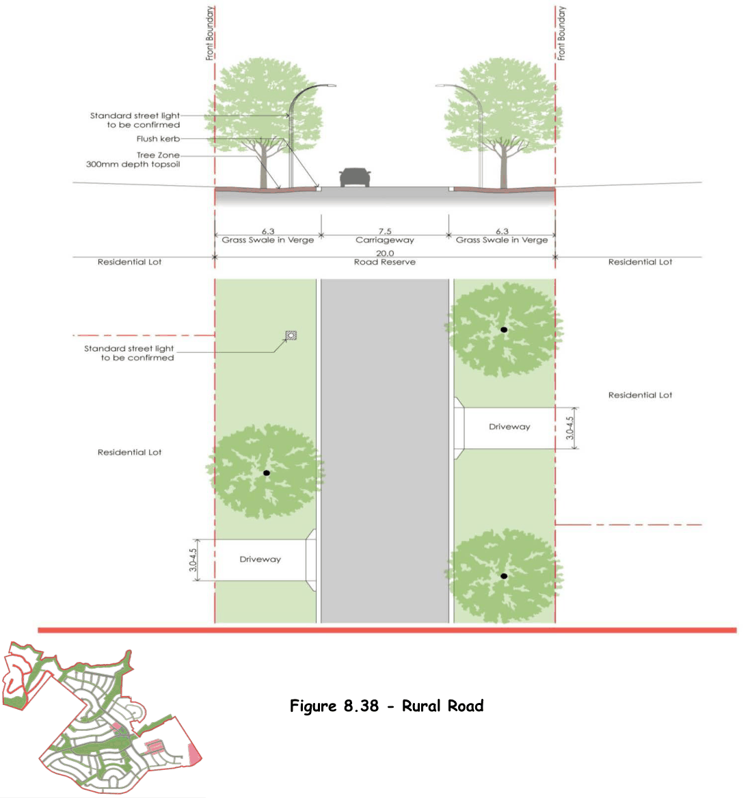

> [Picture on page 62: a picture, saved as a picture (images/ch-08-00-redbank-at-north-richmond-page-62-6.gif, 150 dpi).]

Figure 8.38 - Rural Road

Collector Road

Collector roads are to be the primary road providing connections across the site and linking local streets. Collector roads are to have an 11m wide carriageway allowing two lanes of traffic to pass side-by-side, as well as cars parked adjacent to kerbs. The typical collector road is to have an overall road reserve of 21m with a 4.5m wide verge supporting a paved footpath, trees and grass on one side. Opposite there is to be a 5.5m verge supporting a shared path, trees and grass. The collector road occurs within the R2 Low Density Residential, R3 Medium Density Residential and B1 Neighbourhood Centre zoning.

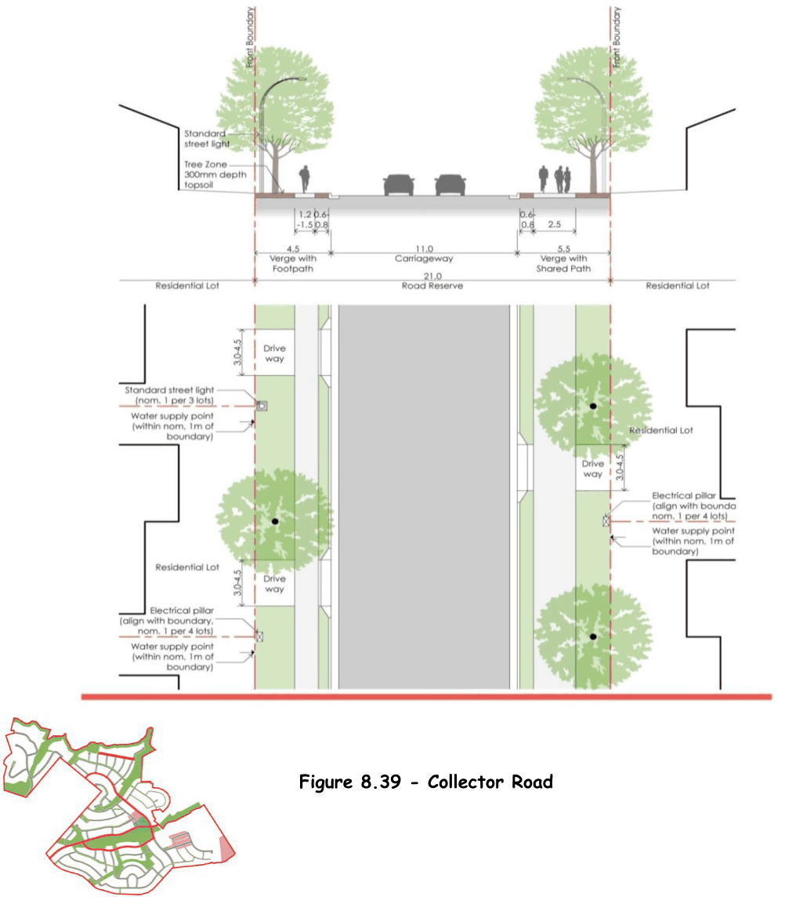

> [Picture on page 63: a picture, saved as a picture (images/ch-08-00-redbank-at-north-richmond-page-63-8.gif, 150 dpi).]

Figure 8.39 - Collector Road

Collector Road with Keyline Elements Corridor

This variation of the proposed street types shows the integration of a Collector Road and the Keyline Elements Corridor.

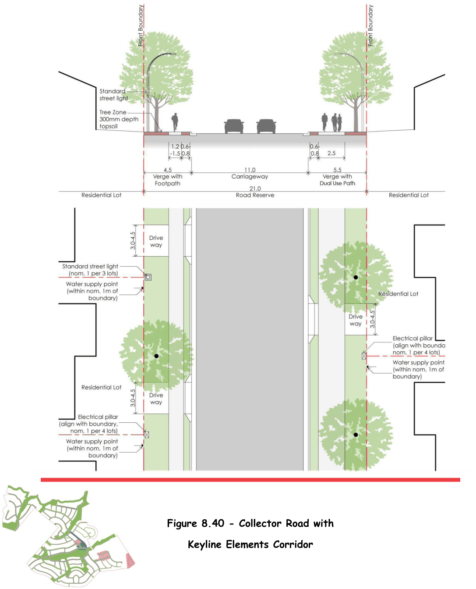

> [Picture on page 64: a picture, saved as a picture (images/ch-08-00-redbank-at-north-richmond-page-64-3.gif, 150 dpi).]

Figure 8.40 - Collector Road with

#### Keyline Elements Corridor

Collector Road Variation – Adjacent to Open Space

Collector roads adjacent to open space zoning are 17m wide, maintaining an 11m carriageway and one 4.5m wide verge with paved footpath, tree and grass.  The verge adjacent to open space is only 1.5m wide to allow for street lighting, otherwise creating easy access and open vistas to parklands.  A shared path is to be located within the open space.  This type of collector road occurs within the R2 Low Density Residential and R3 Medium Density Residential zoning.

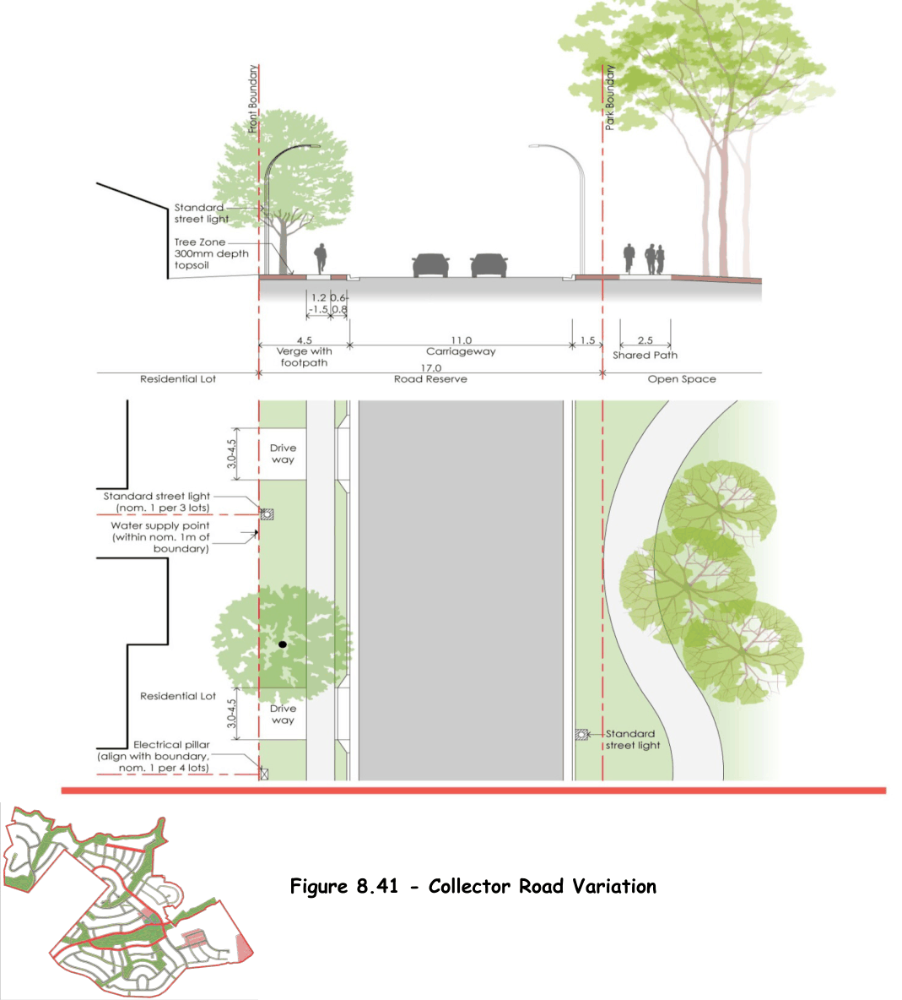

> [Picture on page 65: a picture, saved as a picture (images/ch-08-00-redbank-at-north-richmond-page-65-6.gif, 150 dpi).]

Figure 8.41 - Collector Road Variation

Collector Road Variation – Arthur Phillip Drive Extension

The proposed extension of Arthur Phillip Drive is to match the existing configuration with an 11m carriageway and 4.5m verges to both sides.  There is to be a footpath to one side and grass only to the other.  This type of collector road occurs within the R2 Low Density Residential zoning.

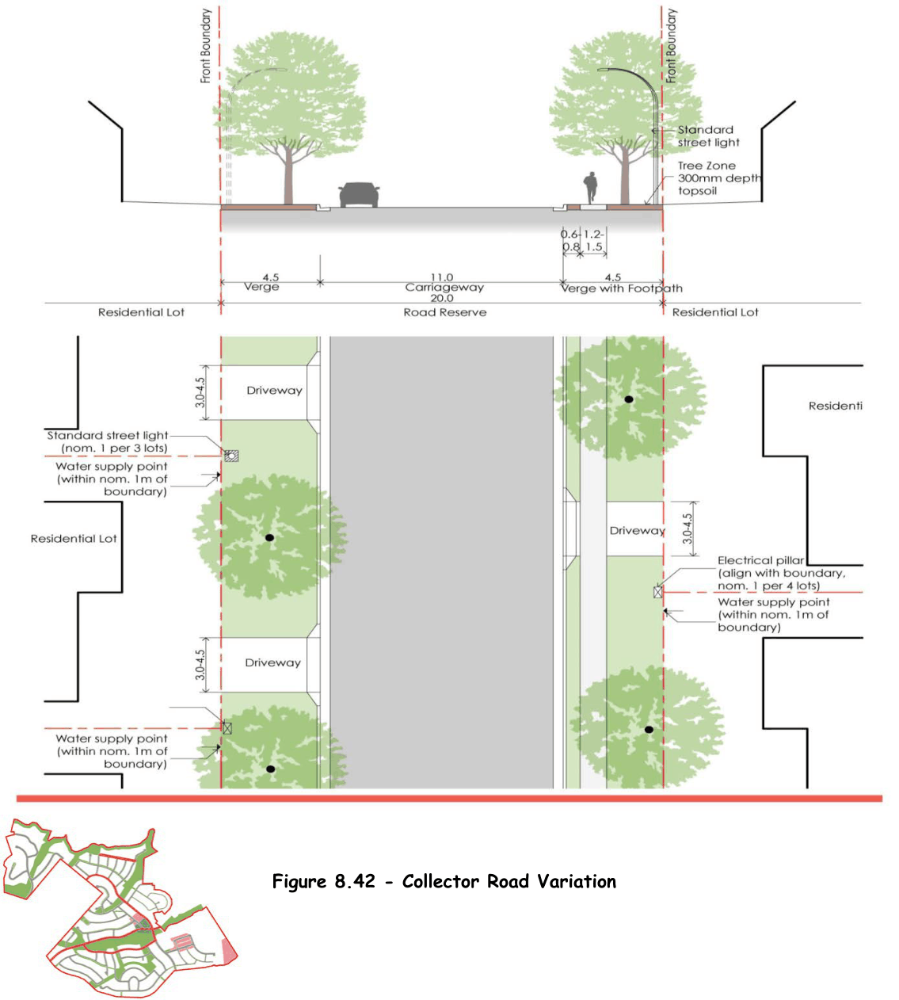

> [Picture on page 66: a picture, saved as a picture (images/ch-08-00-redbank-at-north-richmond-page-66-5.gif, 150 dpi).]

Figure 8.42 - Collector Road Variation

26m Entry Road - Adjacent Side and Back Boundaries

This scenario allows a 26m wide road reserve to cater for wide verges supporting boulevard trees, feature garden beds and public art.  This will provide a striking experience driving from Grose Vale Road to Redbank Neighbourhood Centre -creating an 'entry statement'.  The 11m carriageway allows for 2 vehicles to pass side-by-side as well as car parks adjacent the kerb.  This entry road option occurs in the R2 Low Density Residential zoning, and in particular, near the junction with Grose Vale Road where there will be side and rear property boundaries and no driveway crossings.

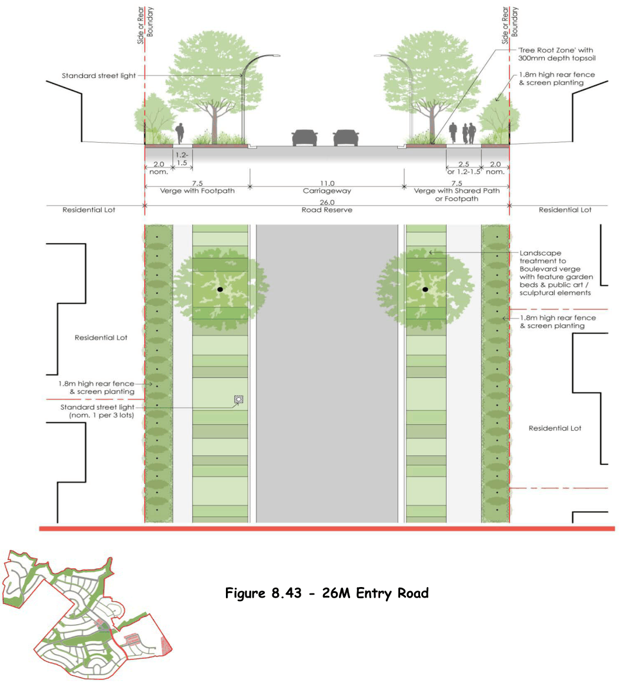

> [Picture on page 67: a picture, saved as a picture (images/ch-08-00-redbank-at-north-richmond-page-67-7.gif, 150 dpi).]

Figure 8.43 - 26M Entry Road

23m Entry Road – Adjacent Front Boundaries

This scenario allows a 23m wide road reserve to cater for wide verges supporting boulevard trees, footpaths and/or shared paths and front facing property boundaries.  The boulevard trees continue the 'entry statement' into Redbank Neighbourhood Centre, while grassed verges compliment the property frontages.  The 11m carriageway allows for 2 vehicles to pass side-by-side as well as car parks adjacent the kerb.  This entry road occurs in the R2 Low Density Residential zoning.

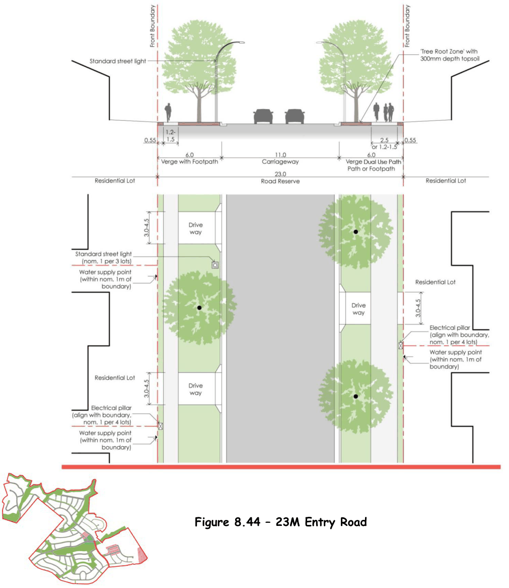

> [Picture on page 68: a picture, saved as a picture (images/ch-08-00-redbank-at-north-richmond-page-68-7.gif, 150 dpi).]

Figure 8.44 – 23M Entry Road

90° On-Street Car Parking

90° on-street car parking may occur in the neighbourhood centre where there will be higher density living and a higher demand for car parks for easy access to shops and facilities.  Tree plantings are to be located at regular intervals between car parks to provide additional visual amenity and shade for visitors to the neighbourhood centre.  Suitable transition provisions and distances are to be applied at interfaces with adjoining road types/widths.  Sets of bicycle racks are to be provided along the paved verges where appropriate.

Tree bays are to be spaced at a maximum of 21 metres or every 8 spaces, whichever is the lesser.  Each group of parking spaces is to be ‘bookended’ by tree bays.  At street frontages to the neighbourhood centre appropriate pedestrian pavement or raised threshold treatments are to be provided to align with tree bays, pedestrian desire lines and bus stops.  An on-street cycleway is to be provided within the 12 metre carriageway.

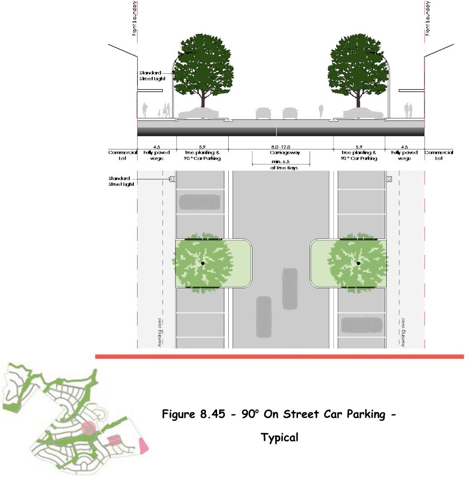

> [Picture on page 69: a picture, saved as a picture (images/ch-08-00-redbank-at-north-richmond-page-69-11.gif, 150 dpi).]

Figure 8.45 - 90o On Street Car Parking -

#### Typical

Pedestrian Paths and Pram Ramp Crossings – Typical Plan

Proposed pedestrian paths and pram ramps are to be consistent with Australian Standard - Design for Access and Mobility (AS 1428 set).

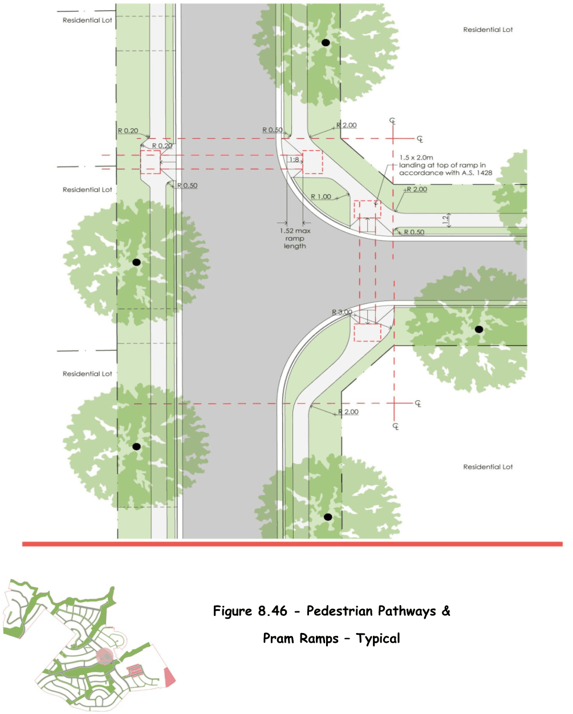

> [Picture on page 70: a picture, saved as a picture (images/ch-08-00-redbank-at-north-richmond-page-70-4.gif, 150 dpi).]

#### Figure 8.46 - Pedestrian Pathways &

#### Pram Ramps – Typical

Grose Vale Road

• Lots backing onto Grose Vale Road are to be approximately 40m deep

• 5-10m wide vegetated buffer is to be included in the rear of each lot

• Rural 'style' post and rail fence with wire mesh is to be installed on the Grose Vale Road boundary and landscaping is to be provided within the road reserve

• Where required, retaining walls may be built to accommodate level changes between Grose Vale Road and the rear of lots

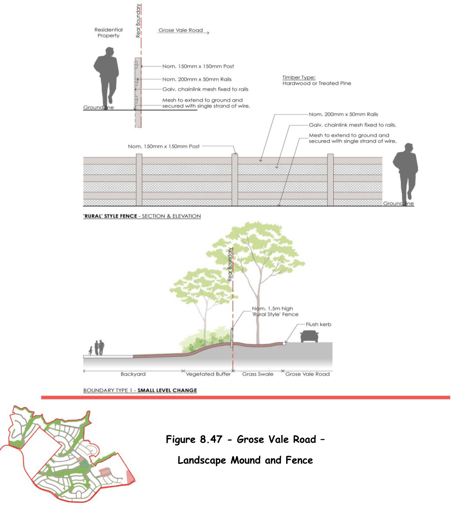

> [Picture on page 71: a picture, saved as a picture (images/ch-08-00-redbank-at-north-richmond-page-71-8.gif, 150 dpi).]

Figure 8.47 - Grose Vale Road –

#### Landscape Mound and Fence

Grose Vale Road

• Lots backing onto Grose Vale Road are to be approximately 40m deep

• 5-10m wide vegetated buffer shall be included in the rear of each lot

• Rural 'style' post and rail fence with wire mesh shall be installed on the Grose Vale Road boundary and landscaping is to be provided within the road reserve

• Where required, retaining walls shall be built to accommodate level changes between Grose Vale Road and

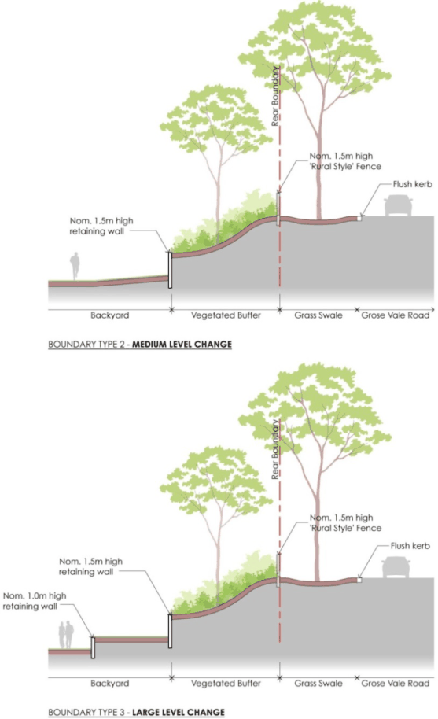

> [Picture on page 72: a picture, saved as a picture (images/ch-08-00-redbank-at-north-richmond-page-72-7.gif, 150 dpi).]

the rear of lots

#### Figure 8.48 - Grose Vale Road – Landscape Mound and Fence

Entry Road – Landscape Character

The Entry Road is to be characterised by a curving carriageway flanked by wide verges with shared path and footpath to either side, stretching from Grose Vale Road to the Redbank Neighbourhood Centre.  A strong ‘entry statement’ is initially created at the junction with Grose Vale Road via a feature wall wrapping around the rear and side property boundaries within the R2 Low Density Residential zoning.  The verge is to consist of boulevard trees under planted by feature garden beds and strategically placed public art to herald the entry into Redbank.  Further into the site, the verge is to narrow slightly to cater for front facing properties within R2 Low Density Residential zoning.  Here the verge allows for the continuation of boulevard trees, feature garden beds, shared path and footpath.

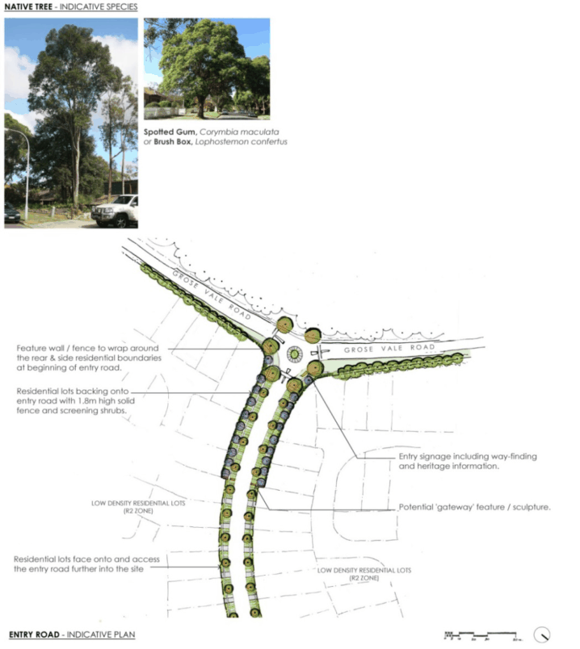

> [Picture on page 73: a picture, saved as a picture (images/ch-08-00-redbank-at-north-richmond-page-73-9.gif, 150 dpi).]

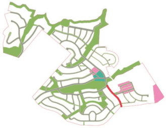

> [Picture on page 73: a picture, saved as a picture (images/ch-08-00-redbank-at-north-richmond-page-73-10.gif, 150 dpi).]

#### Figure 8.49 - Entry Road and Landscape
