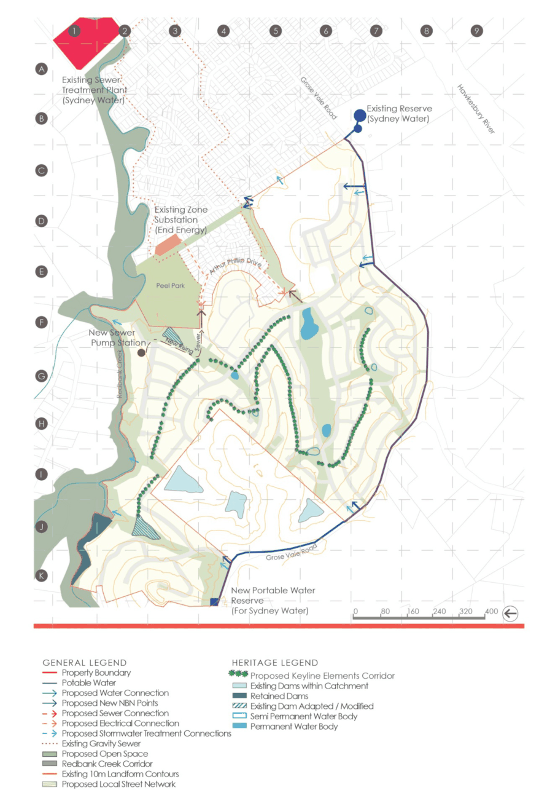

#### 8.3.9 UTILITY SERVICES

#### Objectives

(a) To provide water and sewer utility services to the site in a manner that:

i. provides for public health and convenience

ii. is of sufficient capacity to cater for the forecast needs of the site

iii. connects with the surrounding infrastructure

iv. avoids environmental harm

v. is provided in a logical and cost effective manner.

#### Development Controls

1\. Utility services are provided generally in accordance with Figure 8.50.

2\. Reticulated water and sewerage is to be provided to all lots.

> [Picture on page 75: a picture, saved as a picture (images/ch-08-00-redbank-at-north-richmond-page-75-1.gif, 150 dpi).]

#### Figure 8.50 - Utilities Plan
