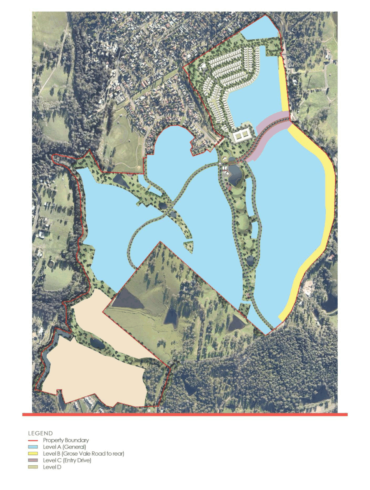
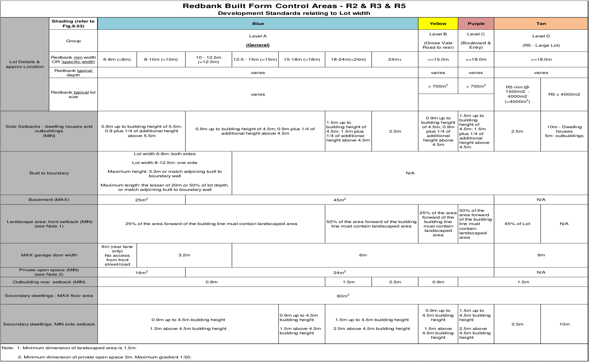

#### 8.3.10.1 SINGLE DWELLINGS, OUTBUILDINGS AND SECONDARY DWELLINGS

#### Development Controls

1\. The development within areas shown in Figure 8.51 is to satisfy requirements set out in Tables 8.3 and 8.4.

2\. Development on lots adjacent to Grose Vale Road is to appear as substantially single storey when viewed from Grose Vale Road.  The purpose of this control is to reduce the visual impact of development when viewed from Grose Vale Road and to allow for distant views from Grose Vale Road to the west.

3\. In order to achieve the stormwater quality objectives for Redbank all dwellings are to be provided with a 3000L minimum rain water tank which must be plumbed for internal use.

> [Picture on page 77: a picture, saved as a picture (images/ch-08-00-redbank-at-north-richmond-page-77-1.gif, 150 dpi).]

#### Figure 8.51 – Shading Plan

Table 8.3 – Built Form Controls for Single Dwellings, Outbuildings and Secondary Dwellings

| Redbank Built Form Control Areas - R2 & R3 & R5 Development Standards relating to Lot area |  |  |  |  |  |  |  |  |  |  |  |  |
|---|---|---|---|---|---|---|---|---|---|---|---|---|
| Lot Details & approx Location | Shading (refer to Fig.8.53) Group Redbank min width Redbank typical depth | Blue Level A (General) varies varies |  |  |  |  |  |  | Yellow Level B (Grose Vale Road to rear) >=15.0m varies | Purple Level C (Boulevard & Entry) >=18.0m varies | Tan Level D (R5 - Large Lot) >=18.0m varies |  |
|  | Redbank typical lot size OR 'specific lot area' | R3 min @ 180m2 - 250m2 (< 250m2) | R3 at 250m2 - 300m2 (< 300m2) | R3 at 300m2 - 450m2 (<450m2) R2 min @ 375m2 - 450m2 (<450m2) | 450-600m2 (<600m2) | 600-900m2 (<900m2) | 900-1500m2 (<1500m2) | 1500m2+ | > 700m2 | > 700m2 | R5 min @ 1500m2 - 4000m2 (<4000m2) | R5 ≥ 4000m2 |
| Dwelling Height (MAX) |  | 10m |  |  |  |  |  |  |  |  |  |  |
| Floor area (% lot area or m2) (MAX) |  | 90% | 85% | 270 | 330 | 380 | 430 |  | 380 | 380 | 430 | N/A |
| Total Site coverage (% of lot area) (MAX) |  | 65% | 60% | 55% | 50% | 50% | 40% | 30% | 50% |  | 30% | N/A |
| Rear Setback (MIN) |  | up to 4.5m = 3m above 4.5m = average of rear setbacks of adjoining dwelling houses or 10m, whichever is the lesser |  | up to 4.5m = 3m above 4.5m = 8m |  |  | up to 4.5m = 5m above 4.5m = 12m | up to 4.5m = 10m above 4.5m = 15m | Up to 4.5m = 5m above 4.5m = 12m |  | 15m - Dwelling houses + attachments to dwelling houses |  |
| Primary street setback (MIN) |  | 3.0m or average of adjoining residential development |  | 4.5m or average of adjoining residential development |  |  | 6.5m or average of adjoining residential development | 10.0m or average of adjoining residential development | 6.5m or average of adjoining residential development |  | Average of nearest two dwelling houses within 40m of lot, or 10m where two dwellings are not located within 40m of lot |  |
| Landscaping (MIN) See Note 1 |  | 10% |  | 15% | 20% | 30% | 40% | 45% | 30% | 30% | 45% | N/A |
| Private open space (MIN) |  | 16m² |  | 24m2 |  |  |  |  |  |  | N/A |  |
| Outbuilding: MAX floor area |  | 36m2 |  | 45m2 |  | 60m2 | 100m2 |  | 60m2 | 60m2 | 100m2 | 100m2 |
| Outbuilding: MAX height |  | 4.8m |  |  |  |  |  |  |  |  |  |  |
| Secondary dwellings: MAX height |  | 6m |  |  |  |  |  |  |  |  |  |  |
| Note: 1. Minimum dimension of landscaped area is 1.5m. 50% of landscaped area must be located behind the building line. |  |  |  |  |  |  |  |  |  |  |  |  |

Table 8.4 – Built Form Controls for Single Dwellings, Outbuildings and Secondary Dwellings

> [Picture on page 79: a map, saved as a picture (images/ch-08-00-redbank-at-north-richmond-page-79-2.gif, 150 dpi); the street names and other small labels are on the picture.]
> Words printed on the picture (title and legend, copied from the PDF):
> Redbank Built Form Control Areas - R2 & R3 & R5
> Development Standards relating to Lot width
> Shading (refer to
> Level B Level C
> (R5 - Large Lot)
> Road to rear)
> Redbank min width
> OR 'specific width'
> 6-8m (<8m) 8-10m (<10m)
> 10 - 12.5m
> 12.5 - 15m (<15m) 15-18m (<18m) 18-24m(<24m) 24m+ >=15.0m >=18.0m
> Lot Details &
> \> 700m2 > 700m2
> Redbank typical lot
> R5 ≥ 4000m2
> R5 min @
> 0.9m up to
> Side Setbacks - dwelling houses and
> of 4.5m; 0.9m
> 0.9m up to building height of 4.5m; 0.9m plus 1/4 of
> additional height above 4.5m
> 0.9m up to building height of 5.5m;
> 0.9 plus 1/4 of additional height
> 10m - Dwelling
> plus 1/4 of
> 1.5m up to
> building height of
> 4.5m; 1.5m plus
> 1/4 of additional
> height above 4.5m
> 1.5m up to
> plus 1/4 of
> Lot width 6-8m: both sides
> Lot width 8-12.5m: one side
> Maximum height: 3.3m or match adjoining built to
> Built to boundary
> Maximum length: the lesser of 20m or 50% of lot depth,
> or match adjoining built to boundary wall
> 25% of the area
> forward of the
> Landscape area: front setback (MIN)
> 25% of the area forward of the building line must contain landscaped area
> 45% of Lot N/A
> (see Note 1)
> 50% of the area forward of the building
> line must contain landscaped area
> 50% of the
> of the building
> MAX garage door width
> 6m (rear lane
> Private open space (MIN)
> (see Note 2)
> Outbuilding rear  setback (MIN)
> 1.5m 2.5m 0.9m
> Secondary dwellings : MAX floor area
> 0.9m up to 4.5m building height
> 0.9m up to 4.5m
> building height 1.5m up to 4.5m building height
> 0.9m up to
> 1.5m up to
> Secondary dwellings: MIN side setback
> 1.2m above 4.5m building height
> 2.5m above 4.5m building height
> 1.5m above 4.5m
> Note:  1. Minimum dimension of landscaped area is 1.5m.
> 2\. Minimum dimension of private open space 3m. Maximum gradient 1:50.

Fig.8.53)
