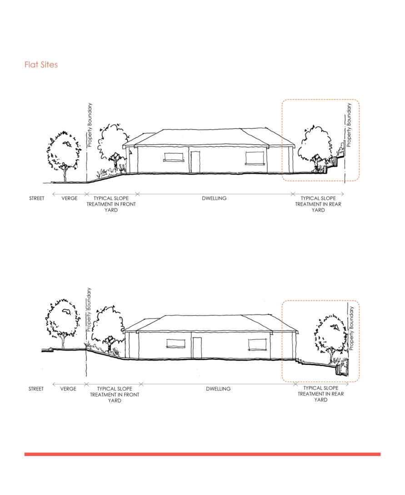
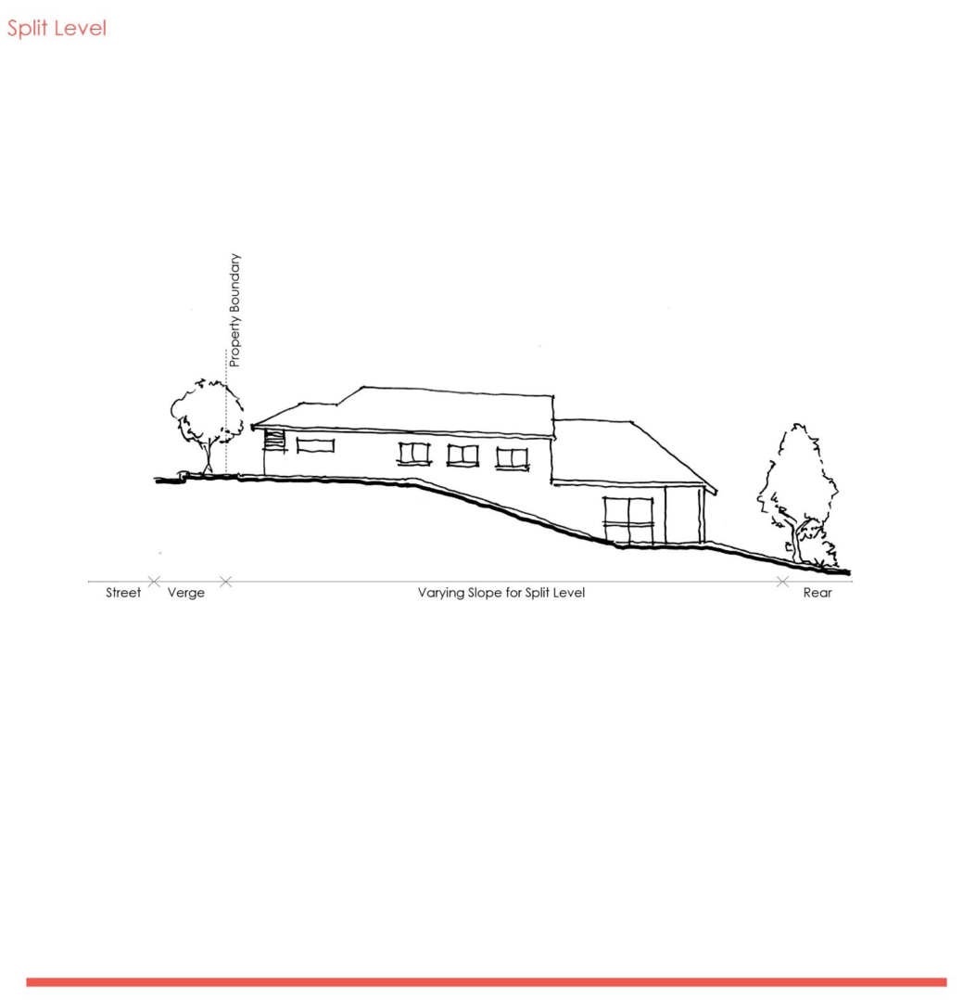
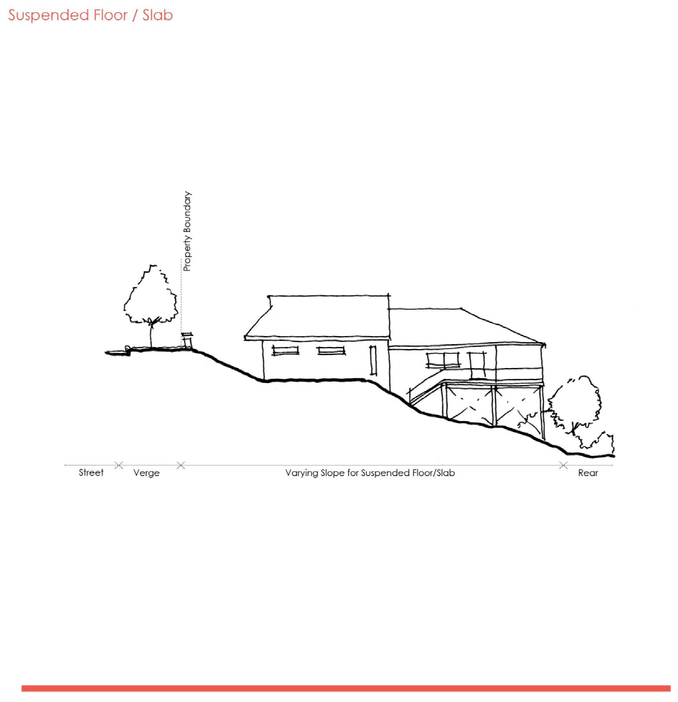
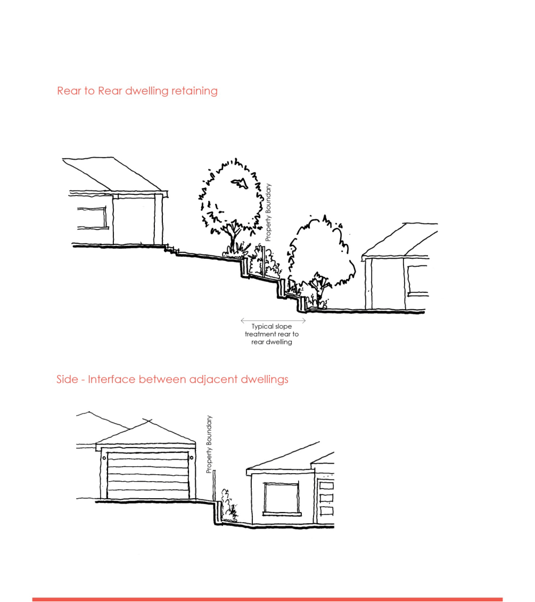
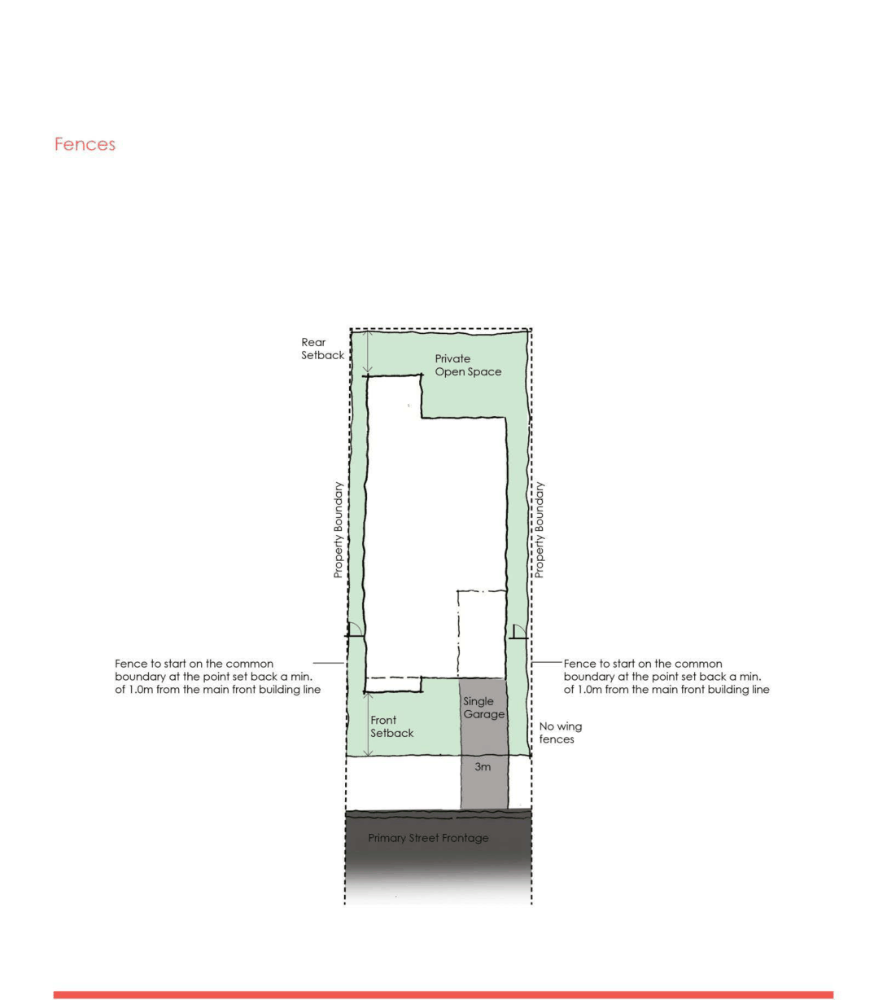
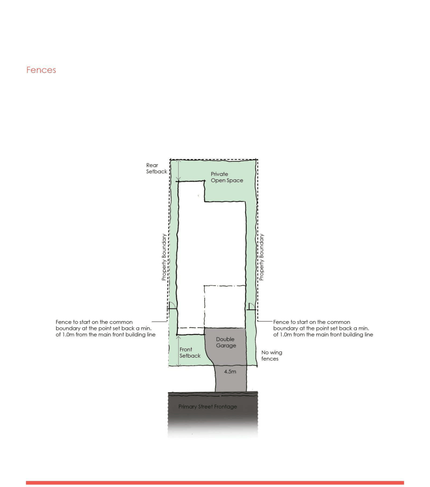

#### 8.3.10.5 RETAINING WALLS AND FENCES

#### Development Controls

1\. Retaining walls are to be provided generally in accordance with Figures 8.47, 8.48, 8.52 to 8.55 and comply with the following:

i. step down in segments from site boundaries and incorporate landscaping to minimise their visual impact and the perception of height change, particularly when viewed from the public domain

ii. maximum height of any retaining wall is 1.5m

iii. minimum separation between retaining walls is 1.0m or as per standard engineering principles whichever is the greater.

2\. Fences are to be provided generally in accordance with Figure 8.56 and 8.57 comply with the following:

i. have a maximum height at all other boundaries of 1.8m

ii. where on a corner lot, address both streets

> [Picture on page 84: a picture, saved as a picture (images/ch-08-00-redbank-at-north-richmond-page-84-1.gif, 150 dpi).]

#### Figure 8.52 – Building on flat sites

> [Picture on page 85: a picture, saved as a picture (images/ch-08-00-redbank-at-north-richmond-page-85-1.gif, 150 dpi).]

#### Figure 8.53 - Split level building on sloping site

> [Picture on page 86: a picture, saved as a picture (images/ch-08-00-redbank-at-north-richmond-page-86-1.gif, 150 dpi).]

#### Figure 8.54 – Suspended floor/slab on sloping site

> [Picture on page 87: a picture, saved as a picture (images/ch-08-00-redbank-at-north-richmond-page-87-1.gif, 150 dpi).]

#### Figure 8.55 – Boundary treatment

> [Picture on page 88: a picture, saved as a picture (images/ch-08-00-redbank-at-north-richmond-page-88-1.gif, 150 dpi).]

#### Figure 8.56 - Fences

> [Picture on page 89: a picture, saved as a picture (images/ch-08-00-redbank-at-north-richmond-page-89-1.gif, 150 dpi).]

#### Figure 8.57 - Fences
