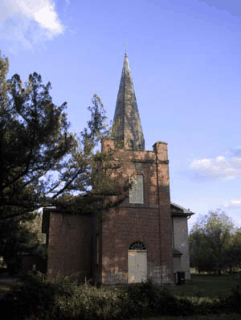
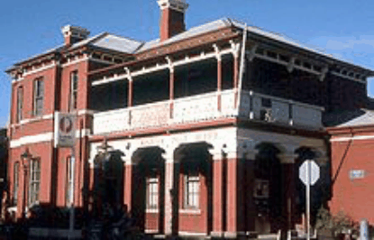
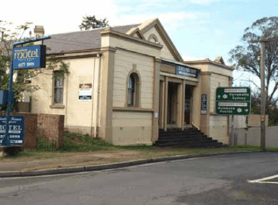
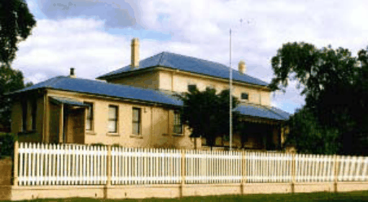
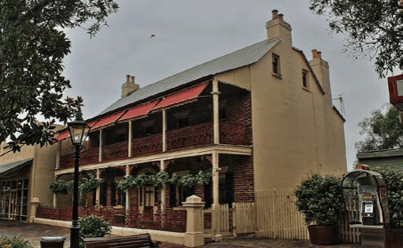

### 10. 3. 2 European Heritage

The Hawkesbury LGA is of immense significance in the context of Australian History and nowhere else

is evidence of the early development of Australia so rich. The Hawkesbury LGA is the third oldest

place of British settlement in Australia, with substantial evidence of early European colonial settlement

patterns. These settlement patterns remain clear in the landscapes, the buildings, the street patterns

and archaeological remains and the presence of this evidence of early development is richer than in

any other place in Australia.

The Macquarie Towns of Pitt Town, Windsor, Richmond and Wilberforce in the Hawkesbury LGA are

remarkable for their careful siting and design, acknowledging the risk of urban settlement on the flood

liable land. They retain much of their Colonial character intended with Governor Macquarie’s original

settlement planning such as grid street patterns, village greens (e.g. Richmond) town squares (e.g.

Thompson Square, Windsor), church groups (e.g. St Matthew’s, Windsor and St Peter’s, Richmond),

together with significant single storey cottages (e.g. Bathurst Road, Pitt Town) and cemeteries.

Thompson Square, containing a fine collection of Georgian and Victorian buildings with significant

heritage and architectural values, is one of the best examples of colonial squares remaining today and

is also one of the oldest public squares in Australia.  These buildings have been built between 1815

> [Picture on page 4: a picture, saved as a picture (images/ch-10-00-heritage-conservation-page-4-30.gif, 150 dpi).]

and 1880.

#### Figure 1: St Matthew's Anglican Church, Windsor

> [Picture on page 5: a picture, saved as a picture (images/ch-10-00-heritage-conservation-page-5-1.gif, 150 dpi).]

#### Figure 2: St Peters Anglican Church, Richmond

The government and church buildings of the Macquarie Towns in the LGA represent some of the

earliest surviving architecture in Australia and some of these works such as the Windsor’s Georgian

buildings completed before 1822, were some of the finest built in the colony.

The buildings contain numerous rare and aesthetically superior elements, and continue to be widely

recognised for its importance to the understanding of settlement, urban design, and architecture during

the colonial period, while its historic associations carry strong cultural messages of the period's society

and government.

The continued appreciation of the history and the presence of these early buildings and landscapes

are clearly evident with the preservation of significant works including St Matthew’s Church and

> [Picture on page 5: a picture, saved as a picture (images/ch-10-00-heritage-conservation-page-5-12.gif, 150 dpi).]

Courthouse at Windsor.

#### Figure 3: Windsor Post Office

> [Picture on page 5: a picture, saved as a picture (images/ch-10-00-heritage-conservation-page-5-15.gif, 150 dpi).]

#### Figure 4: The School of Arts Building, Windsor

> [Picture on page 6: a picture, saved as a picture (images/ch-10-00-heritage-conservation-page-6-1.gif, 150 dpi).]

#### Figure 5: Windsor Courthouse

> [Picture on page 6: a picture, saved as a picture (images/ch-10-00-heritage-conservation-page-6-3.gif, 150 dpi).]

#### Figure 6: Loder House

With Hawkesbury’s rich history and the reasonably intact early settlements, towns and landscapes, it

has a significant archaeological potential, compared with other sites of Colonial settlement in New

South Wales. With relatively undisturbed sites dating form early European settlement the potential for

future research is high.
