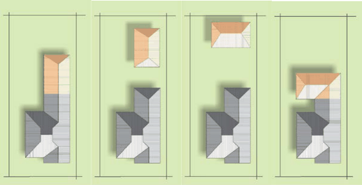
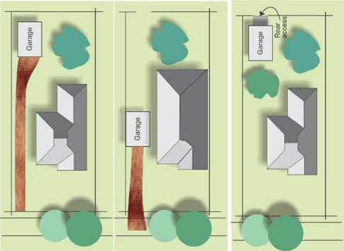
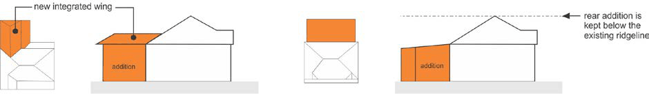
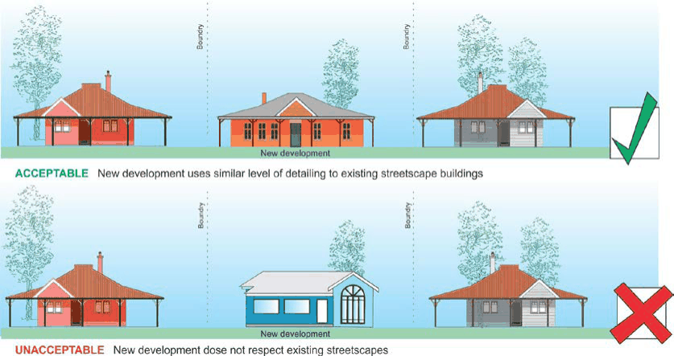
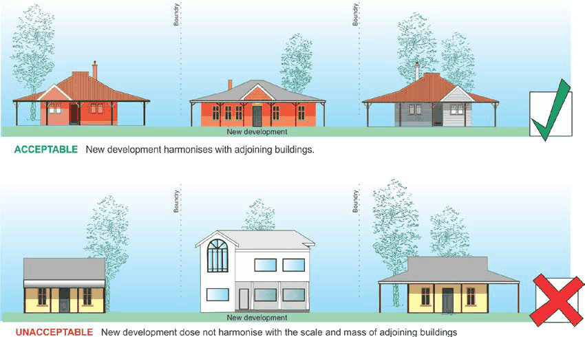
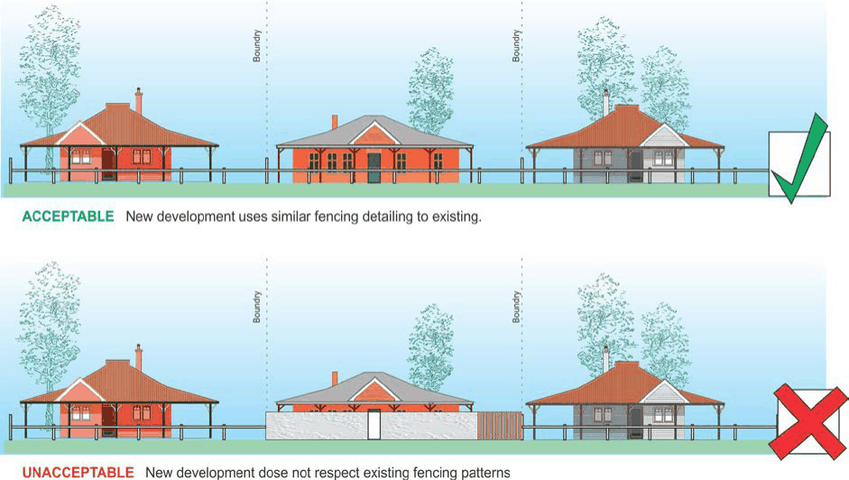

### 10. 3. 9 State Heritage Items

The heritage items and conservation areas listed as “State” significant are significant for the whole of

NSW. These items and areas are also listed in the State Heritage Register.  This is a separate list that

provides for protection under the NSW Heritage Act 1977.  Applicants should consult the NSW

Heritage Office or Office of Environment and Heritage (OEH) website www.environment.nsw.gov.au/

to find out whether or not the property is listed on the State Heritage Register.

Any development affecting a “State” significant heritage item or conservation area will require the

lodgement of either an Integrated DA pursuant to Section 91 of the Act where the concurrence from

the NSW Heritage Council is required under Section 60 of the Heritage Act 1977.  Alternatively, a

separate application can be made to the NSW Heritage Office under Section 60 of the Heritage Act

1977 prior to the lodgement of a DA with Council.

### 10.4 Development, Conservation and Management

Generally, Council’s approval is required for development of heritage items or the carrying out of any

development or works (other than certain minor works and maintenance works) on a heritage listed

property or within a heritage conservation area.

When a heritage item is affected by an “Interim Heritage Order” under the Heritage Act 1977 the

consent for any major work from the NSW Heritage Council will also be needed in addition to Council

consent.

NOTE An Interim Heritage Order is a temporary form of protection over an item or land that may be made while further investigation of the heritage value of the item is carried out. The effect of an Interim Heritage Order is that a person cannot damage, destroy, alter or move the item, building or land without approval from the Heritage Council. The majority of Interim Heritage Orders are made in response to community representations or concerns raised by local government.

#### 10.4.1 When development consent is required

Development consent is required for any of the following works:

a) demolishing or moving any of the following or altering the exterior of any of the following

(including, in the case of a building, making changes to its detail, fabric, finish or appearance):

(i) a heritage item,

(ii) an Aboriginal object,

(iii) a building, work, relic or tree within a heritage conservation area,

b) altering a heritage item that is building related by making structural changes to its interior or by

making changes to anything inside the item that is specified in Schedule 5 of the LEP in relation

to the item,

c) disturbing or excavating an archaeological site while knowing, or having reasonable cause to

suspect, that the disturbance or excavation will or is likely to result in a relic being discovered,

exposed, moved, damaged or destroyed,

d) disturbing or excavating an Aboriginal heritage of significance,

e) erecting a building on land:

(i) on which a heritage item is located or that is within a heritage conservation area, or

(ii) on which an Aboriginal object is located or that is within an Aboriginal place of heritage

significance,

f) subdividing land:

(i) on which a heritage item is located or that is within a heritage conservation  area, or

(ii) on which an Aboriginal object is located or that is within an Aboriginal place of heritage

significance,

#### 10.4.2 When development consent is not required

Certain minor works such as general maintenance works or restoration works with no adverse impacts

on the heritage significance of a heritage item or a conservation area may be carried out without

consent of Council (see Table 1 for details).

However, prior to undertaking any of these works, the proponent is required to notify Council in writing

of the following for Council’s consideration:

(i) A sketch plan of the location of the proposed works in relation to the heritage item.

(ii) Full details of the proposed works including materials, colours, fixtures, dimensions and

detailing.

(iii) Photographs showing the location of the proposed works in relation to the heritage item.

(iv) Brochures or colour charts that show the proposed colours and/or details of the proposed

works.

If Council determines the works do not require development consent, Council will advise the applicant

in writing accordingly. The proponent can only commence the works upon the receipt of Council’s

confirmation. If, Council is of the view that the proposed works are not minor, a DA will need to be

lodged with Council for determination.

#### Table 1: Development/Work not requiring consent

| DEVELOPMENT/WORK | CRITERIA | REMARKS |
|---|---|---|
| Works in is of a minor nature (e.g. repainting of surfaces) | Only Surfaces already painted. No changes to the original colours of the surfaces of the heritage item. | If it is not possible to find the original colour, attempts should be made to have a very close match made to minimise any adverse impacts on the item or the conservation area. |
| Internal alterations | Non-structural alterations to local heritage items only where the interiors of items are not listed as significant. | Alterations to any significant interiors or items identified in the State Heritage Register require Council’s approval. |
| Installation of skylights, solar panels, roof vents, water heaters or certain communication facilities | They should not be visible from a public road or place. Criteria as specified in the State Environment Planning Policy (Exempt and Complying Development) 2008. |  |
| Erection of minor outbuildings such as cabanas, garden sheds, gazebos and green houses | Outbuildings/structures that do not affect the heritage significance of the item, or its setting or curtilage. They should not be visible from a public road or place. | The location, scale and materials are to be carefully made. |
| General maintenance works such as treating timber members, replacing broken windows, restoring verandah | Any maintenance/restoration works as per a conservation | Any new replacement materials should match the original as closely as |

| DEVELOPMENT/WORK | CRITERIA | REMARKS |
|---|---|---|
| columns/fence posts, rehinging doors/windows, replacing down pipes/gutters, re-roofing in matching materials, patching surfaces, general maintenance works for heritage gardens and repairing stone/brick works and planter works | management plan approved by Council and other urgent and important works to maintain and protect the heritage item. | possible. |
| Construction of a new grave or monument, excavation or disturbance of the land for the purpose of conserving and repairing monuments and grave markers | Works should not disturb human remains, relics, Aboriginal objects in the form of grave items, or to a place of Aboriginal heritage significance. |  |
| Demolition and erection of any fences or boundary walls | Should be behind the front alignment of the heritage building. | Demolition of existing fences not identified as significant, do not contribute to the overall setting or character of a heritage item or conservation area New fences should either match as closely as possible the original fencing or based on historical research or if the original fence type is not known, it should relate to the architectural character and period of the existing building with respect to design, materials, colour and height. |
| Any works involving the removal of additions and alterations which do not contribute to the heritage significance of the building or the character of the conservation area | Where the proposed removal allows increased exposure of the heritage item and generally enhances its heritage significance | Professional advice recommended to assist applicants/owners. |
| Works limited to the removal of a tree or other vegetation | The tree or vegetation is a risk to human life or property |  |

#### 10.4.3 Adaptive Reuse

Historic buildings and their component parts are a finite resource, which once lost cannot be replaced.

The process of converting a historic building to a new use, or a change in occupation, has the potential

to cause irreversible damage to the building, through loss of character, of archaeological information

and historic fabric if careful attention is not paid to the risks involved in both the design and

construction process.

Respect for a building’s character will inform decisions on the viability of conversion. It is accepted that

the original use of a building is often the most appropriate one. It is therefore particularly important in

cases where the new use of a building will be significantly different that the building’s character and

possible risks to it are identified at an early stage through a thorough assessment of the surviving

fabric. It is possible that in some cases the loss of character would be so excessive that conversion to

a certain function may not be appropriate.

Old buildings are best maintained and appreciated by using them. The active use of a heritage

building with sensitive alterations is often preferable to having a perfectly intact building with no use.

When developing or renovating, locate useful compatible functions within the old building so that the

building has a new life and an ongoing history.

Adaptive reuse is when the proposed development upgrades and modifies buildings or places as part

of conservation efforts. Generally it is a process by which older and/or historic buildings are developed

for their cultural value while receiving economically, socially, culturally viable new uses of a

sustainable nature.

Where a building can no longer function with its original or existing use while retaining its financial

sustainability, a new use through adaptation may be the only way to preserve its heritage significance.

Adaptive reuse of a heritage building may be acceptable on heritage grounds, provided the use is

compatible and the heritage significance of the item is not adversely affected. The Burra Charter

defines compatible use as follows:

“Compatible use means a use which involves no change to culturally significant fabric,

changes which are substantially reversible, or changes which require a minimal impact.”

Note Refer to the publication “New Uses for Heritage Places: Guidelines for the adaptation of Historic

Buildings and Sites” prepared by the Heritage Branch, Office of Environment and Heritage, for further

information on the adaptation of heritage buildings.

Adaptive reuse involves appropriate and acceptable modification of the existing entity and perhaps

sympathetic extensions, in order to reinvigorate the building and to achieve a dignified and viable

future.  The adaptation of old buildings provides opportunities for architects and designers to create

innovative design solutions within the context of recognised heritage values.

#### 10.4.4 Demolition or relocation of a heritage building/item

Demolition of a heritage item is contrary to the intent of heritage listing, and hence, may only be

considered as a last resort in circumstances where the building or the structure is considered to be no

longer be of significance or beyond any repairs. Structural problems are generally rectifiable and are

therefore of themselves, not sufficient grounds for demolition of a heritage property or structure.

However, lack of maintenance and negligence that leads to demolition of heritage items is not

tolerated.

A proposal to demolish a heritage item or a building in a conservation area, should demonstrate that

all options to retain the item have been comprehensively researched and documented for Council’s

consideration. The demolition of a non-contributory building within a heritage conservation area and

replacement by an appropriately designed infill building may be supported.

If structural failure is cited as a justification for demolition, evidence should be provided that the

structural integrity of the building has failed to the point where it cannot be rectified without removal of

a majority of its significant fabric. In this instance a report from a registered and experienced structural

engineer is required certifying that the building has structurally failed together with a Heritage Impact

Statement prepared by a heritage consultant.

This assessment should be undertaken in accordance with the NSW Heritage Assessment Criteria for

ascertaining heritage significance as well as any past heritage studies pertaining to the item.

Council generally does not support the relocation of a heritage item except on a very rear occasion

where there is a compelling reasons or strong justification for relocation of the item. Where relocation

of a heritage item is proposed, a heritage impact assessment clearly demonstrating why this is the

most desirable action to retain the significance of the item or the conservation area. Justification for

relocation must be based on the heritage significance of the item or area, not on the development

potential of the land or the area occupied by the item.

#### 10.4.5 Conservation Incentives

In order to encourage and enhance management and conservation of heritage items, Council may

consider applications for any use of a building listed as a heritage item, or of the land on which the

building is occupied, even though the proposed use is a non-confirming (prohibited) use on the land

and would not normally be allowed by the LEP, provided the Council is satisfied that:

(i). the conservation of the heritage item or Aboriginal place of heritage significance is facilitated

by the granting of consent, and

(ii). the proposed development is in accordance with a heritage management document that has

been approved by the consent authority, and

(iii). the consent to the proposed development would require that all necessary conservation work

identified in the heritage management document is carried out, and

(iv). the proposed development would not adversely affect the heritage significance of the heritage

item, including its setting, or the heritage significance of the Aboriginal place of heritage

significance, and

(v). The proposed development would not have any significant adverse effect on the amenity of

the surrounding area.

#### 10.4.6 The Burra Charter

In general terms, the methodology that should be applied to the management of heritage places is

described in the ‘Burra Charter’.  The ‘Burra Charter’ is a document which was developed in 1999 by

the Australian Chapter of the International Council on Monuments and Sites (ICOMOS) sets out the

following four ways to conserve places of cultural significance. Following review of this ICOMOS

adopted the Burra Charter (Oct 2013)

Maintenance of the physical fabric – periodic maintenance, to ensure that a thing does not fall into

disrepair as the result of neglect or of ageing, is the most important task in conservation. Often this is

all that is needed to keep what is significant about a thing.

Restoration and reconstruction (including repair) – these may become necessary when the physical

fabric of something that has significance has been allowed to deteriorate. They can sometimes be

difficult to carry out properly when things such as materials have changed.

Preservation – this includes stabilising things that are in danger, providing protection against the

elements and placing restrictions on how people may use a thing. Preservation can be expansive and

inconvenient and the need for it can often be avoided by carrying out periodic maintenance.

Adaption – Sometimes the only practical way of keeping what is significant about a thing is to

physically alter it or give it a new use. A minimalist approach should always be taken to adaptation so

as to avoid the irreversible loss of what is significant about a thing. Overall, it recommends a cautious

approach to change is recommended.

“Do much as necessary to care for the place and make it usable, but otherwise change it as

little as possible”.

The Burra Charter also provides sound guidance on heritage assessment and heritage management

practices.

For more information, please visit www.australia.icomos.org.

### 10.5 DEVELOPMENT CONTROLS

Development controls for heritage items and heritage conservation areas listed in Schedule 5 –

‘Environmental Heritage’ of the LEP and any development on land adjacent to or within the vicinity of a

heritage item or heritage conservation area as follows:

#### 10.5.1 Conservation and Maintenance

a) Original garden elements including outbuildings, fences, stonework, pathways and other like features should be identified and where appropriate retained in any redevelopment.  Where this is not possible, the replacement should endeavour to reuse salvaged elements of the original or use new elements to match as closely as possible with the original style, design, materials, colour and height of that garden element. Old photographs or careful inspection of remaining fabric can often reveal the original design features and style of the item.

b) Alteration of the original fabric of a heritage item is to be minimised and where possible original features are to be repaired, rather than be replaced.

c) The reconstruction of original details should only occur where recommended as an appropriate conservation measure by an approved conservation plan. This should be considered in accordance with the provisions of the ‘Burra Charter’.

d) Any features that are considered valuable in reflecting the history and maintaining the character of the item should be retained.

e) The removal of original detailing or the enclosure of verandahs on the front façade of a heritage item will generally not be permitted. However reinstatement of missing original verandahs or detailing are permitted where there are satisfactory documentary or other acceptable evidence clearly demonstrating that they were part of the original heritage item.

f) New decorative features should not be used on a heritage item unless documentary, physical or other evidence indicate that it once existed.

g) Intrusive security measures such as roller shutters, window bars and the like should not be introduced to the heritage item or within heritage conservation areas.

h) Construction techniques should be compatible and reflect original building techniques where possible, such as the use of lime based mortars for re-pointing bricks rather than the use of cement based mortars1.

i) External fixtures such as solar panels, rainwater tanks, air conditioning units or other like utility installations should not be installed on the front façade of the heritage item or any other elevation readily visible from a public road or place.

NOTE 1 Colour coated steel roofing (Colorbond) is not considered to be a suitable replacement material for

galvanised iron, galvanised steel, slate or tile roofing.  Construction techniques should be compatible

and reflect original building techniques where possible, such as the use of lime based mortars for re-

pointing bricks rather than the use of cement based mortars.

Applicants are encouraged to refer to technical publications on construction materials and techniques

published by the NSW Heritage Council. Some of these publications can be viewed on Councils’

website: www.hawkesbury.nsw.gov.au.

#### 10.5.2 Adaptive reuse

a) The adaptive reuse of a heritage item or a change of use is to demonstrate that:

- The new use requires minimal alterations to significant fabric and building elements, and

that any changes to these are reversible or have minimal impact on the heritage

significance of the item.

- Any internal changes do not affect original materials or do not result in loss of original

features that contribute to the heritage significance of the external appearance of the

item.

- Alterations and/or additions required to support the new use do not obscure the

understanding of the item’s significant use.

- The introduction of new services will not have a detrimental impact on significant fabric, or

spaces or archaeological deposits.

- The new use is consistent with the agreed conservation policy identified in the

conservation management plan.

#### 10.5.3 Alterations and Additions

a) In order to ensure that the scale and form of the proposed development will not dominate the heritage item, especially when viewed from a public road or place, additions and alterations should:

(i) Be located along the least significant elevation or in the least significant part of the

setting.

(ii) Not obscure or detract from the street elevation of the heritage item.

(iii) Be setback further from the street elevation of the heritage item (see Figure 9).

(iv) Where possible extensions should be freestanding in rear yard with a glazed breezeway

connecting new and old sections.

b) In siting alterations and additions, site features that are considered significant should be retained including the important views/vistas, gardens, fences, outbuildings, mature vegetation or archaeological sites.

> [Picture on page 14: a picture, saved as a picture (images/ch-10-00-heritage-conservation-page-14-28.gif, 150 dpi).]

#### Figure 7: New Additions/Extensions

c) First floor alterations and additions to a heritage item should be restricted to the rear of a dwelling and should minimise impact upon the original roof form when viewed from the public domain.

d) Where possible, the garages/carports should be located at the rear of the property with rear access. If rear access is not feasible, then the garage located to the rear or side of the building, may be acceptable.

e) The conversion of roof spaces in heritage buildings is not recommended except in very rare cases. Where sufficient heights are available and where Council’s Heritage Adviser has indicated that building can possibly be developed, however in these cases do not include dormer windows or changes to the roof pitch or form, when viewed from the public domain or other significant views to and from the heritage item. The conversion of a roof space within a heritage building should only occur where the existing roof height permits such a conversion. Conversions of underutilised roof spaces that involve the loss of original ceilings etc to compensate for the limited height would not be supported.

f) External shutters are not to be added to original windows and doors of a heritage building unless they were features of the original design of the building.

g) Original verandahs and balconies are not to be altered except for the reinstatement of original details and reversal of unsympathetic alterations.

> [Picture on page 15: a picture, saved as a picture (images/ch-10-00-heritage-conservation-page-15-19.gif, 150 dpi).]

#### Figure 8: Location of garages

#### 10.5.4 Built Form and Character

a) Alterations and additions should be consistent with the existing building form with respect to roof type, pitch and eaves, verandah, façade rhythms, geometry of bay dimensions and the size, proportions and position of windows, doors and other openings.

b) Alterations and additions should be designed to compliment the existing period style and character of the heritage item.

c) Alterations and additions should be visually recessive and easily identified as being later work. Measures to achieve this include:

(i) The side walls of the addition should be setback or recessed to establish a break or

courtyard or rebate between the two.

(ii) The use of a lower roofline on the additions to the building.

(iii) The use of different but complimentary building materials and colours.

(iv) The use of ‘lighter’ building materials and construction for the new additions to the

building (e.g. timber extension to brick/stone dwelling).

(v) The bulk and scale of the proposed extension is to be far less than the bulk and scale of

the heritage building.

> [Picture on page 16: a picture, saved as a picture (images/ch-10-00-heritage-conservation-page-16-7.gif, 150 dpi).]

#### Figure 9: Possible forms for rear additions to single storey dwellings

d) Any proposed first floor addition to the rear of a single storey heritage item at the rear is generally not acceptable. Where a Heritage Impact Statement prepared by a heritage consultant believes this is possible the addition should incorporate a transition from the single storey scale of the original building (at the front) to the two storey scale of the new structure at the rear. This transitional form may be building form (such as roofs that step up progressively) or may be a space or void which helps to separate the two height forms.

e) When adding a new garage to a heritage item, open-sided carports are generally more acceptable and less intrusive than solid structures as they do not affect the fabric and the streetscape appearance of the heritage item.

#### 10.5.5 Finishes, Materials and Colours

a) Rear first floor additions should use recessive colours and should not visually dominate the existing building.

b) New materials are to be compatible with the colour, finishes and proportion of existing materials, and they should be easily recognised as being new on a close inspection without detracting from the character and heritage significance of the existing building.  The use of Colorbond or zincalume for roof sheeting, flashing, guttering and downpipes on heritage buildings is not permitted. Instead, recycled or new galvanised steel custom orb sheeting and lead flashings are to be used as the appropriate conservation technique.

NOTE Serious damage can result from the use of incompatible materials. For example, colorbond material generally causes an adverse chemical reaction with the materials on the fixtures and will cause deterioration in long term. Most old construction used relatively “soft materials” such as stone, brick, lime and plaster. Concrete and strong mixes of cement mortar are usually incompatible with the 19th and 20th century buildings. Use of them can lead to cracking walls, drummy render, uneven settlement and also permeability problems. Some modern materials are even technically incompatible with old buildings.

c) New decorative elements (such as finials, barge boards, or verandah brackets) not belonging to the particular architectural period are to be avoided (unless documentary, physical or other forms of evidence indicate it once existed), as this can affect the integrity of the heritage item and/or the heritage conservation area.  Also, decorative items should not attempt to replicate the architectural or decorative detail of the original, so as to maintain a distinction between old and new.

d) External finishes to additions to a heritage building must compliment the architectural style of the existing building.

e) The brick laying pattern of alterations and additions should match that of the existing building.

f) Exterior face brick or stone walls and unpainted surfaces should not be painted, plastered or coated except in exceptional circumstances where this is considered an appropriate conservation measure.

g) Original render should not be removed.  Where repairs or replacement is necessary, this should be undertaken using materials that are consistent with original render.

h) Later cement render to buildings should only be removed where its removal will not damage the face brick or stone.

i) Original roofing materials should be retained wherever possible and repaired as necessary with compatible materials.  However, if it can be demonstrated that the roofing needs to be replaced, then the new roofing material is to match as closely as possible, the colour, texture, materials flashings, length of roof sheeting and profile of the original roofing.

j) Large areas of concrete or bitumen driveways should be avoided, and where possible the use of alternative materials such as pavers, gravel or grass-crete should be explored.

k) Colour schemes for heritage buildings should closely resemble the original or early colour schemes, or if this is not known, be compatible with the particular architectural period of the building and based on research of the original finishes. Careful paint scrapings may identify the original colours that were used.

NOTE It may be possible to get second hand bricks to match the original; if not brick manufacturers may be

able to provide new bricks which will closely match the original design.

l) Garage or carport designs should use design detailing, materials and colours that compliment the heritage item. However, new garages or carports should:

(i) Be separate from the heritage item where possible.

(ii) Preferably be of a ‘lightweight’ construction such as timber with metal roofing.

(iii) Avoid replication of decorative detail or finishes found on the heritage item.

(iv) Be more simple and contemporary in design.

(v) Be located behind the building line of the heritage item.

#### 10.5.6 New development within the curtilage of a Heritage Item

a) The development should not be sited in front of the front building line of the existing heritage item.

b) Where a development is within the curtilage of a heritage item, it should be appropriately designed and located to complement the scale, proportions and geometric alignments of the existing heritage item and ensure the visual prominence of the heritage item is retained.

NOTE The setting of a heritage building/item is generally referred to as the curtilage and may include the

immediate garden, mature trees, original allotment boundaries, outbuildings, paddocks, fencing,

archaeological sites, views/vistas or any other feature or space that have historical relationship with the

heritage item and contribute to the heritage significance of the item and allow a greater understanding of

the historical context of the heritage item. Therefore, the protection of the curtilage surrounding the

heritage item/building is vital for retaining and interpreting the heritage significance of that building/item. The NSW Heritage Office defines ‘heritage curtilage’ as: “The area of land (including land covered by water) surrounding an item or area of heritage

significance which is essential for retaining and interpreting its heritage significance”.

Curtilage has its limits and the scale of the curtilage varies within the functional requirements of the

heritage item, and the need of the item for a certain amount of space around it to fulfil that function. Protection of a heritage item extends to the land and structures lying within its curtilage. Land title

boundaries and heritage curtilages do not necessarily Coincide.

c) The bulk and scale of development should not dominate its’ surroundings.  In order to minimise bulk, new development should be consistent with the predominant height in the street.  If it is difficult to determine the predominant height, then it should be somewhat lower than the adjoining buildings.

d) Where there is an established pattern of side setbacks that contribute to the character of the streetscape this should also be reinforced by new development.

e) A reasonable “buffer” space or courtyard should be provided between the heritage item and the new development to ensure that there will be no adverse impact upon the heritage item.

f) Any new development should ensure consistency with the character and the heritage significance of the established streetscapes.

g) New development within the curtilage of a heritage item should not obstruct the significant views and vistas from public areas to the heritage item.

#### 10.5.7 Development within a Heritage Conservation Area

a) New development should be sited and designed so as not to adversely impact upon the heritage significance of the area.

b) Development is to be compatible with the surrounding built form and pattern of development by responding sympathetically to:

(i) Existing form, massing, setbacks, scale and architectural style and geometry.

(ii) The design and pitch of the roof (if any).

(iii) Site topography and landscape.

(iv) Views to and from the area.

(v) Surrounding neighbourhood character and streetscape.

(vi) The style, size, proportion and position of the openings for windows and doors (if any).

(vii) Colour, texture, style, size and type of finish of the materials to be used on the exterior of

the building.

#### 10.5.8 Development in the vicinity of a Heritage Item or

### Conservation Area

a) Where development is proposed on land adjacent to or within the vicinity of a heritage item or a heritage conservation area the following should be taken into consideration to ensure that it will compliment the identified significance or setting of the heritage item or the heritage conservation area:

b) The character, siting, bulk, scale, height and external appearance of the development.

c) The visual relationship between the proposed development and the heritage item or heritage conservation area.

d) The potential for overshadowing of the adjoining heritage item or any building within a heritage conservation area.

e) The colours and textures of materials proposed to be used in the development.

f) The landscaping and fencing of the proposed development. Allowance for suitable deep rooted landscaping such as trees is important in conservation areas and adjacent to heritage items.

g) The location of car parking spaces and access ways into the development.

h) The impact of any proposed advertising signs or structures.

i) The maintenance of the existing streetscape, where the particular streetscape has significance to the heritage item.

j) The impact the proposed use shall consider the amenity of the heritage item.

k) The effect the construction phase will have on the well being of a heritage item.

h) Avoid making a replica of a heritage building for infill development.

> [Picture on page 19: a picture, saved as a picture (images/ch-10-00-heritage-conservation-page-19-24.gif, 150 dpi).]

#### Figure 10: Streetscape

l) Development should retain and enhance any significant views to and from the heritage item or heritage conservation area and any public domain area.

m) New development adjoining or adjacent to a heritage item should avoid incorporating large unbroken wall areas.

> [Picture on page 20: a picture, saved as a picture (images/ch-10-00-heritage-conservation-page-20-3.gif, 150 dpi).]

#### Figure 11: Scale and Mass

#### 10.5.9 Development of Archaeological Sites

a) New development should be designed to minimise impacts on an archaeological site that is considered to be of heritage significance.

b) Any development that involves the disturbance of archaeological sites or deposits cannot proceed without the appropriate approvals under the NSW Heritage Act 1977.  The applicant should seek advice from the Heritage Branch of the Office of Environment & Heritage and Council’s Heritage Officer in relation to these requirements.

c) Archaeological investigations must be carried out according to Office of Environment and Heritage’s Code of practice for archaeological investigation of Aboriginal objects in NSW, available at www.environment.nsw.gov.au/licences/archinvestigations.htm.

#### 10.5.10 Subdivision

a) Where a subdivision proposal contains a heritage item, the heritage item and any other associated outbuildings should be retained on the same allotment.

b) An appropriate setting or curtilage for the heritage item should be defined whilst taking the following into consideration:

(i) The original form and function of the heritage item.

(ii) Any outbuildings, gardens, trees, fencing, gates and archaeological sites.

(iii) Adjoining development and allotments.

(iv) Access points and orientation.

(v) Any visual links.

c) In order to determine whether the proposed curtilage of the heritage item is appropriate, the subdivision plan should show the proposed building envelops for each proposed allotment. Subdivision will not be supported where the curtilage or setting of the heritage building on or adjoining the site would be compromised.

d) Where practicable, any visual linkages and the original access arrangements to the heritage item should be retained.

e) The amalgamation of sites is generally discouraged in heritage conservation areas because it obscures the original subdivision patterns and can result in unsympathetic development, particularly in terms of form and scale.

f) Lot boundary changes within heritage conservation areas must demonstrate that:

(i) The setting of an existing significant building on the site or the setting of development on

adjoining sites is not compromised.

(ii) Significant features of the existing site or adjoining sites, including streetscape and

landscape features, trees, fences, outbuildings and gardens are not adversely impacted.

(iii) The change to lot layout is in keeping with the character of the area.

#### 10.5.11 Landscaping

a) Any landscaping works including re-planting and the introduction of new garden features upon land that contains a heritage item should be sympathetic to the original garden setting and the significance of existing individual elements of the garden curtilage surrounding the heritage building.

b) Existing trees, ladscaping features and other vegetation with environmental heritage values should be retained.

c) Where edging is required to separate paths, garden beds and gardens from areas or lawn, edging materials are to be consistent with the character, period and style of the heritage item/building.

d) Existing fences which have been identified as significant or that contribute to the overall setting or character of a heritage item are to be retained or repaired, rather than replaced. Research of original photographs and local history (i.e. early fencing details) is recommended. Where any new fences are proposed these should match as closely as possible with the original fencing, or if the original fence type is not known, it should relate to the architectural character and period of the existing heritage item with respect to design, materials, colour and height.

e) High, solid concrete, masonry or metal panel fences will not be permitted along the front property boundary of land containing a heritage item or land within a heritage conservation area. Where it is required to reduce traffic noise and maintain residential amenity, alternative measures other than solid fences such as double-glazing, internal room layout and / or landscaping should be investigated.

> [Picture on page 22: a picture, saved as a picture (images/ch-10-00-heritage-conservation-page-22-1.gif, 150 dpi).]

#### Figure 12: Fencing

NOTE The recommendations of the statement/report should be based on the heritage significance of the item,

not on the development potential of the land it is situated

#### 10.5.12 Signage

Development is to comply with the requirements specified in Part C, Chapter 3 –Signs of the DCP.

### 10.6 SUBMISSION REQUIREMENTS

Refer Appendix B Lodging a Development Application.

In addition, the following information may be required.

#### Heritage Impact Statement

A Heritage Impact Statement (HIS) is to be prepared by a qualified and experienced heritage

consultant for development of, or development within the vicinity of, a heritage item or heritage

conservation area in accordance with:

(i) The principles contained within the Australia ICOMOS Burra Charter (October 2013).

(ii) The document entitled ‘Conservation Management Documents’ (NSW Office of Environment &

Heritage, 1996).

(iii) Any other guidelines issued by the Office of Environment and Heritage.

For details see the NSW Office of Environment & Heritage website, www.heritage.nsw.gov.au.

#### Heritage Conservation Management Plan

A Heritage Conservation Management Plan may be required where the proposed development is

likely to affect the significance of a heritage item or heritage conservation area.

This plan explains the heritage significance of the item or the area and provides a clear statement of

conservation policy. The issues to be addressed in the Heritage Conservation Management Plan will

vary depending on the heritage item and its significance as well as the nature and scale of the

proposed development.

This plan should be prepared by a qualified and experienced heritage consultant in accordance with

the ‘Principles of Conservation Work on Heritage Places (1999)’ and ‘Conservation Management

Documents (1996)’ published by NSW Office of Environment & Heritage.

#### Aboriginal Cultural/Archaeological Report

If a development involving the excavation or filling of land or the erection (involving disturbance of

land) or demolition of buildings on land which is an archaeological site that has Aboriginal significance,

or a potential archaeological site that is reasonably likely to have Aboriginal significance, an

archaeological report adequately and appropriately addressing relevant issues is to be prepared by a

suitably qualified professional.

Applicants are advised to contact the NSW Office of Environment and Heritage Office (OEH) or view

the OEH website www.environment.nsw.gov.au for advice and more information.

Written evidence confirming the compliance of the proposal with the relevant statutory requirements of

the NSW Heritage Act, 1977 and the guidelines of the Office of Environment and Heritage, is also

required.

• Comprehensive written and photographic evidence as to the current condition of the building

fabric, including the condition of footings, load-bearing walls, building materials, pest infestation,

water damage, sub-soil drainage, damage from natural occurrences, and whether it constitutes

a danger to the users or occupiers of the building or the public.

• A statement or report prepared by a heritage consultant and/or a structural engineer containing

the following information:

- as to the capability of repair, restoration, stabilisation or reconstruction of the heritage

building prepared by a qualified and experienced structural engineer;

- other options examined instead of demolition and reasons why these options are not

viable; and

- a thorough and accurate financial assessment that considers the costs associated with

restoration or conservation of the building, compared to alternative development options.

• Curtilage Study – applications proposing subdivision of or adjacent to a heritage property are

required to include a curtilage study prepared by a heritage consultant.
