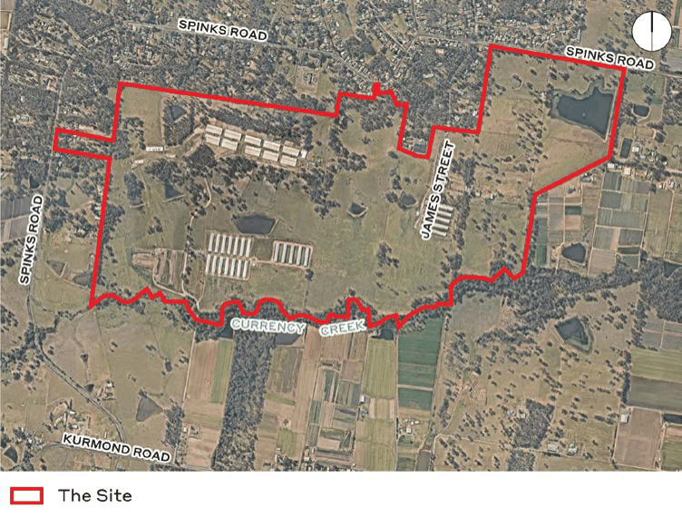

### 1.1 Land to which this chapter applies

This site-specific DCP applies to all land identified within the Jacaranda site. The site occupies approximately 185.3 hectares of predominately rural land bound by Spinks Road to the north and Currency Creek to the south. The site

is comprised of several separate land parcels as summarised in Table 1.

#### Table 1 Summary of property details

| Address 103 Spinks Road, Glossodia 103 Spinks Road, Glossodia 213 Spinks Road Glossodia 361 Spinks Road Glossodia 11 James Street Glossodia 3 Derby Place Glossodia 746A Kurmond Road, 780A-780C | Lot 2 52 20 75 3 44 DP214755 Freemans Reach 50 DP751637 Kurmond Road, North Richmond 1, 2 & 3 DP784300 | Deposited Plan DP533402 DP1104504 DP214753 DP214752 DP230943 |
|---|---|---|

> [Picture on page 5: a picture, saved as a picture (images/jacaranda-at-glossodia-page-5-9.gif, 150 dpi).]

#### Figure 1 Land Application Map

Source: Ethos Urban
