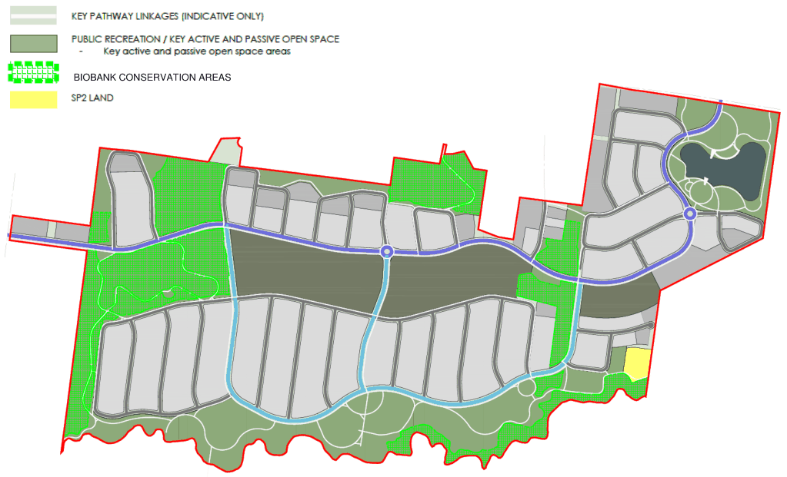
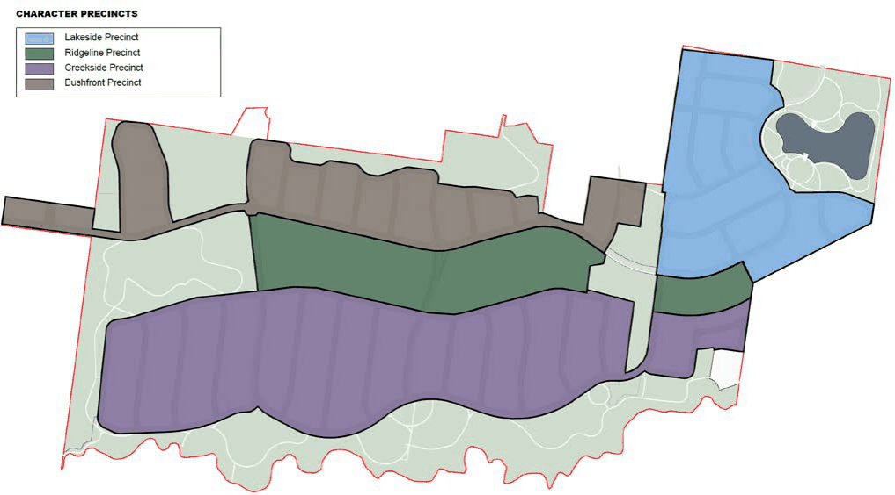

### 2.1 The Concept Masterplan

> [Picture on page 7: a picture, saved as a picture (images/jacaranda-at-glossodia-page-7-8.gif, 150 dpi).]
> Words printed on the picture (title and legend, copied from the PDF):
> BIOBANK CONSERVATION AREAS

#### Figure 2 Jacaranda Concept Masterplan

Source: Onecollective

#### 2.1.1 Place and Character

#### Objectives

O.1  Ensure that development is consistent with the desired character of each precinct within Jacaranda. O.2  Ensure that development responds to the general topography, natural landscape features, native vegetation, and riparian corridors. O.3 Consider views to the Blue Mountains and Richmond. O.4  Encourage a diversity of housing, streetscapes types, and landscape treatments that reinforce the desired character of each precinct and help provide variety within the overall development site.

> [Picture on page 8: a picture, saved as a picture (images/jacaranda-at-glossodia-page-8-1.gif, 150 dpi).]

#### Figure 3 Character Areas Structure Plan

Source: Onecollective

#### Controls

C.1  The layout of subdivision, public spaces and the street network of Jacaranda is to be generally consistent with the Structure Plan at Figure 2. C.2 Development within each precinct is to be in accordance with the Desired Character Statements outlined below in Table 2 for each character precinct in Figure 3.

#### Table 2 Desired Character Statements

#### A. Lakeside

#### Precinct

The Lakeside Precinct is located at the entry to Jacaranda with a central entry drive that interfaces with and provides a direct connection to Lake Park. The central entry drive creates a unique entry to the community and to Lake Park.

Streets are oriented and located to provide direct access and views towards the Lake Park and to facilitate the efficient design of the stormwater system.

Lake Park is a space for the Jacaranda and the Glossodia communities to gather and meet

– it is a destination. It is the key recreational area in Jacaranda setting the landscape tone of the community. Lake Park offers a variety of recreational spaces, facilities and experiences that improves the recreational and community use. It incorporates viewing platforms, shelters, and other embellishments to provide choice and diversity of recreational activity.

A potential café location within Lake Park serves as a key meeting place for the Jacaranda and wider Glossodia community. The Lake Park, the Ridgeline Corridor and Green Connection intersect, acting as a marker at the entry to the Jacaranda community.

Lots are oriented to maximise dwelling orientation towards areas of open space and take advantage of views.

Landscape elements including street trees establish the character of Jacaranda.

The Lakeside Precinct is predominantly a suburban character with a mix of single and two-

storey (and in certain circumstances three-storeys where the proposed development

does not dominate the streetscape) dwellings set within landscaped lots. Residential development comprises predominantly 1000sqm+ lots but increases to 2000sqm+ lots along the northern, eastern and western boundaries where the site interfaces with Spinks Road and the existing adjoining rural residential neighbours. The residences are modern homes with a touch of country. They feature a mix of clearly defined porches, entry features and verandahs.

Consistent building alignments towards the front boundaries and street presence of the built form will add to the local street character around the Lake Park.

Front fences along the central entry drive within the Lakeside Precinct are predominately hedging or piers with hedging in between.

Landscaped rear setbacks provide a natural buffer zone and transition to adjacent farmland.

#### B. Ridgeline

#### Precinct

The Ridgeline Precinct is located centrally within Jacaranda and incorporates the south facing land that follows the central ridgeline.

The character is defined by a sense of space and a green ‘leafy’ and rural feel created by larger lots, increased space and trees between homes, and elevated distant views.

The residential pattern maximises the space between homes and the opportunity for trees and views between dwellings to reinforce the rural character.

Residential development is predominantly 4000sqm+ lots, with the larger lots accommodating the topography of the site. Dwellings do not display a consistent setback to the street – the feeling is more relaxed and driven by individual lot features and landscape elements. Large trees feature prominently within front yards.

The residences are large homestead and ranch style homes with simpler roof profiles. They feature a mix of statement entry features and large verandahs.

The street character along the central ridge line to the north and local street to the south is predominantly defined by landscape. Buildings are set back from the street according to orientation and topography, creating an open rural feel, without rigid building alignments.

Front fences within the Ridgeline Precinct are predominately post and rail with feature landscaping.

#### C. Creekside

#### Precinct

The Creekside Precinct is located in the southern part of Jacaranda adjacent to Currency Creek and the associated riparian corridor and open space.

The character is defined by a sense of greenery and open space created by the Creekside Park setting and surrounding bushland areas and a suburban village type character that is cohesive with the surrounding community.

Currency Creek and the extensive open space and parkland features along the riparian corridor are the main focal point and setting for the Precinct, together with the biobanking areas to the west and north of the precinct.

Creekside Park incorporates a diverse range of active and passive recreational spaces and features.

Landscape treatments provide variety and differentiate it from the other precincts whilst still providing an integrated and cohesive overall character.

The road network through the Precinct provides direct linkages and esplanade interfaces to the Creekside Park which maximise access, exposure, and activation of the parkland area drawing residents from the other Precincts. Residences fronting open space have a direct visual connection with the parkland.

The subdivision pattern maximises pedestrian and visual linkages to open space contributing to the peri-urban positioning of the community.

The Creekside Precinct is predominantly a suburban character with a mix of single storey

and two-storey (and in certain circumstances three-storeys where the proposed

development does not dominate the streetscape) dwellings set within landscaped lots. Residential development comprises 1000sqm+ lots and will include a variety of lot types and frontages (i.e. park front lots, internal lots, bush front lots) that will add diversity to the precinct.

The residences are modern homes with a touch of country. They feature a mix of clearly defined porches, entry features and verandahs.

Residents benefit from the close proximity to the three Village Greens along the southern edge of the Creekside Precinct, which create a finer grain of residential clusters and give opportunity for subtle variations in character around the West, Central and East Village Green.

Front fences within the Creekside Precinct are predominately hedging or a mix of fencing with hedging.

#### D. Bushfront

#### Precinct

The Bushfront Precinct is located in the northern part of Jacaranda and incorporates the north facing land that falls from the central ridgeline towards the existing rural residential areas to the north.

The Precinct is defined by a sense of space and a green ‘leafy’ character created by the interface to the surrounding bushland setting and the interface to the lower density rural residential areas.

The street network provides esplanade interfaces to bushland and conservation areas.

The subdivision pattern maximises pedestrian and visual linkages from within and through the Precinct to the surrounding bushland and conservation areas.

Residences are orientated to address the bushland and open space areas

The Bushfront Precinct is predominantly a suburban character with a mix of single storey

and two-storey (and in certain circumstances three-storeys where the proposed

development does not dominate the streetscape) dwellings set within landscaped lots. Residential development comprises predominantly of 1000sqm+ lots but increases to 2000sqm+ lots along the northern boundaries transitioning to existing rural residential neighbours.

The residences are modern homes with a touch of country. They feature a mix of clearly defined porches, entry features and verandahs.

Consistent building alignments towards the front boundaries and street presence of the built form provide a defined residential edge towards the adjacent bushland, and along the central ridge.

Front fences within the Bushfront Precinct are predominately post and rail or modern masonry piers with infill panels.
