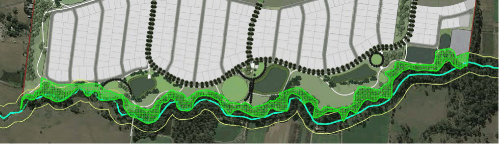
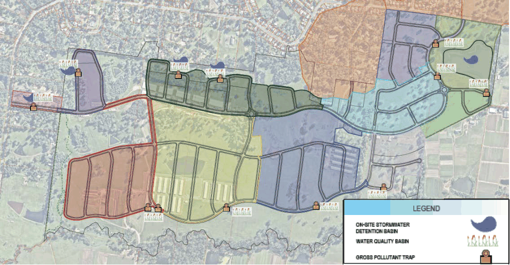
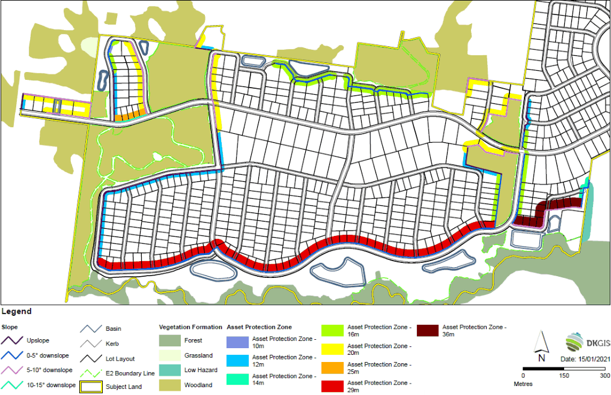

### 2.2 Natural Environment Considerations

#### 2.2.1 Contamination

#### Objectives

O.1 To minimise the risks to human health and the environment from the development of potentially contaminated land. O.2 To ensure that potential site contamination issues are adequately addressed at the subdivision stage.

#### Controls

C.1 A Stage 2 Detailed Site Investigation is to be provided in support of all Development Applications for subdivision of Jacaranda. C.2 Where the site has known contamination, or a Stage 1 Preliminary Site Investigation identifies potential or actual site contamination, a Stage 2 Detailed Site Investigation shall accompany the Development Application. C.3 A Remediation Action Plan (RAP) may be required by the consent authority in accordance with the recommendations of the Stage 2 Detailed Site Investigation. C.4 A Site Audit Statement may be required by the consent authority in accordance with the recommendations of the Remediation Action Plan.

#### 2.2.2 Cultural Heritage

#### Objective

O.1 Ensure that heritage significance is considered for development affecting places of Aboriginal heritage significance.

#### Controls

C.1 Council may request an Aboriginal Cultural Heritage Assessment to accompany a Development Application should an Aboriginal Heritage Due Diligence deem the proposed development to have potential impacts on Aboriginal heritage. C.2 In order to ensure work and activities do not harm Aboriginal objects, an Aboriginal Due Diligence Assessment Report must be submitted in support of all Development Applications for subdivision or infrastructure works. Should the Aboriginal Heritage Due Diligence Report indicate that the development may potentially impact on Aboriginal heritage, an Aboriginal Cultural Heritage Assessment to accompany a Development Application

#### 2.2.3 Biodiversity

#### Objectives

O.1  To conserve the remaining high and very high value native vegetation and biodiversity within Jacaranda. O.2 To ensure that native vegetation contributes to the character and amenity of Jacaranda. O.3  To preserve and enhance the ecological values of Jacaranda and ecological links to surrounding areas, protect and rehabilitate CPW and RFER and biodiversity on retained land including the rehabilitation of the riparian corridor along Currency Creek.

#### Controls

C.1  Development is to be consistent with the Biodiversity Certification for Jacaranda.

C.2  Development Applications nearby or adjacent to retained lands, as identified within the Biodiversity Certification Application, need to include an assessment on any potential impacts to potential impact to remnant CPW and RFEF.

C.3 Off leash dog exercise areas must not directly adjoin the Biobank sites.

C.4 Drainage from open space areas that use recycled water should be consistent with both quality and quantity of the predevelopment stormwater in order to ensure that there will be no impacts from irrigation water runoff/seepage entering the biobank sites.

C.5  A Construction Environment Management Plan must be prepared in accordance with the BCAR&S requirements and include provisions for pre-clearance and clearance surveys of fauna, dam dewatering protocols, seed collection, and reuse of vegetation material.

C.6  Seed from the native plants to be removed shall be collected prior to any vegetation clearing and used for growing local provenance plants for revegetation at the site including the rehabilitation of Currency Creek riparian corridor and the Biobank sites.

C.7 Native trees approved for removal shall be salvaged for reuse to enhance habitat in the Biobank sites and the riparian corridor along Currency Creek including tree hollows and tree trunks (greater than 25-30 centimetres in diameter and three metres in length), and root balls.

C.8 Asset Protection zones are to be located outside the Biobank sites.

C.9 The proposed RE1 zoned land areas accommodating passive recreational uses and trails adjacent the biobank areas are to be physically separated from biobank areas with suitable fencing.

#### 2.2.4 Flooding

#### Objectives

O.1  To minimise the flood risk to life and property with the use of land. O.2 To allow development on land that is compatible with the land’s flood hazard. O.3 To allow development that will not have a significant adverse effect on flood behaviour.

#### Controls

C.1  Flood prone land within any proposed residential lot shall be identified in the subdivision DA. C.2  If residential development is to be located within or adjacent to a flood affected area, a finished floor level of habitable rooms above the predicted 1% AEP peak flood level adjacent the property is to be implemented. C.3 A Flood Report prepared by an appropriately qualified and experienced Hydraulic Engineer should be prepared in support of any application for a subdivision within the Creekside Precinct.

#### 2.2.5 Riparian Corridor

#### Objectives

O.1  Protect the riparian corridor, water quality, flooding conditions and ecological values of Currency Creek. O.2  Encourage integration of the public open space network and recreational uses with existing natural habitat. O.3 Reduce potential land use conflict between Jacaranda and the rural properties immediately south of the Creek currently used for intensive agriculture.

#### Controls

C.1  A Riparian Buffer Area that averages 40m wide is to be provided along the northern side of Currency Creek generally consistent with Figure 4. The Riparian corridor must be measured in accordance with the guidelines of the Natural Resources Access Regulator (NRAR). C.2  A Vegetation Management Plan shall be prepared and implemented for the protection, rehabilitation, management and maintenance of the riparian corridor along Currency Creek as part of the development of the site. C.3  Within the riparian Buffer Area existing native vegetation is to be retained and rehabilitated. Any installation/construction of the following within the riparian Buffer needs to be consistent with relevant provisions in the NSW Office of Water’s Guidelines for riparian corridors on waterfront land’.

- Where clearing is required for infrastructure and servicing

- Where pedestrian and cycle pathways are proposed

- Where pedestrian, cycle, utility and vehicle crossings are proposed.

C.4  The location of infrastructure, servicing, pathways, and crossings is to consider vegetation that is to be substantially retained and protected. C.5  Recreation and drainage uses within the Riparian Buffer Area are permitted in accordance with the requirements of the Natural Resources Access Regulator (NRAR). These uses are to be sensitively designed and managed and existing native riparian vegetation should not be unnecessarily removed to accommodate

them. Development should seek to avoid riparian vegetation removal as a first principle, then limit removal where no impact is not possible. Wetlands and ponds are to be located and designed to be sympathetic to the environment. C.6  The design and construction of works and activities within a watercourse, including any stormwater outlets is to aim to be as 'natural' as possible yet provide a stable transition from a constructed drainage system to a natural flow regime. A watercourse 'rehabilitation' design philosophy rather than a 'construction' philosophy is to be applied. The design and construction footprint, and the extent of disturbances within riparian corridors is to be minimised while achieving the desired discharge function and outcome. C.7  Any public open space and drainage infrastructure adjacent to the identified riparian corridors is to be designed to contribute to riparian outcomes by providing landscaping that responds to the hydrological function of the adjacent riparian corridor and contributes to the maintenance or improvement of water quality within the water course. C.8 Any pedestrian, cycleway or road crossing of Currency Creek must be designed to maintain riparian connectivity and provide fauna passage and be sensitive to the geomorphic functions of the watercourse. C.9 All Asset Protection zones are to be located outside the riparian corridor along Currency Creek. C.10 Any pathway lighting in the vicinity of riparian corridor must be designed and constructed to minimise spill over into the riparian land. C.11 A permanent physical barrier shall be placed at the landward extent of the riparian corridor (such as bollards or a pathway) to prevent damage to riparian vegetation from maintenance activities (mowing, slashing etc) on the adjacent Village Green.

> [Picture on page 15: a picture, saved as a picture (images/jacaranda-at-glossodia-page-15-26.gif, 150 dpi).]

#### Figure 4 Proposed riparian buffer (average of 40m)

Source: EcoLogical Australia

#### 2.2.6 Stormwater Management

#### Objectives

O.1 Integrated Water Cycle Management Controls manage waterway health and slow the conveyance of stormwater into Currency Creek through WSUD principles. O.2 Manage the stormwater from urban parts of Jacaranda to ensure no adverse impacts occur to adjacent, adjoining property or the downstream creek or watercourse environment. O.3 Facilitate a water management network that integrates with the open space network.

#### Controls

C.1 Stormwater management is to be designed and implemented with all subdivision DA’s. C.2  Water Sensitive Urban Design (WSUD) water quality controls implemented to meet the stormwater management objective as outlined in Table 3. Indicative locations are provided in Figure 5.

#### Table 3 Water quality and environmental flow targets

|  | Water Quality % reduction in pollutant loads |  |  |  | Environmental Flows Stream erosion control ratio |
|---|---|---|---|---|---|
|  | Gross Pollutants (>5mm) | Total suspended solids | Total phosphorus | Total nitrogen |  |
| Stormwater management objective | 90 | 85 | 65 | 45 | 3.5-5.0:1 |
| ‘Ideal’ stormwater outcome | - | 90 | 85 | 65 | 1:1 |

> [Picture on page 16: a picture, saved as a picture (images/jacaranda-at-glossodia-page-16-3.gif, 150 dpi).]

#### Figure 5 Indicative location and extent of water quality management measures

Source: Orion Consulting

C.3  Stormwater management controls implemented to result in no significant adverse impacts to adjacent or adjoining property. C.4 Stormwater quality basins are to be located generally in accordance with the indicative locations illustrated in Figure 5. C.5 Any applications involving alterations to or the construction of basins/dams should include an assessment under the Dam Safety Act 2015 to determine whether they will be classifies as a ‘declared dam’ under Section 4 of the Dams Safety Regulation 2019. C.6 Details on the collection of stormwater run-off from the roads within the development, keeping the water within the landscape, improving the water quality of the runoff within the development, etc should be provided as part of any development application for subdivision of the subject site. C.7 The function of water bodies should be clearly specified (e.g. water storage, water quality or recreational purposes) in the Development Application. C.8 A Geotechnical Report is required to make any recommendation for the filling of existing dams or drainage lines.

C.9 Water quality and environmental flow shall achieve the stormwater management objective in Table 3, as a minimum, and should target the ‘ideal’ stormwater outcome. C.10 The detention basins are located to avoid any adverse impacts on native vegetation that is to be retained or

areas that are to be rehabilitated with native vegetation. C.11 Detention basins which directly adjoin the Currency Creek Biobank site are vegetated with suitable local native

provenance plant species from the vegetation community that occurs or once occurred in this location.

#### 2.2.7 Bushfire Management

#### Objectives

O.1  To prevent loss of life and property due to bushfires, by discouraging the establishment of incompatible uses in bushfire-prone areas. O.2  To ensure adequate fuel management of asset protection zones in accordance with the Rural Fire Service (RFS) fuel management standards. O.3 To define construction standards that applies to lots within 100m of bushfire prone vegetation.

#### Controls

C.1  Subject to detailed design at Development Application stage, the indicative location and widths of Asset Protection Zones (APZs) are to be provided generally in accordance with the following:

- are to be located wholly within Jacaranda;

- may incorporate roads and flood prone land;

- are to be located wholly outside of vegetation shown in the Core Riparian Zone of the riparian corridors and biobanks and fuel management not impacting on vegetation within these areas in any way;

- may be used for open space and recreation subject to appropriate fuel management;

- are to be maintained in accordance with Planning for Bushfire Protection (NSW Rural Fire Service);

- may incorporate private residential land, but only within the building setback;

- are not to burden public land; and

- are to be generally bounded by a perimeter fire trail/road that is linked to the public road system at regular intervals in accordance with Planning for Bushfire Protection. C.2  Reticulated water is to meet the standards contained within Planning for Bushfire Protection. Water supply is to be via a ring main system, engineered to the requirements of Australian Standard AS 2419.1 – 21 Fire Hydrant Installations. C.3  Vegetation management within public parks and community title areas is to be subject to completion of a Fuel Management Plan that is to be integrated within the Park Plan of Management. C.4  Landscaping and property maintenance for lots within 100 m of bushland are to be in accordance with measures described in Planning for Bushfire Protection. C.5  Buildings adjacent to APZs (refer Figure 6) are to be constructed in accordance with the requirements of Appendix 3 of Planning for Bushfire Protection and Australian Standard 3959-2018 - Construction of Buildings in Bushfire Prone Areas. C.6  Where an allotment fronts and partially incorporates an APZ (refer Figure 6) it shall have an appropriate depth to accommodate a dwelling with private open space and the minimum required APZ. The APZ will be identified through a Section 88b instrument. C.7  Temporary APZs, identified through a Section 88b instrument, will be required where development is proposed on allotments next to undeveloped land. Once the adjacent stage of development is undertaken,

the temporary APZ will no longer be required and shall cease. C.8  Roads are to be designed in accordance with acceptable solutions as defined within Planning for Bushfire Protection.

> [Picture on page 18: a picture, saved as a picture (images/jacaranda-at-glossodia-page-18-4.gif, 150 dpi).]

#### Figure 6 Asset protection zone map

Source: Peterson Bushfire
