### 2.3 Built Environment Considerations

#### 2.3.1 Connectivity

#### Objectives

O.1 Design a street hierarchy that accommodates pedestrians, cyclists, vehicles, and potential bus routes. O.2 Provide an integrated and legible street hierarchy that is supplemented by a corresponding hierarchy for pedestrians and bicycles. O.3  Maximise connectivity between residential areas, community facilities, open space and centres within and external to Jacaranda. O.4 Create a safe, convenient, and efficient network that integrates with the surrounding network. O.5 Ensure appropriate connections to the neighbouring Glossodia Village.

#### Controls

C.1 The locations and alignments of all roads are to be generally in accordance with Figure 7 which meets the

above objectives. Where a variation to the network is proposed, the alternative network is to be designed to: − create a permeable network; − encourage walking and cycling and minimise travel distances; − enable buses to travel through the precinct on collector roads;

− maximise connectivity between residential areas and community facilities, open space and centres; − take account of topography and site drainage, and accommodate significant vegetation; − optimise solar access opportunities for dwellings through a grid street network that is aligned generally north-south and east-west; − provide frontage to and maximise surveillance of environmental conservation, open space and drainage lands; − provide views and vistas to landscape features and visual connections to nodal points and landscape

context;

− maximise the effectiveness of water sensitive urban design measures; and − minimise the use of cul-de-sacs. C.2  Pedestrian access is to be provided where practical, and preferably in the following locations (see Figure 8)

1\. Spinks Road East - connection from Lake Park;

2\. James Street - potential connection along existing street;

3\. Spinks Road Central - connection through E2 land to Spinks Road;

4\. Derby Place - potential connection along existing street; and

5\. Spinks Road West - connection from central collector road to Spinks Road. C.3 Proposed connections outside the site to Glossodia Village are to connect with the main 2.5m off-road pedestrian and cyclist pathways and open space areas within Jacaranda.

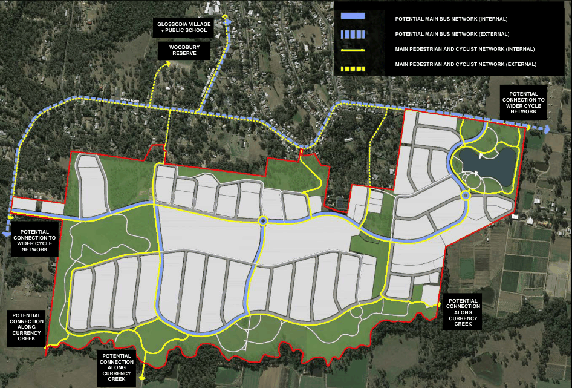

> [Picture on page 19: a map, saved as a picture (images/jacaranda-at-glossodia-page-19-19.gif, 150 dpi); the street names and other small labels are on the picture.]
> Words printed on the picture (title and legend, copied from the PDF):
> POTENTIAL MAIN BUS NETWORK (INTERNAL)
> \+ PUBLIC SCHOOL
> POTENTIAL MAIN BUS NETWORK (EXTERNAL)
> MAIN PEDESTRIAN AND CYCLIST NETWORK (INTERNAL)
> MAIN PEDESTRIAN AND CYCLIST NETWORK (EXTERNAL)

#### Figure 7 Movement Network

Source: Onecollective

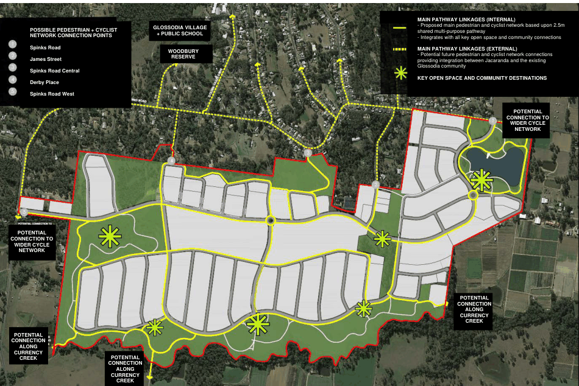

> [Picture on page 20: a map, saved as a picture (images/jacaranda-at-glossodia-page-20-1.gif, 150 dpi); the street names and other small labels are on the picture.]
> Words printed on the picture (title and legend, copied from the PDF):
> MAIN PATHWAY LINKAGES (INTERNAL)
> - Proposed main pedestrian and cyclist network based upon 2.5m
> shared multi-purpose pathway
> - Integrates with all key open space and community connections
> MAIN PATHWAY LINKAGES (EXTERNAL)
> - Potential future pedestrian and cyclist network connections
> providing integration between Jacaranda and the existing
> KEY OPEN SPACE AND COMMUNITY DESTINATIONS
> \+ PUBLIC SCHOOL
> POSSIBLE PEDESTRIAN + CYCLIST
> NETWORK CONNECTION POINTS
> Spinks Road Central
> Spinks Road West

Figure 8 Proposed key pedestrian and cyclist connectivity within Jacaranda and to existing Glossodia community Source: OneCollective

#### 2.3.2 Open Space and Public domain

#### Open Space Network

#### Objectives

O.1 To deliver a combination of conservation and passive and active recreation within an Open Space Network that incorporates the riparian corridor as well as other open space corridors, environmental conservation reserves and parks. O.2  To provide access to recreation opportunities within 400m for residents

O.3 To retain view corridors to toward currency creek and the Blue Mountains from public spaces on the

central ridgeline particularly through the western biodiversity area, eastern biodiversity area and central

roundabout areas.

O.4 To ensure recreation areas to be free from burdens/constraints from utility provision e.g. electricity

easements. All drainage easements to be excluded from recreation area calculations / mapped

differently. O.5 To protect and conserve remnant native vegetation in the open space/public domain and enhance biodiversity local native vegetation where feasible.

#### Controls

C.1 The open space network with Jacaranda will incorporate the following key open space features: A. Village Green B. Lake Park C. Passive Recreation Areas

C.2 All streets focus view lines and pedestrian linkages towards parks to maximise visual connectivity

C.3  Open spaces are to be provided generally in accordance with the identified open space and recreation areas shown in Figure 9. C.4 Shared pedestrian and bicycle pathways are to be provided generally in accordance with Figure 8. C.5 Development is to be sited and orientated to retain and encourage views to the Village Green and Lake Park. C.6  Where practical and safe, existing native trees should be retained in open space zones. The retention of trees is to be considered in the context of other considerations within this DCP and the existing condition of the trees. Practical is a measure of assessing the retention of trees against sensible and orderly development including the alternate development controls proposed in the draft DCP including achieving a balance of cut/fill

across the site. Safe is a measure of assessing the existing condition of the trees as assessed by an arborist. C.7  Adequate drinking fountains shall be provided at appropriate locations within the public domain in accordance with the Local VPA. C.8  Permeable/porous materials and finishes are to be used for pedestrian pathways within the open space network. C.9 Timber look aluminium to be used for park furniture. C.10 Off leash dog exercise areas must not directly adjoin the Biobank sites. C.11 Areas within the Village Green are to be planted with local native species from the relevant local native

vegetation communities to improve the habitat value, including:

• land adjacent to the riparian corridor to increase the width of the corridor to improve resilience and

connectivity along the creek and habitat provided by the riparian corridor

• the informal creek side passive areas

• the proposed WSUD / bio-basins.

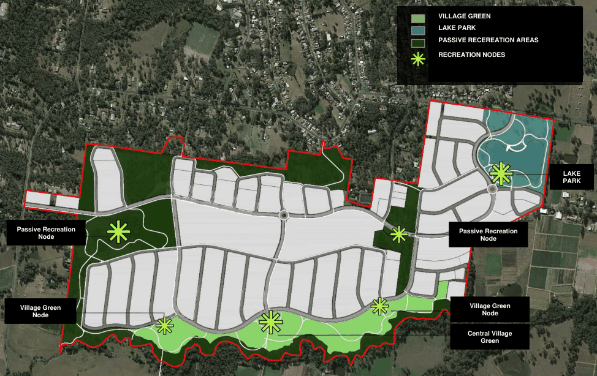

> [Picture on page 21: a map, saved as a picture (images/jacaranda-at-glossodia-page-21-22.gif, 150 dpi); the street names and other small labels are on the picture.]
> Words printed on the picture (title and legend, copied from the PDF):
> PASSIVE RECEREATION AREAS

#### Figure 9 Open Space Network

Source: Onecollective

#### Parks and Playgrounds Objectives

O.1  Provide a variety of recreation spaces, facilities and experiences that improve recreation outcomes.

O.2  Design public open spaces based upon multiple use principles that provide a range of recreational opportunities and improve maintenance outcomes. O.3  Maximise connectivity and movement between key recreational and natural assets. O.4 Implement measures to mitigate the urban heat island effect.

#### Controls

C.1 Parks and playgrounds should incorporate the following elements as detailed in the Voluntary Planning Agreement: − Active recreation areas utilising open grassed areas for informal games − Passive recreation areas to encourage enjoyment of the natural environment − Play spaces, both structured and natural, with reference to the NSW Government “Everyone Can Play” Guidelines. Type will be dependent on location − Shelters including picnic facilities, where appropriate. Galvanised steel and other hard wearing materials should be used for picnic shelters /viewing platforms. − Pathways and landscaping C.2 Playground equipment and surfacing must comply with Australian Standards AS 4685.1-6:2021. C.3 Outdoor fitness equipment must comply with the Australian Standards.

#### Table 4 Village Green

#### Character

#### A. Village Green

• A natural parkland area that is linear in nature, relates to the Currency Creek Riparian Vegetation and utilises suitable stormwater controls.

• An integrated and easily connected pedestrian and cyclist experience between the Village Green, creekline and wider open space network to encourage walking, cycling and improve accessibility, connectivity, and safety.

#### Controls

• Design the Village Green as a series of connected nodes that provide a greater spread, diversity and choice of usage and help to activate the Currency Creek frontage.

• The Village Green is to comprise the following:

a) The Main Central Green – Provide a centrally located node for recreational activity

and community gathering.

b) Secondary Nodes – Provide smaller nodes linked to the main central green –

providing more recreational diversity and choice and help to activate the creekline environments.

c) Creekline Setting – Provide nature-based cycling and walking paths and passive

recreation areas integrated with the creekline setting that increase the amenity and recreational diversity of the Village Green.

• The Village Green parkland includes:

a) Riparian corridor revegetation to strengthen the environmental value of the creek. This revegetation is to be bordered by a walking trail that provides connection to the natural attributes of the place

b) The Main Central Green that will provide children’s play, amenities, appropriate car parking and a space for informal community sports and games.

c) Secondary smaller spaces at either end that provide access to informal open spaces.

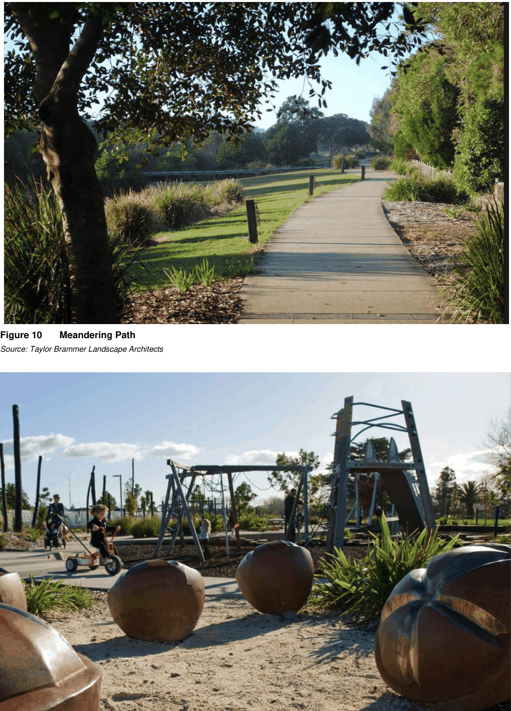

> [Picture on page 23: a picture, saved as a picture (images/jacaranda-at-glossodia-page-23-1.gif, 150 dpi).]

#### Figure 10 Meandering Path

Source: Taylor Brammer Landscape Architects

#### Figure 11 Children’s Play

Source: Taylor Brammer Landscape Architects

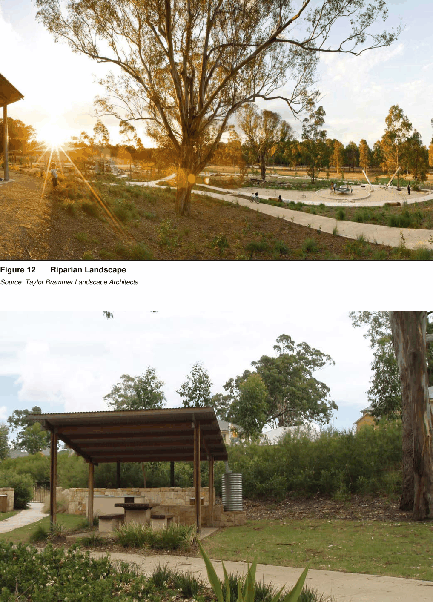

> [Picture on page 24: a picture, saved as a picture (images/jacaranda-at-glossodia-page-24-1.gif, 150 dpi).]

#### Figure 12 Riparian Landscape

Source: Taylor Brammer Landscape Architects

#### Figure 13 Picnic Shelter

Source: Taylor Brammer Landscape Architects

#### Table 5 Lake Park

#### Character

#### B. Lake Park

• Create a unique entry to the community

• Provide a central entry drive that helps to activate the Lake Park and provide a more diverse range of recreational nodes and experiences.

• Create a pedestrian friendly street interface between the Lake Park and adjoining residential to improve safety, accessibility and connectivity.

• Offer a greater variety of recreation spaces, facilities and experiences that improves recreational and community design outcomes.

• Creation of a unique entry park that utilises the adjacent water body and remnant trees across the site.

• Establish identity of Jacaranda using planting themes/signage/ fencing/walling recognising the rural character and history of the place.

#### Controls

• Introduce water safety measures such as benching where appropriate.

• Improve biodiversity and ecology by retaining existing trees within the open space

where possible and improving Lake water quality.

• Provide active and passive uses in the Lake Park.

• Provide a safe and attractive edge treatment to the lake.

• Encourage a range of uses with the Lake Park such as community markets,

children’s play, dog park and outdoor performance and exercise areas.

• Provide tree lined avenues to reinforce the sense of entry.

• Integrate stormwater controls within the Lake Park.

• Provide a continuous pedestrian link around the lake that connects the various

functions.

• Provide structured semi mature planting to establish spaces that provide shade to

mitigate the urban heat island effect and create day one impact.

• Remnant native vegetation should be retained and protected consistent with the

Biodiversity Certification Assessment Report and Strategy.

• Establish habitat areas for native fauna around the lake.

• Off-leash dog areas are prohibited directly adjacent to the lake.

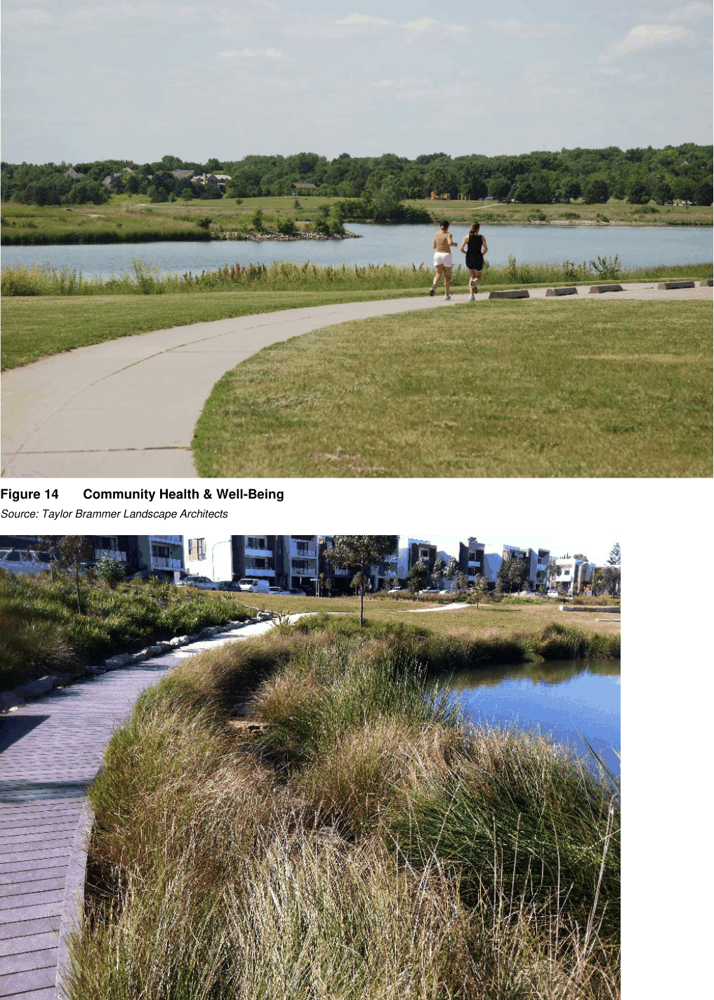

> [Picture on page 26: a picture, saved as a picture (images/jacaranda-at-glossodia-page-26-1.gif, 150 dpi).]

#### Figure 14 Community Health & Well-Being

Source: Taylor Brammer Landscape Architects

#### Figure 15 Relationship to Water

Source: Taylor Brammer Landscape Architects

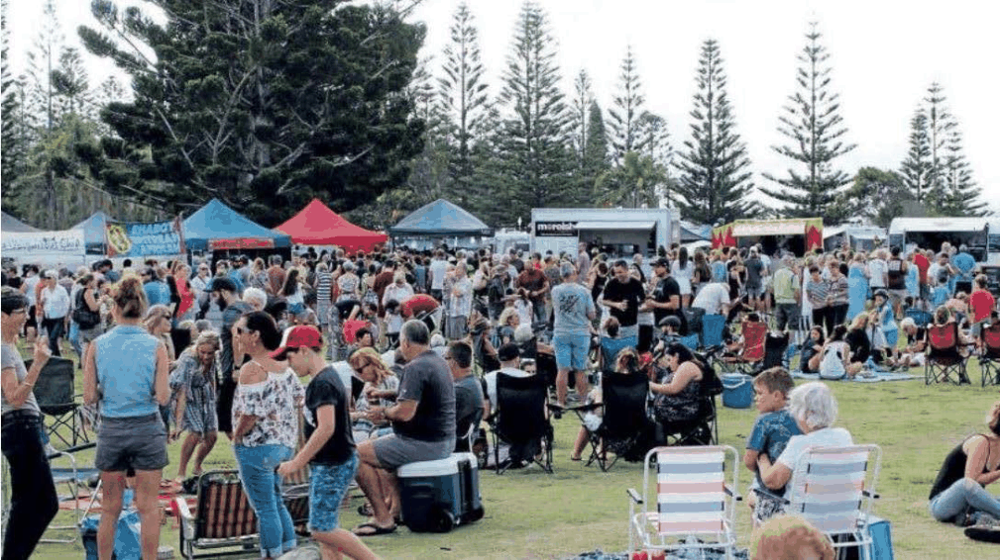

> [Picture on page 27: a picture, saved as a picture (images/jacaranda-at-glossodia-page-27-1.gif, 150 dpi).]

#### Figure 16 Community Events

Source: Taylor Brammer Landscape Architects

#### Table 6 Passive Recreational Areas

#### Character

#### C. Passive

#### Recreational Areas

• Existing woodland and remnant trees retained and valued for biodiversity.

• Pedestrian access is established with a series of meandering informal paths.

• Provide RE1 public recreation spaces (nodes) within the Biobank land areas to encourage passive recreation activities while being sympathetic to the biobank areas.

• Views and vantage points to toward Currency Creek and the Blue Mountains.

• Offer outlooks and passive recreation spaces, facilities and experiences that improve recreational outcomes.

#### Controls

• Provide carefully located walking trails on RE1 Public Recreation land, within the E2 zoned biobanking areas and permeable footpaths within parklands. Footpaths to be constructed of low maintenance permeable materials.

• Provide a series of interpretive signs in accordance with the biobank agreement

• Provide informal sitting areas in locations to appreciate the best views and natural features.

• Incorporate additional supplementary planting to parkland edges.

• Consider interface with biobank areas.

• Provide viewing areas, outlooks and vantage points to enjoy mid distant views.

• Ensure landscaping treatments retain views.

• Provide passive recreation nodes, including children’s play spaces, shelters and furniture, is easily accessible, visible and low maintenance.

• Provide hard concrete edge to recreation nodes to define edge between biobank zones and recreation areas.

• Recreation areas need to be designed to consider long term maintenance and environmental sustainability.

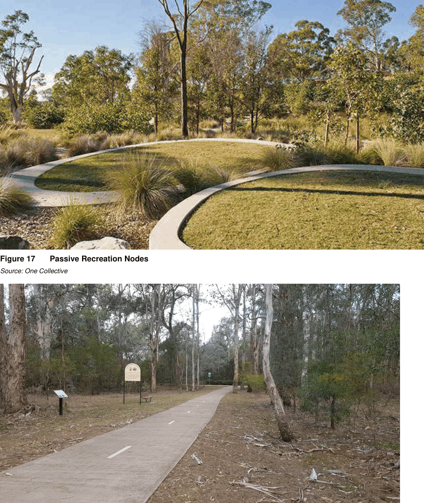

> [Picture on page 28: a picture, saved as a picture (images/jacaranda-at-glossodia-page-28-1.gif, 150 dpi).]

#### Figure 17 Passive Recreation Nodes

Source: One Collective

#### Figure 18 Pathways through Conservation Areas

Source: Taylor Brammer Landscape Architects

#### 2.3.3 Tree Retention Investigation

#### Objective

O.1 To protect and retain Cumberland Plain Woodland within the site shown ‘remnant canopy’ and ‘degraded’ within the R5 zoned land in Figures 19 and 20 where feasible on individual lots. .

#### Controls

C.1  Where practical, safe, and suitable for the tree’s long-term health, high-quality Cumberland Plain Woodland should be retained on residential lots in the R5 Large Lot Residential zone. C.2 High-quality Cumberland Plain Woodland are to be individually assessed by an arborist prior to subdivision with an arborist report required for each DA. Individual trees considered to provide significant habitat and amenities are to be retained and incorporated into lots wherever practicable. The retention of trees is to be

considered in the context of other considerations within this DCP and the existing condition of the trees. C.3 Where trees with significant habitat are identified to be removed, the tree hollows and tree trunks shall be

relocated to the Riparian Corridor and/or Biobank Areas to improve habitat. C.4 Where high-quality Cumberland Plain Woodland trees are removed, they will be replaced at a ratio of at least two new trees for each tree removed.

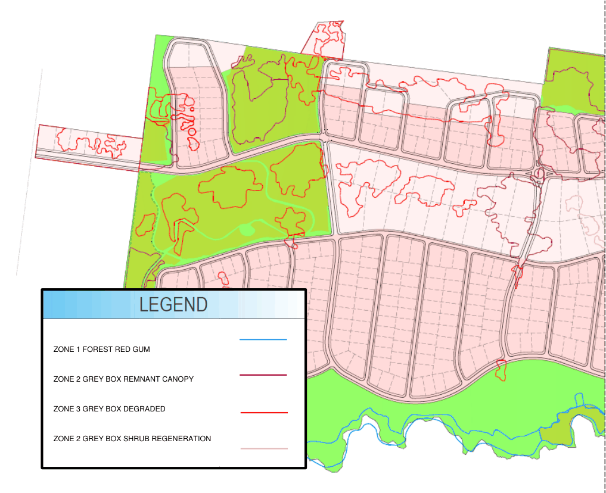

> [Picture on page 29: a picture, saved as a picture (images/jacaranda-at-glossodia-page-29-12.gif, 150 dpi).]
> Words printed on the picture (title and legend, copied from the PDF):
> ZONE 1 FOREST RED GUM
> ZONE 2 GREY BOX REMNANT CANOPY
> ZONE 3 GREY BOX DEGRADED
> ZONE 2 GREY BOX SHRUB REGENERATION

#### Figure 19 Tree Retention Investigation

Source: Orion Consulting

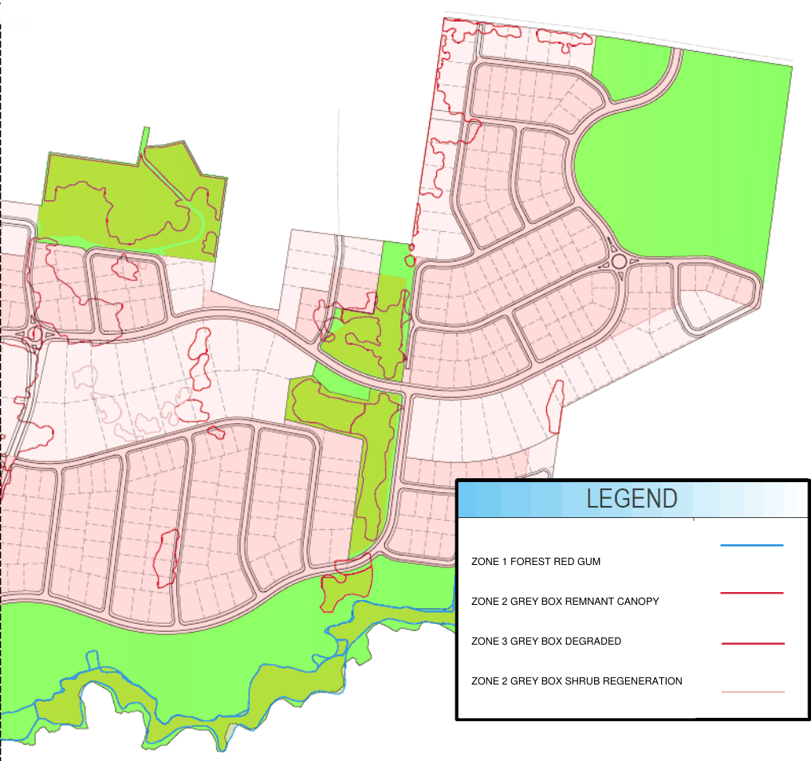

> [Picture on page 30: a picture, saved as a picture (images/jacaranda-at-glossodia-page-30-1.gif, 150 dpi).]
> Words printed on the picture (title and legend, copied from the PDF):
> ZONE 1 FOREST RED GUM
> ZONE 2 GREY BOX REMNANT CANOPY
> ZONE 3 GREY BOX DEGRADED
> ZONE 2 GREY BOX SHRUB REGENERATION

#### Figure 20 Tree Retention Investigation

Source: Orion Consulting

#### 2.3.4 Sustainability and Resilience

#### Objectives

O.1 To maximise the benefits of tree canopy and greener streets to residential lots. O.2 To minimise energy and water usage and greenhouse emissions and encourage the adoption of renewable energy initiatives. O.3 To prevent and minimise the impacts of urban heat island effect.

#### Controls

C.1 Street trees and landscaping within residential lots are to maximise solar access to dwellings during winter, and shade during summer. Deciduous species are preferred for the northern sides of dwellings to maximise the climatic and amenity benefits of trees and provide for adequate solar access to dwellings and private open space. C.2 All lots within Jacaranda shall be connected to the recycled water system for non-potable uses. C.3  Solar (PV) system installation is required on all non-residential buildings/structures.

C.4 All dwellings shall have roofing materials with a solar absorptance value of 0.70 or less. C.5 Subdivision applications are to demonstrate measures intended to mitigate the urban heat island effect.

#### 2.3.5 Infrastructure and Utilities

#### Objective

O.1 To permit appropriate infrastructure provision.

#### Control

C.1 Ideally, no utilities are to be permitted within riparian areas. If necessary, they may cross riparian areas but not run the length of riparian areas and should be underground. C.2  Infrastructure and utilities are to be in accordance with biobank requirements. C.3  Drainage infrastructure should be on separate lots to recreation areas to facilitate categorisation as operational land. C.4   All electricity within the subdivision is to be underground. C.5  A reticulated recycled water system is to provide recycled water from the proposed Glossodia Local Water Centre for domestic non-potable uses such as toilet flushing, washing machines, garden irrigation and car washing. Recycled water may be used in public parkland for irrigation of lawns and gardens provided there is no direct impact to biobank sites and biodiversity values.

#### 2.3.6 Subdivision Staging

#### Objective

O.1 To provide for logical sequencing of development.

#### Control

C.1 The staging of subdivision within Jacaranda is to occur from east to west and generally in accordance with Figure 21. Staged applications must demonstrate that appropriate access to infrastructure and services is available and that construction works aim to mitigate environmental harm. C.2 Sub-staging is permitted. C.3 Out of sequence staging will be required to demonstrate appropriate access to infrastructure and services for residents.

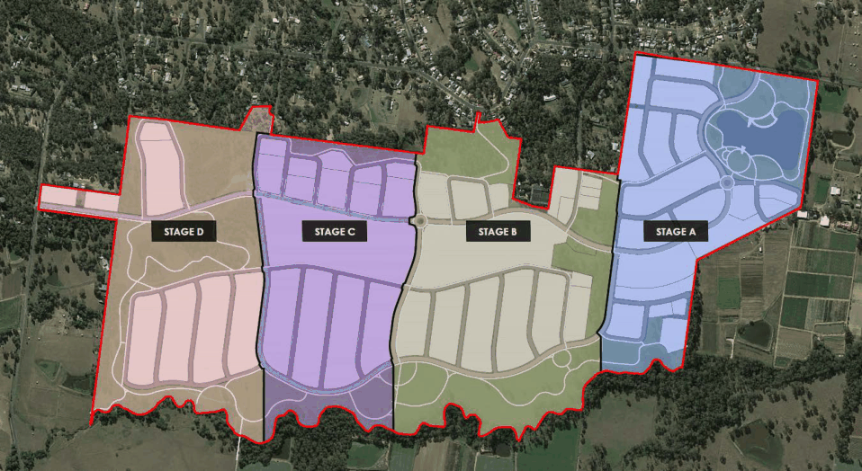

> [Picture on page 32: a picture, saved as a picture (images/jacaranda-at-glossodia-page-32-1.gif, 150 dpi).]

#### Figure 21 Indicative Staging Plan

Source: OneCollective

#### 2.3.7 Development Yield

#### Objective

O.1 To limit the development capacity of Jacaranda.

#### Control

C.1 A maximum of 580 lots at Jacaranda. C.2 Lot yields per stage are to be generally in accordance with Table 7.

#### Table 7 Lot Yield

| STAGE | YIELD RANGE |
|---|---|
| A | 150 - 160 |
| B | 140 - 150 |
| C | 155 - 165 |
| D | 115 - 125 |
