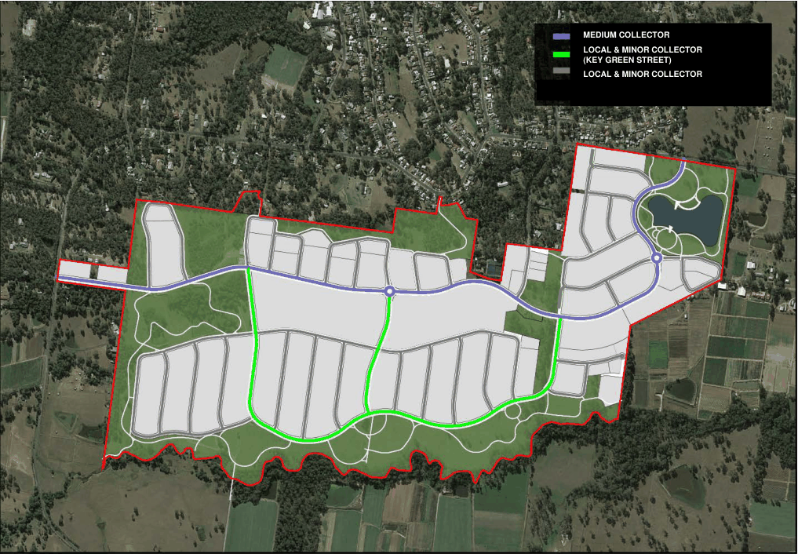
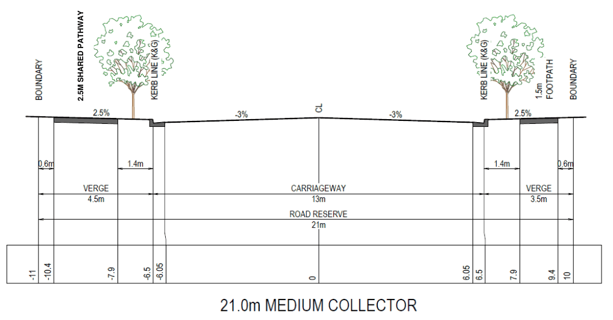
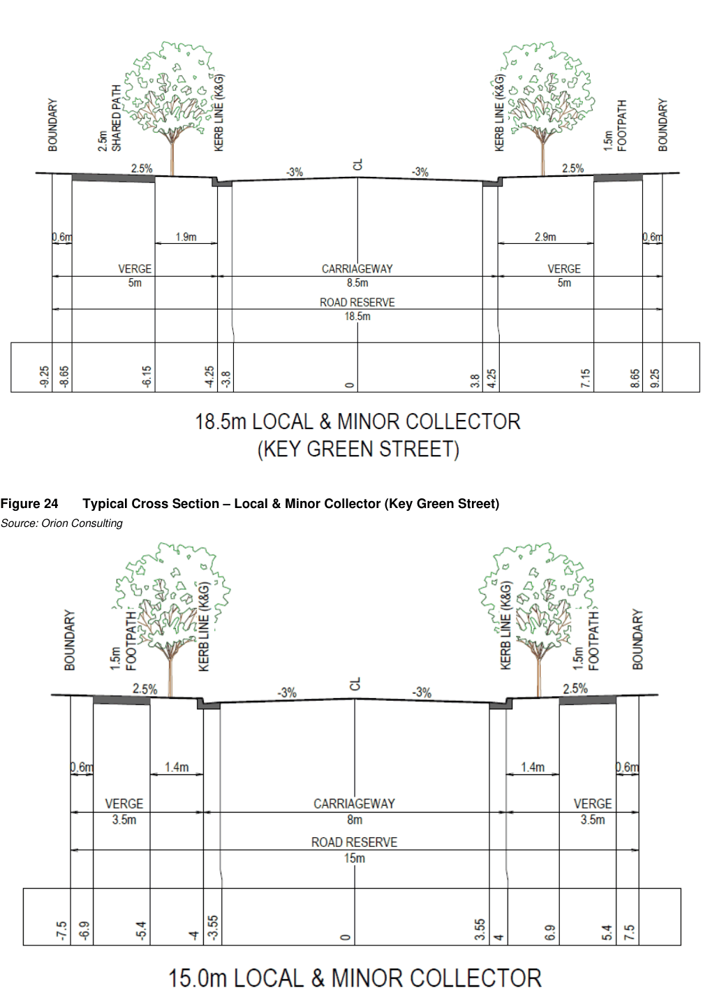
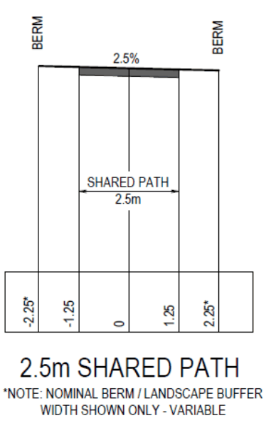
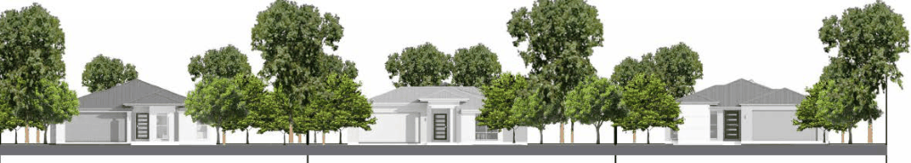
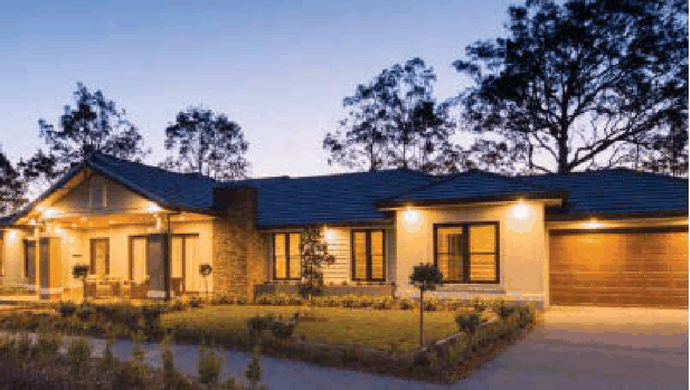
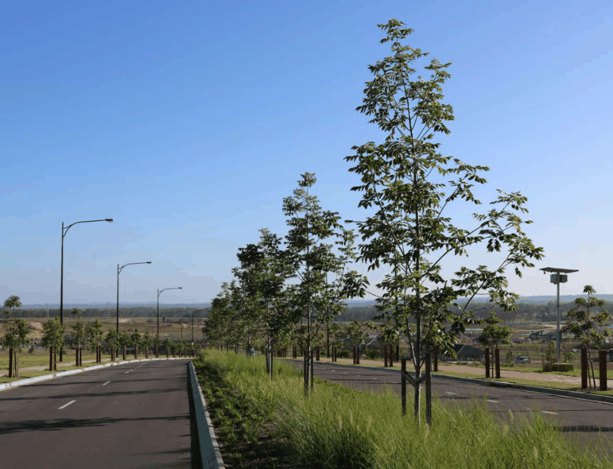

### 3.0 Controls for Development in the Residential Zones

### 3.1 Urban Design

#### 3.1.1 Street Hierarchy, Layout and Design

> [Picture on page 33: a picture, saved as a picture (images/jacaranda-at-glossodia-page-33-4.gif, 150 dpi).]
> Words printed on the picture (title and legend, copied from the PDF):
> MEDIUM COLLECTOR
> LOCAL & MINOR COLLECTOR
> (KEY GREEN STREET)
> LOCAL & MINOR COLLECTOR

#### Figure 22 Street Hierarchy Plan

Source: OneCollective

#### Objectives

O.1 Establish a hierarchy of interconnected streets that give safe, convenient, and clear access within and beyond Jacaranda. O.2  Contribute to the creation of an interesting and attractive streetscape. O.3 Where possible take account of topography and site drainage and accommodate significant vegetation. O.4  Provide intersections, traffic and where appropriate, parking lanes that naturally calm traffic.

#### Controls

C.1 The design of streets, roundabouts and intersections is to be consistent with the relevant typical street sections shown at Figures 23 to 25. Where streets adjoin open space the verge width can be reduced to 1m width. C.2 Streets within Jacaranda are to function as one of the following typologies within the transport network hierarchy: A. Medium Collector: The main access routes into and out of Jacaranda, distributing traffic throughout the site, and providing for potential bus routes, with off-road pedestrian and cyclist paths. B. Local & Minor Collector (Key Green Street): Linking the collector roads to residential areas. C. Local & Minor Collector: Providing local property access with provisions for pedestrians, cyclists, and vehicles.

C.3 Alternative street designs for local streets and access ways may be permitted on a case by case basis if they preserve the functional objectives and requirements of the design standards. C.4 The construction and operation of temporary access roads is permitted where necessary to ensure that access to residential properties is provided in the early stages of development. Temporary access roads are to remain in operation only until such time as the road network has been developed to provide permanent access to all properties. C.5  Where four-way intersections are proposed, traffic is to be controlled, where appropriate, by roundabouts, median strips, or signage. C.6 The proposed bus route is to be located on Medium Collector roads and other roads as shown on Figure 47 in order to ensure that most residents (at least 85%) are within walking distance (400m) of a bus stop. C.7  Establish safe crossing points across Medium Collector roads and all critical intersections for pedestrians and cyclists C.8 Pedestrian footpaths shall be at least 1.5m wide to facilitate easy and convenient pedestrian movements and should be constructed on at both sides of Local & Minor Collector Roads. C.9 Barrier kerb is required for all streets. C.10 A Traffic report is required for subdivision Development Applications. C.11 Driveways from lots are not permitted with direct access to Spinks Road. Access to lots is to be from the internal road network. C.12 All footpaths and shared pathways within the main pedestrian and cyclist network to be constructed with concrete.

> [Picture on page 34: a picture, saved as a picture (images/jacaranda-at-glossodia-page-34-21.gif, 150 dpi).]
> Words printed on the picture (title and legend, copied from the PDF):
> 2.5M SHARED PATHWAY

#### Figure 23 Typical Cross Section – Medium Collector Road

Source: Orion Consulting

> [Picture on page 35: a picture, saved as a picture (images/jacaranda-at-glossodia-page-35-1.gif, 150 dpi).]

#### Figure 24 Typical Cross Section – Local & Minor Collector (Key Green Street)

Source: Orion Consulting

#### Figure 25 Typical Cross Section – Local & Minor Collector

Source: Orion Consulting

> [Picture on page 36: a picture, saved as a picture (images/jacaranda-at-glossodia-page-36-1.gif, 150 dpi).]

#### Figure 26 Typical Cross Section – Pedestrian/Cycle Link

Source: Orion Consulting

#### 3.1.2 Streetscape Character

#### Objectives

O.1  Create a ‘semi-rural style village’ that respects and integrates with the character of the existing Glossodia Village whilst reflecting contemporary urban design and architecture principles. O.2 Streetscapes are designed to complement the semi-rural character of the site and retain existing local native trees and other native species where feasible to reflect a green ’leafy’ feel.

O.3 Seek opportunity for existing native trees to be retained where feasible within front setbacks and between houses on R5 zoned lots to create a more open and greener character. .

#### Controls

C.1  Retaining walls, side fencing, rear fencing heights and materials are to reflect the character of the sub-precinct. C.2 Buildings are to be designed and sited to reflect the desired character of the sub-precinct it is located within, as identified by Figure 3 and described within Table 2. C.3 Building design is to be compatible with the semi-rural character of the area and may incorporate contemporary expressions of design elements. C.4 External fixtures must not detract from the appearance of the building or the streetscape. C.5 Articulation must extend forward of the minimum front building line setback by up to 2m (articulation zone) for feature elements to enhance façade articulation and design. Acceptable building elements within the articulation zone include:

- entry feature or portico

- awnings or other features over windows

- eaves and sun shading structures

- window box treatment

- bay windows or similar features

- balconies, verandas, pergolas, or the like C.6 Wrap around verandas are permitted so long as they are compatible with the semi-rural character of the site. C.7   External wall materials are to be limited to weatherboard or plywood sheeting, rendered and bagged masonry, stone, glass, metal sheeting or uniform face bricks. Other external wall materials that can demonstrate clear sustainability benefits to Council are permitted. C.8 External colours are to be muted earth and bush vegetation tones. Large areas of primary, vibrant colours are to be avoided.

> [Picture on page 37: a picture, saved as a picture (images/jacaranda-at-glossodia-page-37-11.gif, 150 dpi).]

#### Figure 27 Typical streetscape character

Source: Onecollective

> [Picture on page 37: a picture, saved as a picture (images/jacaranda-at-glossodia-page-37-14.gif, 150 dpi).]

#### Figure 28 Typical Jacaranda Home

Source: Onecollective

#### 3.1.3 Street Tree Planting, Lighting and Furniture

#### Objectives

O.1 To establish a hierarchy of interconnected streets that give safe, convenient and clear access within and beyond the Precinct. O.2  To contribute to the creation of an interesting and attractive streetscape.

O.3 To provide cool, green leafy streets to complement the semi-rural character of the site.

#### Controls

C.1 Street trees are required for all streets. Street planting is to:

- use the preferred species listed in Table 8;

- be consistently used to distinguish between public and private spaces and between different classes of street within the street hierarchy;

- provide an attractive and interesting landscape character without blocking the potential for street surveillance.

- minimise risk to utilities and services;

- be durable and suited to the street environment and, wherever appropriate, include endemic species;

- maintain adequate lines of sight for vehicles and pedestrians, especially around driveways and street corners;

- provide appropriate shade in summer and solar access in winter; and

-  be healthy and vigorous at the time of delivery and planting. C.2  Where appropriate tree planting shall be considered alongside the off road pedestrian pathways/shared cycleways.

C.3 Signage, street furniture and lighting is to be: − designed to reinforce the district identity of Jacaranda; − coordinated in design and style; − located to minimise visual clutter and obstruction of the public domain; and − of a colour and specification agreed with Council. C.4  Root director W Series or equivalent is to be installed in either RDW600 for new trees on local streets or RDW900 for new trees on Collector Roads. Structural soil to be used as backfilling to provide better conditions for root growth. C.5 The electrical network shall be underground. C.6  Street tree spacing shall be modified to avoid conflict with driveways, utilities and street lighting. C.7 Subdivision applications are to demonstrate measures to mitigate the urban heat island effect. C.8 Street trees are to provide a vertical height clearance of 4m for vehicles at maturity. C.9 Permeable driveways for individual dwellings are preferred. Driveways are to be identified and agreed at the subdivision DA stage in coordination with the street trees and solar passive design. C.10 Timber look aluminium to be used for street furniture. C.11 Concept Street Lighting Plan must accompany any Master Plan Development Application for the subject site.

#### Table 8 Indicative Street Tree Species List

#### Medium Collector Road

| BOTANICAL NAME | COMMON NAME | MATURE HEGHT | SPREAD | SPACING | PLANTING SPACE (ROOT WELL) |
|---|---|---|---|---|---|
| Acer ‘Crimson Sentry’ | Crimson Sentry | 7m | 4m | 8-15m | 5-7m3 |
| Acer freemanii | Autumn Blaze | 13m | 10m | 8-15m | 5-7m3 |
| Acmena smithii | Creek Lilly Pilly | 15m | 3m | 8-15m | 5-7m3 |
| Backhousia citriodora | Lemon-scented Myrtle | 12m | 4-6 | 8-15m | 5-7m3 |
| Cupaniopsis anacardioides | Tuckeroo | 15m | 3-5m | 8-15m | 5-7m3 |
| Fraxinus ‘Cimmaron’ | Cimmaron Ash | 13m | 8m | 8-15m | 5-7m3 |

| Jacaranda mimosifolia | Jacaranda | 15m | 15-25m | 8-15m | 5-7m3 |
|---|---|---|---|---|---|
| Magnolia ‘Exmouth’ | Magnolia ‘Exmouth’ | 12m | 5m | 8-15m | 5-7m3 |
| Magnolia ‘Little Gem’ | Little Gem | 6m | 3m | 8-15m | 5-7m3 |
| Pyrus ‘Aristocrat’ | Ornamental Pear | 11m | 7m | 8-15m | 5-7m3 |
| Pyrus ‘Chanticleer’ | Ornamental Pear | 11m | 6m | 8-15m | 5-7m3 |
| Waterhousea floribunda | Weeping Lilly Pilly | 8m | 5m | 8-15m | 5-7m3 |
| Zelkova serrata ‘Green Vase’ | Green Vase | 14m | 10m | 8-15m | 5-7m3 |

#### Local & Minor Collector (including Key Green Street)

| BOTANICAL NAME | COMMON NAME | MATURE HEGHT | SPREAD | SPACING | PLANTING SPACE (ROOT WELL) |
|---|---|---|---|---|---|
| Acer freemanii | Autumn Blaze | 13m | 10m | 8-20m | 3-5m3 |
| Acmena smithii | Creek Lilly Pilly | 15m | 3m | 8-20m | 3-5m3 |
| Backhousia citriodora | Lemon-scented Myrtle | 12m | 4-6 | 8-20m | 3-5m3 |
| Cupaniopsis anacardioides | Tuckeroo | 15m | 3-5m | 8-20m | 3-5m3 |
| Elaeocarpus eumundi | Quandong | 7m | 2m | 8-20m | 3-5m3 |
| Fraxinus ‘Cimmaron’ | Cimmaron Ash | 13m | 8m | 8-20m | 3-5m3 |
| Ginkgo biloba | Maidenhair Tree | 12m | 5m | 8-20m | 3-5m3 |
| Hymenosporum flavum | Native Frangipani | 8m | 6m | 8-20m | 3-5m3 |
| Livistona australis | Cabbage tree palm | 30m | 0.5m | 8-20m | 3-5m3 |
| Magnolia ‘Exmouth’ | Magnolia ‘Exmouth’ | 12m | 5m | 8-20m | 3-5m3 |
| Melaleuca decora | Paperbark | 9m | 5m | 8-20m | 3-5m3 |
| Pyrus ‘Chanticleer’ | Ornamental Pear | 11m | 6m | 8-20m | 3-5m3 |
| Pyrus nivalis | Snow Pear | 8m | 5m | 8-20m | 3-5m3 |
| Syzygium australe | Lilly Pilly | 8m | 6m | 8-20m | 3-5m3 |
| Tristaniopsis laurina ‘Luscious’ | Water Gum | 10m | 3-8m | 8-20m | 3-5m3 |
| Ulmus parvifolia | Chinese elm | 13m | 12m | 8-20m | 3-5m3 |
| Waterhousea floribunda | Weeping Lilly Pilly | 15m | 7m | 8-20m | 3-5m3 |
| Zelkova serrata | Green Vase | 14m | 10m | 8-20m | 3-5m3 |

> [Picture on page 40: a picture, saved as a picture (images/jacaranda-at-glossodia-page-40-1.gif, 150 dpi).]

#### Figure 29 Streetscapes are to have a green leafy character and outlook

Source: Celestino
