### 3.2 Residential Design

#### 3.2.1 Character

O.1 To provide for the housing needs of the community within a low-density residential environment that responds to the surrounding land use and landscape context. O.2 Promote well-designed buildings that make a positive contribution to the streetscape and amenity of the neighbourhood. O.3 Encourage a form of housing that is low in scale and complements the rural and bushland character of the site and neighbourhood. O.4 Ensure development makes the best use of a site’s natural and other positive features, and considers amenity, streetscape and energy efficiency at the outset. O.5  The materials and finishes selected for dwellings should harmonise with the natural environment and respond to the existing character of the existing Glossodia Village. O.6 Has a distinctive Australian, contemporary rural appearance and character. O.7 Protect the natural character of adjacent rural or ecological zones and existing natural features and landscape. O.8 Maintain a sense of openness and rural character in areas proposed for residential development.

#### Controls

Character C.1 Residential development is to be consistent with the character of each of the precincts as outlined in Table 2. C.2 The scale of new development is to be consistent with the desired future character and of a residential scale that allows the natural environment to visually dominate.

C.3 Dwellings on R2 zoned lots are to address the public domain and to reinforce a sense of security and community. In particular main entry doors and windows of habitable rooms should face the street. C.4 While the natural character and landscape visually dominate, the building form and setback of dwellings on R2 zoned lots contribute to the street character. C.5 The natural character and landscape visually dominate the street character on R5 zoned lots. C.6 Passive solar design principles should be governing the design of homes within Jacaranda. C.7  All development proposals should consider the urban heat island effect and should propose suitable measures to minimise such as permeable surfaces, light coloured roofs and a high percentage of mature tree canopy cover considering different constraints for example Planning for Bushfire Protection, ongoing maintenance costs, allowing for developable building envelopes for purchasers and passive solar design.

#### 3.2.2 Lot Size

#### Low Density Residential Zone (R2) Objective

O.1 To provide for the housing needs of the community within a low-density residential environment that responds to the surrounding land use and landscape context.

#### Controls

C.1  The minimum average lot frontage is to be 20m. C.2 The minimum average lot depth is to be 40m.

#### Large Lot Residential Zone (R5) Objectives

O.1 To provide residential housing in a rural setting while preserving, and minimising impacts on environmentally sensitive locations and scenic quality. O.2 To minimise conflict between large lot residential uses and adjoining land uses.

#### Controls

C.1  The minimum average lot frontage is to be 30m. C.2 The minimum average lot depth is to be 50m.

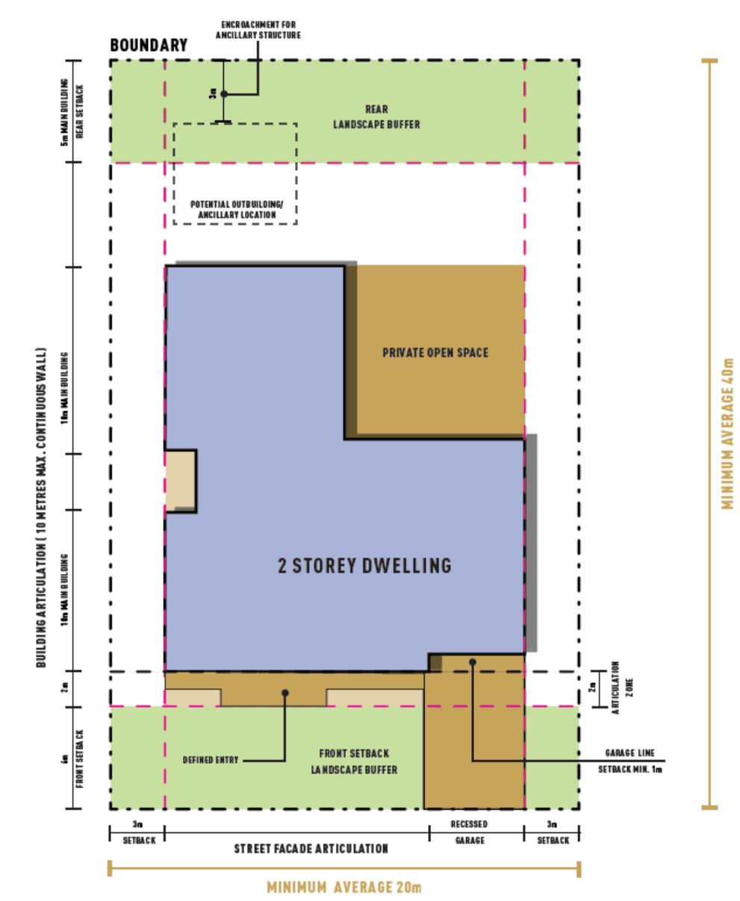

> [Picture on page 42: a picture, saved as a picture (images/jacaranda-at-glossodia-page-42-1.gif, 150 dpi).]

#### Figure 30 Typical R2 Low Density Residential lot type and character

Source: Jackson Teece

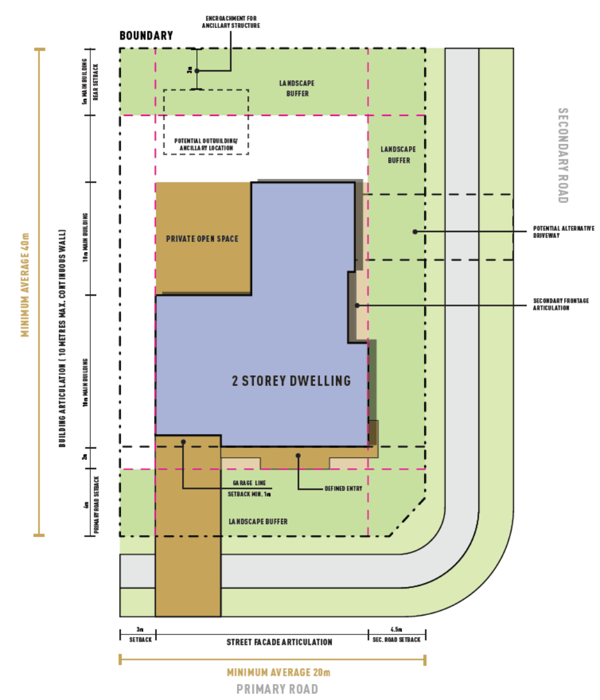

> [Picture on page 43: a picture, saved as a picture (images/jacaranda-at-glossodia-page-43-1.gif, 150 dpi).]

#### Figure 31 Typical R2 Low Density Residential corner lot type and character

Source: Jackson Teece

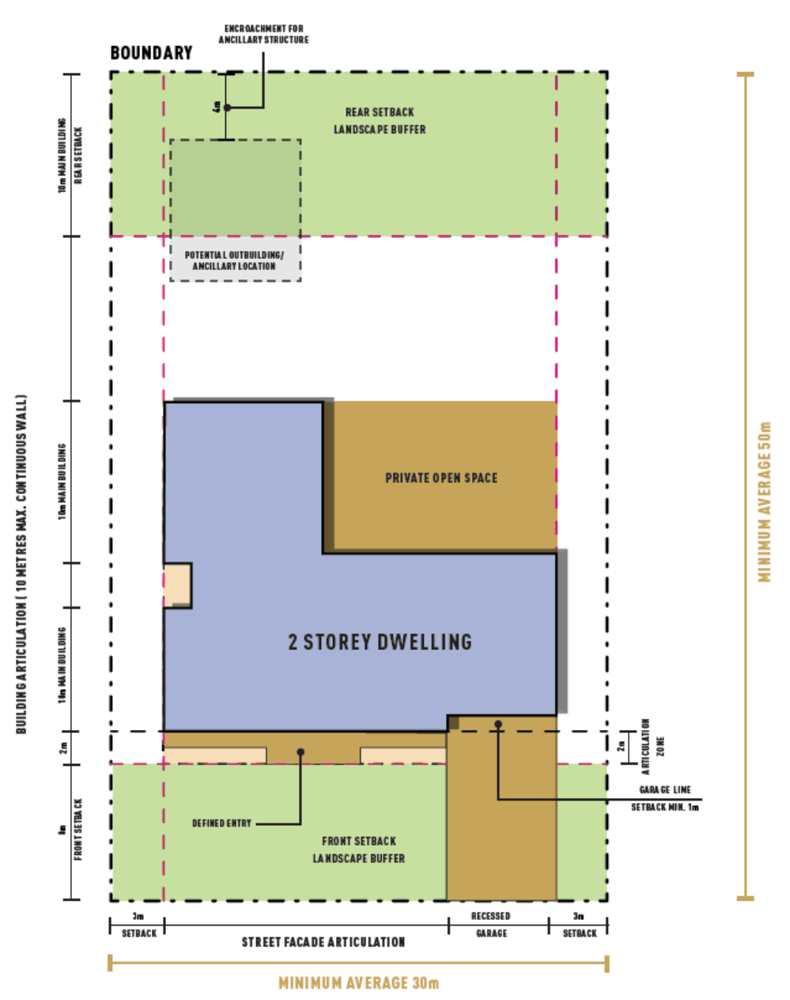

> [Picture on page 44: a picture, saved as a picture (images/jacaranda-at-glossodia-page-44-1.gif, 150 dpi).]

#### Figure 32 Typical R5 Low Density Residential lot type and character

Source: Jackson Teece

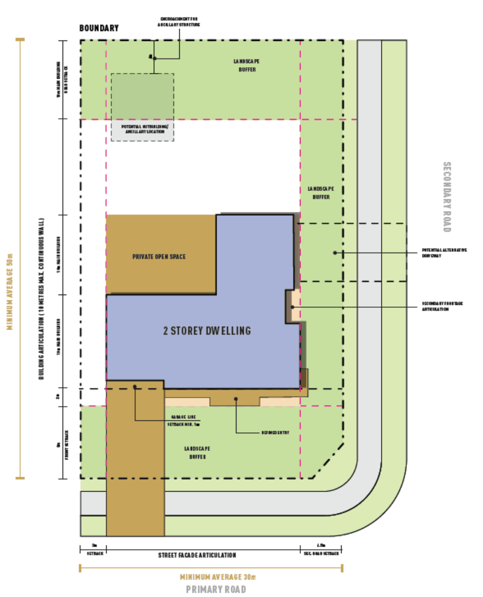

> [Picture on page 45: a picture, saved as a picture (images/jacaranda-at-glossodia-page-45-1.gif, 150 dpi).]

#### Figure 33 Typical R5 Low Density Residential corner lot type and character

Source: Jackson Teece

#### 3.2.3 Built Form

#### Objectives

O.1  To ensure that built form responds to the public domain. O.2  To encourage ecologically sustainable development.

#### Controls

C.1  The building entry is to be visible from the street and clearly defined in built form. C.2  Buildings are to include articulation elements such as patios, verandahs, eaves, pergolas, balconies, balustrades, porticos. These structures may encroach up to 2m into the front setback area/articulation zone. C.3  All rooftop services, vents and lights are to be integrated into roof design. C.4  Solar roof panels are permitted and encouraged

#### 3.2.4 Siting & Setbacks

#### Objectives

O.1  To enable the integration of built and landscape elements to create an attractive, visually consistent streetscape. O.2  To allow some flexibility for residences to achieve better orientation for sun, shade, wind and neighbouring development, and better use of allotments to create private open space and courtyards. O.3  To encourage simple and articulated building forms. O.4  To ensure garages do not dominate the streetscape.

#### Controls

C.1 Dwellings are to be consistent with the front setback controls and principles in Figures 30 & 31 for Low Density Residential or Figures 32 & 33 for Large Lot Residential. The Height Planes in Part D Chapter 1 Section 1.3 do not apply to dwellings at Jacaranda. C.2 Within the R2 zone dwellings may be sited beyond the prescribed front and secondary street setback to a maximum of 2m. A consistent building/street alignment is expected. C.3 Within the R5 zone dwellings are generally to address the public domain and to reinforce a sense of security and community on smaller lots. C.4  Within the R5 zone dwellings may be sited beyond the prescribed front and secondary street setback. No consistent building/street alignment is expected. C.5 Site planning should be designed to provide opportunity to plant at least two trees within each residential lot and some trees within the public domain. C.6 A site analysis should support any Development Application for a dwelling house to assist in design decisions based on site conditions and surrounding context and assess the impacts of the development on the site and its surroundings. C.7 The key issues to be considered in the site planning and layout include:

• Privacy for occupants and the maintenance of neighbours’ privacy and amenity.

• Sufficient solar access and natural ventilation to provide a comfortable and energy efficient living environment for residents and neighbours.

• Location and design of dwellings to avoid adverse impacts on adjoining properties in terms of overshadowing.

• Well located and useable private outdoor areas for residents.

• The street character is maintained through setbacks, separation and height, driveway, and car parking location.

• Circulation and access suitably located for the development and the locality.

• Design and construction suitable to the slope of the land, minimising the need for cut and fill and considering any geotechnical constraints.

• Minimising tree removal by locating the development to retain existing vegetation, if appropriate

• Safety and surveillance of the development and the locality is maximised.

• Location of bush fire asset protection zones.

C.9 Dwellings on corner lots:

• Are to address both the street frontages through design and landscaping.

• The feature articulation element (porch/verandah) must wrap around the corner 2m behind the front building line at a depth that is equal to the articulation element adopted along the front facade.

• The feature articulation element on the secondary frontage may encroach in the side setback no more than 2m.

• Wall material variation and colours should extend to the side fence return on the secondary street frontage.

• Landscape features and planting should continue around the corner.

• The façade facing the secondary street frontage should be articulated to avoid long walls and provide a variety of materials.

• Setbacks on corner lots should be consistent with the setbacks identified in Figures 31 & 33.

• The garage can be accessed from either road frontage, subject to compliant sightlines and distances from intersections and adjacent driveways.

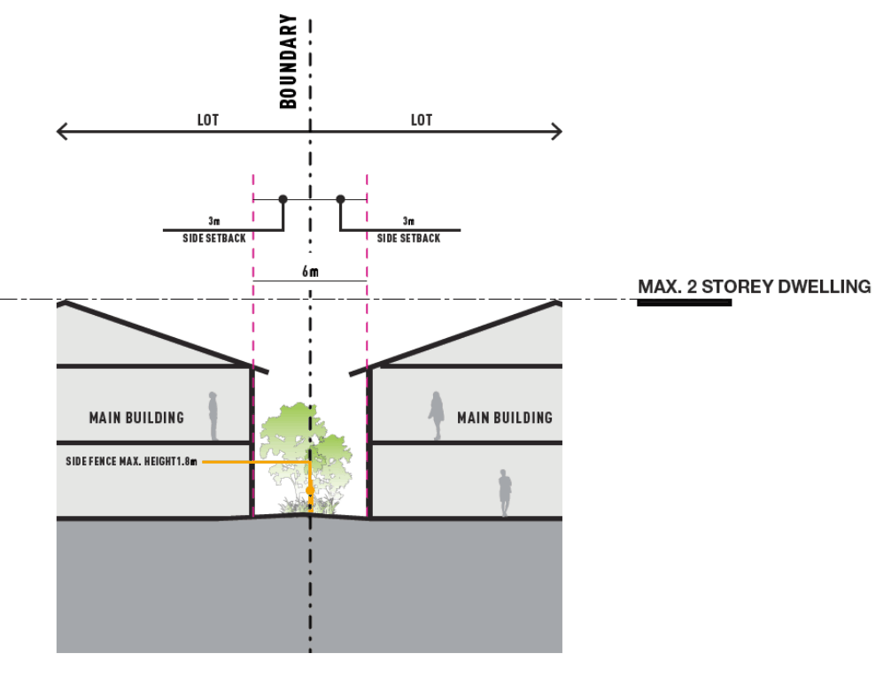

> [Picture on page 47: a picture, saved as a picture (images/jacaranda-at-glossodia-page-47-20.gif, 150 dpi).]

#### Figure 34 Site Section Lot Interface

Source: Jackson Teece

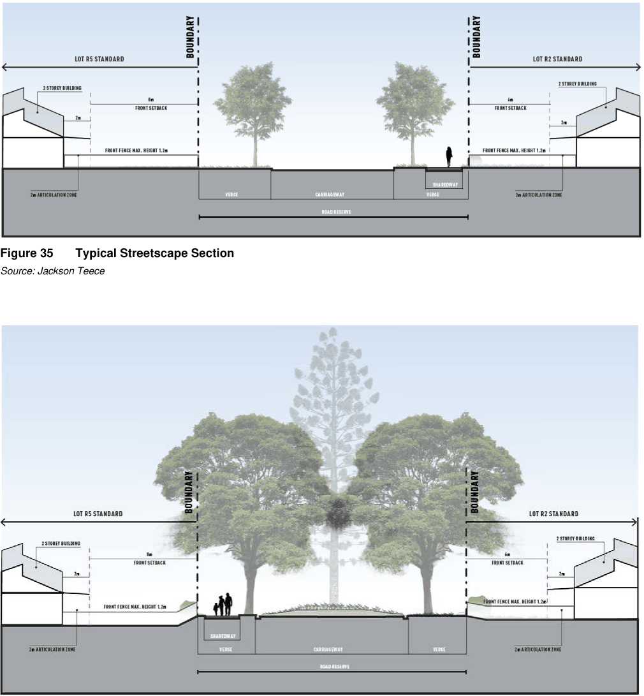

> [Picture on page 48: a picture, saved as a picture (images/jacaranda-at-glossodia-page-48-1.gif, 150 dpi).]

#### Figure 35 Typical Streetscape Section

Source: Jackson Teece

#### Figure 36 Typical Streetscape Section - Sloping

Source: Jackson Teece

#### 3.2.5 Height of Buildings

#### Objective

O.1  Provide for appropriate height commensurate with the site constraints and opportunities where potential impacts can be mitigated.

#### Control

C.1 The maximum height is two storeys except where it can be demonstrated that a third storey does not dominate the streetscape or unreasonably overshadow adjoining properties and the topography of the site is appropriate as demonstrated in Figure 37. C.2 Basements are not included in the calculation of building height where they do not exceed 1.2 metres above finished ground level.

#### 3.2.6 Private Open Space

#### Objective

O.1  Lot design considers the private open space needs of future residents.

#### Controls

C.1  Each dwelling is to be provided with an area of Private Open Space that contains an area of Principal Private Open Space (PPOS). C.2 The size and location of the PPOS is to be determined having regard to dwelling design, allotment orientation, adjoining dwellings, landscape features and topography as illustrated in Figures 40 & 41. C.3 The PPOS should be directly accessible from living rooms and be located behind the building line. C.4 At least 50% of the area of the required PPOS should receive solar access for at least 3 hours of sunlight between 9am and 3pm at the winter solstice (21 June).

#### 3.2.7 Sloping Sites

#### Objectives

O.1  Ensure built form responds to the topography of the site.

#### Controls

C.1 Slab-on-ground construction is not suitable for steeply sloping sites due to excavation, retaining and waterproofing requirements. C.2  On sloping sites, the footprint of the building should be broken into appropriately sized sections to reduce the extent of cut and fill required. C.3  Cut or fill should be limited to 1.2m in height /depth from the natural level of the land. Where this is impracticable on steep sites the design for split levels should be considered to follow the topography. C.4 Under croft spaces are to be designed and constructed so that:

• They are finished with even grades.

• Services, storage areas and cut/fill surfaces should be concealed from view by battens or other screening.

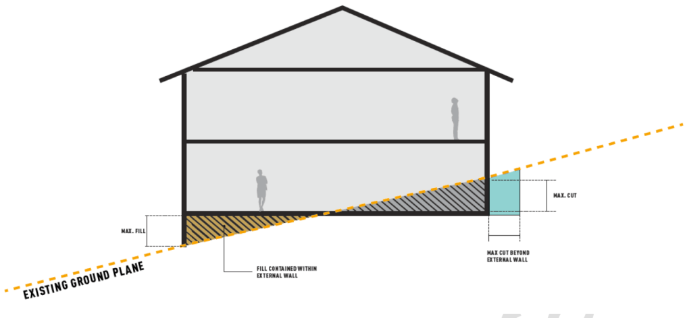

> [Picture on page 50: a picture, saved as a picture (images/jacaranda-at-glossodia-page-50-1.gif, 150 dpi).]

#### Figure 37 Cut & Fill

Source: Jackson Teece

#### 3.2.8 Garages, Parking and Site Access

#### Objectives

O.1 To control the number, dimensions, and location of vehicle access points to reduce the visual impact of garages, carports, and parking areas on the streetscape. O.2 To provide safe, secure, and convenient access to parking within garages, carports and parking areas, with casual surveillance of private driveways from dwellings and from the street. O.3 To minimise conflict between pedestrians and vehicles at the junction of driveways and footpaths. O.4  To provide predominantly on-site parking for residents.

#### Controls

C.1 Carports and garages should be constructed of materials that complement the colour and finishes of the main dwelling. C.2 Garages and carports are to be set back a minimum 1.0m behind the building line. C.3 On corner lots the garage can be accessed from either road frontage, subject to compliant sightlines and distances from intersections and adjacent driveways. C.4 Driveways should be a maximum of 3.0m wide at the front boundary and located a minimum of 1.0m from the side boundary. C.5 Permeable/porous materials and finishes including gravel, paving and the like are to be used for residential driveways.

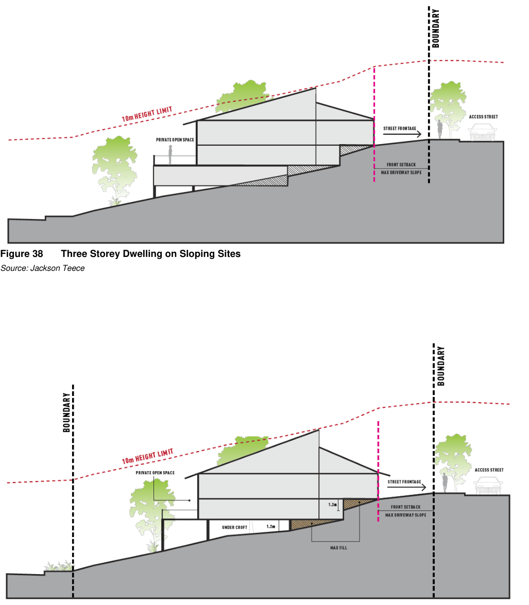

> [Picture on page 51: a picture, saved as a picture (images/jacaranda-at-glossodia-page-51-1.gif, 150 dpi).]

#### Figure 38 Three Storey Dwelling on Sloping Sites

Source: Jackson Teece

#### Figure 39 Sloping Site

Source: Jackson Teece

#### 3.2.9 Amenity, Privacy and Security

#### Objectives

O.1  All areas in a development should be clearly recognisable as private, common, or public space. O.2 Ensure a superior built form outcome for future residents.

#### Controls

C.1  Landscaping should promote privacy of dwellings and private open space areas. C.2 Building siting and windows are to ensure visibility to the street from the front of the dwelling house. C.3  Dwelling houses on corner allotments should address both public frontages. C.4 The location, planning and orientation of buildings are to maximise solar access, natural light and privacy to dwellings and assist with the achievement of BASIX requirements. C.5 Houses are to be designed to have good natural cross ventilation with well-considered placement of windows to draw breezes through the house. C.6 Sustainable energy solutions are encouraged to minimise greenhouse gas emissions. C.7 Buildings should be sited and designed to ensure that the performance of existing rooftop solar energy

systems on dwellings on adjoining lots are not compromised.

#### 3.2.10 Landscaping

#### Objectives

O.1  Ensure the vision for Jacaranda to be a landscape-led development is achieved through landscaping on private property in conjunction with the public realm. O.2  Utilise landscaping to create effective microclimates to future proof the new community. O.3  Manage the rural urban interface.

#### Controls

C.1 Front and side setbacks are to incorporate planting and landscaping elements to facilitate a predominantly landscaped streetscape setting. C.2 Residential development within the R5 Large Lot Residential zone should aim to retain significant trees where possible within landscaped and private open space areas. Significant trees are those trees referred to by Clause 5.9 of the LEP and will be subject to an arborist report at DA stage. C.3 On lots larger than 4,000sqm a minimum of four trees are required (three min 45L and one min 100L, and/or including retained native trees). At least two trees are to be in front of the front building line. C.4 On lots smaller than 4,000sqm a minimum of three trees (two min 45L and one min 100L, and/or including retained native trees), are required. At least one tree is to be in front of the front building line. C.5 The plant selection for Jacaranda is to consider:

- The plant selection list identified in Appendix A where practicable. − The topography of the site, in particular ridgelines and valleys. − The use of locally indigenous species and exotic species, where available and suitable to the character and amenity of the site. − The suitability of planting, and potential impacts on residential solar access and safety for residents, vehicular traffic, and pedestrians. − the management of soil salinity, groundwater levels and soil erosion. C.6  Residential lots directly adjoining existing fresh produce farms shall provide a landscaped garden buffer of a minimum 4 metres width along the common boundary.

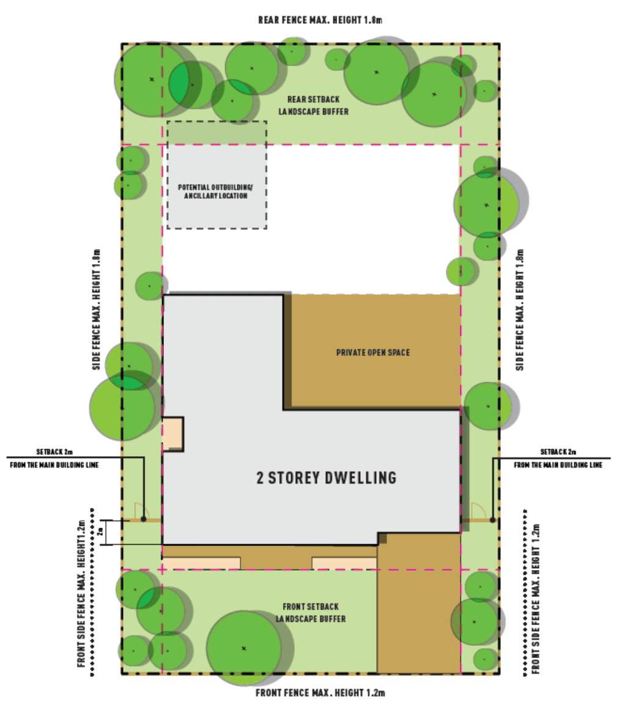

> [Picture on page 53: a picture, saved as a picture (images/jacaranda-at-glossodia-page-53-1.gif, 150 dpi).]

#### Figure 40 Landscape & Fencing

Source: Jackson Teece

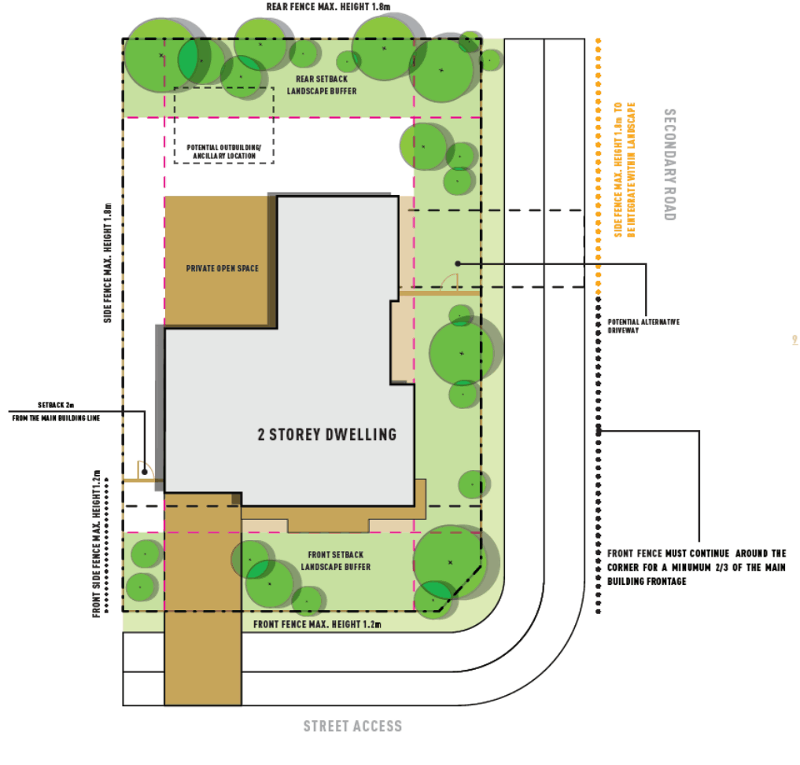

> [Picture on page 54: a picture, saved as a picture (images/jacaranda-at-glossodia-page-54-1.gif, 150 dpi).]

#### Figure 41 Landscape & Fencing – Corner Lot

Source: Jackson Teece

#### 3.2.11 Residential Landscape Plan

#### Objectives

O.1  Landscape design is considered during dwelling design. O.2  Landscape species are to achieve a semi-rural character.

#### Controls

C.1  A Landscape Plan facilitating a semi-rural character is to be submitted with a DA for a dwelling house.

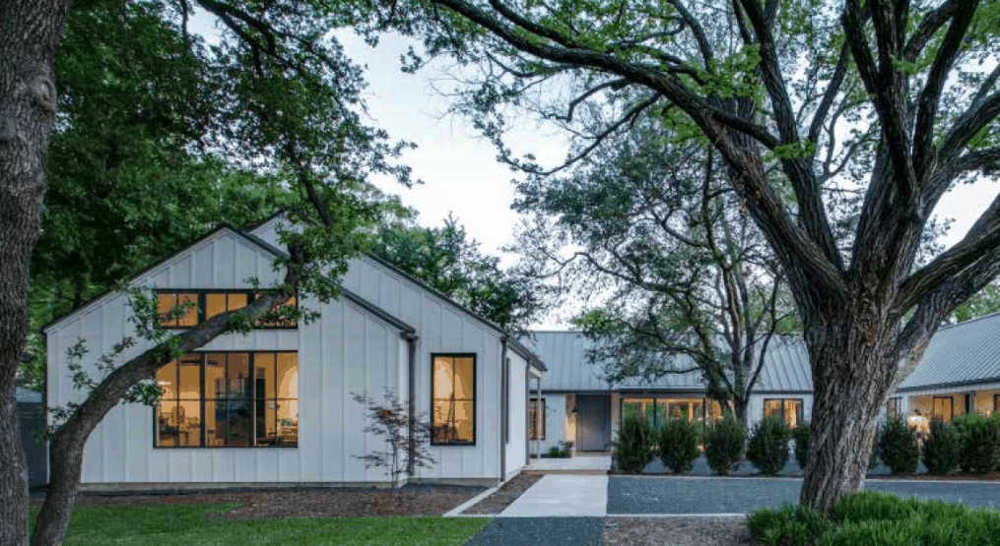

> [Picture on page 55: a picture, saved as a picture (images/jacaranda-at-glossodia-page-55-7.gif, 150 dpi).]

#### Figure 42 Integration of landscaping within front setbacks

Source: Onecollective

#### 3.2.12 Materials and Colours

#### Objectives

O.1  Materials and colours are to be compatible with the streetscape and desired character. O.2  Encourage the use of a variety of materials and colours to provide visual interest, and distinct aesthetic identity to each different neighbourhood precinct.

#### Controls

C.1 The materials and finishes selected for dwellings should be from a neutral colour palette and respond to the existing natural rural character.

C.2 A mix of different wall materials or treatments, excluding windows, is encouraged on each elevation to create architectural interest. C.3 All built elements (garages, ancillary buildings, studios, fences, garden and retaining walls and the like) are to be designed to blend into the landscape or be consistent with the colour scheme and/or design of the main building to minimise visual intrusiveness.

#### 3.2.13 Solar Access & Orientation

#### Objectives

O.1 To provide for a high level of residential amenity including solar access.

#### Controls

C.1 Buildings should be designed to minimise overshadowing and maximise solar access to any adjoining development and the public domain. Solar access should be maintained for any north facing window of a habitable room of any adjoining residential dwelling and at least 50% of the private courtyard area for a minimum three hour continuous period between 9:00am and 3:00pm for the 21 June, winter solstice period.

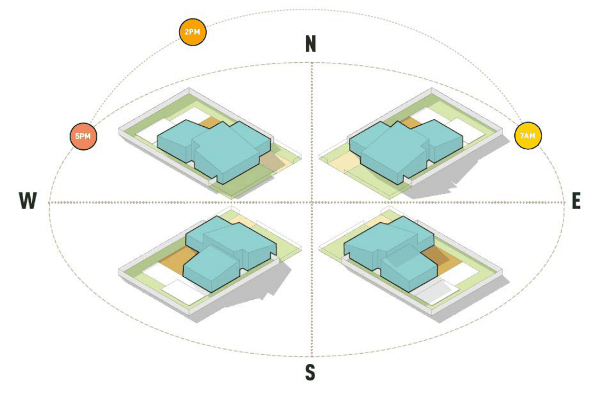

> [Picture on page 56: a picture, saved as a picture (images/jacaranda-at-glossodia-page-56-9.gif, 150 dpi).]

#### Figure 43 Orientation for Solar Access

Source: Jackson Teece

#### 3.2.14 Numerical Controls for Dwelling Houses and Ancillary Development

#### Objectives

O.1 To achieve a height and bulk that is compatible with the desired future character of the area. O.2 To create coherent, attractive streetscapes that engage with the public domain, O.3 To provide for a high level of residential amenity, including solar access, air circulation, privacy, noise mitigation and appropriate boundary interfaces. O.4 To provide landscaped open space that softens the visual impact of buildings within the landscape and includes useable private recreation space of sufficient areas and dimensions to cater for the recreational needs of residents. O.5 To provide adequate and safe on-site vehicle access and parking in a manner that does not visually dominate the street.

#### Controls

C.1 Dwellings are to comply with the relevant R2 or R5 controls in Appendix C.

#### 3.2.15 Ancillary Buildings

#### Objectives

O.1 Enable the erection of ancillary outbuildings in a manner that complements the landscape character and any scenic qualities of the locality. O.2 Reduce the visual dominance of ancillary development on the streetscape. O.3 Minimise the impact of ancillary development on adjoining land uses.

#### Controls

C.1 Ancillary buildings design and materials are to be consistent with the primary dwelling house design. C.2 Ancillary buildings should be sited to minimise tree removal as well as visual dominance and impact on the streetscape. C.3 Ancillary buildings should be designed to be subordinate in scale and footprint to the primary dwelling house and must be located wholly behind the main residence.

#### 3.2.16 Fences

#### Objectives

O.1 Appropriately demarcate the public and private domain and provide for surveillance of the public domain. O.2 Establish appropriate fencing materials and scale commensurate with the rural landscape vision for the community.

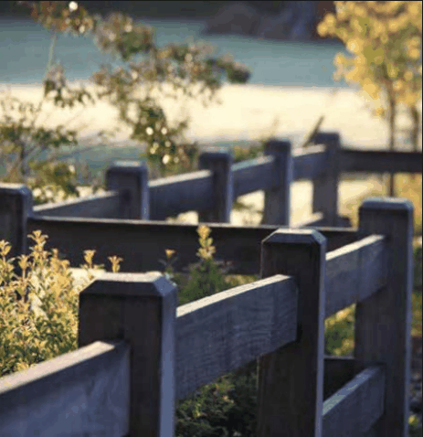

> [Picture on page 57: a picture, saved as a picture (images/jacaranda-at-glossodia-page-57-18.gif, 150 dpi).]

#### Figure 44 Details and materials that reflect the rural style character

Source: Onecollective

#### Controls

C.1 The front boundary is to be defined by either front fencing 1.2m high (the upper two thirds of the fence must be at least 50% open construction) or mass planting beds of species that have a mature height of 1.2m and should be consistent with the Character Statements in Table 2. C.2 Side and rear fencing is to be a minimum height of 1.2m and a maximum height of 1.8m high. C.3 Side fences is to extend to two metres behind the front building line. Side fences on corner lots are to be a maximum height of 1.2m for the front two-thirds of the dwelling length behind the front building line. C.4   Fencing materials and details must be included in the landscape plans accompanying dwelling applications for approval by Council.
