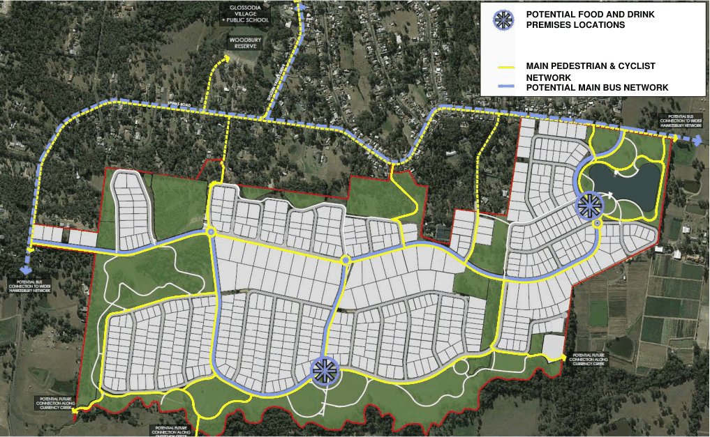

### 3.3 Non-Residential Design

#### Objectives

O.1 Enable the appropriate provision of non-residential land uses to serve the needs of the local community. O.2 Minimise the impacts of non-residential activities on surrounding residential areas. O.3 Retail activities in residential areas do not detract from the function or viability of nearby centres. O.4 Ensure the appropriate location of neighbourhood shops.

#### Controls

C.1 Retail land uses are to be located: − adjoining land zoned RE1 Public Recreation or that is separated from land zoned RE1 Public Recreation only by a public road, or − with frontage to a collector road, or − within 90 metres of public transport stop. C.2  Shop fronts or front setback land uses are to encourage active and interactive street frontages that are sympathetic to the streetscape with similar materials to adjoining buildings to be used. C.3  Any area of land between the front property boundary and the building alignment, exclusive of approved driveways and parking areas, is to be landscaped. C.4  Address and entry points for any residential use on the same allotment of land are to be separate from the retail use access points and be readily identifiable. C.5  Design of the building frontage, front and side setbacks are to include safe and convenient pedestrian facilities such as weather protection, shade, seating, and landscaping. C.6 On corner sites, shop fronts are to wrap around the corner. C.7 Entrances are to be readily visible from the street and well lit. C.8 Plant and equipment (particularly cooling or heating plant) is to be located to not cause noise annoyance to

neighbours. C.9 Waste storage areas must be designed to minimise visual impact and should be screened and properly

positioned to not to attract pests and cause odour problems for neighbours. C.10 External storage areas are not permitted unless adequately screened from view. C.11 A food and drink premises is permitted generally in the indicative locations in Figure 45. The exact location of

the café or the proposed lot which is going to accommodate a future café needs to be clearly identified in a

future staged subdivision application.

> [Picture on page 59: a picture, saved as a picture (images/jacaranda-at-glossodia-page-59-1.gif, 150 dpi).]
> Words printed on the picture (title and legend, copied from the PDF):
> POTENTIAL FOOD AND DRINK
> PREMISES LOCATIONS
> MAIN PEDESTRIAN & CYCLIST
> NETWORK
> POTENTIAL MAIN BUS NETWORK

#### Figure 45 Indicative Food and Drink Premises Locations

Source: Onecollective
