### 4.0 Appendices

### 4.1 Appendix A- Indicative Landscape Planting Palette

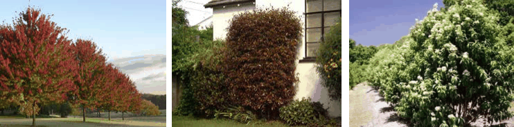

> [Picture on page 60: a picture, saved as a picture (images/jacaranda-at-glossodia-page-60-3.gif, 150 dpi).]

Tree Planting Matrix

Acer ‘Crimson Sentry’

Acer ‘Autumn Blaze’

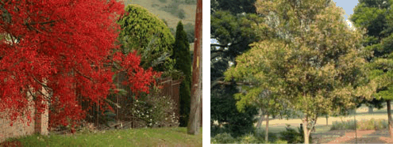

> [Picture on page 60: a picture, saved as a picture (images/jacaranda-at-glossodia-page-60-7.gif, 150 dpi).]

Acmena smithii

Backhousia citriodora

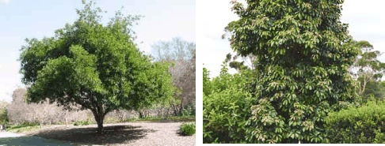

> [Picture on page 60: a picture, saved as a picture (images/jacaranda-at-glossodia-page-60-10.gif, 150 dpi).]

Brachychiton acerifolius

Ceratopetalum apetalum

Cupaniopsis anacardioides

Elaeocarpus eumundi

| SPECIES | LOCATION |  |  |  |  |  |  |  |  |
|---|---|---|---|---|---|---|---|---|---|
|  | Entrance and Signage | Collector Road | Local Streets and Access Roads | Green Streets | Parks & Open Space: Space Definition | Parks & Open Space: Shade | Parks & Open Space: Display/Mark er | Transition Open Space (Riparian) | Riparian |
| Acer ‘Crimson Sentry’ | X |  |  |  |  |  |  | X |  |
| Acer freemanii ‘Autumn blaze’ | X |  | X |  |  |  |  |  |  |
| Acmena smithii | X |  |  | X |  | X |  |  |  |
| Backhousia citriodora | X | X | X |  | X |  |  | X |  |
| Brachychiton acerifolius | X | X |  |  |  |  | X |  |  |
| Ceratopetalum apetalum |  |  |  |  |  |  |  | X |  |
| Cupaniopsis anacardioides |  | X | X |  |  |  |  |  |  |
| Eucalyptus amplifolia |  |  |  |  |  |  |  | X |  |
| Eucalyptus tereticornis |  |  |  |  |  |  |  |  |  |
| Eucalyptus eugenioides |  |  |  |  |  | X |  |  | X |
| Elaeocarpus eumundi |  |  | X |  | X |  |  | X |  |
| Eucalyptus globoidea |  |  |  |  |  | X |  |  |  |

Eucalyptus tereticornis

Ficus rubiginosa

Fraxinus ‘Cimmaron’

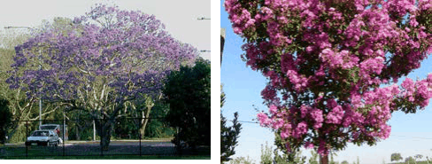

> [Picture on page 61: a picture, saved as a picture (images/jacaranda-at-glossodia-page-61-4.gif, 150 dpi).]

Gingko biloba

Hymenosporum flavum

Jacaranda mimosifolia

Lagerstroemia indica

Livisona australis

| SPECIES | LOCATION |  |  |  |  |  |  |  |  |
|---|---|---|---|---|---|---|---|---|---|
|  | Entrance | Collector Road | Local Streets and Access Roads | Green Streets | Parks & Open Space: Space Definition | Parks & Open Space: Shade | Parks & Open Space: Display/Marker | Transition Open Space (Riparian) | Riparian |
| Eucalyptus paniculata |  |  |  |  |  | X |  | X |  |
| Eucalyptus saligna |  |  |  |  |  | X |  | X |  |
| Eucalyptus tereticornis |  |  |  |  | X | X |  | X | X |
| Ficus coronta |  |  |  |  |  | X |  | X |  |
| Ficus rubiginosa |  |  |  |  |  | X |  | X |  |
| Fraxinus ‘Cimmaron’ | X |  | X |  |  |  | X |  |  |
| Ginkgo biloba |  |  | X |  |  |  | X |  |  |
| Hymenosporum flavum |  |  | X |  |  |  |  |  |  |
| Jacaranda mimosifolia | X | X |  |  |  |  | X |  |  |
| Lagerstroemia indica |  |  |  |  |  |  | X |  |  |
| Livistona australis |  |  |  | X |  |  | X | X |  |

Magnolia ‘Exmouth’

Melaleuca stypheloides

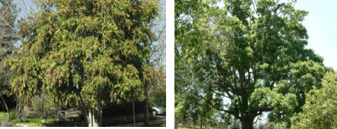

> [Picture on page 62: a picture, saved as a picture (images/jacaranda-at-glossodia-page-62-3.gif, 150 dpi).]

Pyrus ‘Chanticleer’

Pyrus nivalis

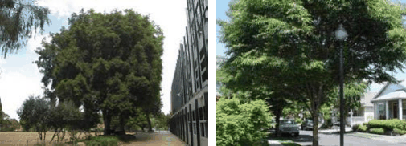

> [Picture on page 62: a picture, saved as a picture (images/jacaranda-at-glossodia-page-62-6.gif, 150 dpi).]

Syzigium australe

Toona ciliata var australis

Waterhousea floribunda

Zelkova serrata ‘Green Vase’

| SPECIES | LOCATION |  |  |  |  |  |  |  |  |
|---|---|---|---|---|---|---|---|---|---|
|  | Entrance | Collector Road | Local Streets and Access Roads | Green Streets | Parks & Open Space: Space Definition | Parks & Open Space: Shade | Parks & Open Space: Display/Marker | Transition Open Space (Riparian) | Riparian |
| Magnolia ‘Exmouth’ | X |  | X | X |  |  | X |  |  |
| Magnolia ‘Little Gem’ | X | X |  |  |  |  | X |  |  |
| Melaleuca decora |  |  | X |  |  | X |  | X | X |
| Melaleuca styphelioides |  |  |  |  | X |  |  | X | X |
| Melaleuca quinquenervia |  |  |  |  | X |  |  | X |  |
| Pyrus ‘Aristocrat’ | X |  |  |  |  |  |  |  |  |
| Pyrus ‘Chanticleer’ | X | X | X |  |  |  |  |  |  |
| Pyrus nivalis | X |  | X |  |  |  | X |  |  |
| Syzygium australe |  |  | X |  | X |  |  |  |  |
| Syncarpia glomulifera |  |  |  |  |  | X |  | X | X |
| Toona ciliata var. australis |  |  |  |  |  | X |  | X |  |
| Tristaniopsis laurina ‘Luscious’ |  |  | X |  | X |  |  | X |  |
| Ulmus parvifolia |  |  |  | X |  | X | X |  |  |
| Waterhousea floribunda | X | X | X | X |  | X |  | X |  |
| Zelkova serrata | X | X |  |  |  |  | X |  |  |

#### 4.1.1 Shrub and Understorey Planting Matrix

Provide form and texture to add more contrast and scale in urban and entry areas while reinforcing character in open space and rainforest areas. Passive surveillance principles need to be considered in design. A diversity of leaf form, shape, texture, colour and scale are vital in providing an innovating, uplifting and illuminating residential community.

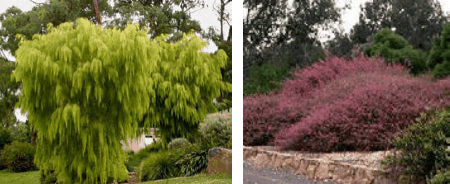

> [Picture on page 63: a picture, saved as a picture (images/jacaranda-at-glossodia-page-63-6.gif, 150 dpi).]

Acacia cognata

Bauera rubioides

Berberis thunbergii

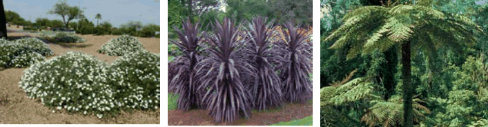

> [Picture on page 63: a picture, saved as a picture (images/jacaranda-at-glossodia-page-63-10.gif, 150 dpi).]

Callistemon citrinus

Convolvulus cneorum

Cordyline australis

Cyathea australis

Dicksonia antarctica

| SPECIES | LOCATION |  |  |  |
|---|---|---|---|---|
|  | Lake Park | Entry | Village Parks | Riparian |
| Abelia x grandiflora | X |  | X |  |
| Acacia cognata |  |  | X |  |
| Azacia binervia |  |  |  |  |
| Baeckea virgata |  |  | X |  |
| Bauera rubioides |  |  | X |  |
| Berberis thunbergii |  | X |  |  |
| Callistemon citrinus |  |  | X |  |
| Callistemon linearis |  |  | X |  |
| Callistemon salignus |  |  | X |  |
| Callistemon viminalis |  |  | X |  |
| Camellia sasanqua | X |  |  |  |
| Casuarina glauca ‘Cousin It’ | X |  | X |  |
| Convolvulus cneorum |  | X | X |  |
| Cordyline australis | X | X |  |  |
| Cordyline stricta | X |  |  |  |
| Cordyline terminalis | X |  |  |  |
| Correa alba | X |  |  |  |
| Cyathea australis | X |  | X |  |
| Daviesia ulicifolia |  |  | X |  |
| Dicksonia antarctica | X |  | X |  |
| Dodonaea viscosa | X |  |  |  |
| Dodonaea triquetra | X |  |  |  |
| Doryanthes excelsa | X | X |  |  |

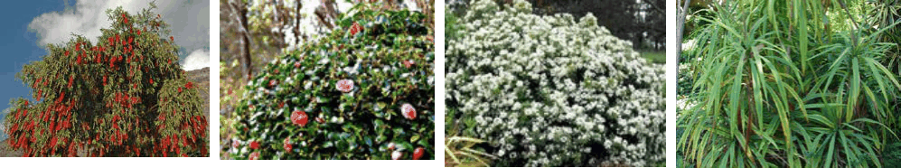

> [Picture on page 64: a picture, saved as a picture (images/jacaranda-at-glossodia-page-64-1.gif, 150 dpi).]

Callistemon viminalis

Camellia sasanqua

Choisya ternata

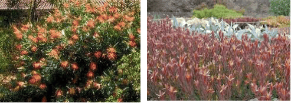

> [Picture on page 64: a picture, saved as a picture (images/jacaranda-at-glossodia-page-64-5.gif, 150 dpi).]

Cordyline stricta

Doryanthes excelsa

Grevillea ‘Superb’

Leacadendron ‘Safari Sunset’ Loropetalum chinensis

| SPECIES | LOCATION |  |  |  |
|---|---|---|---|---|
|  | Lake Park | Entry | Village Parks | Riparian |
| Gardenia augusta | X | X |  |  |
| Grevillea ‘Superb’ |  |  | X |  |
| Hakea dactyloides |  |  | X |  |
| Hebe elliptica |  |  | X |  |
| Indigophera australis | X |  |  |  |
| Kunzea ambigua |  |  | X |  |
| Lavandula stoechas | X | X |  |  |
| Leptospermum petersonii |  |  | X |  |
| Leucadendron ‘Safari Sunset’ |  |  | X |  |
| Loropetalum chinensis |  |  | X |  |
| Melaleuca nodosa |  |  | X |  |
| Melaleuca thymifolia |  |  | X |  |
| Michelia figo | X |  | X |  |
| Murraya paniculata | X |  | X |  |
| Nandina domestica | X |  | X |  |
| Notelaea venosa |  |  | X |  |
| Photinia glabra |  |  | X |  |
| Photinia x fraseri |  |  | X |  |
| Pittosporum tobira |  |  | X |  |
| Pittosporum revolutum |  |  |  |  |
| Rosmarinus officinalis | X | X |  |  |
| Russelia equisetiformis | X |  |  |  |
| Strelitzia juncea | X |  |  |  |
| Teucrium fruticans |  |  | X |  |
| Viburnum odoratissimum | X |  |  |  |
| Viburnum tinus |  |  | X |  |
| Westringia fruticosa | X |  | X |  |
| Westringia ‘Wynyabbie Gem’ | X |  |  |  |

#### 4.1.2 Climbers Planting Matrix

Species used to introduce an element of colour and texture at height.

| SPECIES | LOCATION |  |  |  |
|---|---|---|---|---|
|  | Lake Park | Entry | Village Parks | Riparian |
| Bougainvillea glabra |  | X |  |  |
| Hardenbergia violacea |  |  | X |  |
| Hibbertia scandens |  |  | X | X |
| Kennedia rubicunda |  |  |  | X |
| Pandorea pandorana ‘Snowbells’ |  | X |  |  |
| Parthenocissus tricuspidata | X | X |  |  |
| Rosa species | X | X |  |  |
| Trachelospermum jasminoides | X |  |  |  |

#### 4.1.3 Grasses Planting Matrix

Grasses act as transitional elements embracing both the more manicured spaces and the vital riparian zones.

| SPECIES | LOCATION |  |  |  |
|---|---|---|---|---|
|  | Lake Park | Entry | Village Parks | Riparian |
| Aristida ramosa |  |  | X | X |
| Austrodanthonia racemosa var. racemosa |  |  |  | X |
| Bothriochloa decipiens |  |  |  | X |
| Carex appressa |  |  | X |  |
| Chloris divaricata var. divaricata |  |  |  | X |
| Commelina cyanea |  |  | X | X |
| Danthonia longifolia |  |  | X |  |
| Danthonia tenuior |  |  | X |  |
| Dianella species |  | X | X | X |
| Dichelachne micrantha |  |  | X |  |
| Dichopogon strictus |  |  |  | X |
| Echinopogon ovatus |  |  |  | X |
| Entolasia stricta |  |  |  | X |
| Eragrostis brownie |  |  |  | X |
| Juncus usitatus |  |  | X |  |
| Lomandra longifolia | X | X | X |  |
| Microlaena stipoides var. stipoides |  |  | X | X |
| Themeda australis |  |  | X | X |

Austrodanthonia racemosa Carex appressa

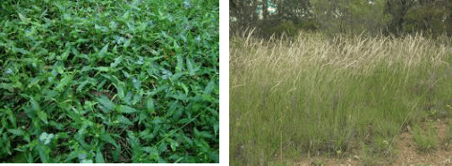

> [Picture on page 66: a picture, saved as a picture (images/jacaranda-at-glossodia-page-66-2.gif, 150 dpi).]

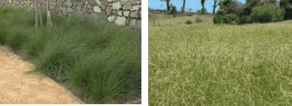

> [Picture on page 66: a picture, saved as a picture (images/jacaranda-at-glossodia-page-66-3.gif, 150 dpi).]

Commelina cyanea

Dichelachne micrantha

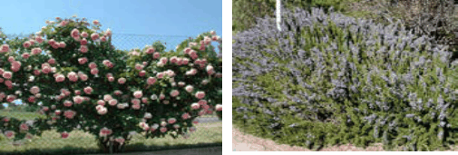

> [Picture on page 66: a picture, saved as a picture (images/jacaranda-at-glossodia-page-66-6.gif, 150 dpi).]

Poa labillardieri

Microlaena stipoides

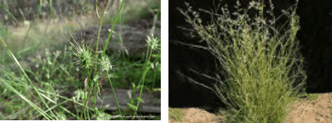

> [Picture on page 66: a picture, saved as a picture (images/jacaranda-at-glossodia-page-66-9.gif, 150 dpi).]

Rosa ‘Pierre de Ronsard’

Rosmarinus officinalis

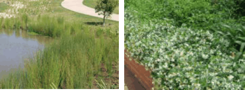

> [Picture on page 66: a picture, saved as a picture (images/jacaranda-at-glossodia-page-66-12.gif, 150 dpi).]

Echinopogon ovatus

Eragrostis brownie

Juncus usitatus

Trachelospermum jasminoides

Russelia equisetiformis

Strelitzia reginae

Teucrium fruticans

#### 4.1.4 Ground Covers Planting Matrix

Reinforce the character of each zone on the ground plane

| SPECIES | LOCATION |  |  |  |  |
|---|---|---|---|---|---|
|  | Lake Park | Entry | Village Parks | Riparian | Wetland |
| Ajuga reptans | X |  | X |  |  |
| Alternanthera dentata ‘Little Ruby’ | X | X | X |  |  |
| Banksia spinulosa ‘Birthday Candles’ | X |  | X |  |  |
| Brachyscome multifida | X |  | X |  |  |
| Convolvulus mauritanicus |  |  | X |  |  |
| Dichondra repens | X |  | X | X |  |
| Echinacea purpurea |  |  | X |  |  |
| Euphorbia species |  | X | X | X |  |
| Glycine species |  |  |  | X |  |
| Grevillea ‘Bronze Rambler’ | X |  | X |  |  |
| Helichrysum petiolare |  |  | X |  |  |
| Iris germanica |  |  | X |  |  |
| Juniperus conferta | X | X |  |  |  |
| Juniperus horizontalis | X |  |  |  |  |
| Juniperus Sabina | X |  |  |  |  |
| Liriope muscari | X | X | X |  |  |
| Marsdenia rostrata |  |  |  | X |  |
| Myoporum parvifolium | X |  | X |  |  |
| Nandina domestica ‘Nana’ | X | X | X |  |  |
| Pratia purpurascens | X |  |  | X |  |
| Rosa ‘Flower Carpet’ | X | X | X |  |  |
| Scaevola aemula | X |  | X |  |  |
| Sigesbeckia orientalis subsp. orientalis |  |  |  | X |  |
| Stachys byzantina |  |  | X |  |  |
| Tulbaghia violacea |  | X | X | X |  |
| Viola hederacea | X |  | X |  |  |
| Zephyranthes candida | X |  | X |  |  |

#### 4.1.5 Wetland Planting Matrix

Species selected to stabilise constructed wetlands and reinforce the natural and ecosystems of these areas.

| SPECIES | LOCATION |  |  |  |  |
|---|---|---|---|---|---|
|  | Lake Park | Entry | Village Parks | Riparian | Wetland |
| Baumea articulate | X |  |  |  | X |
| Bolboschoenus caldwelli | X |  |  |  | X |
| Cyperus exaltatus | X |  |  |  | X |
| Elaeocharis sphacelata | X |  |  |  | X |
| Entolasia marginata | X |  |  |  | X |
| Ficinia nodosa | X |  |  |  | X |
| Juncus usitatus | X |  |  |  | X |
| Potamogeton tricarinatus (aquatic) | X |  |  |  | X |
| Schoenoplectus mucronatus | X |  |  |  | X |
| Triglochin procerus (aquatic) | X |  |  |  | X |

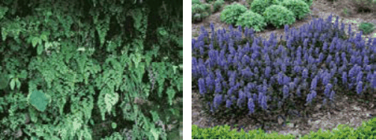

> [Picture on page 68: a picture, saved as a picture (images/jacaranda-at-glossodia-page-68-1.gif, 150 dpi).]

Adiatum affine

Ajuga reptans

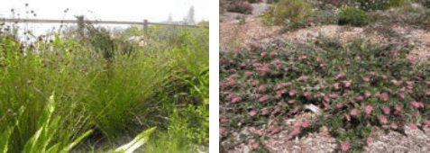

> [Picture on page 68: a picture, saved as a picture (images/jacaranda-at-glossodia-page-68-4.gif, 150 dpi).]

Banksia ‘Birthday Candles’

Baumea articulata

Ficinia nodosa

Grevillea ‘Bronze Rambler’

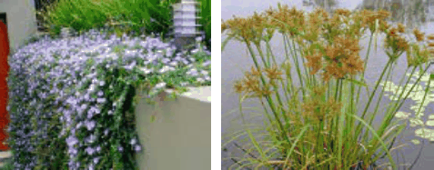

> [Picture on page 68: a picture, saved as a picture (images/jacaranda-at-glossodia-page-68-9.gif, 150 dpi).]

Juniperus sabina

Liriope muscari

Convolvulus mauritanicus

Cyperus exaltatus

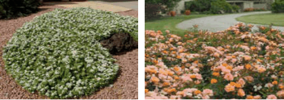

> [Picture on page 68: a picture, saved as a picture (images/jacaranda-at-glossodia-page-68-14.gif, 150 dpi).]

Dampiera diversifolia

Echinacea purpurea

Myoporum parvifolium

Rosa ‘Amber Sun’

Scaevola aemula

Schoenoplectus validus
