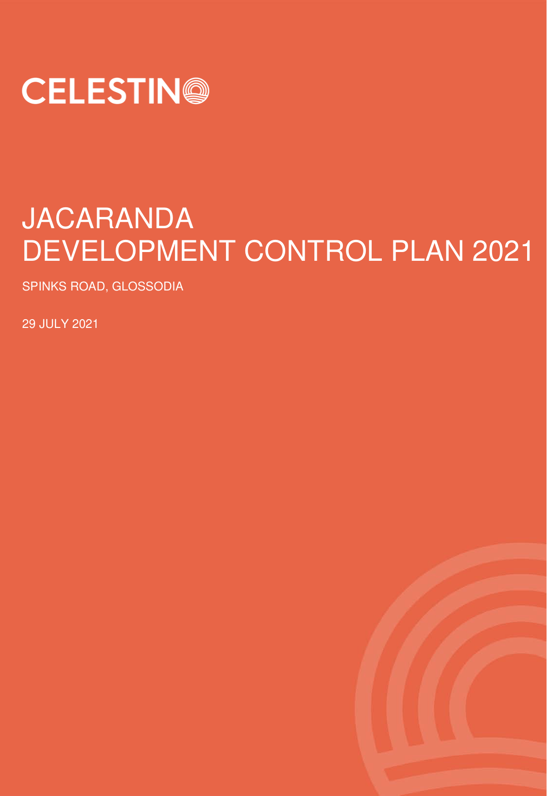

# Hawkesbury Development Control Plan 2002 - Jacaranda at Glossodia

> This chapter is split into 15 section file(s), one per numbered heading, in the order they appear in the PDF.

Source PDF: [Jacaranda-DCP-2021.pdf](Jacaranda-DCP-2021.pdf)

> [Picture on page 1: a picture, saved as a picture (images/jacaranda-at-glossodia-page-1-1.gif, 150 dpi).]

### JACARANDA

### DEVELOPMENT CONTROL PLAN 2021

#### SPINKS ROAD, GLOSSODIA

#### 29 JULY 2021

| 1.0 Introduction 1.1 Land to which this chapter applies | 5 5 |
|---|---|
| 1.2 Relationship to other plans and policies | 5 |
| 1.3 Development principles and outcomes | 6 |
| 2.0 Precinct-Wide Controls | 7 |
| 2.1 The Concept Masterplan | 7 |
| 2.1.1 Place and Character | 7 |
| 2.2 Natural Environment Considerations | 13 |
| 2.2.1 Contamination | 13 |
| 2.2.2 Cultural Heritage | 13 |
| 2.2.3 Biodiversity | 13 |
| 2.2.4 Flooding | 14 |
| 2.2.5 Riparian Corridor | 14 |
| 2.2.6 Stormwater Management | 15 |
| 2.2.7 Bushfire Management | 17 |
| 2.3 Built Environment Considerations | 18 |
| 2.3.1 Connectivity | 18 |
| 2.3.2 Open Space and Public domain | 20 |
| 2.3.3 Tree Retention Investigation | 28 |
| 2.3.4 Sustainability and Resilience | 30 |
| 2.3.5 Infrastructure and Utilities | 31 |
| 2.3.6 Subdivision Staging | 31 |
| 2.3.7 Development Yield | 32 |
| 3.0 Controls for Development in the Residential Zones 3.1 Urban Design | 33 33 |
| 3.1.1 Street Hierarchy, Layout and Design | 33 |
| 3.1.2 Streetscape Character | 36 |
| 3.1.3 Street Tree Planting, Lighting and Furniture | 37 |
| 3.2 Residential Design | 40 |
| 3.2.1 Character | 40 |
| 3.2.2 Lot Size | 41 |
| 3.2.3 Built Form | 46 |
| 3.2.4 Siting & Setbacks | 46 |
| 3.2.5 Height of Buildings | 49 |
| 3.2.6 Private Open Space | 49 |
| 3.2.7 Sloping Sites | 49 |
| 3.2.8 Garages, Parking and Site Access | 50 |
| 3.2.9 Amenity, Privacy and Security | 52 |
| 3.2.10 Landscaping | 52 |
| 3.2.11 Residential Landscape Plan | 55 |
| 3.2.12 Materials and Colours | 55 |
| 3.2.13 Solar Access & Orientation | 56 |
| 3.2.14 Numerical Controls for Dwelling Houses and |  |
| Ancillary Development | 56 |
| 3.2.15 Ancillary Buildings | 57 |
| 3.2.16 Fences | 57 |
| 3.3 Non-Residential Design | 58 |
| 4.0 Appendices 4.1 Appendix A- Indicative Landscape Planting Palette | 60 60 |
| 4.2 Appendix B – Landscape Materials Palette | 69 |
| 4.3 Appendix C – Residential Controls | 71 |
| 4.4 Appendix D – Indicative Public Domain Landscape |  |
| Principles | 72 |

#### List of Figures

Land Application Map

2

Jacaranda Concept Masterplan

3

Character Areas Structure Plan

4

Proposed riparian buffer (average of 40m)

5

Indicative location and extent of water quality management measures

6

Asset protection zone map

7

Movement Network

8

Proposed key pedestrian and cyclist connectivity within Jacaranda and to existing Glossodia community

9

Open Space Network

10 Meandering Path 11 Children’s Play 12 Riparian Landscape 13 Picnic Shelter 14 Community Health & Well-Being 15 Relationship to Water 16 Community Events 17 Passive Recreation Nodes 18 Pathways through Conservation Areas 19 Tree Retention Investigation 20 Indicative Staging Plan 21 Street Hierarchy Plan 22 Street Hierarchy Plan 23 Typical Cross Section – Medium Collector Road 24 Typical Cross Section – Local & Minor Collector (Key Green Street) 25 Typical Cross Section – Local & Minor Collector 26 Typical Cross Section – Pedestrian/Cycle Link 27 Typical streetscape character 28 Typical Jacaranda Home 29 Streetscapes are to have a green leafy character and outlook 30 Typical R2 Low Density Residential lot type and character 31 Typical R2 Low Density Residential corner lot type and character 32 Typical R5 Low Density Residential lot type and character 33 Typical R5 Low Density Residential corner lot type and character 34 Site Section Lot Interface 35 Typical Streetscape Section 36 Typical Streetscape Section – Sloping 37 Cut & Fill 38 Three Storey Dwelling on Sloping Sites 39 Sloping Site 40 Landscape & Fencing

41 Landscape & Fencing – Corner Lot 42 Integration of landscaping within front setbacks 43 Orientation for Solar Access 44 Details and materials that reflect the rural style character 45 Indicative Food and Drink Premises Locations

<!-- sections -->
## Sections

1. [1.0 Introduction](01-1-0-introduction.md)
2. [1.1 Land to which this chapter applies](02-1-1-land-to-which-this-chapter-applies.md)
3. [1.2 Relationship to other plans and policies](03-1-2-relationship-to-other-plans-and-policies.md)
4. [1.3 Development principles and outcomes](04-1-3-development-principles-and-outcomes.md)
5. [2.0 Precinct-Wide Controls](05-2-0-precinct-wide-controls.md)
6. [2.1 The Concept Masterplan](06-2-1-the-concept-masterplan.md)
7. [2.2 Natural Environment Considerations](07-2-2-natural-environment-considerations.md)
8. [2.3 Built Environment Considerations](08-2-3-built-environment-considerations.md)
9. [3.1 Urban Design](09-3-1-urban-design.md)
10. [3.2 Residential Design](10-3-2-residential-design.md)
11. [3.3 Non-Residential Design](11-3-3-non-residential-design.md)
12. [4.1 Appendix A- Indicative Landscape Planting Palette](12-4-1-appendix-a-indicative-landscape-planting.md)
13. [4.2 Appendix B – Landscape Materials Palette](13-4-2-appendix-b-landscape-materials-palette.md)
14. [4.3 Appendix C – Residential Controls](14-4-3-appendix-c-residential-controls.md)
15. [4.4 Appendix D – Indicative Public Domain Landscape Principles](15-4-4-appendix-d-indicative-public-domain.md)
