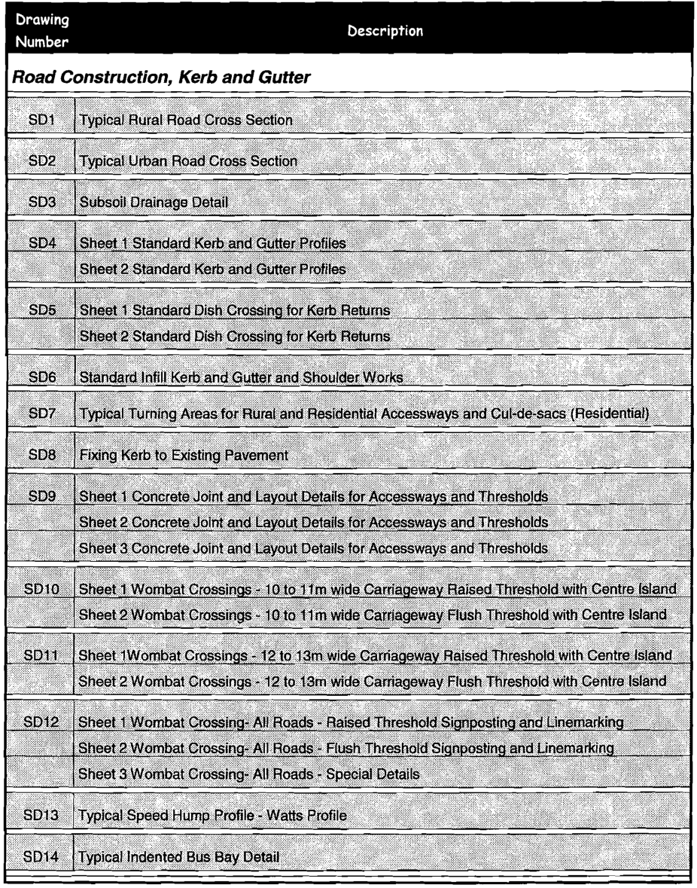
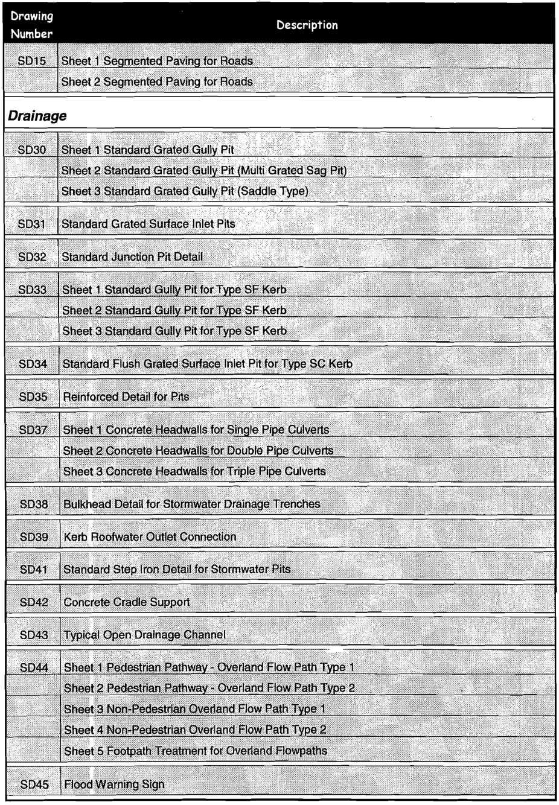
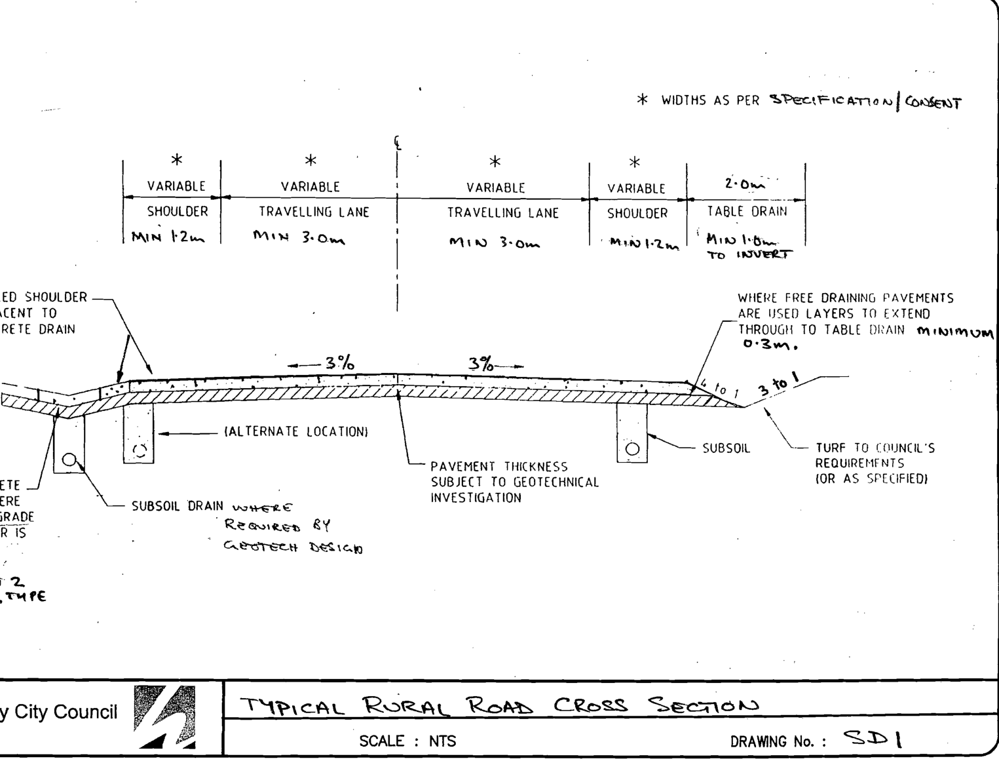
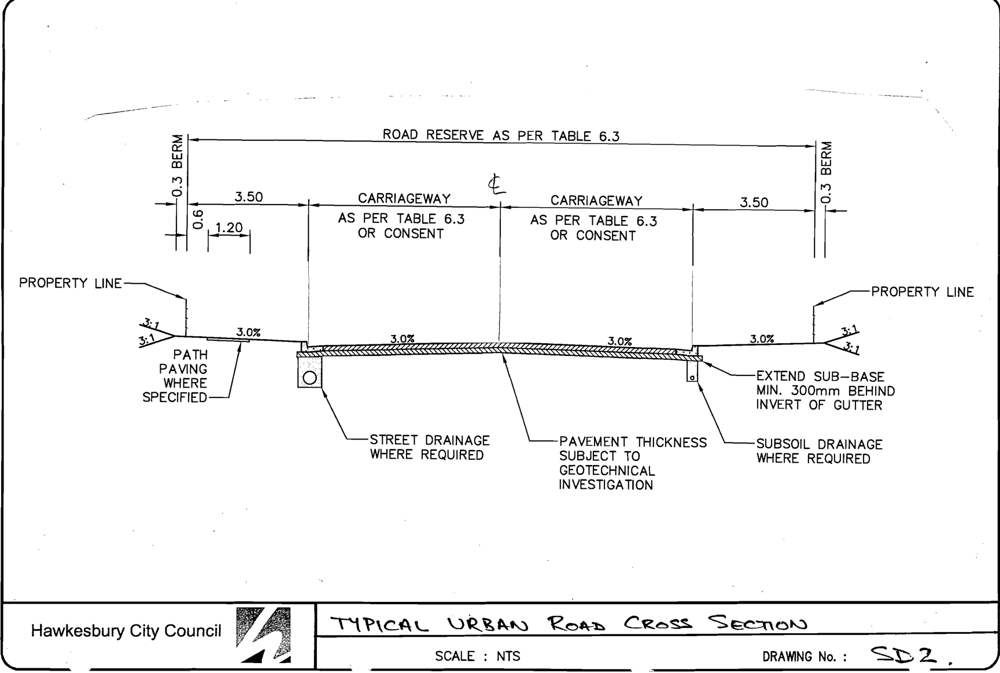
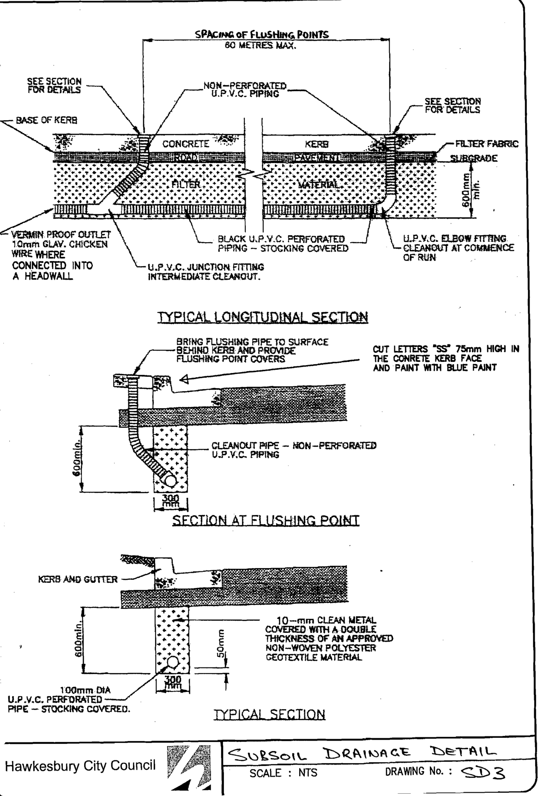
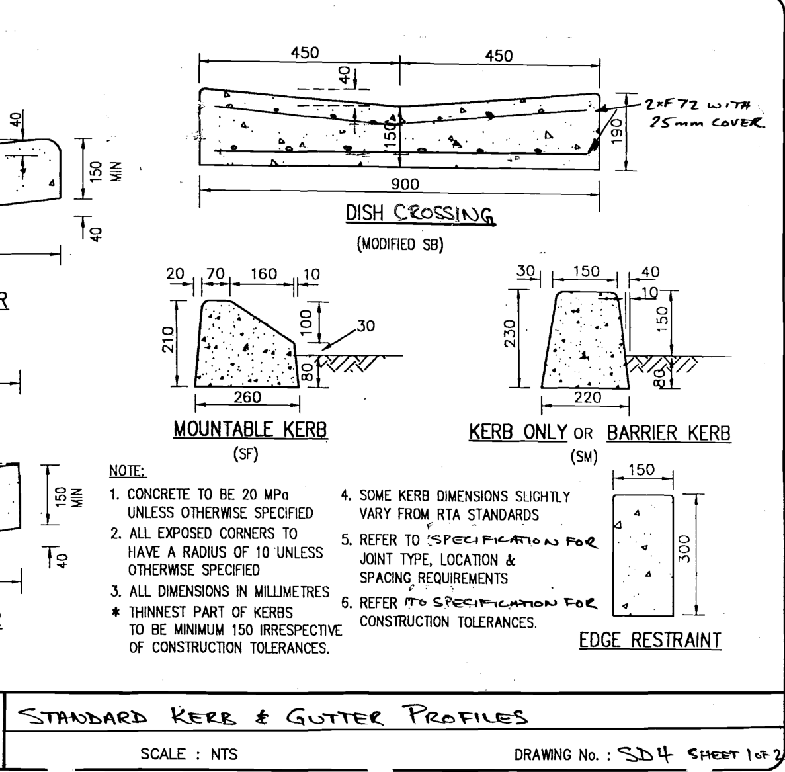

#### 1. LIST OF STANDARD DRAWINGS

The following standard drawings are referenced throughout this document. All civil works to be undertaken shall be designed and constructed in accordance with these drawings.

> [Picture on page 2: a picture, saved as a picture (images/part-03-drawings-page-2-7.gif, 150 dpi).]

STANDARD DRAWINGS

E-1

#### PART III

#### ___--,-----

hawkesbury development control pion

> [Picture on page 3: a picture, saved as a picture (images/part-03-drawings-page-3-4.gif, 150 dpi).]

STANDARDDRAWINGS

_

#### E-2

#### PARTIn

hawkesbury develapment cantral plan

#### ~_~~~~~__~~ _

#### ___________________________ ~

,STANDARDDRAWINGS

#### E-3

> [Picture on page 5: a map, saved as a picture (images/part-03-drawings-page-5-1.gif, 150 dpi); the street names and other small labels are on the picture.]
> Words printed on the picture (title and legend, copied from the PDF):
> SHOULDER TRAVELLING LANE
> "ro t ,,;1\fri..T
> WHEln FREE DRAINING PAVEMENTS
> ARE USED LAYERS TO EXTEND
> .. {AL TERNA TE LOCA TIONl
> REQUIRH1F NT S
> (OR AS SPECIFIED)
> SUBJECT TO GEOTECHNICAL
> SUBSOIL DRAIN v..:>~\Z
> c....~--e..\t 'tl~ ,c...\Q

### * WIDTHS AS PER ~~n=·\CA-T10f<.J' Co~T

#### II

### I

### *

### *

### *

### *

### i·o~-'l

### I

#### fV\ I ~ '). 0.-

#### SEALED SHOULDER~

#### 1'1\, "" \. 2"""

### I

### ,_ "

#### '0'

### t'''''' 'l>fA"~~~~~i~; ;gAIN

### THROUGH TO TABLE [WAIN f't\ '''''f\I\"""

#### o .?W\.

### /)" "

### '. ' ...';..~~. ;!, .'.

### ~O~

### 722(7777///////////// / / /, / / / // ////////7/ZZZZ(Z~Zzzl/2~

### /}t-,/

#### \ \.

#### SUBSOIL \._- TURF TO COUNCIL'S

### o

PROVIDE CONCRETE

.bISH DRAIN WHERE

### R~ C5NHt.~t> i? Y

LONGITUDINAL GRADE

#### e:XCEEbS"Jb~& ORIS'

#### USS THAN 1%

~~1"0 '$1)'-( S~-s---"'i"2­

#### '-£t!.. ott...' 'S.{ .. T"'1 f€

### \'1~\C-AL 'R.0R...~ 'R.o~ c..~oSS ~~O~

### DRAWING No.: CS:, ~ \

> [Picture on page 6: a picture, saved as a picture (images/part-03-drawings-page-6-1.gif, 150 dpi).]
> Words printed on the picture (title and legend, copied from the PDF):
> :=E
> :=E
> ~
> ~
> ~
> ~;,)..> I
> 3.0%
> oJ. UFo
> fctsSf««EE@{\'\'&«««*'/&<««(~«(&""«E««(*W<;;~«««(¢s0l

#### ROAD RESERVE AS PER TABLE 6.3

#### w

#### w

### m

### m

#### o 3.50

#### CARRIAGEWAY

#### CARRIAGEWAY

#### 3.50

### Or

#### AS PER TABLE 6.3

#### AS PER TABLE 6.3

#### OR CONSENT

#### OR CONSENT

#### ~

### cl

#### ~

### On

#### PROPERTY LINE

#### PROPERTY LINE

### .•I//}.O% rn I ruN; 3.0% ~

### t <

### PATH I

#### PAVING

#### EXTEND SUB-BASE

#### WHERE

#### MIN. 300mm BEHIND

#### SPECIFIED

#### INVERT OF GUTTER

#### STREET DRAINAGE

#### PAVEMENT THICKNESS SUBSOIL DRAINAGE

#### WHERE REQUIRED

#### SUBJECT TO

#### WHERE REQUIRED

#### GEOTECHNICAL

#### INVESTIGATION

### \'\'l>\C-"\..- \..)Q...~~~ ~O~'b c..~o~

#### S~Ot-..J

#### DRAWING No. :

### S:t'J 2. ~ ~

> [Picture on page 7: a map, saved as a picture (images/part-03-drawings-page-7-1.gif, 150 dpi); the street names and other small labels are on the picture.]
> Words printed on the picture (title and legend, copied from the PDF):
> ... :"1"'''' •
> ....« "...:.". .".....
> •. + .. .. ..
> .. .+ ..
> ... ... ... t ... 'J­
> 10mm GUY. CHICKKN
> BRFNG FLUSHllIIG PIPE TO SURFACE
> BEHIND I<£RB: ANI) PROVIDE

#### U.P.V.C. P1PfNC

#### SEESECilON

#### RL1ERFABRIC

#### _.. :---S~RAf)·E

### ............ "'"

### "f!( .. .

### .

### .. ..

### ' .. .

...........

### ... .. .

### ~_OFotfTlE1

#### WfR€'M1ERE

#### CONNECTED INTO

#### BLA£K U,P.V.C. PmfOOATm

#### LJ.P._y,C. ElBOW fTT'1"lNG

#### PlPfNG - STOCKING COvetED

#### CLD\NOO1 Af COweNCE

#### U.P.V.C•.JUNCTION: FlmNC

#### A HEADWALL

### CUT L.ET'TERS -ss- 75mm HIGH IN

#### FLUSHING ?OM COVERS

#### ll-tE CONRElE KERB FACE

### -

#### AND .PAINT 'Mnt BLUE PAJNT

#### o

### ..

### 1...~...1

### SECltQ.M..AI FLUSHiNG palm

#### 10-mm ClEAN ~ETAL

#### COVER£D. WITH AOQUBU

#### E

#### THfCKNESS OJ' AN APPROV£D

#### o o

#### GEOTEXTILE WATERtAl

#### lOOmmDtA

#### U.P .'V.C. PERFORATED

#### PIPE - STOCKING COVERED.

### TYPICAL SECTIO~

### .lHawkesbury City Council

#### SCALE: NTS

### DRAWING No.: <;;.]).3

#### 25

> [Picture on page 8: a map, saved as a picture (images/part-03-drawings-page-8-2.gif, 150 dpi); the street names and other small labels are on the picture.]
> Words printed on the picture (title and legend, copied from the PDF):
> • ~ ,.,: ~.~. ,~t--"~"7""<"CT"'7T­
> ., to .'. • .... "ft~' -: lX)
> UNLESS OTHERWISE SPECIFIED VARY FROM RTA STANDARDS
> f . - ­
> OF CONSTRUCnON TOLERANCES.

### I"

### 450 ~ .1 '

#### 450

#### .1

### o'Z f:' jA'~;' ~A :~<~.:~< ~

### g-- ~~~

~ :~:.

........

[t· ....

### ·;". M"2 0Fn ~.­

#### ..,..

### °

........

C>

l!1

### l

### ~T"

C>

l!1

### I..

#### 900

<J •

### DISH c.~o~J~<U

#### (MODIFIED S8)

### ~A. 160"1~

### SIANDARD KERB &GUTTER

#### (MODIFlED SA)

### N 91

### I~'~:~' ,:~. ;.", §T

#### 30

### ...... ~.', V

#### •" ,.:. .: " :e. a ,,:/.'\

### ~o

### .1.

### .1

#### 250

### I. 260 ..I

### I. 220 ..I

### tt: So --­--1

4." . , 4-_

#### 80

#### (SF)

#### (SM) 150

### ~

### I. .. I

#### U") ­ 1. CONCRElE TO BE 20 MPa 4. SOME KERB DIMENSIONS SLlGHllY

### "<I - tr<S,~ ----­

### R

#### : 1 30., ­

N

~4 ,.z- il '.£1

#### Ia

AI ,.z.

### *

•• ' - _.£1 4 "

,.z

### MOUNTABLE KERB.

### KERB ONLY OR BARRIER KERB

### f

### ---
