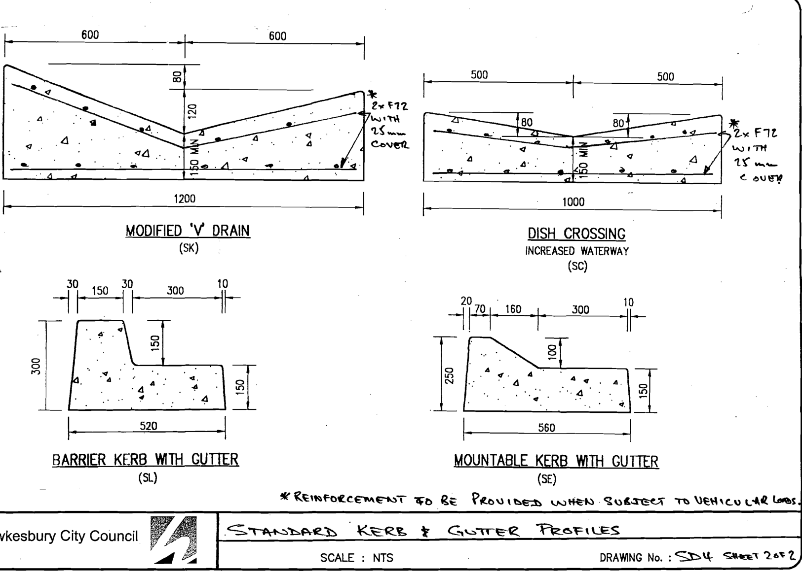
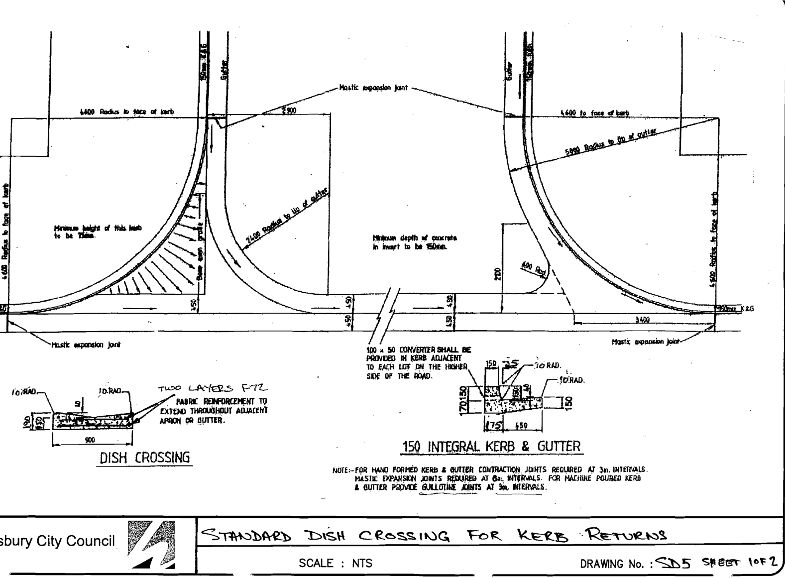
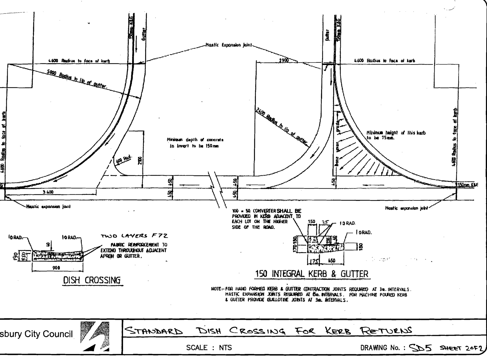
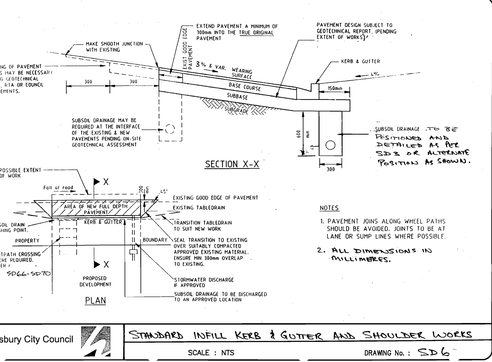

#### 5. REFER TO ~.c;Pec:-' F-'~,o "-3 Fot(" <J

#### o

#### HAVE A RADIUS OF 10 'UNLESS

#### n

#### T~

#### JOINT TYPE, LOCAnON &

### I..

### ·1

#### 600

#### C' "

#### 3. ALL DIMENSIONS IN MIWMETRES 6. REFER "-6 s.~e=;.tl--c~o...,~~ <1

#### • 'THINNEST PART OF KERBS

### ROLL KERB &: GUTTER

#### TO BE MINIMUM 150 IRRESPECTIVE

### EDGE RESTRAINT

(MODIFIED RT)

### CS:."Tl\-tobARb

### K~~ * G~,~~ -PRo~'UE:S

### DRAWING No. : ~ t\- fS~' t>'i­

#### r

> [Picture on page 9: a map, saved as a picture (images/part-03-drawings-page-9-2.gif, 150 dpi); the street names and other small labels are on the picture.]
> Words printed on the picture (title and legend, copied from the PDF):
> .' A ~.

### I..

#### 600

### -1 .

#### 600

### _I

### I.. 500

### .. I..

#### 500. I

#### 2~ f1'l.

#### ___4h"'-.! ,""

#### 't{ __

### 4.

### If

### ~ ~

### •

### ..

#### Cc'Vrt

### q4 '

#### ~.~

### 1.X'" __

### ..

### ...

### I.

#### 1200

### .1

### I..

### 1000"

### _I

### MODIFIED tv' DRAIN

### DISH CROSSING

#### (SK)

#### INCREASED WATERWAY

#### (SC)

#### 30 150

### -1 n

#### 30 300 10

#### 20 '

#### 10

### ,-

### -It­

### -j n· 160 .. ,--

### ·It­

#### 300

r:----....

#### .­

### 8

#### o o

### I

### ',d A .'.

#### "'., • 111

### .4'\1

### ... ~'. " ..4" : "ii, .­

~ ,

### . 4il

### I..

### ·1

### I.

### -I

#### 520

#### 560

### BARRlER KERB WITH GUTlIR

### MOUNTABLE KERB Y[IH GU~

#### (sL)

#### (SE)

### ~ ~~''''''~O€.C.€'lV\.~T ~l) &~ ~1t.o~ 'be-;:b ~~, ~\)«~ '"1"b \)~\-\, c"U L...t ~s

### .S~b.Pre..b K:~1<..¥:. t c.... '-::>\rt"·~ ~~..~,\..:E$

Hawkesbury City Council,

### DRAWING No. : ~\\- ~"\' '2.6~ t

I

> [Picture on page 10: a map, saved as a picture (images/part-03-drawings-page-10-2.gif, 150 dpi); the street names and other small labels are on the picture.]
> Words printed on the picture (title and legend, copied from the PDF):
> to M 1SIIi.
> II 50 WfYERlE~ SHAIJ. BE
> t,j{Jff:-fQR H,W;I f~Hfo KfREl & ~eR CON1~ JDHTS P,EQ\,IRfP ~ 31l.IHJm",LS.
> t\A511( f)I,p.oJj~ JOflIITS Rf,tlU~a AT &1, INtfMS. FCJl rw:IIlHf POURED KERB

### ......... ~~tlc ~ jcint ~

### . .. .

### UllO ~ ~ .,. ~ ~ J~:;?" 4'::C]!S

### 'I

### f-o+l "I!!!lf '0 reE!IWW.. J

HIiIuI ~ ri .......

### ~ IIIfplh ~ 11*".

In iwIItt ID bit 15IllilII.

### !

### I• . ~

### .~-~Wt -~I J

### \

### -~~t6

#### _..

### I'!Qlilil; ~ joIat

10 fA(f1 lOJ DIll THf IllHll

#### sm 01' Tt£ 1¥Wl.

#### ro;ilAD

### !o.}oo "'T"\...:>O t....A::.--{rt.,s \--n_

### ~..."" __ 1Il

### or,o;:-~ ()tTUil THRWlHpuT AIiJACftll

### .' ... .,.. Af'IfJi l,:lA I!fJTl£~·

### L ~]

### 150 1NTE,;f3RAL KERB it GUTTER

### DISH CROSSING

#### , ..

### & GllllfR p~ 8JU0l1I4 .qNT5 IJ .. tlTEIMUi.

#### ~

### c::::;.~b~b -:D\S'" c..~Os..~t~~ Fo~ 'Kt1t.~ '-1<..~~~~

### Hawkesbury City Council.

#### DRAWING No. :~5 $~~ \6t:1.

""­

~,.----,'/

> [Picture on page 11: a map, saved as a picture (images/part-03-drawings-page-11-2.gif, 150 dpi); the street names and other small labels are on the picture.]
> Words printed on the picture (title and legend, copied from the PDF):
> .--"'a,stl[ upl)n.n joInt
> UllO RQjtjIA 10 "au at k8l'tl
> MilinNn depth 1ft ancrllta
> In IIlY....t to bll {SO,.
> "«> • 51). COtfVe,RrfR SHAll. BE
> CACH lftl ON THf HdiER
> SIDE 01 Ttl!! ~.
> '" t "

### i.

### I

### ---

### -----

### J ....... -­ IV -­ ... I<Wll

### J I *,---­

### I

### J

### j

### !

### 1SO~-

,

### .I -.J !. ~

### ,....~ ~

#### PRlM1iD ti • ~. m

### '·...~i'·':..~=::J~

### i~~ 4WAC!NT

### ~J$tF.4Ef't.:;! )!G

### I

### 900' , I

### - , '

#### 150 INTEGRAL KERB & GUTIER

### OISH CROSSING

### NOTf,- FOO tlAW fMt1fU ~ .. ~ cpr4TAACTJQH JOINTS ~OUREQ AT 3•. IHTfR\'A,lS_

### HASTIC; £)(P~rclH ~rs. ~ /JJ 611. QVAL,S . FOR MAcHIIie PMW KERB

#### .. GUhER PRoviDe' Wuoru: JOINTS M 3c. lkTfHWILS.

### <;.~"hPt-~b ~,~\\ C ~oc;.s ,t()~ ~{{. \(~~ ,\<e-\\..)f...~

### DRAWING No. : ~5 S\\-a:, 26~

> [Picture on page 12: a map, saved as a picture (images/part-03-drawings-page-12-1.gif, 150 dpi); the street names and other small labels are on the picture.]
> Words printed on the picture (title and legend, copied from the PDF):
> PAVEMENT DESIGN SUBJECT TO
> EXTEND PAVEMENT A MINIMUM OF
> 300mm INTO THE TRUE ORIGINA~
> GEOTECHNICAL REPORT, (PENDING
> ~XTENT OF WOR~S).,r
> KERB & GUTTER
> LA YERS r1A'( BE NEcESSArn
> ADVICE. Id A OR COUNCiL
> 300 ~.. 300._....._
> SUBSOIL DRAINAGE MAYBE I
> ._WBSOIL DRAINAGE ,-r-b 15 ~
> OF THE EXISTING 8. NEW -_.~ \ j I
> PAVEMENTS PENDING ON-SITE L. J
> EXISTING GOOD EDGE OF PAVEMENT
> 1\. PAVEMENT JOINS ALONG WHEEL PATHS
> TO SUIT NEW WORK
> SHOULD BE AVOIDED. JOINTS TO BE AT
> FL USHltlG POINT.
> SEAL TRANSITION TO EXISTING
> LANE OR SUMP LINES WHERE POSSIBl.E.
> PROPERTY /I' I
> II I BOUNDARY
> OVER SUITABLY COMPACTED
> APPROVED EXIS TlNG MA TERIAl.
> ENSURE MIN 300mm OVERLAP
> "sTORMWA TER DISCHARGE
> SUBSOil DRAINAGE TO BE DISCHARGED
> TO AN APPROVED LOCA TION

### -g

#### r- MAKE SMOOTH JUNC TlON

#### , "_ / WITH EXISTING

#### STEPPlt'G Of PAVEMENT -,-­

#### -'" ". - .

### _. ~"/~ .--_...

#### 3% & V

### --A.R. 'wEARING

### I

### ----..

### I"

REQUlr<EtlUHS.

### 150mm.j

#### I

### REOUIRED AT THE INTERFACE I/"\

### '.,'

### :51'"

### 'PeS, r" C>~~

### ~ 'b.

### o

### .~ ~."rA-' L~ ~ t\:t..

#### "'S.h ~ b it.... t\L.~""-rt:

### SECTION X-X

### I.. .1

#### YO~'''6~ ~ ~""·b\N~.

#### .-J

#### ....--­

#### ~~~TRANSITION TABLEDRAIN

### IT

#### 2... ~\....L b''f'V\~S\(:lNS ,~

#### . f\t\\LL\ M~~.
