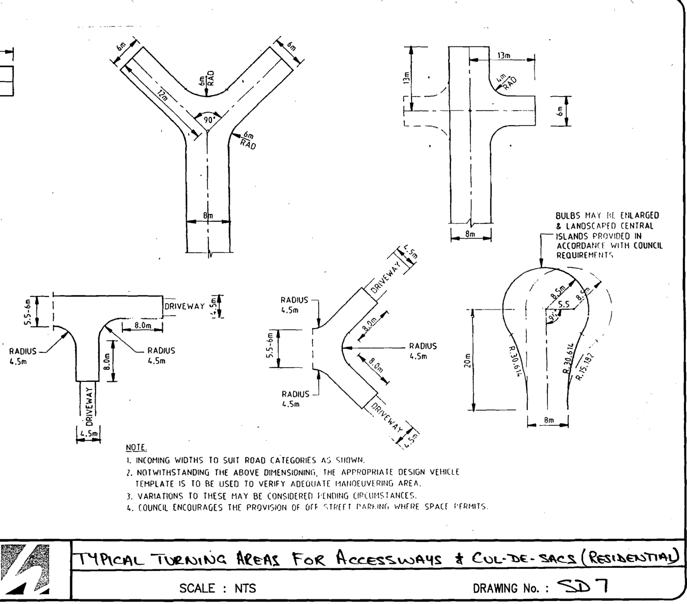
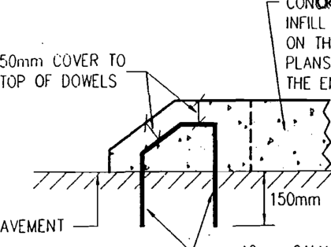
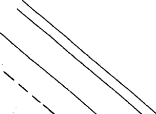
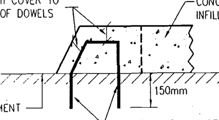

#### F00 1PA 1H CROSSING / I

### I l

### '"

REFER'

### X

'" -",

### " .

### PLAN

### S~bf\~ \t\)F\LL

### \(.tf-~ a G.\Yn-t·~

### ~"h. ~~\.)Lb~

### ~

### DRAWING No.: S:.1:> Co

,_ 13m .,.. 13m .,

> [Picture on page 13: a map, saved as a picture (images/part-03-drawings-page-13-2.gif, 150 dpi); the street names and other small labels are on the picture.]
> Words printed on the picture (title and legend, copied from the PDF):
> BULBS ~lfl"( rH. ENLARGED
> ISLANDS PROVIDED IN
> REQUIRE MOl T',
> AC(ORDANr E WI TH COUNCIL
> 1\. INCOMING WIDTHS TO SUIT ROAD (A'TEGOI~IES AS SIIOWN.
> 1\.  NOTWITHSTANDING THE ABOVE DIMENSIONINC,. THE flPPfWPRIATE DESIGN VEHICLE
> TEMPLATE IS TO BE USED TO VERIFY ADEOUATE 11f1fIOELJVERII,jG AREA.
> 3, VARIATIONS TO THESE ~lf1Y BE CONSIDER[fJ f'(NnltlG (Ip(Ur'lS! ANCE~.,
> 4\. COUNCIL ENCOURflGES THE PRQVI'jlor4 OF ClH r, Tf'fE T P/d?f1f·j(, \·/limE SPA(f r-FfH1ITS

#### !

### ~I

#### r

### v~~f(­

#### L __

### ]

### "

,

### !

### ~~

#### & LANDSCAPfO CENTRAL

### I.. 8~ ..I

### U

#### ',.

I..lim

### ~

### II I

### ~~~[

### EV£WAY -:1f

### '" ~ /I': 6.o,;;-:~ - ­

'"

....~\m

~

<1:~

### '" ­

CDUJ ~t.jt­

#### __ z

CQzo Vl><:

VlCX UJ

oc>(UJ

o.o.~

### ~

### ~

.0~"[-'

#### ~ I

"" .......

/;

JAOIUS-'/ [

ll,sm E C>

00

#### .cr

#### "1)- ~

#### " ':f

### ~c..AL '\'12-t..:),t.:>c. f\t~A1 f'o1{ "-~~~A"'S t C.\)L-""b~· 'S.~s.. (~€St~~"~Y

DRAWING No. : cs:D -,

MEDIAN

TO BE AS SHOWN

APPROVED ENGINEERING

#### CON~tttISLAND /

> [Picture on page 14: a picture, saved as a picture (images/part-03-drawings-page-14-5.gif, 150 dpi).]
> Words printed on the picture (title and legend, copied from the PDF):
> ON THE
> PLANS OR
> THE
> /

INFILL DETAILS

#### CONCRETE ISLAND / MEDIAN

INFILL DETAILS TO BE AS SHOWN

ON THE APPROVED ENGINEERING

PLANS OR AS DETERMINED BY

#### AS DETERMINED BY .

ENGINEER.

THE ENGINEER.

### ""­

/77;

> [Picture on page 14: a picture, saved as a picture (images/part-03-drawings-page-14-16.gif, 150 dpi).]

### " " "-"

EXISTING PAVEMENT

#### 'L--12mm GALVANISED STEEL

#### DOWELS 500mm CENTRES

#### MIN 150mm INTO EXISTING PAVEMENT

### ~

#### "

#### ,\\..\t~ /'

#### "

#### ?I),;/

### "

/

### "

(' /

/'

### "

:\\~.)/ / /

### "

### t0~' //

, /

### "

/

### "()5.- I / / /

V ~),­

#### / " I .-~ CuT c.Ok:>T1I\.)\)I)QS

/.'-

### DETAIL OF  DOWELLING MOUNTABLE (SF) KERB

### TO EXISTING PAVEMENT

#### . N.T.S.

> [Picture on page 14: a picture, saved as a picture (images/part-03-drawings-page-14-46.gif, 150 dpi).]
> Words printed on the picture (title and legend, copied from the PDF):
> TOP OF DOWELS
> INFILL

### *\.. / .

#### "!/ ------ \ ke:v ASo SH-ot..;)J.:)

### S..... /'

IIHO EXISrlN(; r'/WfMEril

#### /' /

TO ANCHOR I<l~n

#### CONCRETE ISLAND / MEDIAN

:·Ornm COVER TO

### DETAIL OF KERB ANCHORING

### INTO EXISTING PAVEMENT

/

#### N. TS

EXISTING PAVEMENT

NOTES

### "--12mm GAL VANISED STEEL

1\.  ONL Y MOUN TABLE KERB OR BARRIER KERB (KERB ONll'i i0 Bl:

FIXED TO [XISTING PAVEMENTS AS DETAILED ABOVt

#### DOWELS 500mm CEN TRES

#### MIN 150mm INTO EXISTING PAVEMENT

### DETAIL OF DOWELLING BARRIER (SM) KERB
