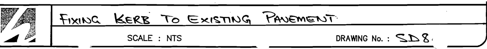
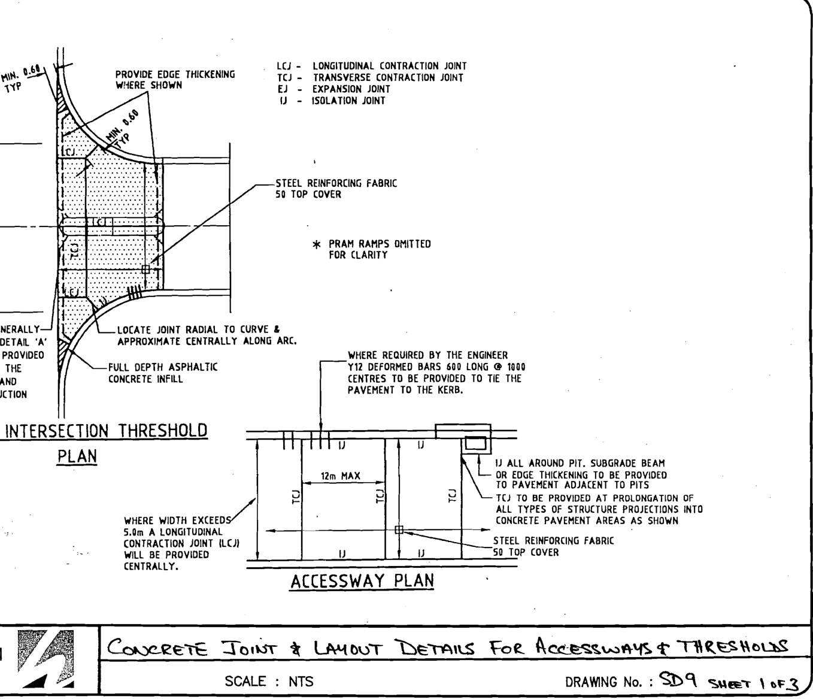
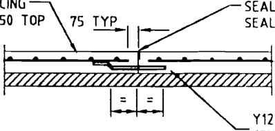
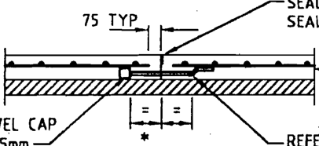

#### 2.  WHERE ROADS ARE TO RECEIVE A RESHEET KERBS :';!11Il L ~~ 9.AI~9J

SUFFICEIN TL Y TO COMPENSA TE FOR THE RESHEET THI~ ~ \.JNJ.L ~,',

MILLING OF THE EXISTING SURF ACE IS TO TAKE PLACf

### TO EXISTING PAVEMENT

N.T.S.

> [Picture on page 14: a picture, saved as a picture (images/part-03-drawings-page-14-72.gif, 150 dpi).]

### ~,x,~c. kt1'Z'K \0 E Xf~"~~ ?~E:M~T"

### DRAWING No. : ~h <6 (

~

#### "

> [Picture on page 15: a map, saved as a picture (images/part-03-drawings-page-15-3.gif, 150 dpi); the street names and other small labels are on the picture.]
> Words printed on the picture (title and legend, copied from the PDF):
> LCJ - LONGITUDINAL CONTRACTION JOINT
> TCJ - TRANSVERSE CONTRACTION JOINT
> EJ - EXPANSION JOINT
> IJ - ISOLAnON JOINT
> STEEL REINFORCING FABRIC
> so TOP COVER
> . . . . . .. .
> LOCATE JOINT RADIAL TO CURVE
> APPROXIMA TE (ENTRALLY ALONG
> FULL DEPTH ASPHALTIC
> WHERE REQUIRED BY THE ENGINEER
> Y12 DEFORMED BARS 600 LONG @ 1000
> CENTRES TO BE PROV~ED TO T~ THE
> PAVEMENT TO THE KERB.
> IJ ALL AROUND PIT. SUBGRADE BEAM
> OR EDGE THICKENING TO BE PROVIOED
> TO PAVEMENT ADJACENT TO PITS
> ALL TYPES OF STRUCTURE PROJECTIONS INTO
> CONCRETE PAVEMENT AREAS AS SHOWN
> S.am A LONGITUDINAL
> CONTRACTION JOINT ILCJ/
> STEEL REINFORCING FABRIC
> WILL BE PROVIDED
> so TOP COVER

### .................... ,.

#### ................ o.

### ('Ell'".. 'ill£lli'

#### f:::::::::::::::::::::::::::::::::::J

#### ~:· ... ·····l·¥

### * PRAM RAMPS OMITTED

II

WITH DETAIL

AND CONSTRUCTION

ADDITIONAL JOINTS IN ACCORDANCE

ISHEET 31 ARE TO WHERE NOMINATED BY THE ENGINEER PENDING ISLAND

LA YOUT

METHODS

### 'T' INTERSECTION THRESHOLD

### PLAN

#### i2 L TCJ TO BE PROVIDED AT PROLONGAnON OF

### WHERE WIDTH EXCEED/'

### ACCESSWAY PLAN

### ~~e1'E: TO'\rr ~ l.AA()U' D~-rA'tS 'f=o£. (\C!!'.J~:cs.~~~'f; et n~~\\oLt:S

#### DRAWING No. : CS;]) ~ cs.\\~"'t , ()~.3

't .'

SAW CUT AND PROVIDE

STEEL

#### SA W CUT AND PROVIDE

REINFORCING

SEALANT RESERVO~ AND

SEALANT RESERVOIR AND

> [Picture on page 16: a picture, saved as a picture (images/part-03-drawings-page-16-8.gif, 150 dpi).]
> Words printed on the picture (title and legend, copied from the PDF):
> TOP
> Y12

SEALANT. SEE

#### SEALANT. SEE DElAIL •A'

FABRIC 50

#### DETAIL 'A'

COVER

#### ~~S~3

> [Picture on page 16: a picture, saved as a picture (images/part-03-drawings-page-16-15.gif, 150 dpi).]
> Words printed on the picture (title and legend, copied from the PDF):
> DOW~L CAP

### l:n:7n:n:::~2~n;;n;n::l·

### ~~~N~~~3

### ~~;N~~ 3

### lr;;;;;/ff~/;;;;;;;r;;;j .

REFER

PROVED

#### DEFORMED StiR 500

TO ALLOW 25mm

TO DOWEL

#### CENTRES, 600 LONG

EXPANSION

DIMENSION TABLE

### TRANSVERSE CONTRACTION JOINT (IT1l

### LONGITUDINAL CONTRACTION JOINT (!J.11

STEEL REINFORCING

FABRIC FROM

PAVEMENT SLAB BENT

UP 75 FROM EDGE OF

SEE NOTE 6 .

#### FALL--

• • • • • • • • '

#### I'

SLAB 8. PROJECTING

50 INTO KERB

### ~~ ~.

### ~~.,N~~3

### WX~ e

#### FORMED SLAB EDGE

### Ii..B
