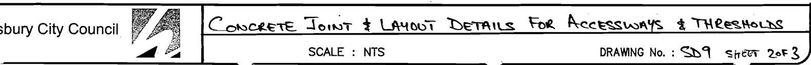
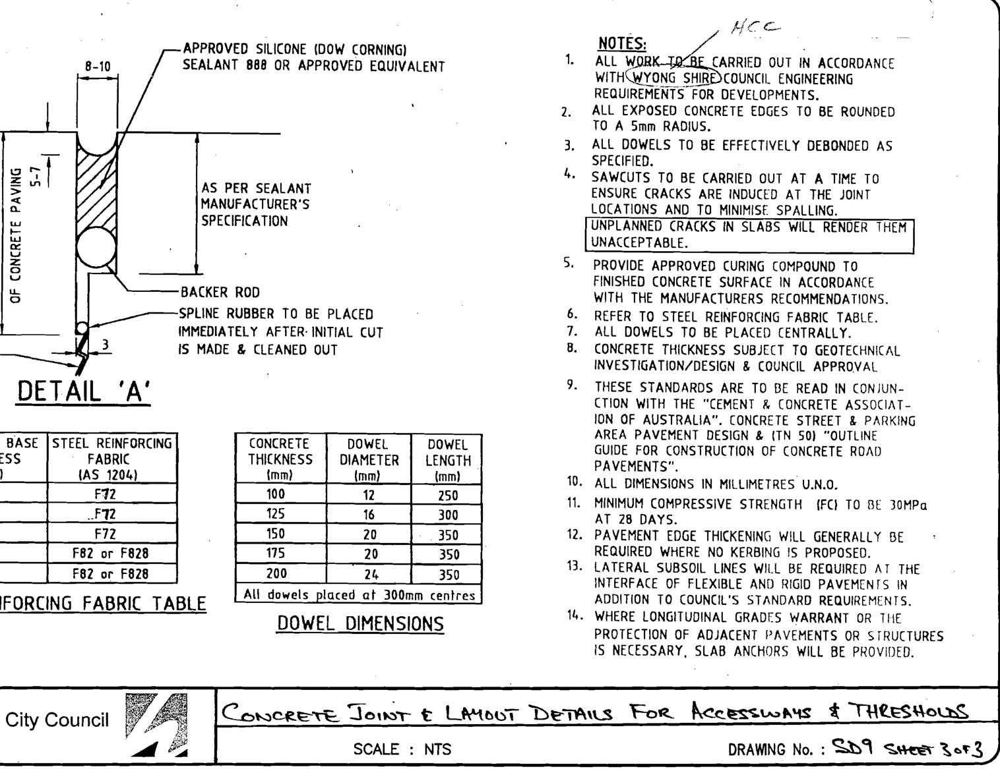

#### Y12 DEFORMED BAR 500

#### TO BE AOEQUA TEL Y SCABBLED

CENTRES, 600 LONG

PRIOR TO CONTINUATION OF WORK

### INTEGRAL KERB FOR CONCRETE ROADS

### CONSTRUCTION JOINT

PROVIDE 10mm THICK APPROVED EXPANSION

PROVIDE 10mm THICK

MATERIAL FULL DEPTH. TOP 25 TO BE

#### . 75 TYP ~-APPROVED EXPANSION

### ---II

MATERIAL FULL DEPTH.

### I .

### FALL- ~

TOP 25 TO BE APPROVED

### ~;;:.,N~:'3 ~~~OTE 6-~;:$~~;:

SEALANT

APPROVED SEALANT

### I

### .' .~

### :n:...:";~L :;,.::,.:::,::'

PROVIDE DOWEL CAP

### ~Q~ .5

### "-

EXPANSiON

### ISOLATION JOINT (ill ~SEE NOH fir BARS

### •

TO ALLOW 25mm

REFER TO DOWEL

FORMED SLAB

EDGE

#### ACCESSW-'\ Y PLAN .

DIMENSION TABLE

### * DENOTES DOWEL TO BE DEBONOED BY APPL YING

### EXPANSION JOINT It!l

BITUMEN 8, POL YTHENE WRAPPING

> [Picture on page 16: a picture, saved as a picture (images/part-03-drawings-page-16-81.gif, 150 dpi).]
> Words printed on the picture (title and legend, copied from the PDF):
> _i~1
> ~ p~

### t '1l-\e.~~US

### Lo~Ci..t\£. "Tou.';,.. *U\"t~\), b~~,LS

#### ~'l ~CC~\A:)t\'

~.........

### DRAWING No. : <;b9 'Sttffi"" 2..6~.s

#### "-­

> [Picture on page 17: a map, saved as a picture (images/part-03-drawings-page-17-1.gif, 150 dpi); the street names and other small labels are on the picture.]
> Words printed on the picture (title and legend, copied from the PDF):
> APPROVED SILICONE /DOW CORNING)
> SEALANT BBB OR APPROVED EQU/VALENT
> AS PER SEALANT
> WITH~YONG SHIRDCOUNCIL ENGINEERING
> 2\. ALL EXPOSED CONCRETE EDGES TO BE ROUNDED
> 3\. ALL DOWELS TO BE EFFECTIVELY DEBONOED AS
> ENSURE CRACKS ARE INDUCED AT THE JOINT
> LOCA TIONS AND TO MINIMISE SPALLING.
> UNPLANNED CRACKS IN SLABS WI[L RENDER THEM
> '\ BACKER ROD
> IS MADE & CLEANED OUT
> 5\. PROVIDE APPROVED CURING COMPOUND TO
> FINISHED CONCRETE SURFACE IN ACCORDANCE
> WITH THE MANUFACTURERS RECOMMENDATIONS.
> 6\. REFER TO STEEL REINFORCING FABRIC TABLE.
> B. CONCRETE THICKNESS SUBJECT TO GEOTECHNIC AL
> 9\. THESE STANDARDS ARE TO OE READ IN CONJUN­
> ION OF AUSTRALIA". CONCRETE STREET &- PIIRKING
> AREA PAVEMENT DESIGN &- (TN 50) "OUTLINE
> GUIDE FOR CONSTRUCTION OF CONCRETE ROAD
> 10\.  ALL DIMENSIONS IN MILLIMETRES U.N.o.
> IFCI TO BE )OMPa
> 11\.  MINIMUM COMPRESSIVE STRENGTH
> AT 28 DAYS.
> 12\.  PAVEMENT EDGE THICKENING WILL
> REQUIRED WHERE NO KERBING 15
> 13\.  LATERAL SUBSOIL LINES WILL BE
> CONCRETE BAsE STEEL REINFORCING
> F82 or F828
> ADDITION TO COUNCIL'S STflNDARD REQUIREMENTS.
> 14\.  WHERE LONGITUDINAL GRADES WARRANT OR THE
> IS NECESSARY. SLAB ANCHORS WILL BE PROVIDED.

### r--t

#### -> «

VI

VI

w

z

### ;''--j L c_

### NOTES: /-" ..
