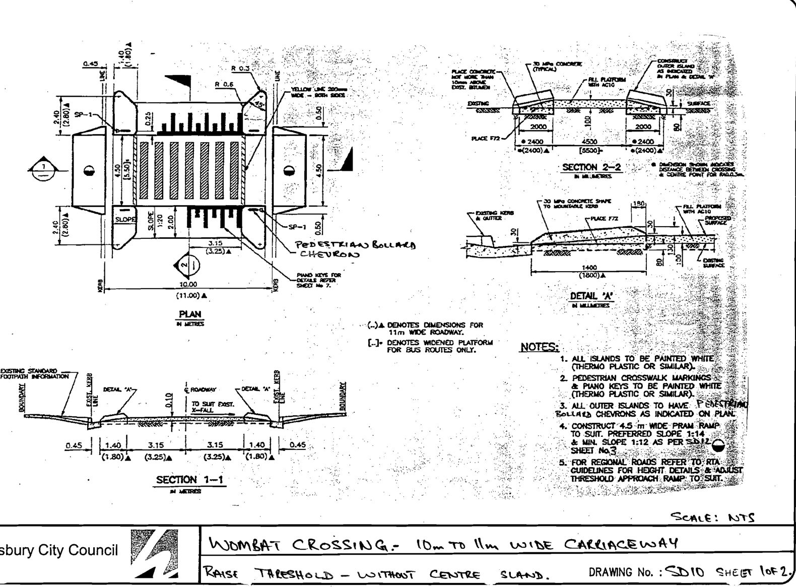

#### F82 or F828

#### 20 . 350

#### All dowels placed at 300mm centres

### STEEL REINFORCING FABRIC TABLE

### DOWEL DIMENSIONS

#### REQUIRED II T THE

#### INTERFACE OF FLEXIBLE AND RIGID PAVEMEN rs IN

#### PROTECTION OF ADJACENT PII VEMENTS OR SrrWCTURES

### Co~~~~ :rou~;"1 i: L~MS', D~TA\\..S Fo~ k~~\A;)~'1S t ,"e.~\\o~

### DRAWING No. : ~~ ~~ '\e.lf3

> [Picture on page 18: a map, saved as a picture (images/part-03-drawings-page-18-1.gif, 150 dpi); the street names and other small labels are on the picture.]
> Words printed on the picture (title and legend, copied from the PDF):
> 0-...:1 j ~-.::;. •
> . SECTION~2 .: lltSI'NoCE 1lE1'oIUN~' .,
> ~ ._.K~:~~_~~::',· .:·~.l\.
> ;": .~' .
> ~~'O .... u'''n", OR "''''' .")' j;.,' .•••. ,
> 2\. P£DESTRJAN CROSSWALK
> ..(niERWO FUSTlC ORS1WllAR).'i;,{;.;}:;0
> TO SUIT ElGSI'.
> 'gbl.:l"Q CHEVRONS IS INDlCATEDONPl
> . . (1.80).
> . TO ·SUIT. PREFERRED SLOPE 1.1." ,,~""",.)~: .':'
> c;.ct\\.~ ~ "-:l"l"'S

#### ...

-_....

### ._­

### ~

### litl I I

### ~

#### O(~~l

#### .. -----"-"':U:1RlS ' : • cemai: fOWl fOIl ~.

#### "'e

#### ~

### 4J­

#### 'Peri ~~, ~

#### .' . ~'. - .". ~'.

### :~;..:..

1\. ALL ISlANDS TO' BE PAJN7ED wHIlE\;." '~"

#### ,,1I'c;...nAI ~II"" ~ :'::':1.,;~~.t,A,·~

#### a PIANO KEYS 10 BE PAlNImWHnE:

### I
