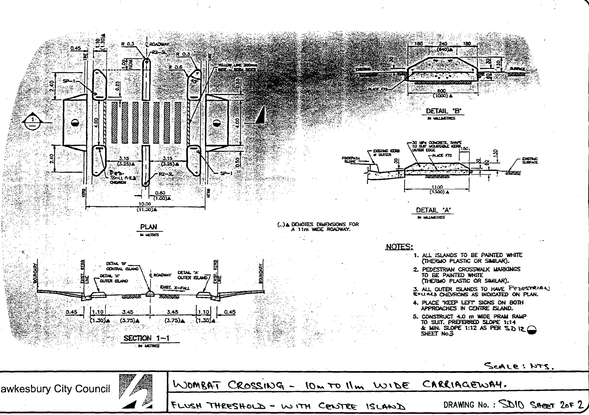
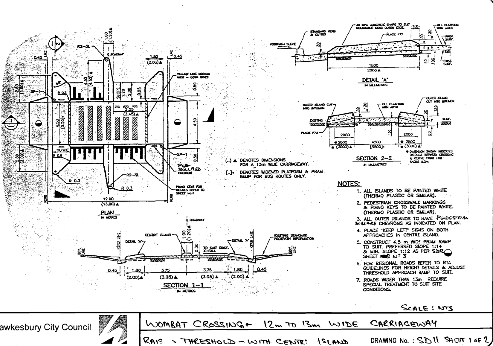

#### 3. All. OUTER IS1.ANDS TO HAVE J"'e~

#### UAIOONCS;:~~·' ..,.

### I

### !

### 4.' CONSJRUCT-4..5 ·:in· W10E'~:;~ Ii ::

#### .T:­

### 0.45 I 11.40 I

### I 3.15 I 1.40 II. O.~5:.,..·

#### 1 -1-

(3..25). (3..25). (1.80). •.... .•. '

### ., . ~~&.&

#### SECTION' 1-1 . ~. - . :" .

### .. ~

### ~l:)fV\tt\-\ C-ilos,.$, ~ ~.- \0"", \b \\"'" \)..) \ ~~ CJ\!.t.\f\c..~~ 1\\.f

### "tz.-A\c;( \"l.l~\\o~ - \.,.....:H~ ~~ SLt\-N)) .. DRAWING No. : ~,~ SHt:lit \C)~ 1.

~--­

> [Picture on page 19: a map, saved as a picture (images/part-03-drawings-page-19-2.gif, 150 dpi); the street names and other small labels are on the picture.]
> Words printed on the picture (title and legend, copied from the PDF):
> ".:,:~.:>: .... =
> ". -'~' ", .':'
> (•.),. OOJOlES OIU91S1ONS FOR
> A 11 m WIDE RON:1NAY.
> . ,i .~~.: :.~. .,:;:
> (niE.~ PLASTIC OR SIMILAR).
> 2\.  PEDESTRIAN CROSSWALK LIARKINGS
> TO BE PAINTED WHflE
> '::;~; "," .
> lteU""l.j) CHF.VRONS loS INOICATEJ> ON PlAN.
> APPROACHfS IN CENIRE ISLAND•
> 5\.  CONS1RUCT 4.0 m WIDE PRAY RAW2
> TO SUrf. PR£FERl"CWSI.OPE 1;14 .

### .. ~

### I

#### }~~}4-1

### .. ~

1\.  AU ISlANDS TO BE PAINTED WHITE

### ~ PL.ASnC OR SlaAIlAR).

3\. AU. OUTER ISLANDS TO HAVE PE'bE?S'J"llt,llh,J

4\.  PlACE 'KEEP LEF1" $lCNS ON BOlli

### t~;:,~.~t.·;\;' ,". >. -'" .

### :%'~{'~d~c;'; 0.45 '11.1o! . .3.45 .' . I. 3.4~ . ,.10 I.,O.45.

### J

ok WIN. SI..OPf: 1:12 JQ PER "S.i:) It...r"\

### '1~:J'''I~~;~;·;:·j:fif:~(·!~~_(:·7').

#### c:;.e.A L @. .. \-,)"l"-S.

### lAJoM.~~ C£..O~tt..)<q \() "" "t\) \\"" \A) \ b~ C.~il«'\~c-..~~ •

### DRAWING No. : ~,~ ~~,. 2.6~ 2.

### ~\.-,=>s.'" \1-\-e..~ \o\-oL:b - ~ ''''' C~~~ '~L~:h

r

> [Picture on page 20: a map, saved as a picture (images/part-03-drawings-page-20-2.gif, 150 dpi); the street names and other small labels are on the picture.]
> Words printed on the picture (title and legend, copied from the PDF):
> , . (2.00).
> . 0UIBt l5LUOD cur
> • ()IIC)QION _ INllICU<S
> DcSfAlC£ IlE1'MOBo CIlDSSliOC
> 4t CDM POINT FOIl .
> FOR A 13m WIDE CAAAw:;£WAY.
> RAUP FOR BUS ROUTES ONl.Y.
> ,. All. ISlANDS TO BE PANTa) WHITE
> (THERlJO PLAS1'lC OR SWIl.AR)•
> 2\.  PEDESTRIAN CROSSWAU: t.WOONGS
> &: PlANO KE'fS TO BE PAINTED WHITE.
> (niEfWO PLASTIC OR ~l1.AR).
> 3\. AU. OUTER ISLANDS TO HAVE ,.p8'b~~
> ~ U~ CHEVRONS IS JIIl)lCAlED ON PlAN.
> 4-. PlACE 'KEEP LEFT' SDlS ON 60TH
> ~ CDI1R£ ISlNID q "! .,.<
> APPROACHES IN CENTR[ ISLANO.
> S.  CON::l'TRUCf 4.5 m WID: PRAAA RAMP
> TO SUIT. PREFERRED SlOPE 1:14­
> SHEET _ IV! 3
> GUIDEUNES FOR HEIGHt DETAJl.S &: ADJUST
> lHRfSHOU) APPROACH iWoIP TO SUIT.
> 7\. RQOJ)S WJD£R THAN 13... REQUIRE
> S?tC1AL TREATUENT TO SUIT SITE

### » _ ~ ShOPE 10 sua ...au......­

### _t _ llUR'X ma:. .. 1m, ,_ ..cIG

### r~ Fn 11!3\~:

#### j,~,.~:""~'::'~';_~~""_"';-""-'-' ;"-":"'..:-~:/~J:_~:~.:..~:.-"'!'~

### ..:~~ .

### "'<f~l .'

### .~.­... '.

### . t--­

### . uo.­

#### I
