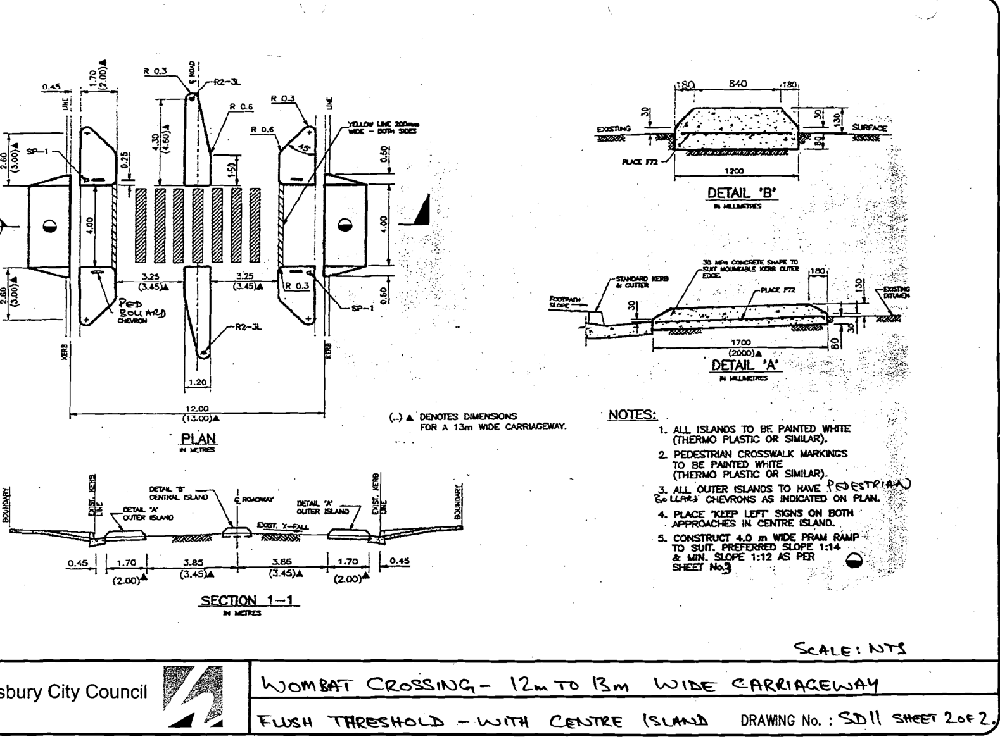
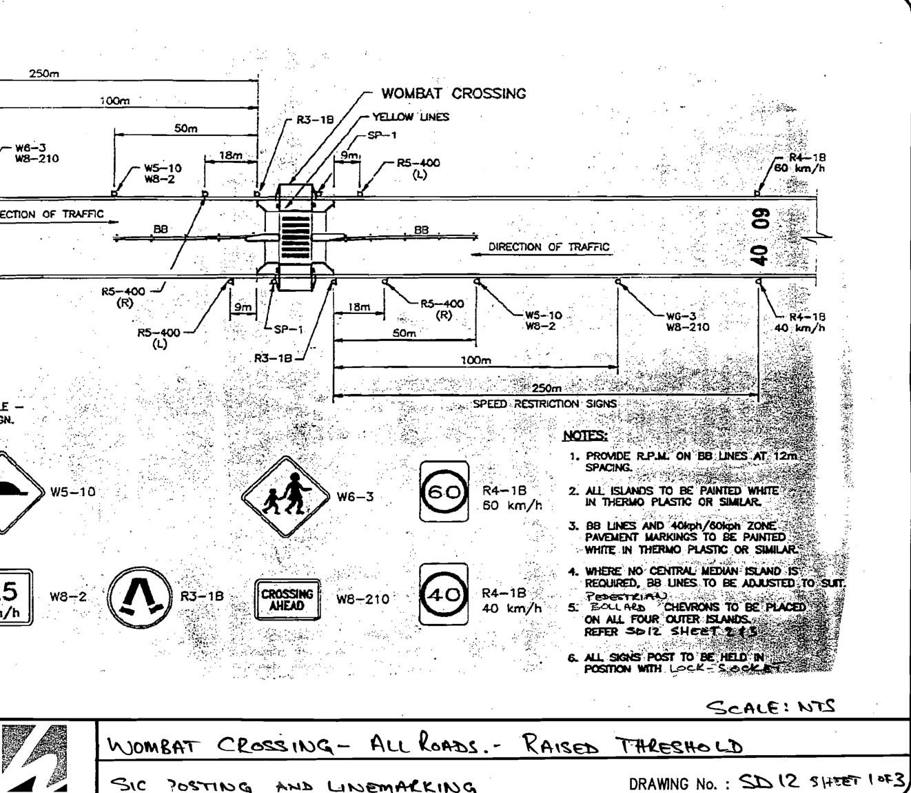

#### 21 FLl. ~ cur II/JO illUO

### r

### .m) 8dUMM . '7 j ~~ ~'f4lW JW:'!O

### ~-L

### ~l­

### ~ .~ \·f····tciTT/~ :?'SZ~

### ;1i'UF.W~··" t ~

### -~~ II "'" I ..

• I .,.,;,' g;

### ~ 4!1OO ~

#### , • (3000).1 [5.">00J. '---r;-[3000).'

#### SECllON 2-2.

(••) .6. . [)£Nores D1W£NS1ONS , [••]_ DENOTES WIDENED Pl.A.lFORU &: ?RAU.

#### NQTES:

#### fWl

#### 0'2

### m

#### !roomlH~

### I

. ....

### . ,J~

& t./IN. Sl.OPE 1:12 /IS PER 'Sbft..i'\

-..,

#### i"" I

6.' fOR REGIONAL ROADS REFER TO RTA

### ~ I' L80 !. ~7!$ I 3:75.1~~ I ~45.

. (2.00},6, (3.95) A. . (3.95).6. ,.. ;' ,.(2.QO)

## SECTION 1-1 .", <',

#### <;VA L(i: : "-3'"t'S

### \A...)Dt't\tAT CR.b~S.'t-.)~ ... \'2."", 1l) ,~W\, w'bE

### ___________ ..II_~_~_\c; ~ ~~\\_~L_b - V-,:}''n\- e.~trT\~L~ DRAWING No. : Sob" ~C:I!\' of '1..

lo..­

....-.,.-----"~

> [Picture on page 21: a map, saved as a picture (images/part-03-drawings-page-21-2.gif, 150 dpi); the street names and other small labels are on the picture.]
> Words printed on the picture (title and legend, copied from the PDF):
> 0 .....0; .• ..:!:!. .
> ~j I '
> (••) .... DENOTES DIMENSIONS
> FOR A 13m WIOE ~t:ialAY.
> 1\.  ALL ISlANDS 1'0 BE p~tmD WHITE
> 3\. AU..·OUTER ISLANDS TO HA\IE ~~~.,-.e~~
> ~ u.~~ CHf.\IROHS AS 1H00000TED ON f't.AN•.§(~::.
> llt.iAIL·J( wn7 l5
> OUIER &SUND I
> ~A-L~ t ~"'t-S

### •

#### 00 ~ 0.3

### .. ~

### ~I~

#### OJ'S

#### . J~tA~

(THERUO PLASTIC OR SlUItAR). < .~

2\. P£DE'STRIAN CROSSWALK w.RKINGS ~."

### TO Be: PAINTED WHITE '. . .::' .:

(THERUO PI.AST1C OR SIMIlAR). ':<,

### i

### I

### 0.45.1 ~.

### I.

### .1,1.7°_11. 0 •45

### ·:F~~~4t~~l

## SECTION 1-1

### "'-:Jo~~Kf Ct2..o~,~~ - \'L-. 'Tt> \~VV\ W 'b'E:" ~ f\~4t, f.\C..E wi\.'

### ~U>S" ~~\+O~ ~- .~~ ~-nz.~ ~~\..~ DRAWING No. ; <;.b \\ c::.~ 'Lc:.~ 2. •.

> [Picture on page 22: a map, saved as a picture (images/part-03-drawings-page-22-1.gif, 150 dpi); the street names and other small labels are on the picture.]
> Words printed on the picture (title and legend, copied from the PDF):
> " ~~:: .~
> ~ ',:t~~T.~:;. !
> DIRECTION OF TRAFF1C
> DIRECTION OF mAFrlC
> ," :~,":.: .'
> 1\. PRCMDE R.PJot'·ON'·;BB:lJN_.
> '. {" .. ,:;
> . 60 km/h . IN THERWO .PlASTlC OR.SDMlAR.;;~:".
> ~. : _..•':':'.~_.:; "." "'.;"": " "'·:'~"C·/·"';" " .~...::. : _.)~'.:~~ ;:-:-"::
> . ' . ,.::. .
> ,.,,, 3. BB UNES ~D~4OIlph/6OIiPtiZONEq
> . PAVDlENT WARJ<JNGS TO BE PAINTED.
> 'WH~IN ntERWPlAST1C:OR SIMI~
> . "...." '.,"- ;:".~,:::,;! ... -~1.5.'·':"l :-:,,.:.. ": ..··i..:.: ~
> , '.' .
> ON ALL f'OUR"OUJm·JSI.ANDS., .",
> <;;~ALE: 1 ~-.-..s

### '.' ". ":~;;~lL 8

### I

### '/ R4-18

### I

4<) km/h

### [

### ~

·~·;=<I,

#### .,'

### ~w~.:.;::'

R4-1B

60 krn/h

#### - ."..~ ?­

### (::-1 SP-l ilEFER 10 RIA SAIIPLE

.

FRIENDLY WOMBAT SIGN.

SPEED·~~~~~il~!.;:,,,,

### .~'j;~~'~~f'c'

### '0"·;"..:......;,..

#### ,:.:..... ,'. .'.'. W6-3'

### ~ WS.;..10

### ~~~lB • ,; :~':~:~:!~~~'"''

### ," . . :i '. .

#### R5-400 (R)

### ~

### ':: •.... ,.:.,;(.

### Ei .5-400 (ll

#### .' .... WHERE NO- CEN11W.i MEDtAN;'ISLANO'~1

#### ". .': ,. REOUIRED BB UNES.TO BE ADJUSTEI

#### R4-1 Bj<., . '.. ?~l~:,.·.;:\g.:;.' ;):);)i:'i:~.:i;i~;';'

### [/25~ wa'2<'@~~lB ·ij::';'i· 1.8_2,0'

'. '.. --- .,
