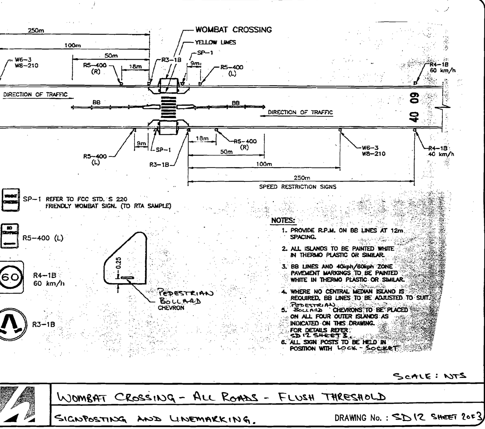

#### 40 km/h' s.: ~L AAJ) ":CHE.VRONSTO BE~.Pl·

### .<~

#### k jh

### m '.. '.

#### POSl11ON WItH. 1;:'- .- ~~.~

,

### .. ~ :7"':;:~il~-.

### "'-JOf.\~4\T Cf-~~ \~~ - ALL ~o~S • -~A'~E.b '"t"M.~~ L...:h

#### \..

### DRAWING No. : ~ t'2.. 'SH~ '&~3

### s\c 1b~-n~('q -f!o."""h U~€'IV\M.t..,~~

."

#### .~----------_--&'--

,,;.'---....;..----------....;,

#### ;r

> [Picture on page 23: a map, saved as a picture (images/part-03-drawings-page-23-2.gif, 150 dpi); the street names and other small labels are on the picture.]
> Words printed on the picture (title and legend, copied from the PDF):
> . ', ....,:.:'. '";"",
> DIR~CTION OF TRAFFlC
> I : : :
> ,. . ;;::
> SPEED RESTRICTION SIGNS
> . fRIENDLY WOt.lBAT SlGN. (TO RTA SAt.lPlE)
> ....: .. ;
> PA\'EMENT WARKlNGS.TO fIE PMflED';"•.
> .",,": :': .: .•.• ":; "::. - ~:. :0,.; .-.:.~ ·.;:'j/~~;.;·~ ..:..;.·.:<,~l~i .;, :!~"i~'/f
> ,,:".:,;,:, ... '
> . ~".:. .
> 4 wHERE NO C9nRAL~' iStANo IS" J-~;

#### .. """""

### Ir

### i r R4-1B

### 1/ 40 km/h

### ( L ) ."0~ km/h

### >1 >~~:;7~ :~~: •..•.•

#### RS-400

### =

### o

~

### o

### I :"

,

### ~R4-1B
