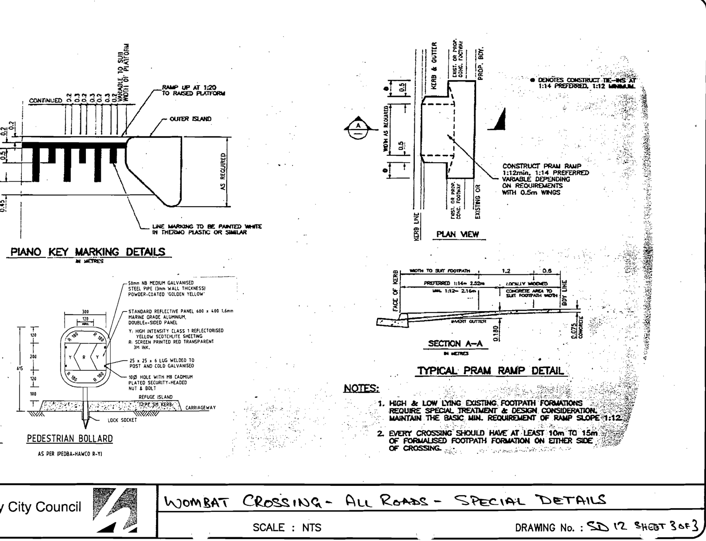
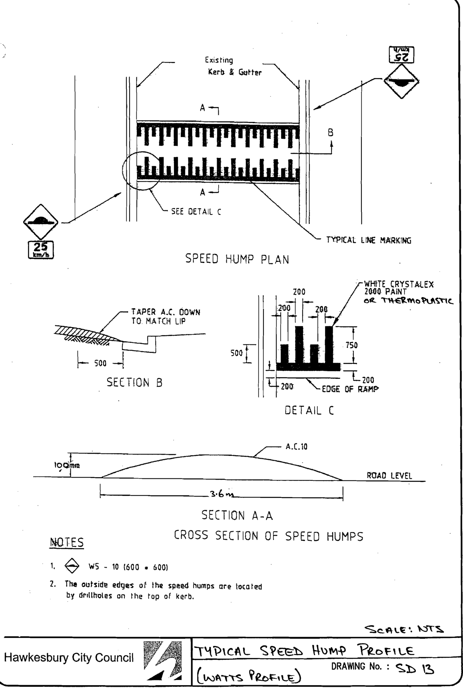

#### 60 km/h

### .~

#### R3-'lB

#### W6-3

### ....·~1~J!r;!t{~4~

### ";~~7~~~,~.

#### .' -gC;\..L_~~

### ~L~~~~~:~~_::""

### ®

### 6

#### R4--18

### ~.40 km/h

### ~

#### S c..tl\-\.. ~ : ~,s..

### "'J~VV\~«f ~o~~t~~ - ~LL ~~ - ~L'Vs..\\ \1\t.~'"o\..l)

#### c;\c..t-.:)~e>~"Tl~ ~"h U·~~'A'L..\'::..'N~ ..

#### DRAWING No. : ~b \'2.. c;.~ 'l.o~

> [Picture on page 24: a map, saved as a picture (images/part-03-drawings-page-24-1.gif, 150 dpi); the street names and other small labels are on the picture.]
> Words printed on the picture (title and legend, copied from the PDF):
> I .ID ;JCC). 0
> W 0' I ~
> 1:14 PREfERREP. 1:12 ...uJIL.;,
> RNIP UP AT 1:20
> TO IWSED FVMORY
> ~ . 'flr
> . ::".: /~'
> CONSTRUCT PRALl RANP
> 1:12min. 1:14 PREFERRED
> WITH O.5m WINGS
> 'N rHERWO PlASllC OR SlIoIILAR
> SOmm NB MEDIUM GALVANISED
> STEEL PIPE Ilmm WALL THIlKNESSI
> POWDER·COATED 'GOLDEN YELLOW'
> "" 'MOnt TO :lUlr toolP",", 1.2 I 0.11
> 1:< PREF6llI£I) 1:\4- U2no • urAUy -...ooom Il:!
> STANDARD REflECTIVE PANel 600 J: 400 1.6mm
> MARINE GRADE ALUMINIUM.
> Y, HIGH lNTENSI1Y CLASS' REFLECTORISED
> YELLOW SCOTCHLITE SMEETING
> R, SCREEN PRINTED RED TRANSPARENT
> SEC110N A-A 0
> '0(1) HOLE WI1H MB CADMIUM
> PLA1ED SECURiTY· HEADED
> NU1 & BDU
> iWNTAlNlHE ~. UIN. REQUIREUENT OF.RAMP SLOPE'~1:1~
> 2S , 2S , 6 LUG WELDED 10
> POST AND COLD GALVANISED
> OF CROSSING. •...:... . .' ."_ ;. '..::.;''''':'... '. . ..' ,."··.c··
> AS PER IPEDBA.HAWCO R·YI

#### "'<

### I 'I i::

#### ... i

### II ~ logr I~

#### . II"

### !J'i I j..::

.•.OOiOtEs CX»ISJRix:r:m!~~i;

### .l3. I r1­

### s -- -\

### i--rrrnrTIJCONliNUED

#### je> do. 0.0 OO>'yll:

#### 1

#### dio.LI

#### -LT-'

### ... cr'

®-~-,

### j

#### _:i:!

#### .'i~~

### j on, ~I .~

#### '"

#### "" '"

### !~ I j~

### ,J " '" .

### \

### I

### "-- UHE ~ "It) I!£ PJoNTD) WHfI'£

### I

### il

#### PIANO KEY MARKING DETAILS

### .. ~

### "~t'

### -- ':'2- 2.1"'"I '.' COtClll!1E: MICA 10 1;;1

#### ~

### -~-"T-ill

### CZ i~a==- wnm 00 .. • , ~

#### ~ .: '. ~~

#### 200I

### t­

#### TYPICAl· PRAU IWlP ·DETAlL .•

### it

### NOTES:,........ UlW~

### EXISliNc>~inii~j.~~;~;f~i

·REQUIRE St>ECIAl.1REAlWENT l!c DESIGN CONSIOERA~ ';:':;:>?',::

### 1

### '.

### ."":" 2. £VEIn' ~t~lSHouLD .H.f.I£' AT.'IEAST ". ;~:'TO ·15in::;~Sf;.'1~~r

a:" FORtoWJS£l) FOOTPAlH FORW-llON ON EJJHER SIDE <~~<',..

### "'.JoM !t\\ C~is.,~~- C\LL 'K~~ -

### DRAWING No. : ~ \'2.. !"\-\~T OS ~~ 5

\.....

> [Picture on page 25: a picture, saved as a picture (images/part-03-drawings-page-25-1.gif, 150 dpi).]
> Words printed on the picture (title and legend, copied from the PDF):
> Exis~ing
> TAPER A.C. DOWN
> TO. MA TCH LIP
> ROAD LEVEL
> 1,
> tocoted
> 2.
> by drillholes on the top of kerb.

#### Kern & GuH-er

### Ai

#### SEE DETAil C

#### TY.1'ICAL liNE MARKING

### SPEED HUMP PLAN

#### •

### ~..

### ...~

#### ~

### 500[

### ~ 500 -l

### SEC T!ON B

### DETAIL C

1------_1.·b~......

### _

### SECTION A-A

#### ~TES

### CROSS SECTION OF SPEED HUMPS

### ~ INS - 10 1600 * 6001

#### The outsid'E! li!dge'S oJ tN s:pead humps ar@

### f.
