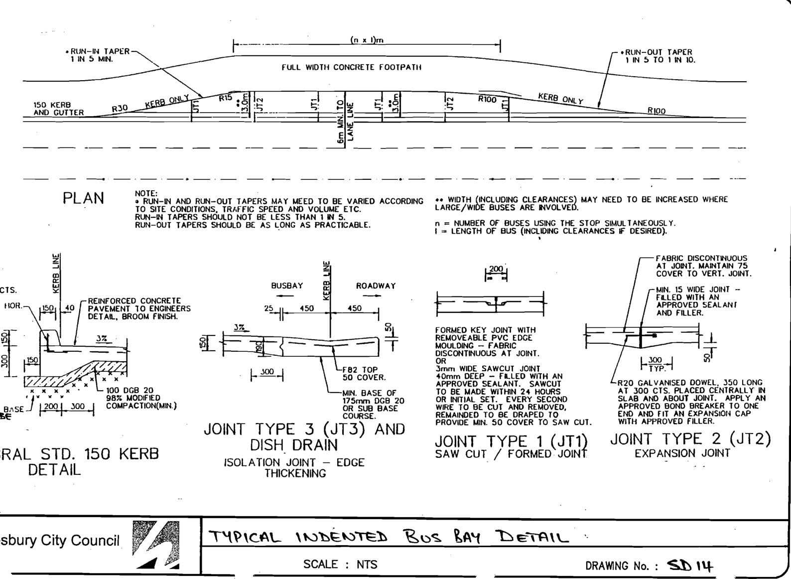

#### 0 _\ DRAWING No. : <;'1) ,~

### Lw~tT~ l e.o~, L~

> [Picture on page 26: a map, saved as a picture (images/part-03-drawings-page-26-1.gif, 150 dpi); the street names and other small labels are on the picture.]
> Words printed on the picture (title and legend, copied from the PDF):
> • RUN-OUT TAPER
> 1 IN ~ TO 1 IN 10.
> • RUN-IN TAP£R---.......
> fULL WIDTH CONCHETE fOOTPA Hi
> (0 x I)m
> AND GUTTER ~o
> TAPERS MAY MEED TO BE VARIED ACCORDING
> •• WIDTH (INCLUDING CLEARANCES) MAY NEED TO BE INCREASED WHERE
> LARGE/WIDE BUSES ARE INVOLVED.
> SITE CONDITIONS. TR/,ffIC SPEED
> TAPERS SHOULD NOT BE
> RUN-OUT TAPERS SHOULD BE
> AND VOLUME ETC.
> LESS THAN 1 IN 5.
> AS LONG AS PRACTICABLE.
> n = NUMBER Of BUSES USING THE STOP SIMUL TANEOUSL Y.
> I = LENGTH Of BUS (INCLIOING CLEARANCES IF DESIRED).
> AT JOINT. MAINTAIN 75
> COVER TO VERT. JOINT.
> MIN. IS WIDE JOINT
> fUED WITH AN
> 40 PAVEMENT 10 ENGINEERS
> DET All, BROOM fiNISH.
> ( . 37.·
> 1/ ' . , ", r"x X X
> K X X X • 100 DGB 20
> MIN. BASE Of
> 175mm DGB 20
> OR SUB BASE
> AT 300 CTS. PLACED CENTRALLY IN
> SL AB AND ABOUT JOINT. APPL Y AN
> APPROVED BOND BREAKER TO ONE
> END AND fIT AN EXPANSION CAP
> WITH APPROVED fiLLER.
> EXP ANSION JOINT
> fORMED KEY JOINT WITH
> REMOVE ABLE PVC EDGE
> MOULDING - f" ABRle
> DISCONTINUOUS AT JOINT.
> 3mm WIDE SAWCUT JOINT
> 40mm DEEP - fILLED WITH AN
> APPROVED SEALANT. SAWCUT
> TO BE MADE WITHIN 24 HOURS
> OR INITIAL SET. EVERY SECOND
> WIRE TO BE CUT AND REMOVED.
> REMAINDED TO BE DRAPED TO
> PROVIDE MIN. 50 COVER TO SAW CUT.
> SAW CUT / FORMED JOINt
> ISOL ATlON JOINT - EDGE
