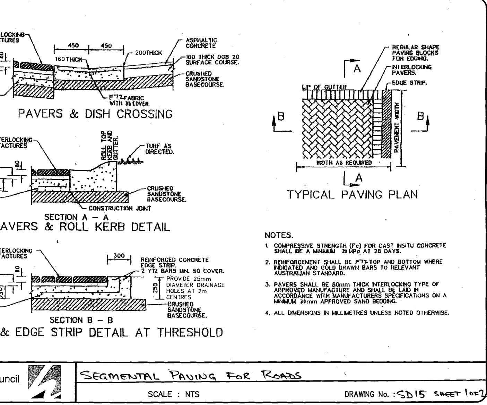

#### R20 GAL vANISED DOWEL, 350 LONG

### JOINT TYPE 2 (JT2)

### DISH DRAIN

### JOINT TYPE 1 (JT1)

### INTEGRAL STD. 150 KERB

### DETAIL

### ''\~'C.AL \l0'ht.\0,,"='h ~\)<;. tA'1 ~~F'A''-·

### DRAWING No. : ~ ''-'­

### "­

### 89w ~~\~

> [Picture on page 27: a map, saved as a picture (images/part-03-drawings-page-27-2.gif, 150 dpi); the street names and other small labels are on the picture.]
> Words printed on the picture (title and legend, copied from the PDF):
> l CO¥PflESSlV£ 5THE~TH (F'Q) fOR CAST INSITU COH\:RE1E
> 2\.  f)DNFORCEMENT ~HALl BE F'1- TOP !'#J eonOM WI-£RE
> WICATE(> ANO COlO OHAWN BARS TO IIE.L~VANT
> EDot STRP. .
> 3\. PAVERS SHALL BEliOmm Tl-tCl< HTER\.OCl(I'lG l'YPE Of
> APPRoveD MANuFACTURE AND SHAll Of: LAID tl
> ~ AT 2m
> 'f • - 'CENTRES
> MlNMJM' Umm APPROVED sAND 'BEOOt-IC. '

### .ASPHALTIC

~~~ ..,

. 100 lUlCK DGD 20

### ~~~~S
