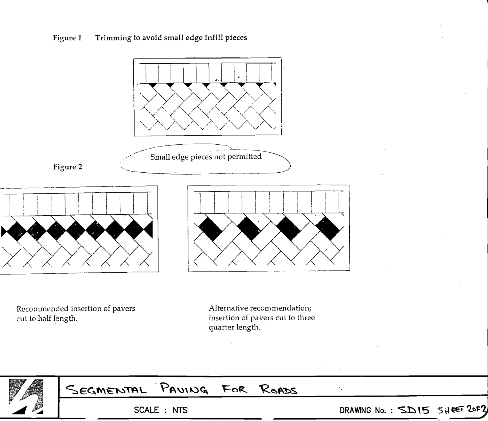
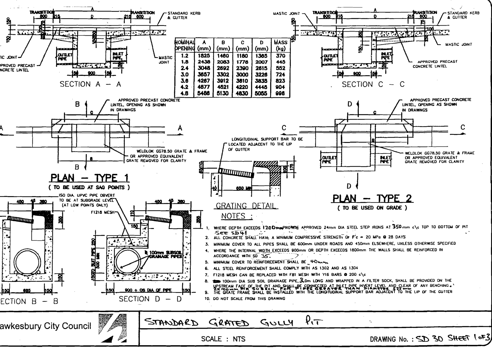
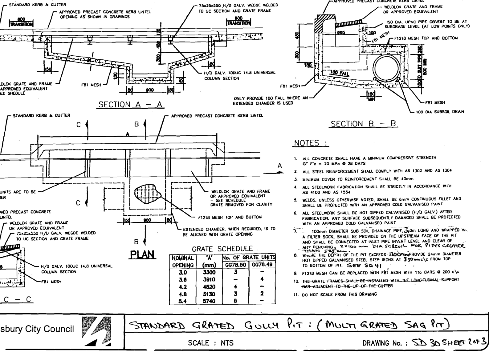

#### 35 ~ COvER.

### SECTION a - B

#### "

### PAVERS & EDGE STRIP DETAIL AT THRESHOLD

### SE'G.'fV\ ~TA L .~C-\ ~,\0 ~~

### 'Ro~

### DRAWING No. :~'h 'S- ~\\-EE"" 'b~

> [Picture on page 28: a picture, saved as a picture (images/part-03-drawings-page-28-1.gif, 150 dpi).]
> Words printed on the picture (title and legend, copied from the PDF):
> ~
> .. '\.
> '--
> • , I
> i
> i I I
> '.

Figure 1 Trimming to avoid small edge infill pieces

Figure 2

### I ill i IT. \.

### I I

### .M

### '-. '-'. 'A '>..... "­

#### ')/ r

### A.(/'')/ >/ ~;//"y

..r-,.•.<:/'...../.<--<./ '''(/'.''y/ ..,,//'-...../A.,....

### , " "

### , "

#### \...... ..../"',. //'\,"'" / ..~...,... ,//"'" /"""', //""'''' /'...., ~

#### .../ ...../ ...../ ...../ './ '-/ 'v

#### './'1

### '::=-;:;;~;g~ pieces-=;e;,,;it;~d~

### I I !

### .\ I I !! ! Tl

### ! I : I Ii!

### I'

#### Recommended insertion of pavers

Alternative recon', mendation;

#### cut to half length.

#### insertion of pavers cut to three

#### quarter length.

### SE~fV\~-n::\L . ~A'l,~<:q F-o~ 1;<~~

#### '"­

### DRAWING No. : cs..~, 5 ·s ~ ~ '2.Cl~

### -----------------------,..

#### (rtl'------/

> [Picture on page 29: a map, saved as a picture (images/part-03-drawings-page-29-2.gif, 150 dpi); the street names and other small labels are on the picture.]
> Words printed on the picture (title and legend, copied from the PDF):
> UASTIC JOIN T
> CONCR£ TE lINTEL
> !>PEt-lIN( (rom) (mm) (mm) (rom) (kg)
> LONGlTlJDINAL SUPPORT BAR TO
> LOCATED ADJACENT TO tHE UP
> 8.50 GRATE&. FRAME
> ATE de I'RAUE
> OR APPROIlED EOU
> PIP£ GRA TE REUOIIED 1'1
> WHERE DEPTH EXCEEDS '11.00.......RO~ APPROIlED 24mm OIl. SlEEL STEP IRONS AT '3S0mm c\c TOP TO OOTTOU OF PIT
> 2\. ALL CONc;RETE SHALr'HAVi:. A I.IINIMUIoI COUPRESSIVE STRENGTh' Ot F'e .. 20 MPa Q 28 DAYS
> 3, UINJUUM COVER TO AlL PIPES SHAlL BE 600mm UNDER ROADS AND 45Dmrn ELSEWHERE. UNLESS OTHERWISE: SPECIFIED
> 4\. WHERE lliE INTERNAl YIlDIJj EXCEEDS 9DOmm OR DEPlli EXCEEDS 1800mm THE WAlLS SHALL BE REINFORCED IN
> 5\. M1NIUUM COlIER TO:RE:'Nf~CEUElr('sHAi.L BE _ CHl ...._
> 6\. ALL STEEL REINFORCEMENT SHAlL COUPLY YIllli AS 1302 AND AS 1304
> 7\. Fl218 MESH CAN BE REPLACED WITH FIll UESH -WIlli Y16 BARS 0 200 c\c
> 8\. l00mm OIl. SUB SOIL DRAINAGE PIPE. 10m LONG AND WRAPPED IN A FlL TER SOCK. SHALL BE PROVIDED ON lHE
> UPSrREAt.I FACE OF...lliE f>lCT ANDFSliALL..BE CONNECTED AT INlET PI~E INVERT LEVEL AND CLEAR OF ANY BENCHING. \
> 9\. THE GRATE" FRAME SHALL BE INSTALLED WITH THE LONGlTlJDlNAL SUPPORT BAR ADJACENT TO THE UP OF THE GUTTER
> 10\. 00 NOT SCALE mOM TillS DRAWING

### i

#### ",""AAO " ..

### ,.....~."'m'

### ~ d.jJ;~'

### ;F0... ...,' ,HI

### ..

### -Pf!OOJIt­

...... ~ ....

### ~

#### SECTION A - A

#### C

#### SECTION C

#### o PRECAST CONCRETE

### ~oMlt.lAl A B C D ~ASS ..

#### 1.2 1825 1480 1180 130~ 370

### 1.8 2438 2083 lna 2007 4-4.5

#### 2.4 J048 2692 2J9O 2615 552

#### 3.0 3857 3302 3000 32215 724

#### 3.8 42157 381~ 3810 383S 823

### ....2 - .an 4S21 4220 #4S 80of.

#### 4.8 5488 5130 4830 5OS5 898

### .

### .

### . .

#### ./'

.........

#### C

#### I I

#### \

### A

### -

### A-

### -­

### C---­

### I.

### ~ WELOLDK GG18.50

#### ./

, ,......

### /

### \

### '"

### I 8

### D J

#### GRATING DETAil

( TO BE USED ON GRADE )

#### NOTES:

( TO BE USED AT SAO POWTS

### ~ ~,~':'.=.~'::l

### ~E

### '" CD" .....'" ""'"

·Sec ~J:)"it" ';:. . -'­ " '" ­ - : -',

#### .. ' •

.,

### ACCORDANCE v,ITH -SO 3'5':'""-" --­ '")' '­

### ..

### ,.'

### ~ ~ t ... _', .

### .... , .

### .•... ',. "--;-: ..~ .•'."~ -J­

#### ,°4" .. -;.

### oz.,r,Cc __ "'''­ ...,-. 6''''' -c,R l'".~es: Gt-.""I"'e"1L 'T'4...... :l>1""'~", su-­

### QOO + os Wdl' fI'E ~_

## SECTION 0 - 0

### ~

### ~

#### SECTION B - B

### ~a.A~

~~LL"t Q,-,

### DRAWING No. : <;J) ~() S~, \ ol=3

#### SCALE NTS

~

~

> [Picture on page 30: a picture, saved as a picture (images/part-03-drawings-page-30-3.gif, 150 dpi).]
> Words printed on the picture (title and legend, copied from the PDF):
> APPROIlED PRECAST CONCRETE KERB UNTEL
> STANDARD KERB .It CUTTER
> 7:1x25.:I:l0 .HIO CALVo WEDCE WELOED
> TO UC SECTION AND CRATE FRAloIE
> WELOlOK GRATE AND FR..."'E
> OR IIPPROIlED EQUIVAl.EN T
> APf'ROIlED PRECAST CONCRETE KERB UNTEL
> OPENlhC AS SHO""," IN QRAWINCS
> 1tiJI~
> c;i"
> """";""'""i -.- • -­
> ...~.; ~ Of."; :.
> AND FR AloIE
> l'ElOLOI< ORA TE
> DR APPROII£D EQUIVALENT
> - SEE SHEDUL£
> WHERE AN
> ONLY PROIilDE 100 FAlL
> EXTENDED CHAloIBER IS USED
> STANDARD KER8 ok CUTTER
> APPROVEO PRECAST CONCRETE KERB UNTEL
> 1\. ALL CONCRETE SHALL HAVE A UII~I"'U'" COUPRESSlIIE STRENGTH
> Of" F'c - 20 MPo 0 28 DAYS
> 2\.  All STEEL RElNFORCEYENT SHALL COMPLY WITH AS lJD2 AHD AS 1304
> ......
> J.  UINIUUI,( COVER TO REINFORCEUENT SHALl BE 40mm
> 4\. ALL STEELWORK FASRIC...TION SIlALL BE STRICTLY IN ACCORDANCE WITH

ISO DIA. UPVC PIPE 08VERT TO BE AT

SUBGRAOE LEIlEL (AT LOW POINTS ONLY)

### /~

I••• ,:: ... -':oJ.':- :-~

### ~'O':: I:. F121~ UESH TOP AND BOTTOtol

### ~

F81 Y(SH

#### SECTION A - A

#### SECTION B - B

#### NOTES:

### -------r\I~--­

#### A

A

AS 4100 AND AS 1!l54

### I c:::-]­

CRA'TE fRAloIE

### -----J----f-:::J I

:I.  WELDS. UNLESS OTHERWISE NOTED. SHALL BE 6mm CONTINUOUS FILLET AHD SHALL BE PROTECTED WITH AN APPROIlED COlD GALVoVllSED PAINT

UNI TS ARE TO BE

### I II alT}1 II I '- "HOLCK GIlAl'E AND FRAloIE

WELDED TOGE lHER

#### I I '.(. I

OR APPROVED EOUIVALENT

#### C

I

- SEE SCHEDULE

### ___~ l

### J _

GRATE RE"'OVEO FOR CLARITY

IIPPROII£D PRECAST COHCRE TE

KERB UNTEL

6\.  All STEELWORK SHALL BE HOT DIPPED GALVANISED (HID CALV.) AFTER FABRICATION. ANY SURFACE SUBSEOUENTL Y DAloIAGED SHALL BE PROI[CTED

#### _~---iOo---T{

Fl216 "'ESH TOP AND BOTTOI,(

AND FRAUE

WITH AN APPROVED COLD GAlVANISED PAINT

WELOLCl< Q'tATE OR IIPPROIIED

1~-_ l00rnm DIALlETER SUB SOIL-'DtiAINAGE'PIPE.J.Om LONG AND YoRAPPEDIN~

7.5x2~ HID CALVo TO UC SEcnON

A FILTER SOCK. SHALL BE PROVIDED ON THE UPSTREAM FACE OF THE PIT

AND SHALL BE CONNECTED AT INLET PIPE INVERT LEIlEL AND CLEAR or ...­

(OUI vAlEN T

### \.. EXTENDED CHAUBER, WHEN REQUIRED. IS TO

WECiOE YIELDED

BE ALIGNED WITH GRATE OPENING

AND GRATE FRAloIE

### B J

#### GRATE SCHEDULE

### .E.l.Ati

...,.~.,. I'IEN/;;"'ING. 2 1l ll:lo"'- "1:>1 ... ~Oa.l:oll- Fo(l., PI ~"S G.~

.. -"n"""..... 5'"&-.5:--..

--" - ..

.

8\.  Vit,,:.RE THE DEPTH OF THE PIT EXCEEDS, nOO..,...pROVlDE 24mm DIAUETER

HOT DIPPED GAlVANISED STEEL STEP IRONS AT 3:SO......~\t fROIooI TOP

#### TO BOTTO'" Of PIT. S~ S~ Iff . •

NoMINAL 'A'

~o. OF GRATE UNITS

opENING (mm) GG78.50 0078.-49

HID CALVo 10000C 14.6 UNIIlERSAL CClLUUN SECnON
