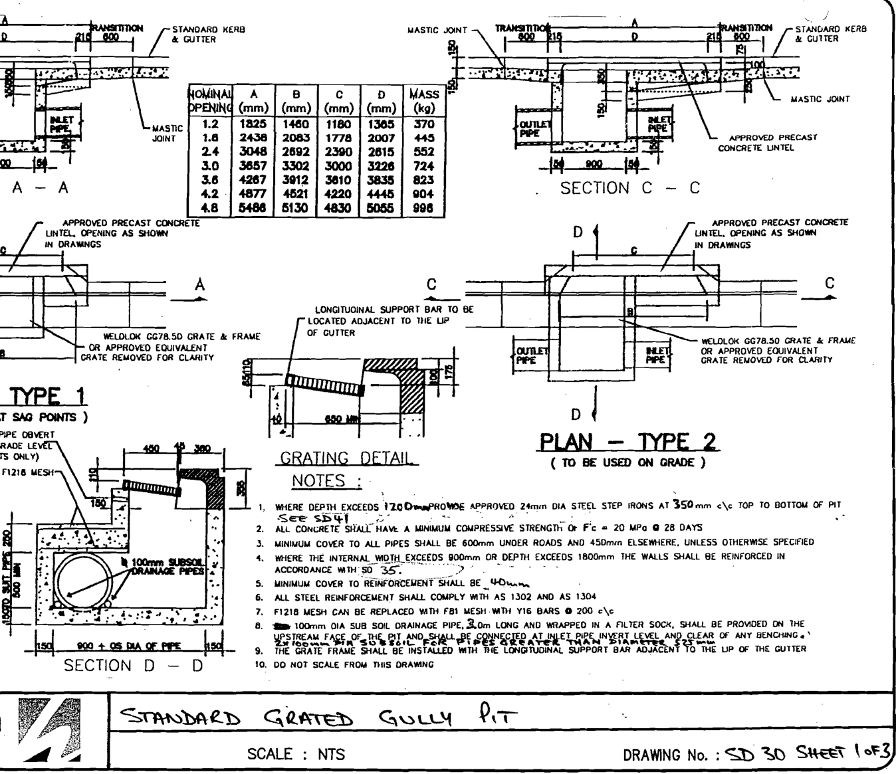
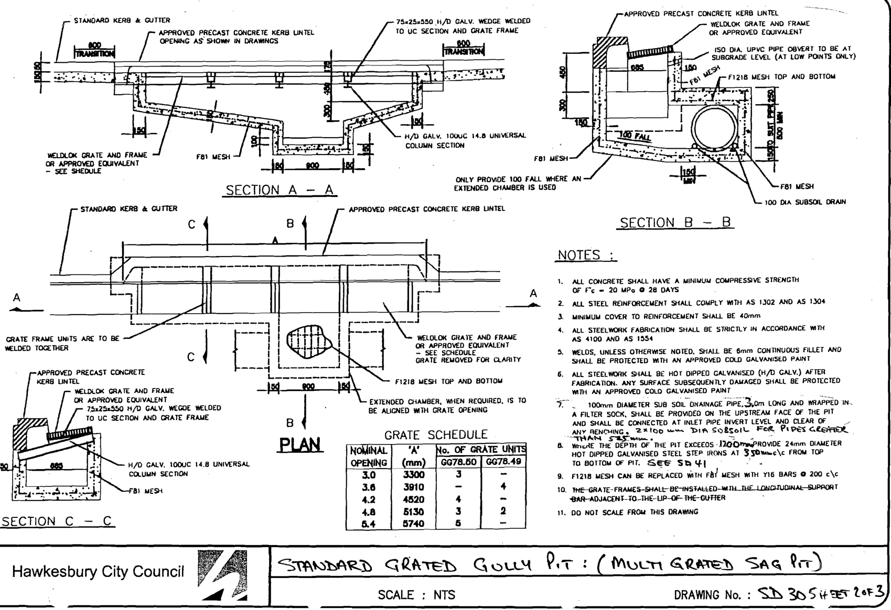
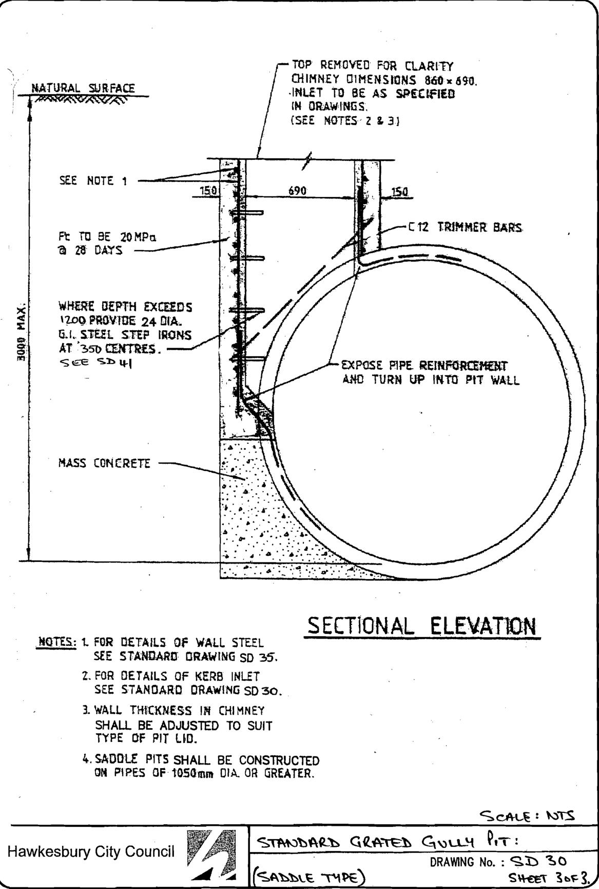

#### 9.  F1218 MESH CAN BE REPLACED WITH F~; IolESH WITH Yl6 BARS 0 200 t\t

81  uESH

10\.  ltff-GRATE- FRAloIES-·SHAI;t:-·ef-jNS'fALHD~JlLWL.L£l/II.CI.1UAl-!MJPPORT itAR-....DJACENJ.-lO-TH(-UP·-{jF-·lHE-GItff£R

11\.  00 NOT SCAlE FROU THIS DRAWING

#### SECTION C - C

3.0 J300 3

### -

3.8 3910

### -

4

4.2 .f62O 4

### -

#### -4.8 5130 3 2

### 5.-4 5740 5 -

### S"W\~b~~n q{(f\~~ C, \,) LL'-\ ~ ., Mucn ~it~~ SA~ q,.)

#### DRAWING No.

#### NTS

#### SCALE

Ilo...

### ~ ~Srtro-t6F~

---------_:....:.....

,-~-----,,,

#### ----- J

### ~atiL.,.

> [Picture on page 31: a picture, saved as a picture (images/part-03-drawings-page-31-4.gif, 150 dpi).]
> Words printed on the picture (title and legend, copied from the PDF):
> ".
> STANDARD KERB
> t.l'UllLn
> ~
> '" CUTTER
> ,..;­
> Asnc JOINT
> pP~I"'( (mm) (mm) (mm) (mm) (kg)
> IolAsnc
> CAs'r
> !PO
> CONCRETE:
> APPROVED PRECAST CONCRETE
> UNTEL, oPENINC AS SHO"'"
> IN DRAWINCS
> I
> BAR TO BE
> LOCATED ADJACENT TO THE UP
> OF GUTTER
> ............
> 8.50 GRATE'" FRAME
> OUIVALENT
> 'R CLARITY
> Vl£LOLOl< GG78.50 GRAIE .5< FRAME
> OR APPROVED EOUIVALENT
> GRATE RE/,/OVED FOR CLARITY
> WHERE DEPTH EXCEEDS 't'2.00"",,*,RO~
> 2\. ALL CONUlET£ SHAlT HA\It. A IoIlNIIolUIol
> ~PROVED 24mm D1A STEEL STEP IRONS AT 15'Omm c\c TOP TO OOTTQI.A OF PIT
> CQ/,/PRESSIVE STRENGTh Ot f'e m 20 IolPo a 28 DAYS
> 600mm UNOER ROADS AND 45Dmm ELSEWHERE. UNLESS OTHERYt1SE SPECifiED
> J. UINI/,/UU COvER TO ALL PIPES SHALL BE
> 4\. WHERE THE INTERNAL YtlOTl:! EXCEEDS
> 900mm OR DEPTH EXCEEDS 1800mm THE WALLS SHALL BE REINfORCED IN
> 5\. IolINIMUU COvER TO'REINF'ORCEIolENf-sHALL BE_ 11-0...._
> 6\. ALL STEEL REINFORCEMENT SHALL COUPLY WITH AS 1302 AND AS 1304
> 7\. F1218 MESH CAN BE REPLACEO 'MTH F81
> -\
> -t. 6 .
> MESH .WItH Y16 BARS 0 200 c\c
> PIPE,1Dm LONG AND WRAPPED IN A flL TER SOCI<, SHALL BE PRO\llDED ON THE
> 8, .... l00mm OIA SUB SOIL DRAINAGE
> 6
> E'TNsT...!uO WIT: mE LON~'fu~AL~P~T~~"'.:;'}~Nr~-t-MUP OF THE GUTTER
> ~TREAIoI FA~ OF'STH~P1T ANOF~Ll~E C~~N~fIP AT I!iET PI~E INVERT LEVEL AND CLEAR OF ANY BENCHING.'
> 10\. DO NOT SCALE FROM nilS DRAWING

#### ~­

### Did IU'~~''''''' ""

### .- ~

### ~~

IolASnc .oNT APPROVED

.. .-:..~ .. j

PRECAST

CONCRETE: LINTEl

koMl",AJ A B C 0 MASS ~

#### 1.2 1825 1480 1180 13&5 370

#### JOINT 1.8 2438 2083 1778 2007 ~

#### 2.04- 3048 2892 2390 2615 552

### ~

### 3.0 3657 3302 3000 me 7204-

### -tAf

### fIi­

#### 3.6 ...287 381~ 3610 J8J5 823

#### SECTION A - A

### SECTION C - C

#### ....2 ' 4871 4621 4220 4+4S 80...

#### ....8 M88 !130 4830 150!5 998

#### ,"'"

### o

. ,

### A

### /'.

### ."\

### A

### C

### C

### /

### LONClTUOINAL SUPPORT----

### -

### -

### --

### I 8

( 10 BE USED AT 5.'D POINTS )

### ~

LOW POINTS ONLY)

#### GRATING DETAIL

### D J

### ~~A~~':'~

(AT

( TO BE USED ON GRADE )

. Fl211! IoIESH

#### NOTES:

I

I I

### ~.

### ·Sec- siiit', . ,:" ,,'-

#### . .. - ._,-_

### ACCORDANCE WItH ~- 35'.~"'- "j

### - '. - -

#### -.'•

### -,.'

:

### .I ~~

### .-

### .

### (j-J

/' :'t~ ,-:.' .~ ....

#### -;­

### ~ eoo t OS Wdlf P!'£ ~ 9. THE 'MA'7tFRAM"1: SH~LL 'e

### ~

## SECTION 8 -

## SECTION 0 - 0

#### 8

### s.~bA-e:J:) C;Q.A~ ~~LL"t (>"

#### DRAWING No. : <;J) ~t) S~, 'C)~3

> [Picture on page 32: a picture, saved as a picture (images/part-03-drawings-page-32-1.gif, 150 dpi).]
> Words printed on the picture (title and legend, copied from the PDF):
> APPROVED PRECAST CONCRETE KERB UN TEL
> .....
> STANDARD KERB .t: CUTTER
> 75.25.550 ,!i/O GAlV. WEDGE WELDED
> TOUC SECTION AND GRATE FRAIAE
> WELOlOK GRA TE hND FRAME
> OR APPROVED EOUIVAl.ENT
> APPROVED PRECAST KERB UN TEL
> CONCRETE
> IN DRAWINGS
> .... , -:: .....f~~~ :~l!
> ••••• .. ••' OJ
> ISO DIA. UPVC PIPE 08VEIIT TO BE AT
> SUBCRAD£ LEVEL (AT LOW POINTS ONLY)
> 4-
> CI~I~ MESH TOP AND BOTTOIA
> OPENlhC AS' SHOWH
> H/O CALV. looue 14.a UNIVERSAL
> COLUIAN SECTION
> W£l.OlOK CRATE AND FRAUE
> OR APPRO~ EClUIVAlENT
> - SEE SHEOUL£
> fBI UESH
> ONLY PROVIDE 100 fAlL WHERE AN
> EXTENDED CHAUBER IS USED
> APPROVED PRECAST CONCRETE KERB UNTEL
> STANDARD KERB A CUTTER
> 1\. AlL CONCRETE SHAlL HAVE A IAINII.IUI.I COUPRESSlVE STRENGTH
> 2\. All STEEL REINFORCEloIENT SHALL COMPLY WITH AS IJ02 AND AS IJ04
> J. "'INIIAUM COVER TO REINFORCEIAENT SHAll BE 40mm
> 40 ALL STEELWORK FABRICATION SliAlL BE STRICTlY IN ACCORDANCE W1TIi
> AS 4100 AND AS 1~54
> CRATE FRAIolE UNITS AR£ TO BE
> WELDED TOCE lHER
> ~o WELDS. UNLESS OTliERWlSE NOTED. SHAll. BE 6mm CONTINUOUS FillET AND
> SHAll BE PROTECTED WITH AJoI APPROVED COlD GALVANISED PAINT
> I I '·1· I
> OR APPROVED EQUIVALENT
> I
> - SEE SCHEDULE
> GRATE REIAOVED FOR ClARITY
> APPROVED PRECAST CONCRETE
> KERB UNTEL
> F1218 IAESH TOP AND BOTTDIA
> \l£LOl.OK CRA TE AND FRAIolE
> OR APPRO~ EQUIVALENT
> 6\. AlL STEELWORK SHAll BE HOT DIPPED GAlVANISED (H/O CAlVo) AFTER
> FABRICATION. ANY SURFACE SUBSEQUENTLy DAIolAGED StiAlL BE PROTECTED
> WITH AJoI APPROVED COLD GAlVANiSm PAINT
> 7,:i~2~ H/O GALV. \\£CiOE WELDED
> A fiLTER SOCK, SHALL BE PROVIDED ON TliE UPS TREAIol FACE ~ THE PIT
> TO UC SECTION AND CRATE fRAIolE
> AJoID SHAlL BE CONNECTED AT INLET PIPE INVERT LEVEL AJoID CLEAR or ....
> --0 , .'
> .
> B. vm<.RE THE DEPTIi Of THE PIT EXCEEDS' .I'lOO"W'ROVIDE 2 4mm DIAIolE TER
> HOT DIPPED GALVANISED STEEL STEP IRONS AT 3SO""""c\c FRW ToP
> BE ALIGNED WllH GRATE OPENING
> TO BOTTOIA Of' PIT. S~ S~ 1ft ' •
> H/D CAlVo tOQUC 14.8 UNIVERSAL
> COLUIAN SECTION
> 9\. F1218 ...ESH CAN BE REPLACED WITH F~I IAESH MTH YI6 BARS 0 200 c\c
> 10\. 1HE"-GRATE" FRAIolES-SHAU:..Bf-;NSl'Al-t£D....'~U1LIlI£..l.DI>lCI.Al-5UPPOIl T
> 81 IAESH
> itAA--ADJACEN~-10....THE-UP-.{)F-1tIf-OOff£R
> II. DO NOT SCALE fRQ/,t THIS DRAWING
> OPENING (mm) GQ78.50 0078.-49
> -4

### tmJIli&\t

### -... - .

### 1'0\:'

### /~

### ~

#### SECTION A - A

#### SECTION B - B

#### C

#### NOTES:

### -------r\l~ -­

Of F"c - 20 MPo 0 28 DAYS

#### A

#### A

### -----J----f-:::J

#### C

### ___

### I c:::-}­

### I I .tTl III

#### '- \\£LDLOK CIIAn: AND FRAIolE

### ~ l

### J _

#### -~---';'---t~

#### 1-:- _ l00mm DIAUETER SUB SOIL-·D"A'NAGE·PIPE:3.0m LONG AN~ I'lRAPPEDIN.•

### \.- EXTENDED CHAIABER. WHEN REQUIRED. IS TO

### J

#### GRATE SCHEDULE

#### NoMINAL 'A' ~o. Of GRATE uNm

#### AtIY I'lENt:><ING. '2.",()O ....­ 1:>,,,,, !>':;'!Soll.. Fotr, "q)'lOS G~

### '-~""N ~s::..._.

#### B

### .ELAti

#### SECTION C - C

#### 3.0 3300 3

### -

### 3.e 3910 -

#### 4.2 4520 4

### -

#### 4.8 5130 3 2

### 5.4 5740 6 -

### S\l\~btt\~D G ((~"Tt'h

### M\)cn ~it~" SA ~ q'T-'J

### C, \,)LL'-\ ~ ,T

### DRAWING No. ~ 3bS\f~t6f-~

> [Picture on page 33: a picture, saved as a picture (images/part-03-drawings-page-33-1.gif, 150 dpi).]
> Words printed on the picture (title and legend, copied from the PDF):
> :s::
> c;.~bb\.~ ~1>E

#### TOP' REMOVED FOR !:LARITf

'", , ,

#### CHIMNEY OU1ENSlDNS 860 x 69'0.

#### KATU'RAL  SURFACE

### ·INLET to BE AS SP((ffIEll

#### (M 01U.\1fINfiS.

### (SEE J'(ons, 2 &. 3}

### seE H.OTE 1

#### F't: TO BE  2i> MPll

#### 111 28- OA:rS

~::'------T lII*::;,

### ...

#### WliiR£ DEPTH EXCEfOS

### x < \1-OQ PROV:1OE 24 alA..

#### G.I•. STEEL S.TEP IRONS

### AT .35l> C'ENTifS.

#### c::; E:E Sb ....'

#### EXPOSE P1PE. REJN.FORtEf1£ltT

#### Am} Ttl RN UP "NTO PIT WAll

### MASS CONCRETE ---­

### SECT10N.AL ELEVATlON

### .NOTES.: t  FOR DETAILS Of 'WAll STEEL

#### SEE STANDARD' ORAWING SO 35.

#### Z. FOR DETAILS OF KERB INLET

#### SEE 57AN DARC DRAWING SO 30.
