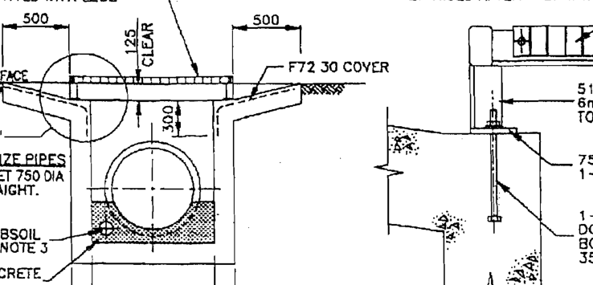
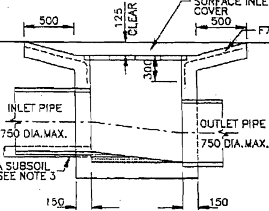
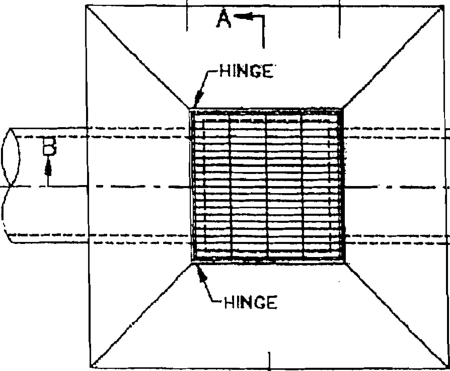
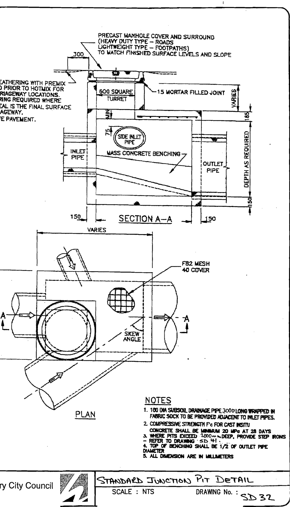

#### 3. WALL THlCKNESS IN CHI MNEY

#### SHALL BE ADJUSTED TO SUIT

#### TYPE OF PIT UD.

#### 4. SADOLE PITS SHALL BE CONSTRUCTED

#### ON I'I?ES OF 105Qmm orA. OR eiREATER.

#### DRAWING No. : ~:D ~o

#### S\\-€f!\ '!b~~.

"WELDLOK" OR EQUIVALENT

SURCHARGE PIT COVER &

FRAME GRATE &. LEGS TO BE HOT DIP

> [Picture on page 34: a picture, saved as a picture (images/part-03-drawings-page-34-4.gif, 150 dpi).]
> Words printed on the picture (title and legend, copied from the PDF):
> 500

FRAME FlmD WITH LEGS

GALVANiSm AFTER FA8RICATION

FIHISHEllSURF:

51 x51 xB ANGLE LEGS

#### M---6mm FlUET WELD

TO FRAME &: BASEPLATE

DETAIL 'X' MAXIMUM SIZE PIPES

75 SQx8 PL WITH

INLET/OUTLET 750 DIA

1-16 DIA HOLE CENTRAL

ON STRAIGHT.

1-M12 G....LV. HDLDING

DOWN BOLT PER LEe

100 DIA SUBSOIL

DRAIN SEE NOfE J

BOLTS 150 LONG WITH

35 PROJECTION

### MASS:CONCRETE./ I

BENCHING 1.'5.Q...j

9QO

### ~50

### SECTfON A-A

### DETAIL 'X'

### INLET AND SU RCHARGE PIT TtPE A

SURCf9RGE'l'lTS'Sl-ZES TABLE PIT OPENING-SIZE GRATETIPE

''WELDLOK'' OR EQUIVALENT

> [Picture on page 34: a picture, saved as a picture (images/part-03-drawings-page-34-33.gif, 150 dpi).]
> Words printed on the picture (title and legend, copied from the PDF):
> COVER
> 500
> ORAl N SEE NOTE 3

SURfACE INLET PIT

#### TYPE A 900lC900 p.e.90g0 8

F72 JO COVER

#### :

### TYPE" a :: 5O'Oxgacr.· p~e~6'09'O ,..

### TYPE C 900)(900 P.c.Soc.:lO B

• WE It liRAlE TO BE FtTTED wrrn LEGS AS. PER DETAIL 'X'

### ...-­

### ---

#### 'faa OIA SUBSOIL -J

#### 'I~J

## SECTION 8-8 SURCHARGE PIT fiPES B & C

\

".;.,

900 TYPE '~' PIT

6OOT'l'PE"a' p

900 l'fPE 'C' PIT

> [Picture on page 34: a picture, saved as a picture (images/part-03-drawings-page-34-52.gif, 150 dpi).]
> Words printed on the picture (title and legend, copied from the PDF):
> HINGE

'~ ...1

NOTES; I. COWPRE'SSM: S'TR!ICIH (fOe)

FOitCAST 1NSml~

SHAU;·8E'A'N1Nlro1lllE2D<1.CPtI

AT 250AYS.

. 2. TOP OF OOlCHlNO SHAl1. BE 1/2­

### --------1------..

OF' 0Ullf:T PIPE l)~

J. 100 0lA. SUBSOIl. ClWMAGE PIPE

-~,-­

3OOOLOHG WJWlI"!D' IN'FABRIC

### -------

10

~'%'I~trt~~~O

#### o

4\. ,AU. PIB SKAU. at PROWlED

### - o

WI1ll A 1.0ClC~CUP.

S. PIT GRAn: SHALL 8E 'WELDLOK~

### --

### ------ --------

### --------

### ----- -----

### -------

ClA.LY CAATl:CC 7S-!I1 OR .

APPRCMt! EQUlVALDT. (SKIRTED)

8\. OURlMO'INSTAI:I:ImON'O$=' CAAT£

~O' FRAUE COllTRACTOO'1S TO

ENSURE Ct.EARN«:E BE'lWE~

UKTEl. N«J OPEN QlfJITE

(R£l"D TO INSTAwnDH

Rll.fJWlC£)

7\. WHER£ PfT'.S Aft!! PACMDm IN

P£'OEST1l1AH PATHWAYS Tli£

### A

GRAn: $HAU. BE SUPPLIED WITH

;. PEDESlltIAM SAF'I! NESH.

### PLAN SURCHARGE PITS TYPE A.B & C

II. AU. DIIooIENSlOHS ARE IN ...UJNO"R£S.

### <;'~'h~~ ~~A-~ S.\)R~AC.(;: :r~LE' ~t,.s'

DRAWING No. : CS~ ';,

> [Picture on page 35: a map, saved as a picture (images/part-03-drawings-page-35-1.gif, 150 dpi); the street names and other small labels are on the picture.]
> Words printed on the picture (title and legend, copied from the PDF):
> 15 MORTAR FJUEOJOINT
> ALL AROUND PRIOR TO H01l.llX FOR
> ~O fEATHERINCREQU1RED WHERE
> 1\. FUJSH SEAL IS THE FINAL SURFACE
> CONCRETE SHAU..BE 20 YPa AT 28 DAYS
> 3\. 'MiERE Pf1S EXCaJ)·'UlOO D£EP. PROW)[ S1EP IRONS
> - REFER 10 DRAVl1NQ ' s~ , ~. _. . .
> 5\. AU. DIr.tENSIOH ARE IN I.It.LJWE'1ERS

#### PRECAST MANHOLE COVER AND SURROUND

#### (HEAVY DUTY mE - ROADS

### ~ ~GHTWElGHT T"t'PE - FOOTPATHS)

### n ~O \/ATCH F1N1SHED SURFACE l.E\IELS AND SLOPE

#### 300WlOE FEATHERING WITH PREMIX

#### PtiS· Itl CARRIAGEWAY LOCATIONS.

### --- -

#### Of CARRiAGEWAY.

#### .

2.. CONCRE:TE PAVEWENT.

### •

### ~

#### t.iASS CO~ BENCHING

#### PtPEI

### ~

#### lOUTI.ET

,

(

### 1SJ

### SECTION A-A

### '\ \\

#### ___J~_

### I

### \

.,

#### (

### --7t .,.e~ --A

### /S~

### j

### /'

### NOTES
