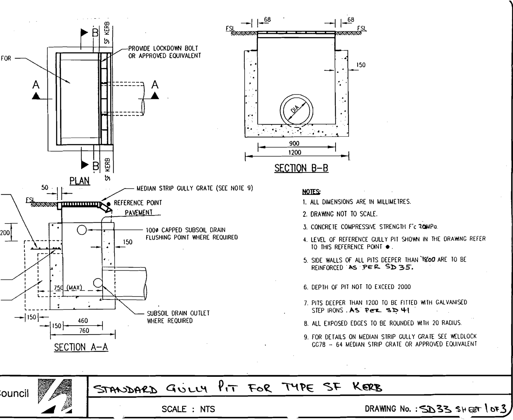

#### 1. 100 DtA SWSOtl DRA1HAGE PPEJOOOI..ONG~.·tf

### PLAN

### FABRIC SOCK TO BE PflIOYIDElJ ~ TO INlET PIPES.

#### 2. COfdPRESSIve snmtc:rI1 F'e FOR CAST IHSmJ

#### 4. TOP " BENCHIHO SHAU. BE 1/2 " 0U11£T PIPE

### DRAWING No. : ~b 31.- )

### \:  lHawkesbury City Council

> [Picture on page 36: a picture, saved as a picture (images/part-03-drawings-page-36-1.gif, 150 dpi).]
> Words printed on the picture (title and legend, copied from the PDF):
> CD
> PROVIDE LOCKDOVtN BOLT
> OR APPRO\1:D EQUIVALENT
> "
> I
> ..
> 900 .. 1
> 1200
> HOl[S;
> • I -
> 1\. ALL DIMENSIONS ARE IN I.4ILLlMETRES.
> REfERENCE POINT
> ~""""""'lt't..
> PA\1:MENl
> 2\. DRA'MNG NOT TO SCALE.
> 3\. CONCRETE COMPRESSlVf SmENGTH f'c ,~Po
> 150
> --.1 ...
> 10011 CAPPED SUBSOIL DRAIN
> HUSHING POIN T WHERE REQUIRED
> 4\. LEVEL OF REFERENCE GULLY PIT SHOY.N IN THE DRAYlING REfER
> I
> I
> I I I.
> 6\. DEPTH OF PIT NOT TO EXCEED 2000
> ""
> 7\. PITS DEEPER THAN 1200 TO BE fiTTED 'MTH GALVANiSm
> STEP IRONS. A"l:> \'~ 'S.~ ..... ,
> SUBSOIL DRAIN OUTLET
> 'M1ERE REQUIRED
> B. ALL EXPOSED EDGES TO BE ROUNDED I'll Hi 20 RADIUS.
> I •
> \. - - - - - ---.:'=-----",--­
> 9\. FOR DETAILS ON MEDIAN STRIP GUllY GRATE SEE 'MIDLOCK
> GG7B - 64 MEDIAN STRIP GRATE OR APPROVfD EQUIVALENT

### -j 1~8 FS

#### 81 ~

### FSL -11-i

.,

GRA1£ OMITTED FOR

CLARITY

### , .

### ~~~~O~U

### ____::r

" . .,

### -.

### ..... . .~.

. .......

### .,.,.'

### I"

### B

### I

.,

### ~

#### [ 50~I ~

### E.LAti tx

### " ~ MEDIAN STRIP GULLY GRATE (SEE NOTE 9)

Y12@ ISOc/c

BOTH WAYS

### .

### O' I" I

#### TO THIS REFERENCE POINT •.

### .
