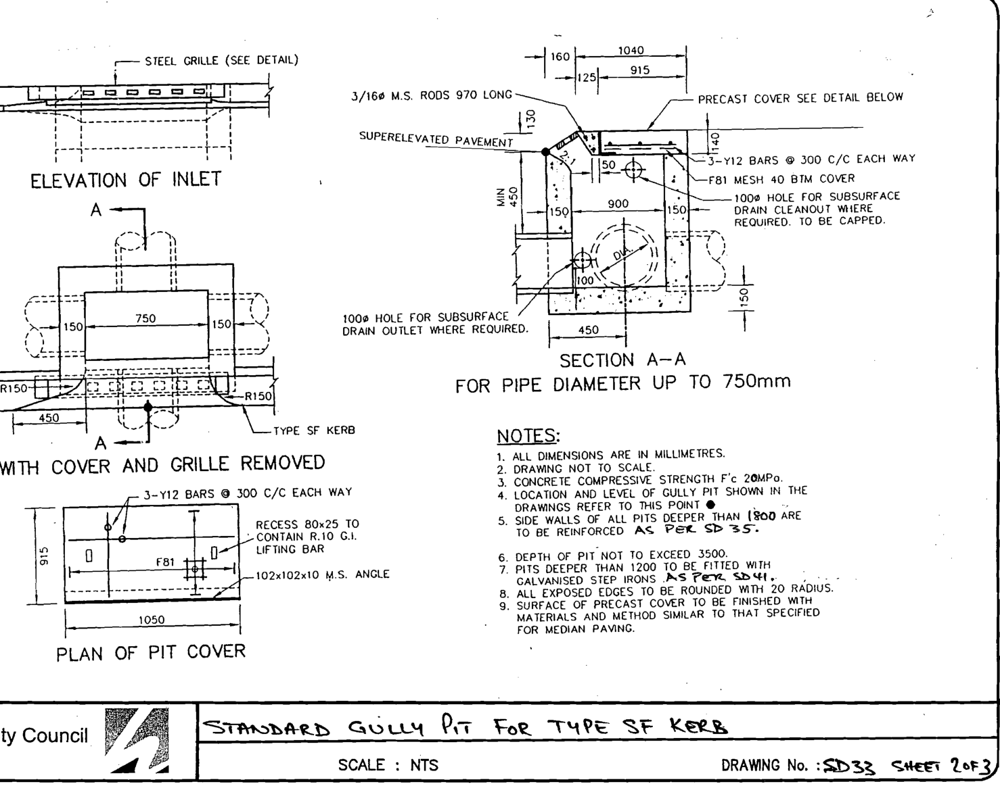

#### 5. SIDE WALLS or ALL PITS DEEPER THAN 'If(oO ARE TO BE

REINFORCED' .a.s .:pE' IZ.. ~]) 35,

3-Y16@ J5c/c

30 COVER

### ~_t~~~lM~:L~~4~ ~

PIT 'MOENING iF REQUIRED

#### • ~

TO ACCOMMOOA TE MEDIAN

DRAINAGE LINE

### -1 1501­ I

### -\ 1,50

### 460 ,j

#### 760 _I

### SECTION A-A

### S~'b~:b Q~L.L"\ V" ~o~ \'1.~E ~~ \(.,EJL~

### Hawkesbury Ci.ty Council

#### DRAWING No, ;~s~ $~~ '()~3 ...

#### ..

> [Picture on page 37: a map, saved as a picture (images/part-03-drawings-page-37-2.gif, 150 dpi); the street names and other small labels are on the picture.]
> Words printed on the picture (title and legend, copied from the PDF):
> 915 .. /
> 3/16il M.S. RODS 970 LONG
> COVER SEE DETAIL BELOW
> F81 MESH 40 8TM COVER
> 1000 HOLE FOR SUBSURFACE
> DRAIN CLEANOUT WHERE
> REQUIRED. TO BE CAPPED.
> 1000 HOLE FOR SUBSURFACE
> ~:; ~~i::J ~j itJ
> II .... II
> TYPE SF KER8
> 1\. ALL DIMENSIONS ARE IN MllLIMETRES.
> 2\. DRAWING NOT TO SCALE.
> 3\. CONCRETE COMPRESSIVE STRENGTH F'c 2Cl1MPo.
> 3- Y12 BARS @ 300 CIC EACH WAY
> 4\. LOCATION AND LEVEL OF GULLY PIT SHOWN IN THE
> DRAWINGS REFER TO 11-IIS POINT. . ..
> 5\. SIDE WALLS OF ALL
> RECESS 80><25 TO
> 6\. DEPTH OF PIT NOT TO EXCEED 3500.
> 102><102><10 ¥.S. ANGLE
> 7\. PITS DEEPER THAN 1200 TO BE FITTED WITH
> 8\. ALL EXPOSED EDGES TO BE ROUNDED Win; 20 RADIUS.
> 9\. SURFACE OF PRECAST COVER TO 8E FINISHED WITH
> MA TERIALS AND METHOD SIMILAR TO THAT SPECIFIED
> FOR MEDIAN PAVING.

#### -/1:]. 1040

#### r-- STEEL GRILLE (SEE DETAIL)

### I 1251"

### t

### l~±j' 1=== =i~! i t

### ~

### r--'----------------T--'

#### . 3- Y12 8ARS @ 300 clC EACH WAY

### ELEVATION OF INLET

A d-',_,

~ . ;,

#### , ....-' ,I

### --1--r..
